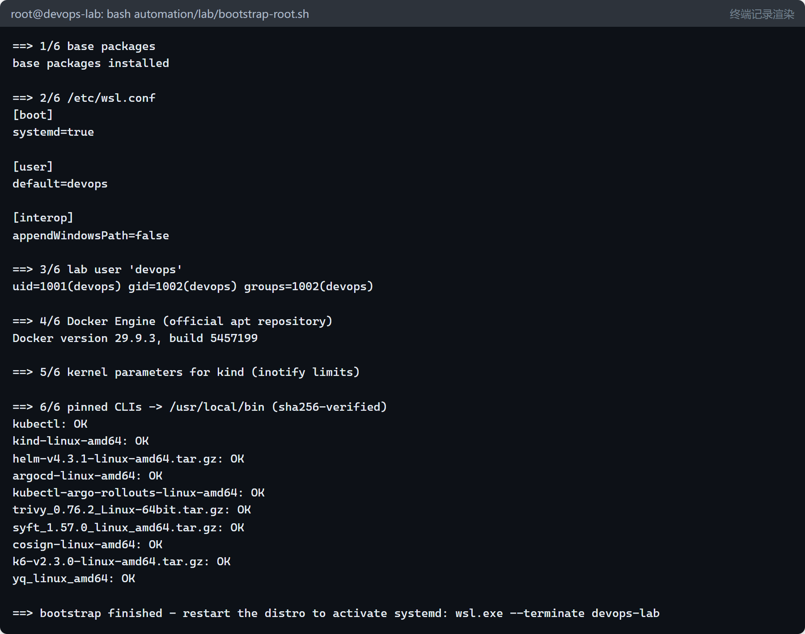
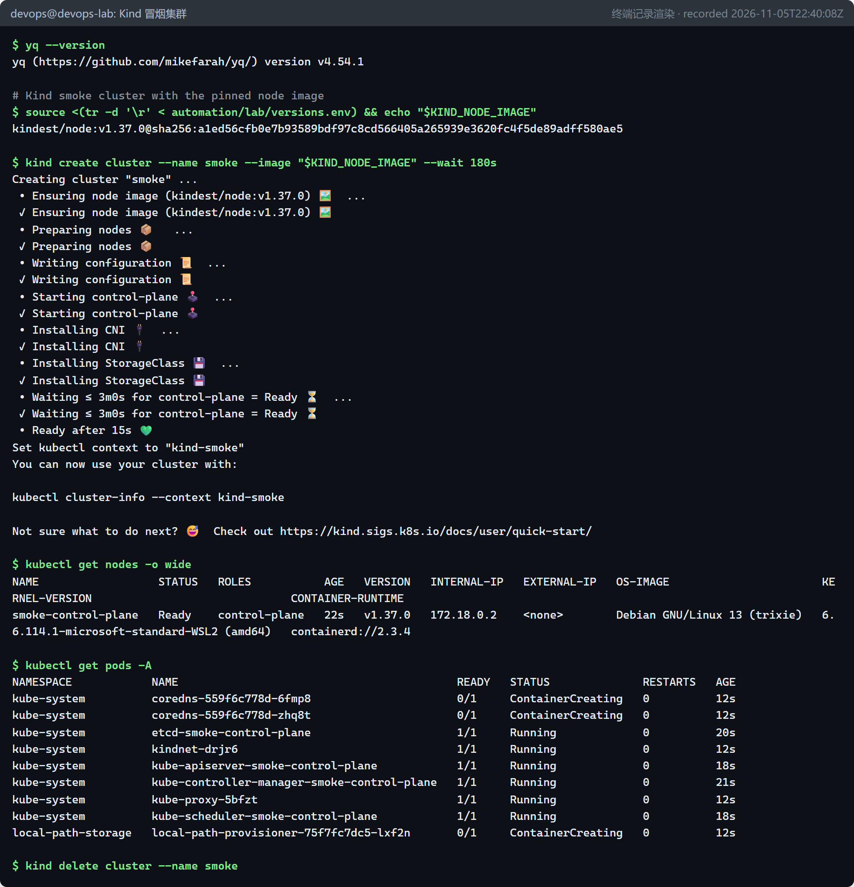

# 实验环境搭建：WSL2 + Docker Engine + Kind（P0） {#ch-p0}

<div class="lead">本章从一台普通的 Windows 11 电脑出发，建立一个与宿主机隔离、版本固定、可随时重建的 Linux 实验环境。后面所有章节（Kubernetes、Helm、Argo CD、可观测性……）都在这个环境里运行。本章也会介绍本手册“如何取证”：每一段输出、每一张截图从哪里来。</div>

## 本章目标与产出

| 产出 | 位置 | 作用 |
|---|---|---|
| 独立 WSL2 发行版 `devops-lab`（Ubuntu 24.04 LTS） | `D:\wsl\devops-lab\ext4.vhdx` | 所有 Linux 实验的运行环境 |
| 发行版创建脚本 | `automation/lab/wsl-create.ps1` | 下载官方镜像、校验 SHA256、导入 |
| 初始化脚本 | `automation/lab/bootstrap-root.sh` | 安装 Docker Engine 与 10 个固定版本的 CLI |
| 版本清单 | `automation/lab/versions.env` | 所有工具版本的唯一来源 |
| 验证脚本 | `automation/lab/verify.sh` | 一键冒烟测试 |
| 证据录制器 | `automation/evidence/transcript.sh` | 把“命令 + 真实输出”录成文本证据 |

**验收标准：** `docker run hello-world` 成功；用固定版本节点镜像创建的 Kind 集群节点进入 `Ready`；所有工具版本与 `versions.env` 一致。本章验收已全部通过（证据见 `evidence/p0/`）。

## 原理：这套实验环境由哪些层组成 {#p0-layers}

在动手之前，先弄清楚命令最终是在“哪一层”执行的。很多环境问题（网络不通、权限不够、找错了命令）都源于没分清层次。

```{.mermaid caption="本手册实验环境的分层结构"}
flowchart TB
  subgraph WIN["Windows 11 宿主机（31 GB 内存 / 16 线程）"]
    PS["PowerShell / Git Bash<br/>git、gh、Edge（截图与 PDF）"]
    subgraph VM["WSL2 轻量虚拟机（真正的 Linux 内核 6.6）"]
      subgraph DISTRO["发行版 devops-lab（Ubuntu 24.04，systemd）"]
        CLI["kubectl / helm / argocd / trivy / cosign ..."]
        subgraph DOCKER["Docker Engine（dockerd → containerd → runc）"]
          K1["Kind 节点容器<br/>lab-control-plane"]
          C1["其他容器<br/>GitLab、Registry ..."]
          subgraph K8S["Kubernetes v1.37（节点容器内部）"]
            P1["Pod：Argo CD"]
            P2["Pod：demo-api"]
            P3["Pod：Prometheus ..."]
          end
        end
      end
      PODMAN["已有发行版 podman-machine-default（不受影响）"]
    end
  end
  PS -- "wsl.exe -d devops-lab" --> CLI
  CLI -- "/var/run/docker.sock" --> DOCKER
  CLI -- "kubeconfig → API Server" --> K8S
  K1 --- K8S
```

### WSL2：Windows 里的真 Linux

WSL2（Windows Subsystem for Linux 2）会在后台运行一台轻量级虚拟机，里面是微软维护的**真正的 Linux 内核**（本机为 `6.6.114.1-microsoft-standard-WSL2`）。每个“发行版”（distro）本质上是一块 ext4 虚拟磁盘（`ext4.vhdx`），共享同一个内核。

和本章相关的几个关键事实：

- **发行版彼此隔离。** 用户机器上原本就有 Podman 使用的 `podman-machine-default`。我们新建一个独立的 `devops-lab`，两边的软件、配置互不干扰，实验做坏了可以整个删除重建。
- **磁盘位置可以指定。** 通过 `wsl --import` 可以把虚拟磁盘放到任意目录。本机 C 盘只剩约 27 GB，而后续要拉取 GitLab、Kind 节点、可观测性组件等大量镜像，所以放在 D 盘。
- **网络模式。** 本机 `%USERPROFILE%\.wslconfig` 里配置了 `networkingMode=mirrored`（镜像网络）：WSL 与 Windows 共享网络接口，Linux 里监听的端口在 Windows 上直接用 `localhost:端口` 访问。这让我们可以用 Windows 上的 Edge 浏览器给 Argo CD、Grafana 等界面截图。
- **systemd。** 新版 WSL 支持把 systemd 作为 1 号进程，这样 `docker` 等服务就能像在普通 Ubuntu 服务器上一样被 `systemctl` 管理、开机自启。

### 容器、镜像与 Docker Engine

**镜像（image）** 是一个只读的、分层的文件系统快照，加上启动命令等元数据；**容器（container）** 是镜像的一个运行实例，本质是宿主机上的一组进程，被 Linux 内核的 *namespace*（隔离视图）和 *cgroup*（资源限制）包裹起来。容器不是虚拟机，它没有自己的内核。

Docker Engine 由几层组成：`docker` 命令行 → `dockerd` 守护进程（REST API，监听 `/var/run/docker.sock`）→ `containerd`（管理容器生命周期与镜像）→ `runc`（真正调用内核创建容器）。本章的验证结果中可以看到 `storage=overlayfs cgroup=systemd/v2 runtime=runc`，正好对应这几层。

::: principle
**为什么选 Docker Engine 而不是 Docker Desktop 或 Podman？**
Kind、GitLab Runner、各官方教程默认都以 Docker 为运行时，在 Linux 中直接安装 Docker Engine 最接近服务器和 CI Runner 的真实环境，也不涉及 Docker Desktop 的许可条款。Podman 虽然兼容 Docker CLI，但 Kind 对 Podman 的支持仍标注为实验性。
:::

### Kind：把 Kubernetes 节点跑在容器里

Kind（Kubernetes IN Docker）是 Kubernetes SIG Testing 维护的官方工具。它把每个 Kubernetes **节点**做成一个 Docker 容器：容器镜像 `kindest/node` 里预装了 `containerd`、`kubelet` 和 `kubeadm`，Kind 在容器里运行 `kubeadm init` 完成集群引导，然后安装默认 CNI 网络插件 `kindnet` 和本地存储 `local-path-provisioner`，最后把访问凭据写入 `~/.kube/config`。

所以本手册里会出现“套娃”：Pod 里的容器 → 运行在 Kind 节点容器里的 containerd 中 → Kind 节点容器又运行在 WSL 里的 Docker 中。理解这一点后，你就知道：

- `docker ps` 只能看到 Kind **节点**容器，看不到 Pod；查看 Pod 要用 `kubectl`。
- 本地构建的镜像要用 `kind load docker-image` 送进节点里的 containerd，Pod 才能使用。
- 节点镜像版本决定了 Kubernetes 版本。我们用 `kindest/node:v1.37.0` 并**固定 digest**，保证任何时候重建都得到同一份节点镜像。

## 前置检查

开始前先确认宿主机满足条件。下面是在 Windows PowerShell 中执行的检查与本机的真实结果（完整记录：`evidence/p0/precheck-windows.log`）：

```console
PS> Get-CimInstance Win32_ComputerSystem | Select-Object @{n="RAM_GB";e={[math]::Round($_.TotalPhysicalMemory/1GB,1)}},NumberOfLogicalProcessors,HypervisorPresent | Format-List
RAM_GB                    : 31.3
NumberOfLogicalProcessors : 16
HypervisorPresent         : True

PS> (Get-CimInstance Win32_Processor).VirtualizationFirmwareEnabled
True

PS> wsl.exe --version
WSL 版本: 2.7.3.0
内核版本: 6.6.114.1-1

PS> Get-Content "$env:USERPROFILE\.wslconfig"
[wsl2]
networkingMode=mirrored

PS> foreach ($u in "https://registry-1.docker.io/v2/","https://ghcr.io/v2/","https://registry.k8s.io/v2/","https://github.com") { ... }
https://registry-1.docker.io/v2/     HTTP 401
https://ghcr.io/v2/                  HTTP 401
https://registry.k8s.io/v2/          HTTP 401
https://github.com                   HTTP 200
```

逐项解读：

| 检查项 | 要求 | 说明 |
|---|---|---|
| 内存 | 建议 ≥ 16 GB | WSL2 默认最多使用宿主机 50% 内存，本机为 15 GiB；后续 GitLab CE 约需 4 GB |
| 虚拟化 | `VirtualizationFirmwareEnabled = True` | 需要在 BIOS/UEFI 中开启 AMD-V / Intel VT-x，否则 WSL2 无法启动 |
| WSL 版本 | 2.x | `wsl --import`、`--manage` 等功能依赖较新的 WSL |
| 镜像仓库连通性 | 返回 401 即正常 | 镜像仓库的 `/v2/` 接口未登录时返回 401 Unauthorized，说明网络可达；超时才说明不通 |

::: tip
如果你的机器还没有安装 WSL，需要以**管理员身份**运行 `wsl --install` 并重启电脑。这是唯一需要管理员权限的步骤，本手册后续操作都以普通用户身份完成。
:::

## 第 1 步：创建独立的 WSL 发行版

我们不从 Microsoft Store 安装 Ubuntu，而是从 Ubuntu 官方镜像站下载 WSL 根文件系统，**校验 SHA256 后**用 `wsl --import` 导入到 D 盘。这样做有三个好处：可以指定安装位置；可以自定义发行版名称；整个过程可脚本化、可审计。

### 脚本解析：`automation/lab/wsl-create.ps1`

```powershell
param(
  [string]$DistroName = 'devops-lab',
  [string]$InstallDir = 'D:\wsl\devops-lab',
  [string]$CacheDir   = 'D:\wsl\images',
  [string]$BaseUrl    = 'https://cloud-images.ubuntu.com/wsl/releases/24.04/current',
  [string]$ImageName  = 'ubuntu-noble-wsl-amd64-24.04lts.rootfs.tar.gz'
)
$ErrorActionPreference = 'Stop'
$env:WSL_UTF8 = '1'   # make wsl.exe print UTF-8 instead of UTF-16

if ((wsl.exe -l -q) -contains $DistroName) {
  Write-Host "WSL distro '$DistroName' already exists - nothing to do."
  exit 0
}

New-Item -ItemType Directory -Force -Path $CacheDir, $InstallDir | Out-Null
$image = Join-Path $CacheDir $ImageName

if (-not (Test-Path $image)) {
  Write-Host "Downloading $BaseUrl/$ImageName"
  curl.exe -fsSL --retry 3 -o $image "$BaseUrl/$ImageName"
  if ($LASTEXITCODE -ne 0) { throw "download failed" }
}

$sums = curl.exe -fsSL "$BaseUrl/SHA256SUMS"
$expected = ($sums -split "`n" | Where-Object { $_ -match [regex]::Escape($ImageName) } |
             Select-Object -First 1).Split(' ')[0].Trim().ToLower()
$actual = (Get-FileHash -Algorithm SHA256 $image).Hash.ToLower()
Write-Host "expected sha256: $expected"
Write-Host "actual   sha256: $actual"
if ($expected -ne $actual) { throw "SHA256 mismatch - refusing to import" }

wsl.exe --import $DistroName $InstallDir $image --version 2
if ($LASTEXITCODE -ne 0) { throw "wsl --import failed" }
wsl.exe -l -v
```

关键点：

- **`$env:WSL_UTF8 = '1'`**：`wsl.exe` 默认输出 UTF-16 编码，在 PowerShell 中做字符串比较时会出现“看起来一样却不相等”的问题。设置该变量后输出 UTF-8，`-contains` 判断才可靠。
- **幂等（idempotent）**：如果发行版已存在就直接退出。幂等是自动化脚本的基本要求——同一个脚本执行一次和执行十次，结果应当相同。
- **校验 SHA256**：从同一个官方目录下载 `SHA256SUMS`，与本地文件的哈希比较，不一致就拒绝导入。这能发现下载损坏，也能发现被篡改的文件（第 7 章的软件供应链安全会把这个思想扩展到容器镜像签名）。
- **`wsl --import <名称> <安装目录> <rootfs> --version 2`**：把 rootfs 解包到一块新的 `ext4.vhdx` 中并注册为发行版。导入的发行版默认以 root 登录，下一步我们会创建普通用户。

### 执行与结果

```console
PS> pwsh -NoProfile -ExecutionPolicy Bypass -File automation\lab\wsl-create.ps1
Downloading https://cloud-images.ubuntu.com/wsl/releases/24.04/current/ubuntu-noble-wsl-amd64-24.04lts.rootfs.tar.gz
expected sha256: 2a790896740b14d637dbdc583cce1ba081ac53b9e9cdb46dc09a2f73abbd9934
actual   sha256: 2a790896740b14d637dbdc583cce1ba081ac53b9e9cdb46dc09a2f73abbd9934
操作成功完成。
  NAME                      STATE           VERSION
* podman-machine-default    Stopped         2
  podman-net-usermode       Stopped         2
  devops-lab                Stopped         2
elapsed: 96s
```

两个哈希完全一致，导入成功，原有的 Podman 发行版保持不变。

## 第 2 步：初始化发行版（bootstrap-root.sh）

导入后的 Ubuntu 是一个“干净”的最小系统。初始化脚本以 root 身份运行，完成 6 件事。完整脚本如下，随后逐段解释。

```bash
#!/usr/bin/env bash
set -euo pipefail

HERE="$(cd "$(dirname "${BASH_SOURCE[0]}")" && pwd)"
source <(tr -d '\r' < "$HERE/versions.env")
LAB_USER="${LAB_USER:-devops}"
export DEBIAN_FRONTEND=noninteractive

log() { printf '\n==> %s\n' "$*"; }

log "1/6 base packages"
apt-get update -y -qq
apt-get install -y -qq --no-install-recommends \
  ca-certificates curl gnupg jq git make unzip tar sudo less vim-tiny \
  iproute2 iputils-ping dnsutils bash-completion python3 python3-venv python3-pip >/dev/null
echo "base packages installed"

log "2/6 /etc/wsl.conf"
cat > /etc/wsl.conf <<EOF
[boot]
systemd=true

[user]
default=${LAB_USER}

[interop]
appendWindowsPath=false
EOF
cat /etc/wsl.conf

log "3/6 lab user '${LAB_USER}'"
id "$LAB_USER" >/dev/null 2>&1 || useradd -m -s /bin/bash "$LAB_USER"
echo "${LAB_USER} ALL=(ALL) NOPASSWD:ALL" > "/etc/sudoers.d/90-${LAB_USER}"
chmod 0440 "/etc/sudoers.d/90-${LAB_USER}"
id "$LAB_USER"

log "4/6 Docker Engine (official apt repository)"
install -m 0755 -d /etc/apt/keyrings
curl -fsSL https://download.docker.com/linux/ubuntu/gpg -o /etc/apt/keyrings/docker.asc
chmod a+r /etc/apt/keyrings/docker.asc
. /etc/os-release
cat > /etc/apt/sources.list.d/docker.sources <<EOF
Types: deb
URIs: https://download.docker.com/linux/ubuntu
Suites: ${UBUNTU_CODENAME:-$VERSION_CODENAME}
Components: stable
Signed-By: /etc/apt/keyrings/docker.asc
EOF
apt-get update -y -qq
apt-get install -y -qq docker-ce docker-ce-cli containerd.io docker-buildx-plugin docker-compose-plugin >/dev/null
usermod -aG docker "$LAB_USER"
docker --version

log "5/6 kernel parameters for kind (inotify limits)"
cat > /etc/sysctl.d/99-kind.conf <<'EOF'
fs.inotify.max_user_watches = 524288
fs.inotify.max_user_instances = 512
EOF
sysctl -q --system || true

log "6/6 pinned CLIs -> /usr/local/bin (sha256-verified)"
TMP="$(mktemp -d)"
trap 'rm -rf "$TMP"' EXIT
cd "$TMP"
gh_dl() { printf 'https://github.com/%s/releases/download/%s/%s' "$1" "$2" "$3"; }
fetch() { curl -fsSL --retry 3 -o "$2" "$1"; }
check() { grep -E "[ *]$1\$" | sha256sum -c -; }

# kubectl (dl.k8s.io publishes a bare hash)
fetch "https://dl.k8s.io/release/${KUBECTL_VERSION}/bin/linux/amd64/kubectl" kubectl
echo "$(curl -fsSL "https://dl.k8s.io/release/${KUBECTL_VERSION}/bin/linux/amd64/kubectl.sha256")  kubectl" | sha256sum -c -
install -m 0755 kubectl /usr/local/bin/kubectl

# kind
fetch "$(gh_dl kubernetes-sigs/kind "$KIND_VERSION" kind-linux-amd64)" kind-linux-amd64
curl -fsSL "$(gh_dl kubernetes-sigs/kind "$KIND_VERSION" kind-linux-amd64.sha256sum)" | check kind-linux-amd64
install -m 0755 kind-linux-amd64 /usr/local/bin/kind

# helm
f="helm-${HELM_VERSION}-linux-amd64.tar.gz"
fetch "https://get.helm.sh/$f" "$f"
curl -fsSL "https://get.helm.sh/$f.sha256sum" | check "$f"
tar -xzf "$f" linux-amd64/helm
install -m 0755 linux-amd64/helm /usr/local/bin/helm

# ……argocd、kubectl-argo-rollouts、trivy、syft、cosign、k6 与上面完全同一模式……

# yq (publishes BSD-style "SHA256 (file) = hash" lines)
fetch "$(gh_dl mikefarah/yq "$YQ_VERSION" yq_linux_amd64)" yq_linux_amd64
sum="$(curl -fsSL "$(gh_dl mikefarah/yq "$YQ_VERSION" checksums-bsd)" | sed -n 's/^SHA256 (yq_linux_amd64) = //p')"
[ -n "$sum" ] || { echo "yq checksum not found" >&2; exit 1; }
echo "$sum  yq_linux_amd64" | sha256sum -c -
install -m 0755 yq_linux_amd64 /usr/local/bin/yq
```

（中间重复模式的 6 个工具在书中省略，仓库中的脚本是完整的。）

### 逐段解释

**`set -euo pipefail`** —— Bash 脚本的“安全带”：`-e` 任何命令失败立即退出；`-u` 使用未定义变量时报错；`-o pipefail` 管道中任一环节失败，整个管道就算失败。没有它，校验失败的二进制可能会被继续安装。

**`source <(tr -d '\r' < versions.env)`** —— 读取版本清单。`tr -d '\r'` 删除 Windows 换行符中的 `\r`：仓库在 Windows 上检出时，若 Git 配置了 `core.autocrlf=true`，文本文件会变成 CRLF 结尾，Bash 会把 `v1.37.2\r` 当成版本号的一部分。本仓库同时用 `.gitattributes` 强制 LF，这里是双保险。

**`/etc/wsl.conf`** —— WSL 在**启动发行版时**读取的配置：

| 配置 | 作用 |
|---|---|
| `[boot] systemd=true` | 让 systemd 成为 1 号进程，Docker 服务可被 `systemctl` 管理并自动启动 |
| `[user] default=devops` | `wsl -d devops-lab` 默认以 `devops` 登录，而不是 root |
| `[interop] appendWindowsPath=false` | 不把 Windows 的 PATH 拼接进 Linux。否则 Linux 中可能意外调用到 Windows 版的 `kubectl.exe`、`helm.exe`（本机 Windows 上恰好也装了这些工具） |

**普通用户 + 免密 sudo** —— 日常操作用普通用户是良好习惯；`NOPASSWD` 只适用于本地一次性实验环境，**不要**在共享或生产机器上这样配置。

**Docker 官方 apt 源** —— 按 Docker 官方文档的做法：下载 Docker 的 GPG 公钥放到 `/etc/apt/keyrings/`，再用 deb822 格式（`.sources` 文件）声明软件源，`Signed-By` 把这个源**只**与这把公钥绑定，防止其他源冒充。`usermod -aG docker devops` 把用户加入 `docker` 组，使其无需 sudo 即可访问 `/var/run/docker.sock`。

::: warning
`docker` 组的成员实际上拥有宿主机 root 等价权限（可以挂载任意目录启动特权容器）。在实验环境中这是可以接受的便利，在服务器上应严格控制该组成员。
:::

**inotify 参数** —— Kind 官方的已知问题文档建议调大 `fs.inotify.max_user_watches` 和 `max_user_instances`，否则节点中的 kubelet 等组件在 Pod 较多时可能报 “too many open files”。

**固定版本 + 校验和** —— 每个工具都遵循同一模式：从官方发布地址下载 → 从**同一发布**下载校验和清单 → `sha256sum -c` 校验 → 通过后才安装到 `/usr/local/bin`。`check()` 函数用 `grep -E "[ *]文件名$"` 只取清单中对应文件那一行，再交给 `sha256sum -c -` 校验。

::: principle
**为什么要固定版本？** “安装最新版”的脚本今天和下个月执行的结果不同，出现问题时无法复现。把版本写进 `versions.env`，环境就成了可以审阅、可以回滚的“代码”。这正是后面 GitOps 一章“一切以 Git 中声明的状态为准”思想的雏形。
:::

### 执行与结果

在 PowerShell 中以 root 身份运行脚本（脚本位于 Windows 的 D 盘，WSL 中自动挂载为 `/mnt/d`）：

```console
PS> wsl.exe -d devops-lab -u root -- bash /mnt/d/workshop/nov/devops-delivery/automation/lab/bootstrap-root.sh
```



整个过程耗时 144 秒。注意图中每个工具都输出了 `: OK`，这是 `sha256sum -c` 校验通过的标志；只要有一个不通过，`set -e` 会让脚本立即失败。

## 第 3 步：重启发行版并验证

`/etc/wsl.conf` 只在发行版**启动时**读取，所以必须先关闭发行版，让 systemd 和默认用户生效：

```console
PS> wsl.exe --terminate devops-lab
PS> wsl.exe -d devops-lab
devops@jiejie:~$          # 现在默认以 devops 用户登录
```

然后逐条验证。以下是真实记录的节选（完整记录：`evidence/p0/verify.log`）：

```console
$ grep PRETTY_NAME /etc/os-release
PRETTY_NAME="Ubuntu 24.04 LTS"

$ ps -p 1 -o comm=
systemd

$ systemctl is-active docker
active

$ id
uid=1001(devops) gid=1002(devops) groups=1002(devops),989(docker)

$ docker version --format 'client={{.Client.Version}} server={{.Server.Version}}'
client=29.9.3 server=29.9.3

$ docker compose version
Docker Compose version v5.7.0

$ kubectl version --client
Client Version: v1.37.2
Kustomize Version: v5.8.1

$ kind version
kind v0.33.0 go1.26.7 linux/amd64

$ helm version
version.BuildInfo{Version:"v4.3.1", GitCommit:"c0d08d0d6d9424d4a14febb5e8a3e51b0dd00dff", GitTreeState:"clean", GoVersion:"go1.27.2", KubeClientVersion:"v1.37"}

$ argocd version --client --short
argocd: v3.6.1+94037c4

$ k6 version
k6 v2.3.0 (commit/e088784614, go1.26.8, linux/amd64)
```

每一行都在验证一个假设：

- `ps -p 1` 输出 `systemd` → `wsl.conf` 的 `[boot]` 生效；
- `id` 中出现 `989(docker)` → 用户已在 docker 组，且这是一个新会话（组成员关系只在新登录会话中生效）；
- client 与 server 版本都是 29.9.3 → CLI 能通过 socket 连上守护进程；
- 各工具版本与 `versions.env` 完全一致。

接下来是最关键的端到端验证：拉取节点镜像、创建一个真实的 Kubernetes 集群。

```console
$ source <(tr -d '\r' < automation/lab/versions.env) && echo "$KIND_NODE_IMAGE"
kindest/node:v1.37.0@sha256:a1ed56cfb0e7b93589bdf97c8cd566405a265939e3620fc4f5de89adff580ae5

$ kind create cluster --name smoke --image "$KIND_NODE_IMAGE" --wait 180s
```



读懂这段输出：

1. **Ensuring node image**：拉取（或复用）`kindest/node` 镜像。因为指定了 `@sha256:...`，Docker 会校验拉到的内容与 digest 一致。
2. **Preparing nodes / Writing configuration / Starting control-plane**：创建节点容器、生成 kubeadm 配置，在容器内执行 `kubeadm init`。
3. **Installing CNI / StorageClass**：安装 kindnet 网络插件和 local-path 存储类。
4. **Set kubectl context to "kind-smoke"**：在 `~/.kube/config` 中写入集群地址与证书，并切换当前 context。
5. `kubectl get nodes -o wide` 显示节点 `Ready`、版本 `v1.37.0`、容器运行时 `containerd://2.3.4`、操作系统 `Debian GNU/Linux 13`——这是**节点镜像内部**的系统，与 WSL 的 Ubuntu 无关，再次印证了“套娃”结构。
6. `kubectl get pods -A` 中 `coredns` 处于 `ContainerCreating`：集群刚创建 12 秒，CNI 尚未完全就绪，这是正常现象，稍等即会变成 `Running`。

最后 `kind delete cluster --name smoke` 删除冒烟集群。至此，P0 的验收标准全部满足。

## 第 4 步：本手册的取证方法

本手册承诺“每一步都实际运行”。为了让这个承诺可以被检查，所有输出都来自两类证据：

**① 终端记录（`evidence/pN/*.log`）。** 由 `automation/evidence/transcript.sh` 生成：

```bash
mapfile -t LINES          # 先把命令清单全部读入内存
exec </dev/null           # 被执行的命令拿到的是空 stdin，不会“吃掉”后面的命令

run_cmd() {
  # 1) 原样打印命令（带 "$ " 提示符）
  # 2) eval 在当前 shell 中执行，所以 cd、export 会延续到下一条命令
  eval "$cmd" >"$tmp" 2>&1
  local rc=$?
  tr -d '\r' < "$tmp" | tee -a "$out"     # 3) 原样记录 stdout + stderr
  if [ $rc -ne 0 ]; then emit "[exit $rc]"; failures=$((failures + 1)); fi
}
```

用法是把命令清单通过 here-document 传给它：

```bash
bash automation/evidence/transcript.sh evidence/p0/verify.log "P0 devops-lab verification" <<'EOF'
docker run --rm hello-world
kind create cluster --name smoke --image "$KIND_NODE_IMAGE" --wait 180s
EOF
```

命令失败**不会**中断录制，而是记为 `[exit N]`。手册中凡是出现 `[exit N]` 的地方，都是真实发生的失败（后面的故障演练中会大量出现）。

**② 截图（`evidence/pN/*.png`）。** 分两种：

- **Web 界面截图**：由 `manual/tools/webshot.py` 驱动本机 Edge 浏览器（Playwright）打开 GitHub、GitLab、Argo CD、Grafana 等页面截取。
- **终端截图**：由 `manual/tools/term2png.py` 把真实的终端记录渲染成图片，标题栏写明“终端记录渲染”和录制时间。渲染不修改任何内容；输出过长时会在图中明确标出“中间省略 N 行输出”。

**③ 手册构建。** `manual/tools/build.py` 把各章 Markdown 交给 pandoc 生成 HTML，用 Mermaid 渲染架构图，再让 Edge 打印成 PDF。第一遍打印后从 PDF 书签中读出每个标题所在页码，写回目录后打印第二遍，因此目录页码是准确的。你可以自己重建本手册：

```powershell
uv venv manual/.venv --python 3.13
uv pip install --python manual/.venv/Scripts/python.exe -r manual/requirements.txt
cd manual; npm ci; cd ..
manual/.venv/Scripts/python.exe manual/tools/build.py
```

## 常见问题

**Q1：执行 `wsl --import` 提示找不到 `wsl` 或要求启用“虚拟机平台”。**
说明 WSL 本身还没安装。以管理员身份打开 PowerShell 执行 `wsl --install`，按提示重启。若提示虚拟化未启用，需要进入 BIOS/UEFI 打开 SVM（AMD）或 VT-x（Intel）。

**Q2：`systemctl` 报 “System has not been booted with systemd as init system”。**
`wsl.conf` 还没生效。执行 `wsl.exe --terminate devops-lab` 后重新进入；用 `ps -p 1 -o comm=` 确认输出 `systemd`。

**Q3：`docker ps` 报 “permission denied while trying to connect to the Docker daemon socket”。**
用户刚被加入 `docker` 组，但当前会话是加组之前开启的。重新登录（`wsl --terminate` 后再进入）即可，用 `id` 确认能看到 `docker` 组。

**Q4：在 Linux 中执行 `kubectl`，实际却运行了 Windows 的 `kubectl.exe`。**
默认情况下 WSL 会把 Windows 的 PATH 追加到 Linux PATH 后面，如果 Linux 中没有安装同名工具，就会调用 Windows 版本，读取的是 Windows 的 kubeconfig。本环境用 `appendWindowsPath=false` 彻底避免这一问题；可用 `command -v kubectl` 检查实际路径。

**Q5：脚本报 `$'\r': command not found` 或版本号中多了不可见字符。**
文件是 CRLF 换行。本仓库的 `.gitattributes` 已强制 `eol=lf`；对已经损坏的文件可执行 `sed -i 's/\r$//' 文件名` 修复。

**Q6：`kind create cluster` 报 “too many open files” 或节点组件反复重启。**
检查 `sysctl fs.inotify.max_user_watches fs.inotify.max_user_instances`，应分别为 524288 和 512。

**Q7：镜像拉取很慢或超时。**
先用前置检查中的 `curl` 命令确认各镜像仓库可达（返回 401 即可达）。如果所在网络需要代理，Docker 守护进程不会读取你的 shell 环境变量，需要通过 systemd drop-in（`/etc/systemd/system/docker.service.d/http-proxy.conf`）为 dockerd 单独配置代理。

**Q8：C 盘空间不足 / 虚拟磁盘越来越大。**
本方案一开始就把发行版放在 D 盘。已有发行版可以用 `wsl --manage <发行版> --move <新目录>` 迁移；`wsl --manage <发行版> --set-sparse true` 可以让虚拟磁盘自动回收空间；在发行版内定期执行 `docker system prune` 清理无用镜像。

**Q9：过一会儿再回来，Kind 集群、GitLab 等容器全部停了，甚至控制面节点停在 `Exited (128)`。**
这是本次实验中真实遇到的问题。WSL 在没有任何 `wsl.exe` 会话连接时，会在短暂空闲后关闭整个发行版——即使 systemd 中的 Docker 正在运行。`sudo journalctl --list-boots` 可以看到发行版被反复“开机”，每次结束时都有 `Reached target shutdown.target`。解决办法是做实验期间保持一个 WSL 终端打开，或在后台运行一个“保活”会话：

```bash
wsl.exe -d devops-lab -- bash -c 'exec sleep infinity'   # 放在单独的终端/后台任务中
```

也可以在 `%USERPROFILE%\.wslconfig` 中调整实例空闲超时，但那会影响所有发行版，本项目没有采用。已经停下的 Kind 节点用 `docker start lab-control-plane lab-worker lab-worker2` 即可恢复，集群状态保存在节点容器中。

## 清理与重建

整个实验环境可以随时删除并用脚本重建：

```powershell
wsl.exe --unregister devops-lab        # 永久删除发行版及其中的全部数据（不可恢复）
Remove-Item -Recurse D:\wsl\devops-lab
pwsh -NoProfile -ExecutionPolicy Bypass -File automation\lab\wsl-create.ps1
wsl.exe -d devops-lab -u root -- bash /mnt/d/workshop/nov/devops-delivery/automation/lab/bootstrap-root.sh
wsl.exe --terminate devops-lab
```

## 本章小结

- 我们在 D 盘新建了一个隔离的 WSL2 发行版 `devops-lab`，安装了 Docker Engine 29.9.3 和 10 个固定版本、经过 SHA256 校验的 CLI 工具。
- Kind 冒烟测试证明：从 Docker 到 Kubernetes v1.37.0 的整条链路工作正常。
- 每个关键动作都有可复查的证据文件；后续章节沿用同样的取证方法。

下一章开始真正的交付工程：用 GitHub Actions 为参考服务建立 PR 质量门禁。
