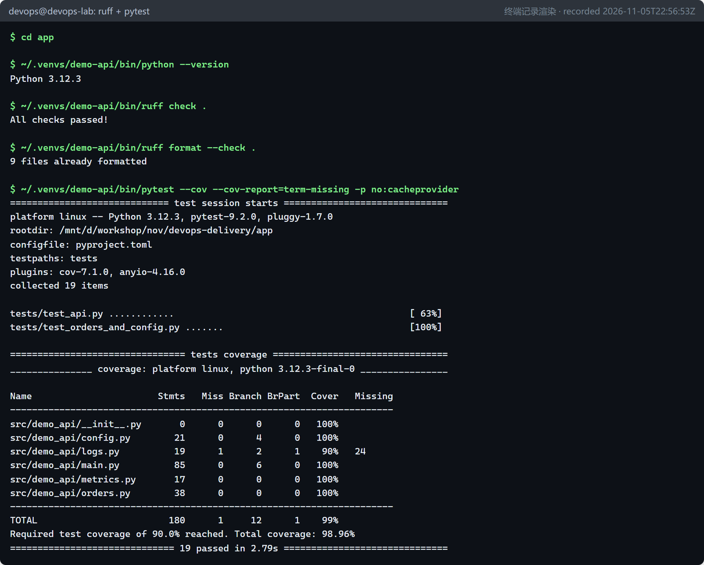
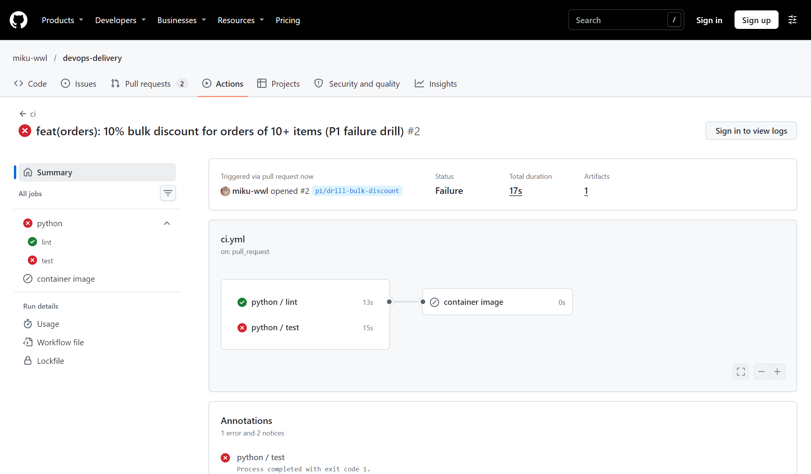
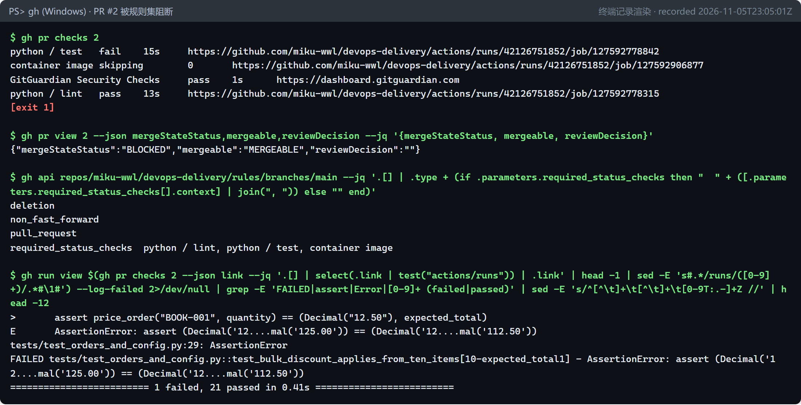
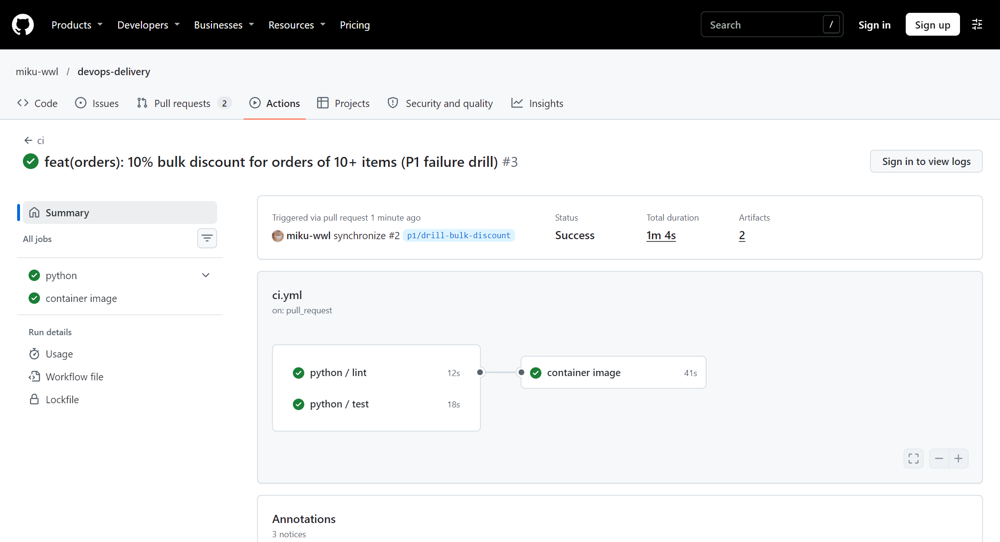

# 持续集成：GitHub Actions 质量门禁（P1 / D1） {#ch-p1}

<div class="lead">持续集成（CI）的目标是：每一次代码变更在合入主干之前，都被自动地构建、检查和测试，不合格的变更进不了主干。本章先介绍 GitHub Actions 的执行模型和官方入门练习，然后为参考服务 demo-api 建立一条真实的 PR 质量门禁：可复用工作流、依赖缓存、测试报告制品、容器冒烟测试，再用规则集（Ruleset）让“测试失败就不能合并”成为强制约束，最后用一次故意引入缺陷的演练来验证这一切。</div>

## 本章目标与产出

| 产出 | 位置 |
|---|---|
| 参考服务 demo-api（FastAPI，19 → 22 个测试） | `app/` |
| 可复用工作流（lint + test） | `.github/workflows/reusable-python-ci.yml` |
| PR 门禁工作流（调用方 + 镜像构建 + 冒烟测试） | `.github/workflows/ci.yml` |
| 规则集 `protect-main` | GitHub 仓库设置（定义保存在 `evidence/p1/ruleset-protect-main.json`） |
| 故障演练 PR | [#2](https://github.com/miku-wwl/devops-delivery/pull/2) |

**验收标准（路线图 D1）：** PR 自动质量门禁运行成功；测试故障能阻断合并。两项均已通过，证据见 `evidence/p1/`。

## 原理：GitHub Actions 的执行模型 {#p1-model}

```{.mermaid caption="一次 pull_request 事件在 GitHub Actions 中的执行过程"}
sequenceDiagram
  autonumber
  participant Dev as 开发者
  participant GH as GitHub 仓库
  participant WF as Actions 调度器
  participant R1 as Runner（ubuntu-24.04 虚拟机）
  Dev->>GH: git push + 创建 Pull Request
  GH->>WF: 触发事件 pull_request（opened / synchronize）
  WF->>WF: 读取 PR 合并提交中的 .github/workflows/*.yml<br/>筛选 on: 匹配的工作流
  WF->>R1: 为每个 Job 分配一台全新的 Runner
  R1->>GH: actions/checkout 拉取代码（只读 GITHUB_TOKEN）
  R1->>R1: 按顺序执行 Steps（run 命令 / uses Action）
  R1-->>WF: 上报每个 Job 的结论（success / failure / skipped）
  WF-->>GH: 以 Check Run 的形式显示在 PR 上
  GH-->>Dev: 规则集根据必需检查决定能否合并
```

几个核心概念：

| 概念 | 含义 | 在本项目中的例子 |
|---|---|---|
| **Workflow（工作流）** | `.github/workflows/` 下的一个 YAML 文件，描述“什么时候、做什么” | `ci.yml` |
| **Event（事件）** | 触发工作流的仓库活动，写在 `on:` 下 | `pull_request`、`push`、`workflow_dispatch`、`workflow_call` |
| **Job（作业）** | 在**同一台 Runner** 上执行的一组步骤；不同 Job 默认**并行**，用 `needs:` 建立先后依赖 | `python`、`image` |
| **Step（步骤）** | Job 中按顺序执行的单元，要么 `run:` 一段 shell，要么 `uses:` 一个 Action | `ruff check`、`actions/checkout` |
| **Action** | 可复用的步骤，可以是 JavaScript、Docker 容器或组合（composite）步骤 | `actions/setup-python` |
| **Runner** | 执行 Job 的机器。GitHub 托管的 Runner 每个 Job 都是一台全新的虚拟机，用完即销毁 | `ubuntu-latest` |
| **Check（检查）** | 每个 Job 的结果显示为 PR 上的一个检查项，规则集可以要求某些检查必须通过 | `python / lint` |

::: principle
**为什么每个 Job 都是全新的机器？** 隔离与可重复：上一次构建残留的文件、进程、凭据都不会影响下一次。代价是每次都要重新安装依赖，所以才需要“缓存”（见后文）。Job 之间要传递文件，必须显式使用 **Artifact（制品）** 或缓存。
:::

**表达式与上下文。** `${{ ... }}` 是 Actions 的表达式语法，在 Runner 执行之前由 GitHub 计算。常用上下文有：`github`（事件信息，如 `github.sha`、`github.event_name`）、`inputs`（可复用工作流的输入）、`secrets`、`steps.<id>.outputs`、`needs.<job>.outputs`、`env`。

**`GITHUB_TOKEN` 与 `permissions`。** 每次运行，GitHub 都会自动生成一个只在本次运行有效的令牌 `GITHUB_TOKEN`。`permissions:` 决定它的权限。安全的默认做法是在工作流顶层只给 `contents: read`，确有需要的 Job 再单独提升（例如第 7 章推送镜像需要 `packages: write`）。

## 官方练习：GitHub Skills「Hello GitHub Actions」 {#p1-skills}

路线图把 GitHub 官方的交互式练习 [Hello GitHub Actions](https://github.com/skills/hello-github-actions) 列为 D1 的正式课程。它的机制很有意思：练习本身就是用 GitHub Actions 实现的——从模板复制出你自己的练习仓库后，仓库里的 `Step 0`～`Step 5` 工作流会监听你的提交，检查你写的文件，并在练习 Issue 中发表下一步说明。

练习的 5 个步骤（内容摘自官方模板仓库 `.github/steps/*.md`）：

| 步骤 | 你要做的事 | 学到的概念 |
|---|---|---|
| 1 | 新建分支 `welcome-workflow`，创建 `.github/workflows/welcome.yml`，写入 `name`、`on: pull_request`、`permissions` | 工作流文件、事件、权限 |
| 2 | 增加 `jobs.welcome`，`runs-on: ubuntu-latest` | Job 与 Runner |
| 3 | 增加一个步骤：用 `gh pr comment` 在新 PR 下留言 | Step、`secrets.GITHUB_TOKEN`、事件上下文 |
| 4 | 从 `welcome-workflow` 向 `main` 发起 PR，观察自动留言与检查结果 | 触发与查看运行 |
| 5 | 合并 PR | 工作流在默认分支上才对整个仓库生效 |

练习最终完成的工作流如下（官方内容）：

```yaml
name: Post welcome comment
on:
  pull_request:
    types: [opened]
permissions:
  pull-requests: write
jobs:
  welcome:
    name: Post welcome comment
    runs-on: ubuntu-latest
    steps:
      - run: gh pr comment "$PR_URL" --body "Welcome to the repository!"
        env:
          GITHUB_TOKEN: ${{ secrets.GITHUB_TOKEN }}
          PR_URL: ${{ github.event.pull_request.html_url }}
```

注意第 3 步的写法：把 `${{ github.event.pull_request.html_url }}` 先放进环境变量 `PR_URL`，再在 shell 中引用 `"$PR_URL"`，而不是直接把表达式拼进 `run:` 脚本。这是防止**脚本注入**的标准做法——PR 标题、分支名等是攻击者可控的文本，直接展开进 shell 可能被执行。

::: warning
**执行状态：未执行（等待用户操作）。** 开始练习需要在用户的 GitHub 账号下新建一个公开仓库（点击模板页的 “Copy Exercise”）。本次自动执行中，创建新公开仓库的操作被权限策略拒绝，因此这一官方练习**没有完成**，本手册也不声称完成。读者按上表操作即可，全程约 30 分钟；完成后练习 Issue 中会出现官方的完成总结。
:::

## 被交付的参考服务：demo-api {#p1-app}

路线图要求使用“已有的最小可运行服务”作为交付对象。仓库中没有现成的后端，所以本项目编写了一个**教学用参考负载** demo-api：一个极小的订单服务。它刻意设计成“刚好够用来演示后面所有章节”：

| 能力 | 实现 | 后续用途 |
|---|---|---|
| 业务接口 | `POST/GET /api/v1/orders`、`GET /api/v1/info` | 合成测试、负载生成 |
| 健康检查 | `/healthz`（存活）、`/readyz`（就绪） | Kubernetes 探针（第 5 章） |
| 指标 | `/metrics`：`http_requests_total`、`http_request_duration_seconds` 等 | Prometheus、Canary 自动分析（第 8、9 章） |
| 结构化日志 | 每行一个 JSON 对象 | Loki 日志检索（第 9 章） |
| 故障注入 | 环境变量 `FAULT_ERROR_RATE`、`FAULT_LATENCY_MS` | Canary 失败演练、可观测性定位演练 |
| 版本标识 | `APP_VERSION`、`GIT_SHA` → `demo_api_build_info` 指标 | 区分稳定版与金丝雀版 |

### 代码结构

```text
app/
├── Dockerfile               # 多阶段构建，基础镜像按 digest 固定，非 root 运行
├── pyproject.toml           # pytest / coverage / ruff 配置（覆盖率下限 90%）
├── requirements.in          # 顶层运行时依赖
├── requirements.txt         # uv 编译出的完整锁定文件（含所有传递依赖）
├── requirements-dev.in/.txt # 测试与 lint 工具
├── src/demo_api/
│   ├── config.py            # 从环境变量读取配置（12-Factor）
│   ├── orders.py            # 价格目录、计价、内存订单存储
│   ├── metrics.py           # Prometheus 指标（RED 方法）
│   ├── logs.py              # JSON 日志格式化
│   └── main.py              # FastAPI 应用工厂 create_app()
└── tests/                   # pytest 测试
```

### 关键代码解析

**应用工厂与依赖注入。** `create_app(settings)` 接收一个配置对象并返回应用实例。测试可以用不同配置（例如打开故障注入）创建任意多个互不影响的应用；生产启动时则由模块末尾的 `app = create_app()` 从环境变量读取配置。

**度量中间件（RED 方法）。** RED 指 Rate（请求速率）、Errors（错误）、Duration（耗时），是度量请求驱动型服务最常用的三个信号：

```python
@app.middleware("http")
async def observe_requests(request: Request, call_next):
    start = time.perf_counter()
    status = 500
    try:
        response = await call_next(request)
        status = response.status_code
        return response
    finally:
        elapsed = time.perf_counter() - start
        route = request.scope.get("route")
        template = getattr(route, "path", "unmatched")
        metrics.observe(request.method, template, status, elapsed)
```

这里有一个容易被忽略的细节：标签使用的是**路由模板**（`/api/v1/orders/{order_id}`），而不是真实路径（`/api/v1/orders/42`）。如果用真实路径，每个订单号都会产生一条新的时间序列，Prometheus 的内存会被“高基数（high cardinality）”标签撑爆。`status` 默认值为 500，`finally` 保证即使处理过程中抛出异常，这次请求也会被计入错误。

**故障注入。** 以 FastAPI 依赖的形式挂在所有 `/api` 路由上，健康检查不受影响（否则 Kubernetes 会误判实例死亡并不断重启它，演练就变味了）：

```python
async def inject_faults() -> None:
    # Not cryptographic randomness - this only decides whether to simulate a failure.
    if settings.fault_error_rate and random.random() < settings.fault_error_rate:  # noqa: S311
        raise HTTPException(status_code=500, detail="injected fault (FAULT_ERROR_RATE)")
```

`# noqa: S311` 是写给安全 lint 规则（Bandit S311：不要用 `random` 做加密用途）的说明：这里不是加密场景，明确豁免并写出理由。

### 测试与本地验证

测试使用 pytest 和 FastAPI 的 `TestClient`（直接在进程内调用 ASGI 应用，无需启动服务器）。`conftest.py` 中的 `make_client` 夹具让每个测试都能拿到“按需配置”的应用：

```python
@pytest.fixture
def make_client():
    def _make(**overrides) -> TestClient:
        return TestClient(create_app(Settings(**overrides)))
    return _make
```

在实验环境中先本地运行一遍（与 CI 使用同样的命令）：



::: note
第一次运行时出现过两个真实问题：`ruff format --check` 报告 3 个文件格式不符（执行 `ruff format .` 修复）；Starlette 1.10 对 `httpx` 发出弃用警告，提示改用 `httpx2`（PyPI 上由 pydantic 组织维护的后继项目），于是开发依赖从 `httpx==0.28.1` 换成 `httpx2==2.16.0`。修复后才是上图的结果。
:::

**为什么要锁定所有传递依赖？** `requirements.in` 只写了 3 个直接依赖，但运行时实际安装了 15 个包。`uv pip compile` 把它们全部固定到确切版本，写入 `requirements.txt`。这样本地、CI、Docker 镜像安装的是**同一组**包；第 7 章的漏洞扫描也能精确到每个包的版本。

### 容器镜像

```dockerfile
ARG PYTHON_IMAGE=python:3.13-slim@sha256:09a17cad02668ae61ece136b4fd36ac3849e14f670ebedb637ea3e15580525bc

FROM ${PYTHON_IMAGE} AS build
WORKDIR /build
COPY requirements.txt .
RUN pip install --no-cache-dir --disable-pip-version-check --prefix=/install -r requirements.txt

FROM ${PYTHON_IMAGE} AS runtime
ARG APP_VERSION=dev
ARG GIT_SHA=unknown
LABEL org.opencontainers.image.source="https://github.com/miku-wwl/devops-delivery" ...
ENV PYTHONDONTWRITEBYTECODE=1 PYTHONUNBUFFERED=1 PYTHONPATH=/app/src \
    APP_VERSION=${APP_VERSION} GIT_SHA=${GIT_SHA}
RUN useradd --uid 10001 --no-create-home --shell /usr/sbin/nologin app
COPY --from=build /install /usr/local
WORKDIR /app
COPY src/ ./src/
USER 10001
EXPOSE 8080
HEALTHCHECK ... CMD ["python", "-c", "...urlopen('http://127.0.0.1:8080/healthz')..."]
CMD ["uvicorn", "demo_api.main:app", "--host", "0.0.0.0", "--port", "8080", "--no-access-log"]
```

| 写法 | 理由 |
|---|---|
| 基础镜像同时写 tag 和 `@sha256:` digest | tag 可以被重新指向新内容，digest 不会；固定 digest 保证可重复构建 |
| 多阶段构建 | 依赖在 `build` 阶段安装，运行时镜像不包含构建缓存等中间产物 |
| 先 `COPY requirements.txt` 再安装，最后才 `COPY src/` | Docker 按层缓存：只改源码时，依赖安装层可以直接复用 |
| `USER 10001` | 不以 root 运行；数字 UID 让 Kubernetes 的 `runAsNonRoot` 校验可以生效 |
| `org.opencontainers.image.*` 标签 | OCI 标准元数据；`source` 让 GHCR 自动把镜像关联到仓库 |

本地构建并做冒烟测试（节选自 `evidence/p1/local-image.log`）：

```console
$ docker image ls demo-api:local --format '{{.Repository}}:{{.Tag}}  {{.Size}}  {{.ID}}'
demo-api:local  202MB  7a43744d6314
$ curl -s localhost:18080/api/v1/info
{"service":"demo-api","version":"0.1.0","commit":"be0efaa"}
$ curl -s -X POST localhost:18080/api/v1/orders -H 'content-type: application/json' -d '{"sku":"BOOK-001","quantity":2}'
{"id":1,"sku":"BOOK-001","quantity":2,"unit_price":"12.50","total":"25.00","created_at":"2026-11-05T22:58:08.003594Z"}
$ curl -s localhost:18080/metrics | grep -E '^(http_requests_total|demo_api_)'
http_requests_total{method="POST",route="/api/v1/orders",status="201"} 1.0
http_requests_total{method="POST",route="/api/v1/orders",status="422"} 1.0
demo_api_orders_created_total 1.0
demo_api_build_info{commit="be0efaa",version="0.1.0"} 1.0
$ docker exec demo-api id
uid=10001(app) gid=10001(app) groups=10001(app)
```

## CI 设计：可复用工作流 + 调用方 {#p1-ci}

```{.mermaid caption="demo-api 的 PR 质量门禁结构"}
flowchart LR
  PR["pull_request → main"] --> CI["ci.yml（调用方）"]
  CI --> PY["job: python<br/>uses: reusable-python-ci.yml"]
  subgraph RW["reusable-python-ci.yml（workflow_call）"]
    L["lint<br/>ruff check + format"]
    T["test<br/>pytest + 覆盖率 ≥ 90%<br/>上传 test-reports"]
  end
  PY --> L
  PY --> T
  L --> IMG["job: container image<br/>buildx + gha 缓存<br/>容器冒烟测试"]
  T --> IMG
  IMG --> CHK{"规则集 protect-main<br/>三个必需检查全部通过？"}
  CHK -- 是 --> M["允许合并（squash）"]
  CHK -- 否 --> B["合并被阻断"]
```

### 为什么要做成“可复用工作流”

如果每个服务仓库都复制一份 lint/test 的 YAML，一旦要升级 Python 版本或加一条安全规则，就得改几十个仓库。**可复用工作流**（`on: workflow_call`）让一份流水线被多个调用方引用，这正是“平台工程 / Developer Experience”岗位日常维护的东西。本仓库中调用方与被调用方在同一个仓库；其他仓库可以用 `uses: miku-wwl/devops-delivery/.github/workflows/reusable-python-ci.yml@<commit-sha>` 引用。

### 被调用方：`reusable-python-ci.yml`

```yaml
name: reusable-python-ci
on:
  workflow_call:
    inputs:
      working-directory:
        description: Directory that contains pyproject.toml and requirements-dev.txt
        type: string
        default: app
      python-version:
        description: Python version for actions/setup-python
        type: string
        default: "3.13"
    outputs:
      coverage:
        description: Total line coverage (percent) reported by pytest-cov
        value: ${{ jobs.test.outputs.coverage }}

permissions:
  contents: read

jobs:
  lint:
    name: lint
    runs-on: ubuntu-latest
    timeout-minutes: 10
    defaults:
      run:
        working-directory: ${{ inputs.working-directory }}
    steps:
      - uses: actions/checkout@3d3c42e5aac5ba805825da76410c181273ba90b1 # v7.0.1
        with:
          persist-credentials: false
      - uses: actions/setup-python@6d4fd22b20465ccc0f7354476588e8df7c9ca0e0 # v7.1.0
        with:
          python-version: ${{ inputs.python-version }}
          cache: pip
          cache-dependency-path: ${{ inputs.working-directory }}/requirements-dev.txt
      - name: Install dependencies
        run: pip install --disable-pip-version-check -r requirements-dev.txt
      - name: ruff check (lint + security rules)
        run: ruff check --output-format=github .
      - name: ruff format --check
        run: ruff format --check .

  test:
    name: test
    runs-on: ubuntu-latest
    timeout-minutes: 15
    outputs:
      coverage: ${{ steps.coverage.outputs.total }}
    defaults:
      run:
        working-directory: ${{ inputs.working-directory }}
    steps:
      # checkout 与 setup-python 同上
      - name: pytest (fails below the coverage threshold in pyproject.toml)
        run: |
          mkdir -p reports
          pytest --cov --cov-report=term-missing \
            --cov-report=xml:reports/coverage.xml --cov-report=html:reports/htmlcov \
            --junitxml=reports/junit.xml
      - name: Coverage summary
        id: coverage
        if: always() && hashFiles(format('{0}/reports/coverage.xml', inputs.working-directory)) != ''
        run: |
          total=$(python -c "...读取 coverage.xml 的 line-rate...")
          echo "total=${total}" >> "$GITHUB_OUTPUT"
          echo "- line coverage: ${total}%" >> "$GITHUB_STEP_SUMMARY"
      - name: Upload test reports
        if: always()
        uses: actions/upload-artifact@cf430e030ddbb5b0abf93d22962f4752f3646cd9 # v7.0.2
        with:
          name: test-reports
          path: ${{ inputs.working-directory }}/reports/
          retention-days: 7
          if-no-files-found: warn
```

逐项说明：

- **`workflow_call` 的 `inputs` / `outputs`**：输入有类型和默认值；输出从内部 Job 的输出向上传递（`jobs.test.outputs.coverage` ← `steps.coverage.outputs.total` ← 写入 `$GITHUB_OUTPUT` 的 `total=...`）。这是 Actions 中跨层传值的标准链路。
- **`defaults.run.working-directory`**：所有 `run:` 步骤都在 `app/` 下执行，免得每条命令都 `cd`。
- **`persist-credentials: false`**：`actions/checkout` 默认会把 `GITHUB_TOKEN` 写进 `.git/config`，以便后续步骤 `git push`。我们不需要推送，就不留下凭据，防止后续步骤（例如第三方工具）读到它。
- **`--output-format=github`**：ruff 以 GitHub 注解（annotation）格式输出，问题会直接标注在 PR 的代码行上。
- **覆盖率门槛写在 `pyproject.toml`（`fail_under = 90`）**，CI 与本地使用同一个阈值，不会出现“本地通过、CI 失败”的配置漂移。
- **`if: always()`**：即使测试失败，也要生成摘要、上传报告——失败时恰恰最需要看报告。`hashFiles(...) != ''` 防止在依赖安装就失败、根本没有报告文件时再报一个无关的错误。
- **`$GITHUB_STEP_SUMMARY`**：写入其中的 Markdown 会显示在运行页面的摘要区。

### 调用方：`ci.yml`

```yaml
name: ci
on:
  pull_request:
    branches: [main]
  push:
    branches: [main]
  workflow_dispatch:

permissions:
  contents: read

concurrency:
  group: ci-${{ github.ref }}
  # Cancel superseded runs on PR branches; never cancel runs on main.
  cancel-in-progress: ${{ github.event_name == 'pull_request' }}

jobs:
  python:
    name: python
    uses: ./.github/workflows/reusable-python-ci.yml
    with:
      working-directory: app
      python-version: "3.13"

  image:
    name: container image
    needs: python
    runs-on: ubuntu-latest
    timeout-minutes: 20
    steps:
      - uses: actions/checkout@3d3c42e5aac5ba805825da76410c181273ba90b1 # v7.0.1
        with:
          persist-credentials: false
      - uses: docker/setup-buildx-action@f87e5991a6d7451dcb8d9637bfbc97413f497069 # v4.4.1
      - name: Build image (GitHub Actions cache backend)
        uses: docker/build-push-action@c3c9e263c25d99ce0380d002d59b67737d91b0dc # v7.4.0
        with:
          context: app
          load: true
          push: false
          tags: demo-api:ci
          build-args: |
            APP_VERSION=ci-${{ github.run_number }}
            GIT_SHA=${{ github.sha }}
          cache-from: type=gha,scope=demo-api
          cache-to: type=gha,mode=max,scope=demo-api
      - name: Smoke test the container
        run: |
          docker run -d --name demo-api -p 8080:8080 demo-api:ci
          for _ in $(seq 1 30); do curl -fsS localhost:8080/healthz && break; sleep 1; done
          curl -fsS localhost:8080/api/v1/info
          curl -fsS -X POST localhost:8080/api/v1/orders \
            -H 'content-type: application/json' -d '{"sku":"BOOK-001","quantity":1}'
          test "$(docker inspect -f '{{.Config.User}}' demo-api:ci)" = "10001"
      - name: Container logs
        if: always()
        run: docker logs demo-api || true
```

- **调用可复用工作流的 Job 没有 `runs-on` 和 `steps`**，只有 `uses` 和 `with`。被调用方的 Job 在 PR 上显示为 “调用方 Job 名 / 被调用方 Job 名”，即 `python / lint`、`python / test`。规则集中的必需检查必须使用**这个完整名称**。
- **`concurrency`**：同一个 PR 推送了新提交时，旧的运行已经没有意义，自动取消以节省 Runner 时间；但 `main` 上的运行一律跑完（表达式 `github.event_name == 'pull_request'` 只在 PR 时为真）。
- **`needs: python`**：镜像构建依赖 lint 与测试通过，失败时直接 `skipped`，不浪费时间构建一个注定不能合并的镜像。
- **`cache-from/cache-to: type=gha`**：BuildKit 把镜像层缓存到 GitHub Actions 缓存服务；`mode=max` 连中间阶段（`build` 阶段）的层也缓存。
- **冒烟测试**：单元测试证明代码逻辑正确，冒烟测试证明**镜像**能启动、能响应、确实以非 root 运行——这两件事不能互相替代。

### 推送前先检查工作流本身：actionlint

工作流也是代码，也会写错。推送之前用官方容器运行 [actionlint](https://github.com/rhysd/actionlint)，它会检查 YAML 语法、表达式类型，并对 `run:` 脚本调用 shellcheck。第一次运行它就发现了一个真实问题：

```console
$ docker run --rm -v "$PWD:/repo" -w /repo rhysd/actionlint:1.7.12 -color=false -verbose
.github/workflows/ci.yml:54:9: shellcheck reported issue in this script: SC2034:warning:2:1: i appears unused. Verify use (or export if used externally) [shellcheck]
[exit 1]
```

把等待循环中的 `for i in ...` 改为 `for _ in ...` 后，结果为 `Found 0 errors in 2 files`。

## 第一次运行：PR #1 {#p1-first-run}

功能分支推送并创建 PR 后，工作流自动运行。以下记录来自 `evidence/p1/pr1-ci-run.log`：

```console
$ gh pr checks 1
GitGuardian Security Checks	pass	1s	https://dashboard.gitguardian.com
container image	pass	42s	https://github.com/miku-wwl/devops-delivery/actions/runs/42126140675/job/127590880194
python / lint	pass	17s	https://github.com/miku-wwl/devops-delivery/actions/runs/42126140675/job/127590734383
python / test	pass	16s	https://github.com/miku-wwl/devops-delivery/actions/runs/42126140675/job/127590734959

$ gh api repos/miku-wwl/devops-delivery/actions/runs/42126140675/artifacts --jq '.artifacts[] | "\(.name)  \(.size_in_bytes) bytes  expires \(.expires_at)"'
miku-wwl~devops-delivery~3LXDQX.dockerbuild  47400 bytes  expires 2027-02-03T23:00:12Z
test-reports  46069 bytes  expires 2026-11-12T23:00:27Z
```

几点观察：

- 整个运行耗时 1 分 4 秒。lint 与 test 并行，镜像构建在两者通过后开始。
- `test-reports` 制品按 `retention-days: 7` 设置为 7 天后过期；另一个 `.dockerbuild` 制品是 `docker/build-push-action` 自动上传的构建记录（可在 Docker Desktop 中导入分析）。
- `GitGuardian Security Checks` 不是本项目配置的：仓库所有者的账号安装了 GitGuardian 的 GitHub App，它会对每个 PR 做密钥泄露扫描。
- 每个 Job 都收到了一条注解：*“The ubuntu-latest label will migrate to Ubuntu 26 beginning October 19, 2026.”* `ubuntu-latest` 是一个会移动的标签。追求可重复性的流水线应写成 `runs-on: ubuntu-24.04` 这样的固定版本，并有计划地升级。

## 缓存：作用域与命中 {#p1-cache}

`actions/setup-python` 的 `cache: pip` 会以“操作系统 + Python 版本 + 依赖文件哈希”作为缓存键。依赖文件不变，键就不变；改动 `requirements-dev.txt` 会自动换一个新键。

GitHub Actions 的缓存有**作用域**限制：一次运行只能读取**当前分支（或 PR 的合并引用）**以及**基础分支（通常是 main）**创建的缓存，不能读取其他兄弟分支的缓存。这是为了防止一个分支“投毒”另一个分支的缓存。本次实验恰好清楚地展示了这一规则：

```console
# PR #2 的第一次运行：PR #1 已经保存过同一个键的缓存，但 PR #2 读不到，于是重新保存
python / lint | Cache saved with the key: setup-python-Linux-x64-24.04-Ubuntu-python-3.13.18-pip-954275a2...

# PR #2 的第二次运行（推送修复提交后）：命中自己第一次运行保存的缓存
python / test | Cache restored from key: setup-python-Linux-x64-24.04-Ubuntu-python-3.13.18-pip-954275a2...
python / test | Cache hit occurred on the primary key setup-python-...-pip-954275a2..., not saving cache.
```

Docker 层缓存也一样：PR #2 第一次运行时镜像 Job 被跳过，没有保存缓存；第二次运行时它读不到 PR #1 的缓存，构建日志中 `CACHED` 层数为 0。**当 PR #1 合并、`main` 上的运行保存缓存之后，所有新 PR 都能读到 `main` 的缓存。**

## 分支保护：规则集（Ruleset） {#p1-ruleset}

工作流只负责“报告”结果，真正“阻止合并”的是仓库的保护规则。GitHub 现在推荐使用**规则集（Ruleset）**代替旧的“分支保护规则”：规则集可以叠加、可以作用于多个分支、可以通过 API 以 JSON 管理。

```json
{
  "name": "protect-main",
  "target": "branch",
  "enforcement": "active",
  "conditions": { "ref_name": { "include": ["~DEFAULT_BRANCH"], "exclude": [] } },
  "bypass_actors": [],
  "rules": [
    { "type": "deletion" },
    { "type": "non_fast_forward" },
    { "type": "pull_request",
      "parameters": {
        "required_approving_review_count": 0,
        "dismiss_stale_reviews_on_push": false,
        "require_code_owner_review": false,
        "require_last_push_approval": false,
        "required_review_thread_resolution": false,
        "allowed_merge_methods": ["squash"]
      } },
    { "type": "required_status_checks",
      "parameters": {
        "strict_required_status_checks_policy": false,
        "required_status_checks": [
          { "context": "python / lint",   "integration_id": 15368 },
          { "context": "python / test",   "integration_id": 15368 },
          { "context": "container image", "integration_id": 15368 }
        ]
      } }
  ]
}
```

```console
$ gh api -X POST repos/miku-wwl/devops-delivery/rulesets --input evidence/p1/ruleset-protect-main.json --jq '{id, name, enforcement, rules: [.rules[].type]}'
{"enforcement":"active","id":26657635,"name":"protect-main","rules":["deletion","non_fast_forward","pull_request","required_status_checks"]}
```

| 规则 | 作用 |
|---|---|
| `~DEFAULT_BRANCH` | 作用于默认分支，即使将来改名也有效 |
| `bypass_actors: []` | 没有任何人（包括仓库管理员）可以绕过 |
| `deletion`、`non_fast_forward` | 禁止删除 main、禁止强制推送改写历史 |
| `pull_request` | 只能通过 PR 合入，禁止直接推送；只允许 squash 合并，保持主干历史线性、每个 PR 一个提交 |
| `required_approving_review_count: 0` | 个人仓库没有第二个审阅者，设为 0；**团队仓库应至少为 1** |
| `required_status_checks` | 三个检查必须成功；`integration_id: 15368` 是 GitHub Actions 应用的 ID，确保这个名称的检查只能由 Actions 上报，别的应用伪造同名状态无效 |
| `strict_required_status_checks_policy: false` | 不要求 PR 分支先与最新 main 同步。设为 `true` 更严格，但每次 main 前进后所有 PR 都要重新运行 |

## 故障演练：让测试失败去阻断合并 {#p1-drill}

验收标准要求证明“测试故障能阻断合并”。演练模拟一个真实场景：开发者实现“满 10 件打九折”的新功能，但把判断写成了 `quantity > 10`（差一错误，off-by-one），而他同时写的参数化测试覆盖了“恰好 10 件”这个边界：

```python
@pytest.mark.parametrize(
    ("quantity", "expected_total"),
    [
        (9, Decimal("112.50")),  # below the threshold: 9 x 12.50, no discount
        (10, Decimal("112.50")),  # exactly the threshold: 125.00 - 10%
        (12, Decimal("135.00")),  # above the threshold: 150.00 - 10%
    ],
)
def test_bulk_discount_applies_from_ten_items(quantity, expected_total):
    assert price_order("BOOK-001", quantity) == (Decimal("12.50"), expected_total)
```

::: tip
**边界值测试**：阈值类逻辑一定要测“阈值减一、阈值本身、阈值加一”三个点。只测 9 和 12，`>` 与 `>=` 的错误就永远发现不了。
:::

推送后创建 PR #2，CI 的结果如下：



失败日志精确指出了问题——恰好 10 件时得到 125.00 而不是 112.50：

```console
E       AssertionError: assert (Decimal('12....mal('125.00')) == (Decimal('12....mal('112.50'))
FAILED tests/test_orders_and_config.py::test_bulk_discount_applies_from_ten_items[10-expected_total1] - AssertionError: ...
========================= 1 failed, 21 passed in 0.41s =========================
```

此时用 GitHub API 查询 PR 的合并状态，规则集给出 `BLOCKED`：



注意 `mergeable` 仍是 `MERGEABLE`——它只表示 Git 层面没有冲突；**能不能合并由 `mergeStateStatus` 决定**，这里是 `BLOCKED`，原因是必需检查 `python / test` 失败、`container image` 未成功。

修复只需一个字符：`>` 改为 `>=`。推送修复提交后：

```console
$ gh pr checks 2
container image	pass	41s	...
python / lint	pass	12s	...
python / test	pass	18s	...
$ gh pr view 2 --json mergeStateStatus,mergeable --jq '{mergeStateStatus, mergeable}'
{"mergeStateStatus":"CLEAN","mergeable":"MERGEABLE"}
```



`CLEAN` 表示所有规则都已满足，可以合并。D1 的验收至此完成。

::: note
**关于合并操作。** 本手册的实验由 AI 编码助手执行，而本次运行的权限策略不允许助手在无人审阅的情况下自行合并 PR（这本身就是一条合理的工程规则）。因此 PR #1、#2 停在“可合并”状态，由仓库所有者审阅后合并。这不影响 D1 的验收：要证明的是“失败时被阻断、修复后满足合并条件”，两者都有证据。
:::

## 安全加固清单 {#p1-hardening}

CI 系统手握源代码和发布凭据，是软件供应链攻击的高价值目标。本章的工作流已经落实了以下做法：

1. **所有 Action 固定到完整的 commit SHA**（`uses: actions/checkout@3d3c42e5...  # v7.0.1`）。tag 是可以被移动的：2025 年 3 月 `tj-actions/changed-files` 被攻破，攻击者把它的多个版本 tag 改指到恶意提交，所有用 tag 引用它的工作流都在日志中泄露了密钥。固定 SHA 的工作流不受影响。注释中保留版本号，方便人阅读，也方便 Dependabot 自动升级。
2. **最小权限**：顶层 `permissions: contents: read`。
3. **不保留凭据**：`persist-credentials: false`。
4. **不把不可信输入直接拼进脚本**：用环境变量传递 `github.event.*` 中的文本（见 Skills 练习第 3 步）。
5. **慎用 `pull_request_target`**：它以目标仓库的权限运行，若再检出 fork 的代码执行，等于把写权限交给陌生人。本项目只使用 `pull_request`。
6. **长期云密钥不进 CI**：后续章节推送镜像使用 `GITHUB_TOKEN`，签名使用 OIDC 无密钥签名（第 7 章）。

## 常见问题

**Q1：PR 一直显示 “Expected — Waiting for status to be reported”，永远无法合并。**
必需检查的名字与实际上报的不一致。常见原因：给工作流加了 `paths:` 过滤，某些 PR 根本不触发它；或者改了 Job 的 `name:`。必需检查的工作流不要使用路径过滤；改 Job 名时同步修改规则集。可复用工作流的检查名是“调用方 Job 名 / 被调用方 Job 名”。

**Q2：明明 main 上有缓存，我的分支却没命中。**
检查缓存键是否一致（依赖文件是否改动），以及 main 上是否真的跑过一次并保存了缓存。兄弟分支之间的缓存互不可见。

**Q3：`Resource not accessible by integration`。**
`GITHUB_TOKEN` 权限不足，在对应 Job 上增加所需的 `permissions`，例如发 PR 评论需要 `pull-requests: write`。

**Q4：新加的 `workflow_dispatch` 工作流在网页上找不到 “Run workflow” 按钮。**
手动触发的工作流文件必须存在于默认分支上。先合并到 main。

**Q5：来自 fork 的 PR 读不到 secrets。**
这是有意的安全设计。需要密钥的步骤（如部署）不应在 fork PR 上运行。

**Q6：公开仓库的运行日志为什么要求登录才能看？**
GitHub 只向登录用户展示 Actions 日志；运行摘要和 Job 结果图对匿名访问者可见。本手册的截图就是匿名打开公开页面得到的，日志部分则通过 `gh run view --log` 获取。

**Q7：如何在本地预先运行工作流？**
可以用 actionlint 做静态检查；第三方工具 `act` 可以在本地 Docker 中模拟运行，但与 GitHub 托管 Runner 的环境并不完全相同，最终仍以真实运行为准。

## 本章小结

- GitHub Actions 由事件触发工作流，工作流由并行的 Job 组成，每个 Job 在一台全新的 Runner 上按顺序执行 Step。
- 我们为 demo-api 建立了“可复用工作流 + 调用方”的 PR 门禁：lint、测试（覆盖率 ≥ 90%）、测试报告制品、依赖与镜像层缓存、容器冒烟测试；所有 Action 固定到 SHA。
- 规则集 `protect-main` 要求三个检查必须通过；故障演练证明失败的测试会让 PR 进入 `BLOCKED`，修复后变为 `CLEAN`。
- 官方 Skills 练习因需要新建公开仓库而未执行，已给出完整步骤。
