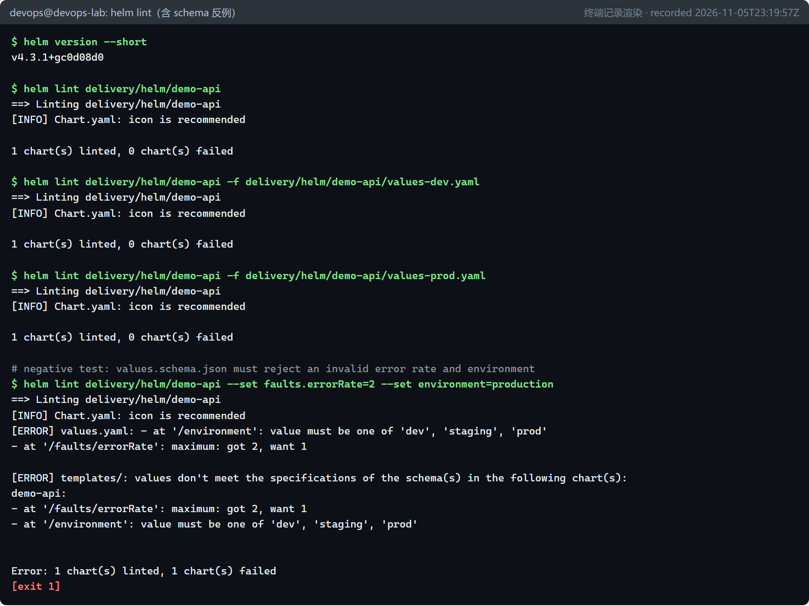
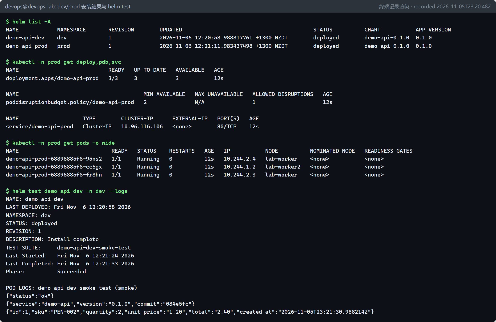
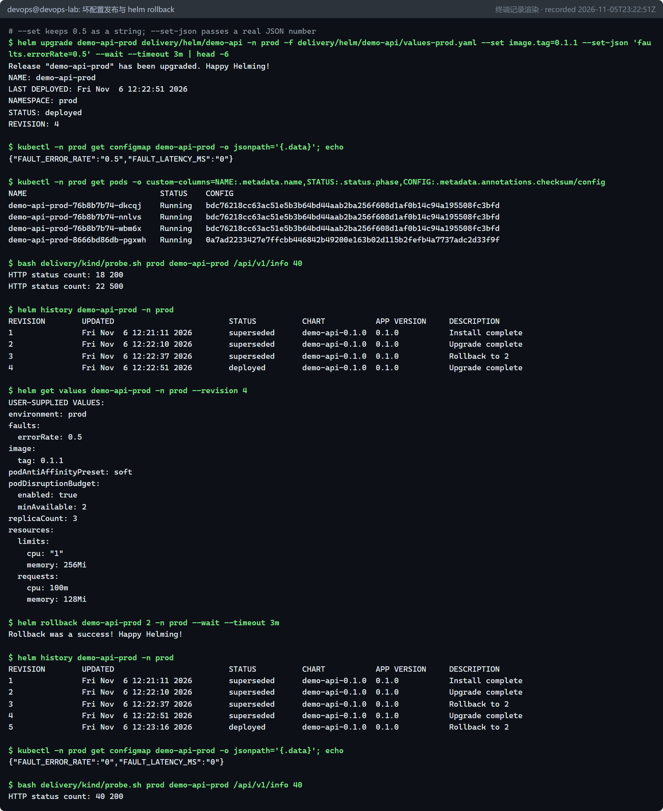

# 打包与部署：Kubernetes 基础与 Helm（P3 / D3） {#ch-p3}

<div class="lead">CI 产出的是镜像，镜像要变成“在集群里稳定运行的服务”，还需要一组 Kubernetes 对象。本章先用最少的篇幅讲清这些对象，再用 Helm 把它们做成一个可参数化、可版本化、可回滚的 Chart：同一个 Chart 按环境部署到 dev 和 prod，经历一次正常升级、一次“坏配置发布”和一次回滚，最后以 OCI 制品的形式发布 Chart 本身。</div>

## 本章目标与产出

| 产出 | 位置 |
|---|---|
| 实验集群（1 控制面 + 2 工作节点）与本地镜像仓库 | `delivery/kind/lab-cluster.yaml`、`create-lab-cluster.sh` |
| demo-api 的 Helm Chart（含 values schema 与 helm test） | `delivery/helm/demo-api/` |
| 环境差异配置 | `values-dev.yaml`、`values-prod.yaml` |
| 探测脚本（统计 HTTP 状态码） | `delivery/kind/probe.sh` |

**验收标准（路线图 D3）：** 可重复部署同一应用，配置按环境区分。已通过：dev（1 副本）与 prod（3 副本 + PDB + 反亲和）由同一 Chart 部署，升级、坏发布、回滚全过程有记录（`evidence/p3/`）。

## 原理一：最小够用的 Kubernetes {#p3-k8s}

Kubernetes 是一个**声明式**系统：你把“期望状态”（例如“运行 3 个 demo-api 0.1.1 的副本”）以对象的形式提交给 API Server，各种**控制器**不停地比较“期望状态”与“实际状态”，并采取行动消除差异。这个“观察 → 比较 → 行动”的循环叫**调和（reconcile）**，是理解 Kubernetes、GitOps（第 6 章）和渐进式交付（第 8 章）的钥匙。

```{.mermaid caption="demo-api 在集群中涉及的对象及其关系"}
flowchart LR
  subgraph NS["Namespace: prod（Pod Security: restricted）"]
    D["Deployment<br/>replicas: 3"] -->|管理| RS["ReplicaSet<br/>（每个版本一个）"]
    RS -->|创建| P1["Pod"] & P2["Pod"] & P3["Pod"]
    CM["ConfigMap<br/>FAULT_* 配置"] -.->|envFrom| P1
    SA["ServiceAccount<br/>不挂载 Token"] -.-> P1
    SVC["Service<br/>ClusterIP :80"] -->|按标签选择| P1 & P2 & P3
    PDB["PodDisruptionBudget<br/>minAvailable: 2"] -.->|保护| P1
  end
  Client["集群内客户端<br/>（helm test / 探测）"] --> SVC
```

| 对象 | 作用 | 本章中的要点 |
|---|---|---|
| **Pod** | 最小调度单位，包含一个或多个容器 | 安全上下文、探针、资源限制都写在 Pod 模板里 |
| **Deployment** | 声明副本数与 Pod 模板，负责滚动更新 | 每次 Pod 模板变化都会生成新的 ReplicaSet，旧的保留用于回滚 |
| **Service** | 为一组 Pod 提供稳定的虚拟 IP 和 DNS 名称 | 通过**标签选择器**找到 Pod；Pod 换了 IP 也不影响调用方 |
| **ConfigMap** | 非敏感配置 | 通过 `envFrom` 注入为环境变量 |
| **ServiceAccount** | Pod 访问 API Server 的身份 | demo-api 不需要访问 API，所以不挂载令牌 |
| **PodDisruptionBudget** | 限制“自愿中断”（节点维护、驱逐）时同时不可用的 Pod 数 | prod 要求至少 2 个可用 |
| **Namespace** | 逻辑隔离与配额、策略的边界 | `dev`、`prod` 两个命名空间 |

**探针（Probe）：** `readinessProbe` 决定 Pod 是否接收流量（未就绪时会从 Service 的后端列表中摘除）；`livenessProbe` 决定容器是否要被重启。二者用途不同，不能混用：把依赖数据库的检查放进 liveness，数据库抖一下就会导致所有 Pod 被重启。

**Pod 安全标准（Pod Security Standards）：** Kubernetes 内置三档策略：`privileged`、`baseline`、`restricted`。给命名空间打上标签 `pod-security.kubernetes.io/enforce=restricted` 后，任何不满足最严格要求的 Pod（以 root 运行、允许提权、未丢弃 Linux capabilities、未设置 seccomp 等）都会被**直接拒绝创建**。本章的 dev、prod 都启用了 `restricted`，Chart 必须“生来安全”。

## 原理二：Helm 解决什么问题 {#p3-helm}

直接用 `kubectl apply` 管理 YAML 会遇到三个问题：同一份清单要部署到多个环境，只能复制后手改；一次发布由多个对象组成，没有“版本”的概念，出了问题不知道回滚到哪里；清单不能像软件包一样发布、引用。Helm 正是“Kubernetes 的包管理器”：

| 概念 | 含义 |
|---|---|
| **Chart** | 一个包：模板（`templates/`）+ 默认值（`values.yaml`）+ 元数据（`Chart.yaml`） |
| **Values** | 模板参数。优先级：`--set` / `--set-json` > 后面的 `-f` 文件 > 前面的 `-f` 文件 > Chart 默认值 |
| **Release** | Chart 在某个命名空间中的一次安装实例，例如 `demo-api-prod` |
| **Revision** | Release 的每次变更（install、upgrade、rollback）都产生一个新的修订号，完整的渲染结果保存在集群的 Secret 中 |
| **Repository / OCI** | Chart 的分发方式。Helm 3.8 起支持把 Chart 当作 OCI 制品推送到镜像仓库 |

```{.mermaid caption="helm upgrade 的工作流程"}
flowchart LR
  V["values.yaml<br/>+ values-prod.yaml<br/>+ --set-json"] --> S{"values.schema.json<br/>校验"}
  S -- 不通过 --> X["立即失败<br/>不产生新修订"]
  S -- 通过 --> T["模板引擎渲染<br/>templates/*.yaml"]
  T --> M["Kubernetes 清单"]
  M --> API["API Server<br/>创建 / 更新对象"]
  API --> R["保存修订 N+1<br/>（Secret: sh.helm.release.v1.*）"]
  R --> W["--wait：等待资源就绪"]
```

## 第 1 步：实验集群与本地镜像仓库 {#p3-cluster}

P0 的冒烟集群只有一个节点；从本章起使用一个“像样一点”的集群：1 个控制面节点 + 2 个工作节点，这样才能观察到 Pod 分布、反亲和、PDB 的效果。

镜像如何进入 Kind 集群？有两种方式：`kind load docker-image` 把镜像直接复制进每个节点；或者运行一个本地镜像仓库，节点像在真实环境中一样从仓库**拉取**。后者更接近生产（按 digest 拉取、仓库可以被扫描和签名），也是 Kind 官方文档 “Local Registry” 一节推荐的做法。`create-lab-cluster.sh` 的关键步骤：

```bash
# 1. registry container (Distribution / registry:3) on the host's loopback
docker run -d --restart=always -p "127.0.0.1:${REG_PORT}:5000" --network bridge \
  --name "$REG_NAME" registry:3.1.2

# 2. cluster
kind create cluster --config "$HERE/lab-cluster.yaml" --image "$KIND_NODE_IMAGE" --wait 180s

# 3. tell containerd on every node that localhost:5001 means http://kind-registry:5000
for node in $(kind get nodes --name lab); do
  docker exec "$node" mkdir -p "/etc/containerd/certs.d/localhost:${REG_PORT}"
  printf '[host."http://%s:5000"]\n' "$REG_NAME" |
    docker exec -i "$node" cp /dev/stdin "/etc/containerd/certs.d/localhost:${REG_PORT}/hosts.toml"
done

# 4. put the registry on the kind network so nodes can resolve "kind-registry"
docker network connect kind "$REG_NAME"

# 5. advertise the registry (KEP-1755 "local-registry-hosting")
kubectl apply -f - <<EOF  # ConfigMap kube-public/local-registry-hosting ...
```

这里有一个“同名不同义”的细节值得体会：在 WSL 主机上，`localhost:5001` 指向仓库容器的映射端口；但在 Kind 节点（容器）里，`localhost` 是节点自己。第 3 步通过 containerd 的 `hosts.toml` 告诉节点：“当你要拉 `localhost:5001/...` 时，实际去 `http://kind-registry:5000`”。这样，同一个镜像名在主机和集群中都能用。

::: note
较早的 Kind 教程会在集群配置里加一段 `containerdConfigPatches`，把 containerd 的 `config_path` 指向 `/etc/containerd/certs.d`。Kind v0.27 起的节点镜像已默认如此（且 containerd 2.x 改了插件名，照抄旧补丁反而可能出错），所以本项目的 `lab-cluster.yaml` 不需要任何补丁。
:::

执行结果（节选，完整记录：`evidence/p3/cluster.log`）：

```console
$ bash delivery/kind/create-lab-cluster.sh
 ✓ Joining worker nodes 🚜
 • Ready after 9s 💚
configmap/local-registry-hosting created
NAME                STATUS   ROLES           AGE   VERSION   INTERNAL-IP   ...   CONTAINER-RUNTIME
lab-control-plane   Ready    control-plane   26s   v1.37.0   172.18.0.2    ...   containerd://2.3.4
lab-worker          Ready    <none>          12s   v1.37.0   172.18.0.4    ...   containerd://2.3.4
lab-worker2         Ready    <none>          13s   v1.37.0   172.18.0.3    ...   containerd://2.3.4

$ for n in $(kind get nodes --name lab); do echo "$n: $(docker exec $n cat /etc/containerd/certs.d/localhost:5001/hosts.toml)"; done
lab-worker2: [host."http://kind-registry:5000"]
lab-control-plane: [host."http://kind-registry:5000"]
lab-worker: [host."http://kind-registry:5000"]
```

## 第 2 步：Chart 结构与模板解析 {#p3-chart}

```text
delivery/helm/demo-api/
├── Chart.yaml            # 名称、Chart 版本（version）、应用版本（appVersion）
├── values.yaml           # 默认值（安全默认：restricted 级别的安全上下文）
├── values-dev.yaml       # dev 只覆盖与默认不同的部分
├── values-prod.yaml      # prod：3 副本、PDB、反亲和、更大的资源
├── values.schema.json    # values 的 JSON Schema，lint / install / upgrade 时强制校验
├── .helmignore
└── templates/
    ├── _helpers.tpl      # 命名、标签、镜像引用等可复用片段
    ├── configmap.yaml
    ├── deployment.yaml
    ├── service.yaml
    ├── serviceaccount.yaml
    ├── pdb.yaml          # podDisruptionBudget.enabled 时才渲染
    ├── hpa.yaml          # autoscaling.enabled 时才渲染（需要 metrics-server）
    ├── NOTES.txt         # 安装后打印的使用说明
    └── tests/test-connection.yaml   # helm test 钩子
```

**两个版本号。** `Chart.yaml` 中的 `version` 是 **Chart 自身**的版本（模板改了就要升）；`appVersion` 是它默认部署的**应用**版本。二者独立演进。后面你会看到 `helm history` 的 `APP VERSION` 列显示的是 `appVersion`，而不是你用 `--set image.tag` 覆盖后的实际镜像版本——这是一个常见误解。

### 辅助模板：`_helpers.tpl`

```text
{{/* Labels used to select pods - must never change after the first install. */}}
{{- define "demo-api.selectorLabels" -}}
app.kubernetes.io/name: {{ include "demo-api.name" . }}
app.kubernetes.io/instance: {{ .Release.Name }}
{{- end -}}

{{/* Image reference: repository@digest when a digest is pinned, otherwise repository:tag. */}}
{{- define "demo-api.image" -}}
{{- if .Values.image.digest -}}
{{- printf "%s@%s" .Values.image.repository .Values.image.digest -}}
{{- else -}}
{{- printf "%s:%s" .Values.image.repository (include "demo-api.imageTag" .) -}}
{{- end -}}
{{- end -}}
```

- **选择器标签必须稳定。** Deployment 的 `spec.selector` 创建后不可修改。所以选择器只用 `name` 和 `instance` 两个永远不变的标签，版本号之类会变的标签只放在普通 `labels` 里。
- **按 digest 引用镜像。** 第 7 章会把 CI 构建出的镜像以 `repository@sha256:...` 的形式晋级到各环境；这里提前预留了 `image.digest`。

### Deployment 模板中的关键写法

```yaml
  template:
    metadata:
      annotations:
        # Changing the ConfigMap changes this hash, which rolls the pods.
        checksum/config: {{ include (print $.Template.BasePath "/configmap.yaml") . | sha256sum }}
    spec:
      serviceAccountName: {{ include "demo-api.fullname" . }}
      automountServiceAccountToken: false
      securityContext:
        {{- toYaml .Values.podSecurityContext | nindent 8 }}
      containers:
        - name: demo-api
          image: {{ include "demo-api.image" . | quote }}
          envFrom:
            - configMapRef:
                name: {{ include "demo-api.fullname" . }}
          readinessProbe:
            httpGet: { path: /readyz, port: http }
          livenessProbe:
            httpGet: { path: /healthz, port: http }
          securityContext:
            {{- toYaml .Values.securityContext | nindent 12 }}
          volumeMounts:
            - name: tmp
              mountPath: /tmp
```

**`checksum/config` 注解**是 Helm 社区的经典技巧。环境变量只在容器启动时读取一次，单独修改 ConfigMap 不会让正在运行的 Pod 生效。把 ConfigMap 渲染结果的 SHA-256 写进 Pod 模板的注解，ConfigMap 一变，Pod 模板随之改变，Deployment 就会自动滚动更新。后面的坏发布演练正是靠它让新配置立刻生效的。

::: warning
**后文的修订。** 这个技巧解决了“配置改了、Pod 不重启”的问题，但留下一个隐患：新旧 ReplicaSet 读取的是**同一个** ConfigMap。旧版本的 Pod 只要在配置变更之后重建（扩容、节点故障、被驱逐），读到的就是新配置。滚动更新很快结束，这个窗口通常不显眼；第 8 章的金丝雀发布会长时间同时运行两个版本，并且会在中止时扩容稳定版，隐患就变成了真实的问题。第 9 章记录了这次问题，并在 Chart 0.3.1 中把发布配置直接写进 Pod 模板的 `env`，`checksum/config` 注解随之删除。
:::

**只读根文件系统 + `/tmp` 空目录卷：** `readOnlyRootFilesystem: true` 让攻击者即使拿到容器内执行权限，也无法改写程序文件；应用若需要临时文件，挂一个 `emptyDir` 到 `/tmp`。

### values.schema.json：把错误挡在集群之外

```json
"environment": { "enum": ["dev", "staging", "prod"] },
"faults": {
  "type": "object",
  "properties": {
    "errorRate": { "type": "number", "minimum": 0, "maximum": 1 },
    "latencyMs": { "type": "number", "minimum": 0 }
  }
}
```

有了 schema，`helm lint`、`helm install`、`helm upgrade` 都会先校验 values，不合格就直接失败，不会生成新修订。下一步就会看到它拦下的两个真实错误。

## 第 3 步：静态检查——lint、schema 与 template {#p3-lint}



`[INFO] Chart.yaml: icon is recommended` 只是建议，不影响结果。反例中，`--set faults.errorRate=2 --set environment=production` 同时违反了两条约束，schema 给出了精确的路径与原因。

`helm template` 在本地渲染出最终清单，不接触集群，是审查 Chart 的最佳方式。用同一个 Release 名分别渲染 dev 和 prod，再做 diff，就能清楚看到“环境差异到底是什么”：

```console
$ grep -c '^kind:' /tmp/dev.yaml /tmp/prod.yaml
/tmp/dev.yaml:5
/tmp/prod.yaml:6
$ diff -u /tmp/dev.yaml /tmp/prod.yaml | grep -E '^[-+][^-+]' | grep -v 'environment:'
+kind: PodDisruptionBudget
+  minAvailable: 2
-  replicas: 1
+  replicas: 3
-        checksum/config: a4b55415d2f0b69ef9942a324f5a9b5215eb98f358df08374b60c48f71513af9
+        checksum/config: dab4d135c88383c6afcb181041914ab0cda32a8a55a6899e7b150865725570d5
-              cpu: 250m
+              cpu: "1"
+      affinity:
+        podAntiAffinity:
+          preferredDuringSchedulingIgnoredDuringExecution: ...
[exit 1]
```

（`diff` 在两个文件不同时返回 1，这里的 `[exit 1]` 是预期的。）你可能会好奇：两个环境的故障注入值都是 0，为什么 `checksum/config` 不同？因为 ConfigMap 的 `metadata.labels` 中包含 `environment: dev/prod`，哈希覆盖的是整个渲染结果。

::: warning
**一个在 diff 中发现的设计缺陷。** 最初的 `values-prod.yaml` 直接写了反亲和规则，选择器里硬编码了 `app.kubernetes.io/instance: demo-api-prod`。diff 一出来就暴露了问题：一旦 Release 换个名字，这条规则会静默失效（选不中任何 Pod，也不报错）。修正方法是在模板中根据 Chart 自己的 `selectorLabels` 生成规则，values 中只保留一个开关 `podAntiAffinityPreset: soft`。**教训：values 文件不应该猜测 Release 名称。**
:::

## 第 4 步：安装到 dev 与 prod {#p3-install}

```bash
# 构建镜像并推送到本地仓库
docker build --build-arg APP_VERSION=0.1.0 --build-arg GIT_SHA=$(git rev-parse --short HEAD) \
  -t localhost:5001/demo-api:0.1.0 app
docker push localhost:5001/demo-api:0.1.0

# 两个命名空间都强制 restricted 级别的 Pod 安全标准
for ns in dev prod; do
  kubectl create namespace $ns
  kubectl label namespace $ns pod-security.kubernetes.io/enforce=restricted \
                             pod-security.kubernetes.io/warn=restricted
done

helm install demo-api-dev  delivery/helm/demo-api -n dev  -f delivery/helm/demo-api/values-dev.yaml  --wait --timeout 3m
helm install demo-api-prod delivery/helm/demo-api -n prod -f delivery/helm/demo-api/values-prod.yaml --wait --timeout 3m
helm test demo-api-dev -n dev --logs
```



观察要点：

- `--wait` 让 Helm 等到资源真正就绪才返回成功；没有它，`helm install` 在对象“提交成功”时就返回了，Pod 可能还在崩溃重启。
- prod 的 3 个 Pod 落在 `lab-worker`（2 个）和 `lab-worker2`（1 个）上：控制面节点带有 `NoSchedule` 污点，只有 2 个工作节点可用；“软”反亲和（preferred）在无法完全满足时仍允许调度。若改成“硬”反亲和（required），第三个 Pod 会一直 Pending。
- PDB 显示 `ALLOWED DISRUPTIONS 1`：3 个副本、至少 2 个可用，所以同一时间只允许驱逐 1 个。
- 所有 Pod 都通过了 `restricted` 策略的准入检查，没有任何警告——这正是 Chart 默认安全上下文的价值。
- `helm test` 启动了 `tests/test-connection.yaml` 中定义的 Pod（同样满足 restricted），它依次调用健康检查、信息接口和下单接口；Pod 以退出码 0 结束即测试通过。

## 第 5 步：升级、坏发布与回滚 {#p3-rollback}

这一步模拟真实发布中最常见的三种情况：一次正常升级、一次“坏发布”、一次回滚。

**修订 2：正常升级到 0.1.1。** 构建新镜像，`helm upgrade --set image.tag=0.1.1`，探测 20 次全部返回 200，`/api/v1/info` 报告 `"version":"0.1.1"`。

**第一次尝试制造坏发布——被 schema 拦下了：**

```console
$ helm upgrade demo-api-prod delivery/helm/demo-api -n prod -f delivery/helm/demo-api/values-prod.yaml --set image.tag=0.1.1 --set faults.errorRate=0.5 --wait --timeout 3m
Error: UPGRADE FAILED: values don't meet the specifications of the schema(s) in the following chart(s):
demo-api:
- at '/faults/errorRate': got string, want number
[exit 1]
```

这是一个真实踩到的坑：**`--set` 只会把整数和布尔值转换成对应类型，`0.5` 这样的小数会被当作字符串。**没有 schema 的话，这个字符串会被原样写进 ConfigMap，问题被推迟到运行时才暴露；有了 schema，它在提交前就被拒绝，而且 `helm history` 中没有留下任何失败的修订。需要传入数字时，应使用 `--set-json 'faults.errorRate=0.5'`，或者把值写进 values 文件。

**修订 4：用 `--set-json` 真正发布一个坏配置（50% 请求返回 500），然后回滚：**



逐段解读：

1. 升级后立即查看 Pod，能看到 3 个新 Pod（新的 `checksum/config`）和 1 个尚未退出的旧 Pod——`--wait` 等待的是新版本就绪，并不等待旧 Pod 完全终止。
2. 探测 40 次：18 次 200、22 次 500，与 50% 的故障率吻合。
3. `helm get values --revision 4` 能精确查出“这次发布到底改了什么”，这在事故复盘中非常有用。
4. `helm rollback demo-api-prod 2` 并不是“删除修订 4”，而是**以修订 2 的内容生成一个新的修订 5**。历史是只追加的，审计信息不会丢失。
5. 回滚后 ConfigMap 恢复为 `FAULT_ERROR_RATE: "0"`，探测 40 次全部 200。

::: principle
**Helm 回滚与 GitOps 回滚的区别。** `helm rollback` 改变的是集群状态，但 Git 中的 values 文件并没有变。如果下一次有人从 Git 重新部署，坏配置会“复活”。第 6 章的 GitOps 会把这个问题彻底解决：回滚是对 Git 的一次提交（`git revert`），集群跟随 Git。
:::

## 第 6 步：打包并以 OCI 制品发布 Chart {#p3-oci}

```console
$ helm package delivery/helm/demo-api -d /tmp/charts
Successfully packaged chart and saved it to: /tmp/charts/demo-api-0.1.0.tgz
$ helm push /tmp/charts/demo-api-0.1.0.tgz oci://localhost:5001/charts --plain-http
Pushed: localhost:5001/charts/demo-api:0.1.0
$ helm template smoke oci://localhost:5001/charts/demo-api --version 0.1.0 --plain-http --show-only templates/service.yaml
Pulled: localhost:5001/charts/demo-api:0.1.0
Digest: sha256:9953e17510793f58f6a6fa7662aba985b5f7645b9bd971cdc7b651b94c759493
```

Chart 被打包成 `.tgz`，以 OCI 制品推送到与镜像相同的仓库，之后可以像引用镜像一样按版本甚至 digest 引用它。`--plain-http` 只因为本地实验仓库没有 TLS；真实环境中的仓库都应启用 HTTPS 和认证。（完整输出：`evidence/p3/helm-package-oci.log`）

## 常见问题

**Q1：`helm upgrade` 报 “got string, want number”。**
`--set` 不转换小数。改用 `--set-json`，或把值放进 values 文件。

**Q2：改了 ConfigMap，Pod 里的环境变量没变。**
环境变量只在容器启动时注入。使用本章的 `checksum/config` 注解，或手动 `kubectl rollout restart`。

**Q3：Pod 创建被拒绝，提示 “violates PodSecurity "restricted"”。**
逐项补齐：`runAsNonRoot: true` 且镜像使用数字 UID、`allowPrivilegeEscalation: false`、`capabilities.drop: ["ALL"]`、`seccompProfile.type: RuntimeDefault`。

**Q4：镜像拉取失败 `ErrImagePull`，地址是 `localhost:5001/...`。**
检查节点内 `/etc/containerd/certs.d/localhost:5001/hosts.toml` 是否存在，以及仓库容器是否已连入 `kind` 网络（`docker network inspect kind`）。

**Q5：Deployment 报 “field is immutable”。**
修改了 `spec.selector`（例如把会变的版本号放进了选择器标签）。选择器只用稳定标签；已经出错的 Release 需要删除重建。

**Q6：实验过程中 Kind 集群和 GitLab 容器“莫名其妙”全部重启，控制面节点停在 `Exited (128)`。**
这是本次实验中真实发生的问题。WSL 在没有任何 `wsl.exe` 会话连接时，会在短暂空闲后**关闭整个发行版**，即使 systemd 中的 Docker 仍在运行；systemd 日志中可以看到每次空闲后都出现 `Reached target shutdown.target`。下次进入时 Docker 重启，Kind 节点容器在开机过程中与 systemd 的 cgroup 创建发生竞争，报 `unable to start unit docker-....scope`。处理方法：保持一个 WSL 终端（或后台的 `wsl.exe -d devops-lab -- sleep infinity`）一直打开；已经停止的节点用 `docker start lab-control-plane lab-worker lab-worker2` 恢复，集群中的工作负载会随之恢复。

## 本章小结

- Kubernetes 以声明式对象 + 控制器调和的方式工作；Deployment、Service、ConfigMap、PDB 等对象各司其职。
- Helm 把这些对象封装成参数化的 Chart：同一 Chart + 不同 values = 不同环境；每次变更都是一个可追溯、可回滚的修订。
- values schema 在本章拦下了两类真实错误（非法取值、`--set` 的类型陷阱）；diff 帮助发现了硬编码 Release 名的设计缺陷。
- 坏配置发布使错误率达到 55%，`helm rollback` 生成新修订并恢复服务——但集群与 Git 不再一致，这正是下一章 GitOps 要解决的问题。
