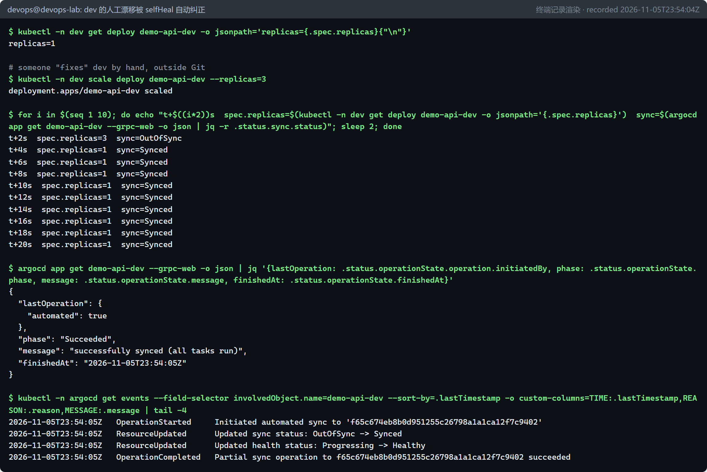
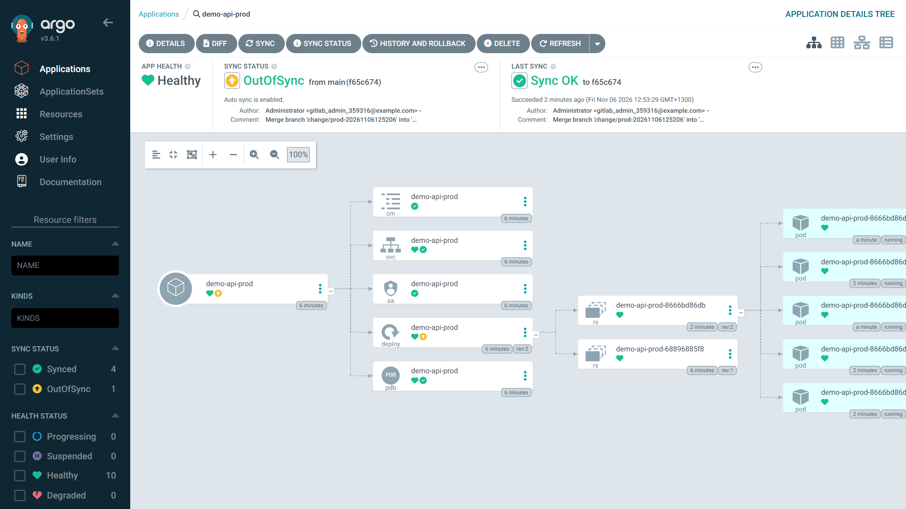
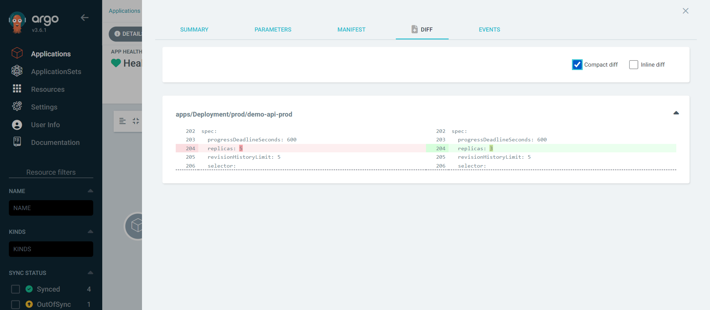
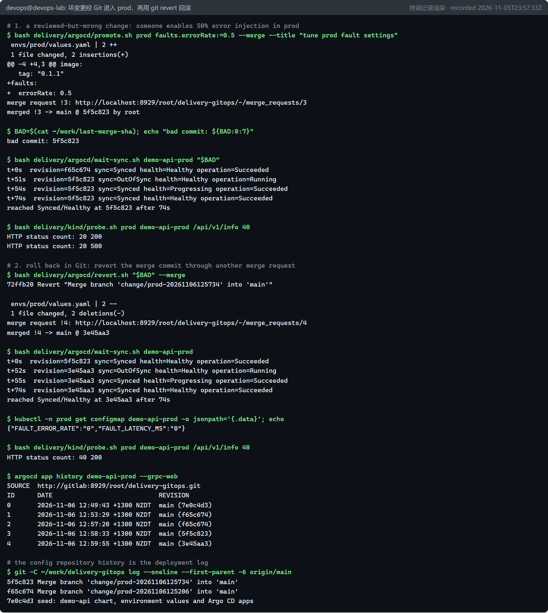
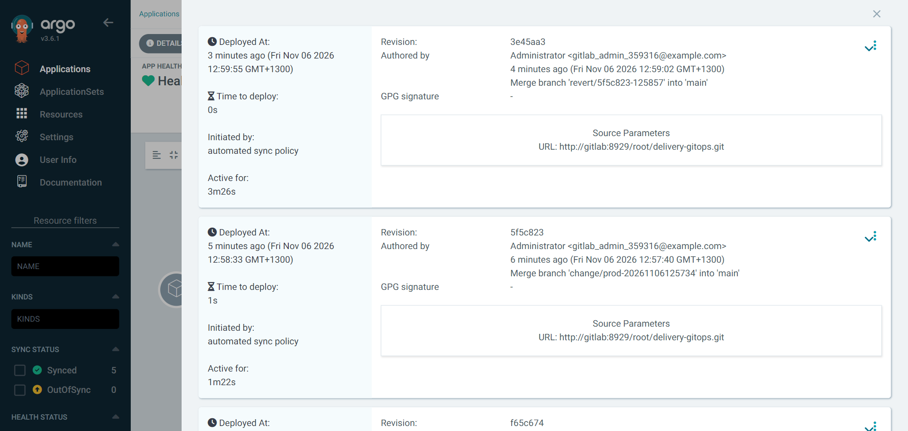

# 持续部署：GitOps 与 Argo CD（P4 / D4） {#ch-p4}

<div class="lead">第 5 章结尾留下了一个问题：`helm rollback` 修好了集群，但 Git 里的配置仍是错的，集群与“事实来源”不再一致。GitOps 的回答是：<strong>让 Git 成为期望状态的唯一来源，由集群内的控制器持续把实际状态拉向 Git</strong>。本章用 Argo CD 实现这一点，并在本地 GitLab 上建立独立的配置仓库。之后，每一次部署都是一次经过合并请求的 Git 提交；随后的漂移检测、自愈、回滚和权限护栏都有实际运行记录。</div>

## 本章目标与产出

| 产出 | 位置 |
|---|---|
| 配置仓库的种子内容（AppProject、Application、环境 values） | `delivery/gitops/` |
| 建配置仓库 + 只读访问令牌 | `delivery/argocd/seed-gitops-repo.sh` |
| 安装 Argo CD v3.6.1 并接入仓库 | `delivery/argocd/install-argocd.sh` |
| 通过合并请求变更环境 / 用 revert 回滚 | `delivery/argocd/promote.sh`、`revert.sh` |
| 等待同步完成并打印时间线 | `delivery/argocd/wait-sync.sh` |

**验收标准（路线图 D4 / Gate G2）：** 声明式部署成功，Git 漂移能被检测、解释并恢复。已通过：dev 漂移 4 秒内被自愈；prod 漂移被检测并给出精确 diff，手动同步恢复；坏变更经 `git revert` 回滚（`evidence/p4/`）。

**学完本章，你应当能够：**

- 用 OpenGitOps 的四条原则说明 GitOps 与推送式部署的区别，以及它在凭据和审计上的好处；
- 区分 Argo CD 的同步状态与健康状态，读懂两者的各种组合；
- 用 AppProject、Application、`automated`/`prune`/`selfHeal` 设计分级的环境策略；
- 通过合并请求完成发布，用 `git revert` 完成回滚，并检测和处理配置漂移。

## 原理：GitOps 与 Argo CD {#p4-principles}

### GitOps 的四条原则

CNCF 的 OpenGitOps 项目把 GitOps 归纳为四条原则：

1. **声明式（Declarative）**：系统的期望状态以声明的方式描述（Kubernetes 清单、Helm values），而不是一串命令。
2. **版本化且不可变（Versioned and Immutable）**：期望状态保存在 Git 这样有完整历史的存储中。每次变更都有作者、时间和审阅记录，可以追溯，也可以撤销。
3. **自动拉取（Pulled Automatically）**：由运行在环境内部的代理主动拉取期望状态，而不是由外部系统把变更推进来。
4. **持续调和（Continuously Reconciled）**：代理持续比较期望状态与实际状态，并消除差异。

```{.mermaid caption="推送式部署与拉取式（GitOps）部署对比"}
flowchart LR
  subgraph PUSH["推送式（传统 CI/CD）"]
    CI1["CI 流水线"] -- "kubectl apply / helm upgrade<br/>（CI 持有集群管理员凭据）" --> K1["集群"]
  end
  subgraph PULL["拉取式（GitOps）"]
    CI2["CI 流水线"] -- "提交 / 合并请求<br/>（只需 Git 写权限）" --> G["配置仓库（Git）"]
    A["Argo CD<br/>（运行在集群内）"] -- "定期拉取" --> G
    A -- "调和：apply / prune / selfHeal" --> K2["集群"]
  end
```

拉取式带来的直接好处：集群的管理员凭据不需要交给 CI 系统，攻击面更小；集群发生的任何偏离都会被检测到；回滚就是 `git revert`；Git 历史就是部署审计日志。

### Argo CD 的组成

| 组件 | 作用 |
|---|---|
| `argocd-server` | API 与 Web UI，CLI 通过它操作 |
| `argocd-repo-server` | 克隆 Git 仓库，渲染清单（Helm、Kustomize、纯 YAML），并缓存结果 |
| `argocd-application-controller` | 核心控制器：比较期望与实际状态，执行同步，计算健康状态 |
| `argocd-applicationset-controller` | 按模板批量生成 Application（多集群/多环境） |
| `argocd-redis` | 缓存 |
| `argocd-dex-server` | 单点登录（OIDC/SAML 对接），本实验未使用 |
| `argocd-notifications-controller` | 同步事件通知（Slack、邮件等），本实验未使用 |

两个状态贯穿全章，务必区分：

- **同步状态（Sync Status）**：集群中的对象是否与 Git 渲染出的清单一致——`Synced` / `OutOfSync`。
- **健康状态（Health Status）**：对象本身是否工作正常——`Healthy` / `Progressing` / `Degraded` / `Missing` 等。例如 Deployment 的 Pod 全部就绪才算 `Healthy`。

二者相互独立：后面你会看到 `OutOfSync` 但 `Healthy`（有人手动扩容到 5 个副本，服务正常但与 Git 不符），也会看到 `Synced` 但 `Progressing`（刚同步了新版本，Pod 还在滚动）。

::: principle
**Argo CD 怎么算出“健康”和“差异”。** 同步状态来自比较：repo-server 把 Git 中的 Chart 渲染成清单（期望状态），application-controller 通过 watch 维护集群对象的缓存（实际状态），两者逐字段对比（忽略 API Server 补上的默认值）。健康状态来自**健康检查**：Argo CD 为 Deployment、StatefulSet、Ingress 等内置类型写好了判断逻辑（例如 Deployment 的新副本全部可用才算 Healthy）；对 CRD，则用 Lua 脚本定义的健康检查，第 8 章的 Argo Rollouts 就是这样：Rollout 停在人工闸门时显示 `Suspended`，被分析中止时显示 `Degraded`。第 12 章会遇到 `Synced` + `Degraded` 的组合：集群中的对象与 Git 完全一致，但 Git 中的期望状态本身是坏的。

还要区分两个常被混用的动作：**Refresh** 是重新读取 Git、重新比较（`argocd app get --refresh`），不会改变集群；**Sync** 才是把期望状态应用到集群。
:::

### 应用仓库与配置仓库分离

本章把“期望部署状态”放在一个**独立的配置仓库** `delivery-gitops` 中，而不是和应用源码放在一起：

- 源码频繁变化并触发 CI；部署状态变化少，且每次变化都需要审阅和审计。
- CI 只需要对配置仓库有写权限（提交 promotion），完全不需要接触集群。
- 配置仓库的提交历史就是一份干净的部署日志。

```text
delivery-gitops/
├── apps/                  AppProject + 每个环境一个 Application
├── charts/demo-api/       第 5 章 Chart 的副本
└── envs/
    ├── dev/values.yaml    dev 的部署状态（镜像版本）
    └── prod/values.yaml   prod 的部署状态（只通过合并请求修改）
```

::: note
**为什么配置仓库放在本地 GitLab？** 本项目的 GitHub 仓库启用了“只能经审阅后合并”的规则，而 GitOps 的每一次发布都需要合并一次。为了让整个循环能在实验中完整、反复地运行，配置仓库建在第 4 章的本地 GitLab 上；种子内容保存在 GitHub 仓库的 `delivery/gitops/`，脚本的仓库地址可以通过 `GITOPS_REPO_URL` 换成任何 Git 服务器（例如一个公开的 GitHub 仓库，此时不需要任何凭据）。
:::

## 第 1 步：建立配置仓库 {#p4-seed}

`seed-gitops-repo.sh` 做三件事：通过 API 创建私有项目 `root/delivery-gitops`；仅当仓库为空时，把 `delivery/gitops/` 与 Chart 组装成首个提交并推送；为 Argo CD 创建一个**项目访问令牌**：

```bash
api -X POST "$GL/api/v4/projects/$PID/access_tokens" \
  --data-urlencode "name=argocd-read" \
  --data-urlencode "scopes[]=read_repository" \
  --data-urlencode "access_level=20" \
  --data-urlencode "expires_at=$(date -d '+30 days' +%F)"
```

`read_repository` 作用域 + Reporter 角色（`access_level=20`）：Argo CD 只能**读**这一个仓库，令牌 30 天后自动过期。即使令牌泄露，攻击者也无法改写部署状态——**最小权限原则**在 GitOps 中尤其重要，因为能写配置仓库就等于能部署到生产。

## 第 2 步：安装 Argo CD {#p4-install}

```bash
kubectl create namespace argocd --dry-run=client -o yaml | kubectl apply -f -
# Server-side apply: the Argo CD CRDs are too large for the client-side
# "last-applied-configuration" annotation.
kubectl apply -n argocd --server-side --force-conflicts \
  -f "https://raw.githubusercontent.com/argoproj/argo-cd/${ARGOCD_VERSION}/manifests/install.yaml"
```

- **按版本号固定安装清单**（`v3.6.1`），而不是 `stable` 分支。
- **服务端应用（server-side apply）**：客户端 `kubectl apply` 会把整个对象写进 `last-applied-configuration` 注解，而注解有 256 KB 的上限，Argo CD 的 Application CRD 超过了它，所以官方文档要求使用 `--server-side`。
- **`timeout.reconciliation: 60s`**：Argo CD 默认每 180 秒（另加随机抖动）检查一次 Git。实验中改为 60 秒以便观察；生产环境通常配置 Git Webhook，提交后立即通知 Argo CD。
- **`docker network connect kind gitlab`**：把 GitLab 容器加入 Kind 节点所在的 Docker 网络，集群内的 Pod 就能用 `gitlab` 这个名字访问它。安装后的验证：

```console
$ kubectl run dnscheck -n argocd --rm -i --restart=Never --image=curlimages/curl:8.23.0 -- curl -s -o /dev/null -w 'gitlab from a pod: HTTP %{http_code}\n' http://gitlab:8929/users/sign_in
gitlab from a pod: HTTP 200
```

- **仓库凭据**以带有标签 `argocd.argoproj.io/secret-type: repository` 的 Secret 形式提供，Argo CD 会自动发现它：

```yaml
apiVersion: v1
kind: Secret
metadata:
  name: repo-delivery-gitops
  namespace: argocd
  labels:
    argocd.argoproj.io/secret-type: repository
stringData:
  type: git
  url: http://gitlab:8929/root/delivery-gitops.git
  username: argocd
  password: <只读项目访问令牌，运行时从 ~/.lab-secrets 读取>
```

## 第 3 步：AppProject 与 Application {#p4-apps}

```yaml
apiVersion: argoproj.io/v1alpha1
kind: AppProject
metadata:
  name: delivery
  namespace: argocd
spec:
  sourceRepos:
    - http://gitlab:8929/root/delivery-gitops.git
  destinations:
    - server: https://kubernetes.default.svc
      namespace: dev
    - server: https://kubernetes.default.svc
      namespace: prod
  clusterResourceWhitelist: []
  namespaceResourceWhitelist:
    - group: "*"
      kind: "*"
```

AppProject 是 Argo CD 的**多租户与安全边界**：属于这个项目的应用只能使用列出的仓库、只能部署到列出的命名空间、不能创建任何集群级对象（Namespace、ClusterRole、CRD……）。第 8 步会验证它。

```yaml
apiVersion: argoproj.io/v1alpha1
kind: Application
metadata:
  name: demo-api-prod
  namespace: argocd
  finalizers:
    - resources-finalizer.argocd.argoproj.io
spec:
  project: delivery
  source:
    repoURL: http://gitlab:8929/root/delivery-gitops.git
    targetRevision: main
    path: charts/demo-api
    helm:
      releaseName: demo-api-prod
      valueFiles:
        - values-prod.yaml
        - ../../envs/prod/values.yaml
  destination:
    server: https://kubernetes.default.svc
    namespace: prod
  syncPolicy:
    automated:
      prune: true
      selfHeal: false
```

| 字段 | 含义 |
|---|---|
| `source.path` + `helm` | Argo CD 在 repo-server 中执行相当于 `helm template` 的渲染，再把结果作为普通清单应用。**集群中不会有 Helm Release**，`helm list` 看不到它 |
| `valueFiles` | 先用 Chart 内的环境默认值，再用配置仓库中该环境的部署状态覆盖；路径可以指向 Chart 目录之外，只要仍在同一仓库内 |
| `finalizers` | 删除 Application 时级联删除它管理的资源 |
| `automated` | Git 有新提交就自动同步 |
| `prune: true` | Git 中删除的对象，集群中也删除 |
| `selfHeal` | 集群中被手动修改的对象，自动改回 Git 的样子 |

dev 与 prod 的差别是有意的：**dev 开启 `selfHeal`，prod 关闭**。在生产环境，有人手动改了东西往往说明正在处理事故，直接覆盖掉可能让事情更糟；只报告漂移、由人决定何时同步，是更稳妥的选择。

## 第 4 步：把两个环境从 Helm 交接给 Argo CD {#p4-handover}

```console
$ helm uninstall demo-api-dev -n dev
release "demo-api-dev" uninstalled
$ helm uninstall demo-api-prod -n prod
release "demo-api-prod" uninstalled
$ kubectl apply -f delivery/gitops/apps/project.yaml -f delivery/gitops/apps/demo-api-dev.yaml -f delivery/gitops/apps/demo-api-prod.yaml
appproject.argoproj.io/delivery created
application.argoproj.io/demo-api-dev created
application.argoproj.io/demo-api-prod created
$ argocd app list --grpc-web
NAME                  CLUSTER                         NAMESPACE  PROJECT   STATUS  HEALTH   SYNCPOLICY  ...  TARGET
argocd/demo-api-dev   https://kubernetes.default.svc  dev        delivery  Synced  Healthy  Auto-Prune  ...  main
argocd/demo-api-prod  https://kubernetes.default.svc  prod       delivery  Synced  Healthy  Auto-Prune  ...  main
$ argocd app get demo-api-prod --grpc-web
Sync Status:        Synced to main (7e0c4d3)
Health Status:      Healthy
GROUP   KIND                 NAMESPACE  NAME           STATUS  HEALTH   HOOK  MESSAGE
policy  PodDisruptionBudget  prod       demo-api-prod  Synced  Healthy        poddisruptionbudget.policy/demo-api-prod created
        ServiceAccount       prod       demo-api-prod  Synced                 serviceaccount/demo-api-prod created
        ConfigMap            prod       demo-api-prod  Synced                 configmap/demo-api-prod created
        Service              prod       demo-api-prod  Synced  Healthy        service/demo-api-prod created
apps    Deployment           prod       demo-api-prod  Synced  Healthy        deployment.apps/demo-api-prod created
$ kubectl -n prod get deploy demo-api-prod -o jsonpath='{.spec.template.spec.containers[0].image}{"\n"}'
localhost:5001/demo-api:0.1.0
```

两个应用都在 45 秒内达到 `Synced` + `Healthy`，镜像版本与 `envs/*/values.yaml` 一致（dev 0.1.1、prod 0.1.0）。注意资源列表里**没有** Chart 中的 `helm test` Pod：Argo CD 只把一部分 Helm 钩子映射为自己的同步钩子，`test` 钩子不在其中，渲染时被跳过——在 GitOps 中，冒烟测试通常改用 Argo CD 的 `PostSync` 钩子实现。

## 第 5 步：发布 = 合并一个合并请求 {#p4-promote}

`promote.sh` 封装了“修改某个环境的部署状态”的标准流程：克隆配置仓库 → 新建分支 → 用 `yq` 修改 `envs/<env>/values.yaml` → 提交、推送 → 创建合并请求 →（可选）合并。把 prod 从 0.1.0 升级到 0.1.1：

```console
$ bash delivery/argocd/promote.sh prod image.tag=0.1.1 --merge --title "promote demo-api 0.1.1 to prod"
 envs/prod/values.yaml | 2 +-
 1 file changed, 1 insertion(+), 1 deletion(-)
@@ -3,2 +3,2 @@ image:
   repository: localhost:5001/demo-api
-  tag: "0.1.0"
+  tag: "0.1.1"
merge request !2: http://localhost:8929/root/delivery-gitops/-/merge_requests/2
merged !2 -> main @ f65c674 by root

# no "argocd app sync": Argo CD notices the new commit on its next poll (<= 60s in this lab)
$ bash delivery/argocd/wait-sync.sh demo-api-prod
t+1s  revision=7e0c4d3 sync=Synced health=Healthy operation=Succeeded
t+81s  revision=f65c674 sync=Synced health=Progressing operation=Succeeded
t+103s  revision=f65c674 sync=Synced health=Healthy operation=Succeeded
reached Synced/Healthy at f65c674 after 103s
```

整个过程中**没有任何人对集群执行命令**：合并之后，Argo CD 在下一次轮询（60 秒间隔加上随机抖动，这次是第 81 秒）发现了新提交，自动同步；随后 Deployment 滚动更新（`Progressing`），22 秒后全部就绪（`Healthy`）。

::: warning
**一个真实的竞态问题。** `promote.sh` 的第一版在 `git push` 之后立即调用 API 创建合并请求，结果返回 HTTP 400。原因是 GitLab 在后台任务中异步处理推送，分支在数据库中“出现”需要一点时间。修复方法是在创建合并请求前轮询 `GET /repository/branches/<分支名>`，直到分支可见。自动化脚本调用“最终一致”的系统时，要等待状态就绪，而不能假设上一步完成后状态立刻可见。
:::

## 第 6 步：漂移检测与自愈 {#p4-drift}

**dev（`selfHeal: true`）。** 模拟有人绕过 Git、直接在集群里把副本数改成 3：



自愈几乎是即时的。原因在于：检测 **Git 变化**依靠轮询（分钟级）；而检测**集群变化**依靠 Kubernetes 的 watch 机制，对象一被修改，控制器就会收到事件。事件记录中的 `Partial sync operation` 说明自愈只重新应用了偏离的那个对象。

**prod（`selfHeal: false`）。** 同样手动扩容到 5 个副本：

```console
$ kubectl -n prod scale deploy demo-api-prod --replicas=5
$ argocd app get demo-api-prod --grpc-web | grep -E 'Sync Status|Health Status|Deployment'
Sync Status:        OutOfSync from main (f65c674)
Health Status:      Healthy
apps    Deployment           prod       demo-api-prod  OutOfSync  Healthy        deployment.apps/demo-api-prod configured
$ argocd app diff demo-api-prod --grpc-web
===== apps/Deployment prod/demo-api-prod ======
204c204
<   replicas: 5
---
>   replicas: 3
[exit 1]
```





漂移被检测、被精确解释（第 204 行，replicas 5 → 3），但没有被自动覆盖。确认后由人执行同步：

```console
$ argocd app rollback demo-api-prod 0 --grpc-web
{"level":"fatal","msg":"rpc error: code = FailedPrecondition desc = rollback cannot be initiated when auto-sync is enabled", ...}
[exit 20]
$ argocd app sync demo-api-prod --grpc-web --timeout 180
Sync Status:        Synced to main (f65c674)
Phase:              Succeeded
$ kubectl -n prod get deploy demo-api-prod -o jsonpath='spec.replicas={.spec.replicas} ready={.status.readyReplicas}{"\n"}'
spec.replicas=3 ready=3
```

第一条命令的失败是有意义的：开启自动同步时，Argo CD **拒绝**回滚到历史版本——如果允许，下一次自动同步又会立刻把它改回 Git 的最新状态。在 GitOps 中，回滚应当发生在 Git 里。

## 第 7 步：在 Git 中回滚一次坏变更 {#p4-revert}

这是第 5 章坏配置演练的 GitOps 版本：一个“看起来合理”的合并请求把 prod 的错误注入率改成了 0.5；发现后，用 `git revert` 撤销它。

{height=128mm}

`revert.sh` 对合并提交执行 `git revert -m 1`（保留第一个父提交，即 main 作为主线），同样通过合并请求进入 main。和 `helm rollback` 相比，这次回滚之后：**Git 与集群一致**；回滚本身也是一次有审阅记录的变更；没有人需要集群凭据。

Argo CD 的历史面板记录了每一次部署，以及每个版本“存活”了多久——坏版本 `5f5c823` 在生产中存活了 **1 分 22 秒**，这正是复盘时需要的“影响持续时间”：



配置仓库的主线历史就是一份部署日志：

```console
$ git -C ~/work/delivery-gitops log --format='%h  %an  %s' --first-parent -6 origin/main
3e45aa3  Administrator  Merge branch 'revert/5f5c823-125857' into 'main'
5f5c823  Administrator  Merge branch 'change/prod-20261106125734' into 'main'
f65c674  Administrator  Merge branch 'change/prod-20261106125206' into 'main'
7e0c4d3  Lab Seeder  seed: demo-api chart, environment values and Argo CD apps
```

## 第 8 步：AppProject 护栏 {#p4-guardrails}

尝试在 `delivery` 项目下创建一个部署到 `kube-system` 的应用：

```console
$ argocd app create sneaky-app --grpc-web --project delivery --repo http://gitlab:8929/root/delivery-gitops.git --path charts/demo-api --dest-server https://kubernetes.default.svc --dest-namespace kube-system
{"level":"fatal","msg":"rpc error: code = InvalidArgument desc = application spec for sneaky-app is invalid: InvalidSpecError: application destination server 'https://kubernetes.default.svc' and namespace 'kube-system' do not match any of the allowed destinations in project 'delivery'", ...}
[exit 20]
```

即使有人能修改配置仓库，也无法借 `delivery` 项目把东西部署到系统命名空间。

## 工程决策：GitOps 中的密钥 {#p4-secrets}

GitOps 要求“期望状态全部在 Git 中”，但密码、令牌、证书私钥不能以明文进入 Git：Git 历史无法真正删除，仓库会被克隆、被 fork，CI 日志也可能打印出文件内容。Kubernetes 的 Secret 对象只是 base64 编码，**不是加密**，提交它和提交明文没有区别。这是每个 GitOps 项目都必须做出的工程决策。

**本项目的做法。** 实验中的所有凭据都在运行时生成，保存在 WSL 中的 `~/.lab-secrets/`（文件权限 600，不在仓库内），由安装脚本直接创建为 Secret：Argo CD 读取配置仓库的令牌（`install-argocd.sh`）、Grafana 的管理员密码（`install-monitoring.sh`）、GitLab 的 root 密码与令牌（`gitlab-up.sh`）。Git 中只出现对它们的引用（例如 `existingSecret: grafana-admin`）。这种“带外”（out-of-band）管理对单人实验足够，但有明显的缺点：密钥不在 Git 中，Argo CD 看不到它们的漂移；在另一台机器上重建环境时，要重新运行这些脚本；没有轮换和审计。

生产环境常用的四类方案：

| 方案 | 工作方式 | Git 中存放什么 | 优点 | 代价 |
|---|---|---|---|---|
| Sealed Secrets | 集群内的控制器持有私钥；开发者用公钥把 Secret 加密成 SealedSecret | 密文 | 纯 GitOps，概念简单 | 私钥的备份与轮换；密文与集群绑定，换集群要重新加密 |
| SOPS（配合 age 或云 KMS） | 只加密 YAML 中的值，保留键名；Argo CD 通过插件解密 | 字段级密文 | diff 仍然可读；可以用多个 KMS 的密钥 | Argo CD 需要额外的插件；解密密钥本身要分发 |
| External Secrets Operator | 控制器按 Git 中的引用，从 Vault 或云密钥管理服务读取数据，生成 Secret | 只有引用（ExternalSecret） | 密钥不进 Git；集中轮换和审计 | 依赖外部系统的可用性；多了一个要运维的组件 |
| Secrets Store CSI Driver | 把外部密钥作为文件挂载进 Pod，可以不生成 Secret 对象 | 只有引用 | 密钥不必存入 etcd | 应用要从文件读取；与环境变量方式不兼容 |

选择时考虑三个问题：密钥的“事实来源”在哪里（Git 中的密文，还是外部的密钥管理系统）；谁能解密（集群、开发者、CI 各自需要什么权限）；怎样轮换和吊销（第 4 章 Runner 令牌泄露的教训：吊销必须快，而且可以审计）。无论选哪种，都要同时打开 etcd 的静态加密，并用 RBAC 限制谁能读取 Secret，因为最终落在集群里的仍然是 Secret 对象（CSI 方式除外）。小团队从 SOPS 或 Sealed Secrets 起步最简单；已经有 Vault 或云 KMS 的组织，External Secrets Operator 更合适。

## 常见问题

**Q1：应用一直 `OutOfSync`，但 diff 中只看到默认字段（例如 `imagePullPolicy`、`terminationMessagePath`）。**
清单省略了这些字段，API Server 补上了默认值，或者有准入 Webhook 修改了对象。在清单中写出这些字段，或者在 Application 中配置 `ignoreDifferences`。

**Q2：Git 已经提交，Argo CD 迟迟不同步。**
默认 3 分钟轮询（加抖动）。可以执行 `argocd app get <app> --refresh` 立即刷新；生产环境配置 Git Webhook。

**Q3：`argocd app rollback` 报 “rollback cannot be initiated when auto-sync is enabled”。**
这是设计如此。用 `git revert` 回滚；确需临时回滚，先关闭自动同步，事后再把 Git 修正回来。

**Q4：repo-server 报无法解析 Git 主机名或认证失败。**
从 Pod 内部测试连通性（本章的 `dnscheck`）；检查仓库 Secret 的标签和 URL 是否与 Application 中的 `repoURL` 完全一致。

**Q5：Helm Chart 的 `test` 钩子没有执行。**
Argo CD 不支持 Helm 的 `test` 钩子。冒烟测试可以改写为带 `argocd.argoproj.io/hook: PostSync` 注解的 Job。

**Q6：自动化脚本在 `git fetch` 时卡住不动。**
本实验遇到过：克隆时通过环境变量提供了认证头，后续的 `git fetch` 没有提供，Git 打开 `/dev/tty` 交互式询问用户名，进程一直等待（重定向 stdin 也拦不住）。在自动化环境中设置 `GIT_TERMINAL_PROMPT=0`，缺少凭据时立即失败，而不是挂起。

## 练习 {#p4-exercises}

::: exercise
1. **（理解）** 同步状态和健康状态有四种常见组合：Synced + Healthy、Synced + Degraded、OutOfSync + Healthy、Synced + Progressing。分别说明含义，并从本书中各找一个真实出现过的例子。
2. **（动手）** 假设 dev 将来启用 HPA（自动扩缩容）。HPA 会不断修改 `spec.replicas`，开启了 selfHeal 的 Argo CD 会怎么做？用 Application 的 `ignoreDifferences` 解决这个冲突，并验证手动扩容后同步状态的变化。
3. **（安全）** 本章给 Argo CD 的是只读、30 天过期的项目令牌。如果图省事改用 root 的个人访问令牌，会扩大哪些风险？“能写配置仓库就等于能部署生产”意味着配置仓库需要哪些保护措施？
4. **（排障）** 合并请求已经合并 5 分钟，Argo CD 仍然没有同步。按顺序列出你的排查步骤。
5. **（设计）** prod 关闭了 selfHeal。举一个开启 selfHeal 会让事故恶化的例子，再举一个关闭 selfHeal 会带来风险的例子。
6. **（思考）** 自动同步开启时，`argocd app rollback` 被拒绝。在 GitOps 中，最快的“紧急回滚”是什么？怎样在速度和审计之间取得平衡？
:::

参考答案见附录 B。

## 本章小结

- GitOps：期望状态以声明方式保存在 Git，由集群内代理拉取并持续调和；部署 = 合并，回滚 = revert，Git 历史 = 部署日志。
- Argo CD 区分“同步状态”与“健康状态”；`automated`、`prune`、`selfHeal` 三个开关决定它有多“主动”。dev 自愈、prod 只报告，是一种常见的分级策略。
- 本章实测：Git 变更约 81 秒内被拾取并在 103 秒内完成发布；集群漂移约 2–4 秒内被自愈；prod 漂移给出精确到行的 diff；坏变更通过 `git revert` 回滚，坏版本在生产中存活了 1 分 22 秒。
- AppProject 把仓库来源、目标命名空间与资源类型限制在可控范围内。
