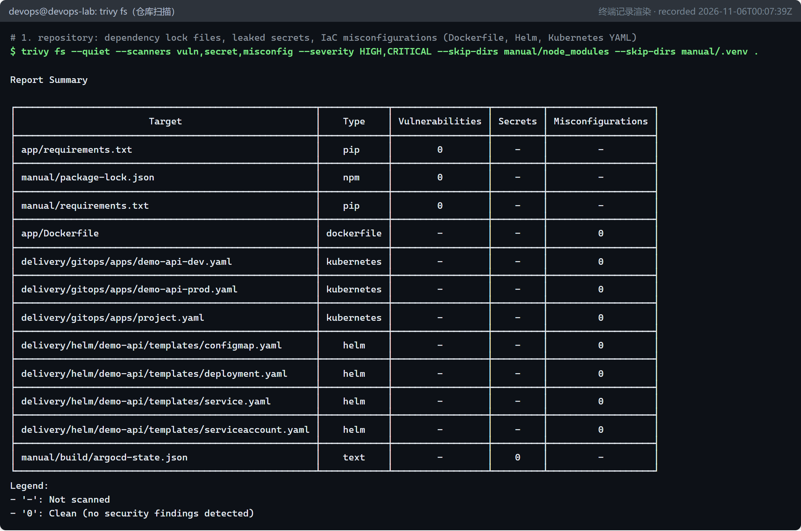
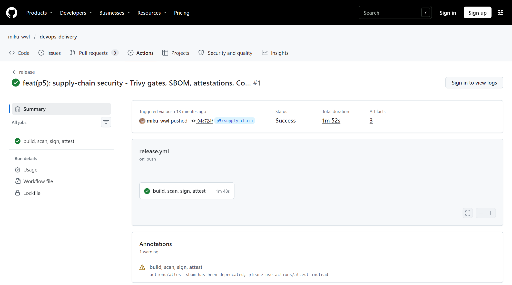
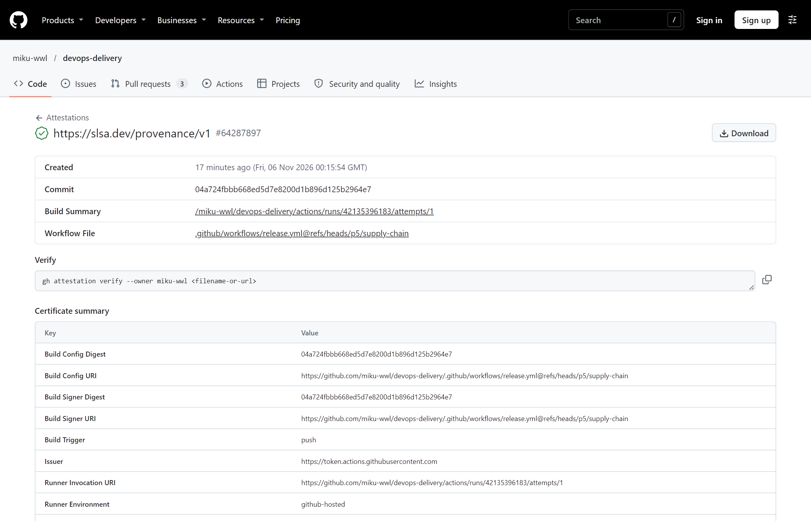
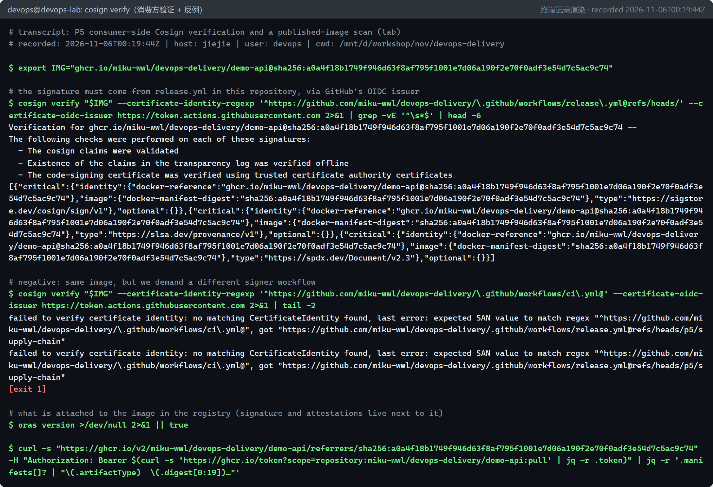
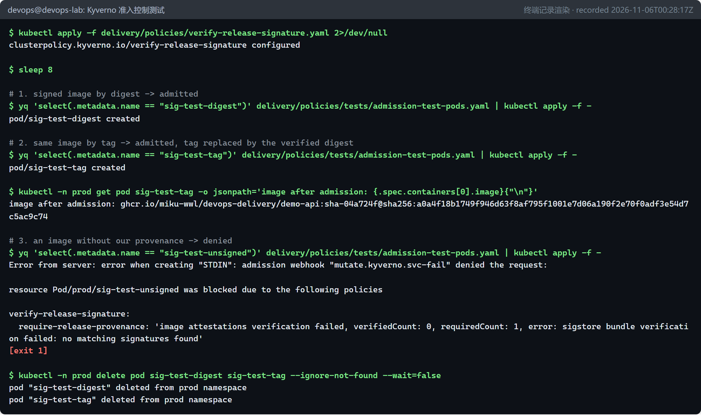
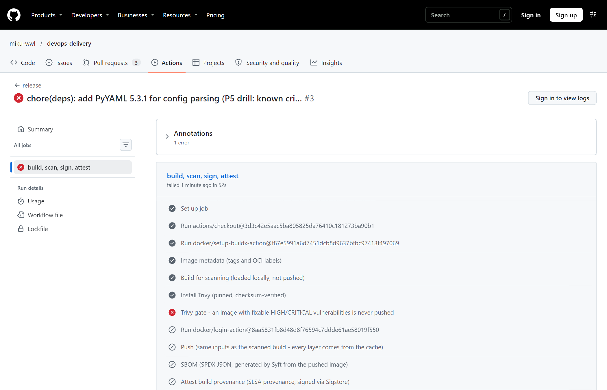

# 软件供应链安全：扫描、SBOM、签名与来源证明（P5 / D5） {#ch-p5}

<div class="lead">前面几章解决了“怎么把代码可靠地送到生产”。本章回答另一个问题：<strong>送到生产的东西，可信吗？</strong>我们用 Trivy 在代码和镜像两个层面设立漏洞门禁，并完成了一次真实的漏洞修复；用 GitHub Actions 发布按 digest 引用、附带 SBOM、SLSA 来源证明和 Sigstore 无密钥签名的镜像，再以消费者身份独立验证；同一个 digest 经 GitOps 从 dev 晋级到 prod；最后用 Kyverno 让集群在准入阶段就拒绝来历不明的镜像。</div>

## 本章目标与产出

| 产出 | 位置 |
|---|---|
| CI 中的 Trivy 门禁（仓库扫描 + 镜像扫描） | `.github/workflows/ci.yml`（`security`、`container image`） |
| 发布流水线：扫描 → 推送 → SBOM → 证明 → 签名 → 验证 | `.github/workflows/release.yml` |
| 固定版本、校验和验证的 Trivy 安装脚本 | `automation/ci/install-trivy.sh` |
| 准入策略与测试 Pod | `delivery/policies/` |

**验收标准（路线图 D5 / Gate G3）：** 漏洞策略阻断不合格发布；签名/来源证明验证通过；同一镜像 digest 在环境间晋级。三项均已通过（`evidence/p5/`）。

**学完本章，你应当能够：**

- 说出软件供应链从源码到运行的每个环节面临的攻击，以及对应的防线；
- 设计“只阻断可修复的高危漏洞”的扫描门禁，并真正修复（而不是忽略）一个漏洞；
- 解释 Sigstore 无密钥签名的完整流程，以及签名、SLSA 来源证明、SBOM 证明三者的区别；
- 以消费者身份独立验证镜像的来源，只按 digest 晋级制品；
- 用准入控制让集群拒绝来历不明的镜像。

## 原理：软件供应链的攻击面与防线 {#p5-principles}

```{.mermaid caption="从源码到运行：每个环节对应的防线"}
flowchart LR
  S["源码<br/>（依赖、配置）"] --> B["构建<br/>（CI Runner）"] --> A["制品<br/>（镜像）"] --> R["镜像仓库"] --> D["部署<br/>（GitOps）"] --> K["运行<br/>（集群）"]
  S -.- C1["Trivy fs：依赖漏洞、<br/>泄露的密钥、IaC 错误配置"]
  B -.- C2["固定 Action SHA、最小权限、<br/>OIDC 代替长期密钥"]
  A -.- C3["Trivy image 门禁、SBOM"]
  R -.- C4["按 digest 引用、<br/>Cosign 签名 + SLSA 来源证明"]
  D -.- C5["只晋级已验证的 digest"]
  K -.- C6["Kyverno 准入：<br/>没有来源证明就拒绝"]
```

近年的真实事件说明，攻击者越来越多地瞄准“交付链条”本身，而不仅是应用代码：SolarWinds 事件中，构建系统被植入后门，用户安装的是带有合法签名的恶意版本；2025 年 `tj-actions/changed-files` 被攻破，大量 CI 流水线的密钥泄露到公开日志中（第 3 章已介绍）。这类事件的共同点是：**仅凭镜像的名字和标签，无法知道它从哪里来、由什么构建、是否被篡改。**

### 漏洞扫描：先弄清“能不能修”

漏洞扫描器把镜像或锁文件中的每个软件包版本，与漏洞数据库中的 CVE 记录比对。每条结果有两个关键属性：

- **严重级别**（CRITICAL / HIGH / MEDIUM / LOW），通常来自 CVSS 评分；
- **修复状态**：`fixed`（上游已发布修复版本）、`affected`（受影响但暂无修复）、`will_not_fix`（发行版决定不修）、`fix_deferred`（推迟修复）等。

一个可执行的门禁策略必须区分二者。本项目的策略是：**阻断“有修复版本的 HIGH/CRITICAL”**（`--severity HIGH,CRITICAL --ignore-unfixed --exit-code 1`）。暂无修复的漏洞不阻断发布——阻断了也没有可行的修复动作——但要持续跟踪：上游一发布修复，下一次构建就会被门禁拦下，迫使你升级。

### SBOM：软件物料清单

SBOM（Software Bill of Materials）列出制品中包含的全部组件及其版本、许可证。它最大的价值体现在下一次“Log4Shell”式事件中：当一个广泛使用的组件曝出漏洞时，有 SBOM 的组织可以在几分钟内回答“我们哪些镜像受影响”。主流格式有 SPDX（Linux 基金会，ISO/IEC 5962）和 CycloneDX（OWASP）。本项目生成 SPDX 2.3 JSON。

### 签名与来源证明：Sigstore 与 SLSA

- **digest 与 tag。** `demo-api:0.1.1` 这样的 tag 是可变的指针，随时可以指向另一份内容；`demo-api@sha256:a0a4...` 是内容的哈希，内容变了 digest 就变。签名、晋级、部署都应当针对 digest。
- **Sigstore 无密钥签名。** 传统签名需要保管私钥，而私钥本身就是高价值目标。Sigstore 的思路是：CI 作业向 GitHub 申请一个 OIDC 身份令牌（“我是 `miku-wwl/devops-delivery` 仓库 `release.yml` 工作流的某次运行”），用它向 **Fulcio** 证书机构换取一张只有 10 分钟有效期、写明该身份的短期证书，用临时私钥签名后立即丢弃私钥，签名事件记录到公开、只追加的透明日志 **Rekor**。验证者不用信任某把密钥，而是验证“这个签名来自**哪个身份**”。
- **签名 vs 来源证明（attestation）。** 签名只说明“某身份认可这个 digest”；来源证明是一份**被签名的声明**（in-toto statement），说明关于这个 digest 的事实，例如 SLSA 来源证明记录了构建它的仓库、提交、工作流、触发事件和 Runner 类型；SBOM 证明则把 SBOM 与 digest 绑定。
- **SLSA**（Supply-chain Levels for Software Artifacts）是一套分级框架。使用 GitHub 托管 Runner 加 GitHub 生成的来源证明，可以满足 SLSA Build Level 2 的要求：来源证明由托管的构建平台生成并签名，构建者本人无法伪造。

```{.mermaid caption="Sigstore 无密钥签名与验证：身份由 OIDC 证明，时间由透明日志证明"}
sequenceDiagram
  autonumber
  participant J as CI 作业（release.yml）
  participant O as GitHub OIDC
  participant F as Fulcio（证书机构）
  participant R as Rekor（透明日志）
  participant G as GHCR（镜像仓库）
  participant V as 验证者（cosign / Kyverno）
  J->>O: 申请身份令牌（需要 id-token: write）
  O-->>J: JWT：仓库、工作流、分支、提交……
  J->>J: 生成一次性密钥对
  J->>F: 公钥 + JWT
  F-->>J: 短期证书（约 10 分钟），SAN = 工作流身份
  J->>J: 用私钥签名镜像 digest，随即丢弃私钥
  J->>R: 记录签名与证书
  R-->>J: 带时间戳的收录证明
  J->>G: 签名包（证书 + 签名 + 收录证明）挂到 digest 上
  V->>G: 取回签名包
  V->>V: 证书链能追溯到 Fulcio 根证书？<br/>SAN 与签发者符合预期？
  V->>V: 收录证明有效，且签名时间落在证书有效期内？
```

::: principle
**证书只有 10 分钟有效，为什么一年后还能验证？** 验证者并不检查“证书现在是否有效”，而是检查“签名发生时证书是否有效”。签名时间不能由签名者自己声称（它可以伪造），而是由 Rekor 证明：每一条签名都写进公开、只追加的透明日志，日志返回带时间戳的收录证明。只要签名时间落在证书的 10 分钟有效期内，签名就永远可验证。这带来两个好处：没有需要长期保管、可能泄露的私钥；任何签名都公开可查，项目方可以监控日志，发现有人冒用自己的身份签名。验证时真正要配置的只有两件事：**签发者**（谁颁发的身份，这里是 GitHub Actions 的 OIDC 服务）和**身份**（证书中的 SAN，这里是本仓库的 `release.yml`）。
:::

## 第 1 步：本地扫描，以及一次真实的修复 {#p5-remediation}

先在实验环境里对仓库和镜像各扫一遍：



仓库是干净的。但镜像扫描发现了问题：Debian 系统包有 46 个 HIGH（全部暂无修复），另有 **5 个有修复版本的 HIGH**，门禁失败：

```console
Python (python-pkg)
Total: 5 (HIGH: 5, CRITICAL: 0)
│ msgpack    │ CVE-2026-114613     │ HIGH │ fixed │ 1.1.2  │ 1.2.3  │ msgpack: Denial of Service via memory leak ...
│            │ GHSA-6v7p-g79w-8964 │      │       │        │ 1.2.1  │ MessagePack for Python: Out-of-bounds read ...
│ setuptools │ CVE-2025-47273      │      │       │ 70.3.0 │ 78.1.1 │ setuptools: Path Traversal Vulnerability ...
│ urllib3    │ CVE-2026-97687      │      │       │ 2.7.0  │ 2.8.0  │ urllib3: Traffic interception via HTTPS proxy ...
│            │ CVE-2026-97689      │      │       │        │        │ urllib3: Denial of Service via unbounded memory ...
[exit 1]
```

奇怪的是，我们的锁文件里根本没有 msgpack、setuptools、urllib3。追查它们的位置：

```console
$ docker run --rm --entrypoint sh localhost:5001/demo-api:0.1.1 -c 'ls -d /usr/local/lib/python3.13/site-packages/pip/_vendor/msgpack /usr/local/lib/python3.13/site-packages/pip/_vendor/urllib3; pip --version'
/usr/local/lib/python3.13/site-packages/pip/_vendor/msgpack
/usr/local/lib/python3.13/site-packages/pip/_vendor/urllib3
pip 26.2.2 from /usr/local/lib/python3.13/site-packages/pip (python 3.13)
```

它们是基础镜像中 **pip 自带（vendored）的副本**。应用运行时根本不需要 pip。正确的修复不是加一条忽略规则，而是在运行时镜像里删除 pip：

```dockerfile
RUN useradd --uid 10001 --no-create-home --shell /usr/sbin/nologin app \
 # pip is only needed at build time. Its vendored copies of urllib3, msgpack and
 # setuptools were flagged by Trivy (HIGH, fix available); removing pip from the
 # runtime image removes them and means nobody can "pip install" inside a container.
 && python -m pip uninstall --yes --quiet pip \
 && rm -rf /usr/local/lib/python3.13/ensurepip
```

重新构建、重新扫描：

```console
$ docker run --rm --entrypoint sh localhost:5001/demo-api:0.2.0 -c 'python -m pip --version 2>&1 | tail -1'
/usr/local/bin/python: No module named pip
$ trivy image --quiet --severity HIGH,CRITICAL --ignore-unfixed --exit-code 1 localhost:5001/demo-api:0.2.0
$ echo "gate exit code: $?"
gate exit code: 0
$ trivy image ... --format json localhost:5001/demo-api:0.2.0 | jq '... 按修复状态统计 ...'
affected: 45, fix_deferred: 1
```

门禁通过。剩下的 46 个都是 Debian 尚未提供修复的系统包问题，按策略接受并跟踪。两个值得注意的细节：

- 镜像大小没有变（仍是 202 MB）：基础镜像层里的 pip 仍然存在，上层的删除只是“遮盖”。扫描器分析的是**最终的合并文件系统**，所以漏洞消失了；要真正减小体积，需要多阶段构建或更小的基础镜像（如 distroless）。
- 删除 pip 本身也是一种加固：入侵者无法在容器里 `pip install` 工具。

## 第 2 步：把扫描变成 CI 门禁 {#p5-ci-gates}

在 `ci.yml` 中增加两道门：

```yaml
  security:
    name: security
    runs-on: ubuntu-latest
    steps:
      - uses: actions/checkout@3d3c42e5aac5ba805825da76410c181273ba90b1 # v7.0.1
        with:
          persist-credentials: false
      - name: Install Trivy (pinned, checksum-verified)
        run: bash automation/ci/install-trivy.sh
      - name: Trivy repository scan - dependencies, leaked secrets, IaC misconfigurations
        # manual/ holds build tooling for the PDF manual; it is not shipped.
        run: >-
          trivy fs --scanners vuln,secret,misconfig --severity HIGH,CRITICAL
          --ignore-unfixed --exit-code 1 --skip-dirs manual .
```

以及在 `container image` 作业中、冒烟测试之前：

```yaml
      - name: Trivy image scan - block fixable HIGH/CRITICAL vulnerabilities
        run: trivy image --severity HIGH,CRITICAL --ignore-unfixed --exit-code 1 demo-api:ci
```

为什么不用现成的 Trivy Action，而是自己写一个安装脚本？`install-trivy.sh` 从 Trivy 的 GitHub Release 下载固定版本（`automation/lab/versions.env` 中的 `TRIVY_VERSION`，与实验环境相同），并用同一发布的 `checksums.txt` 校验后才安装。**少依赖一个第三方 Action，就少一个需要信任的环节**——这正是本章要防范的风险。

::: note
`container image` 已经是规则集的必需检查，所以镜像门禁立即具有阻断力。新增的 `security` 作业暂时不能加入必需检查：被 #1 等尚未合并的 PR 中不存在这个作业，一旦设为必需，它们会永远等待一个不会出现的检查。合并后再把 `security` 加入规则集。另外，`ci.yml` 只在以 main 为目标的 PR 上运行，此后各阶段新增的清单没有经过这道扫描，第 12 章才发现了这个缺口的后果。
:::

## 第 3 步：发布流水线 {#p5-release}

`release.yml` 在 main（以及本实验的 `p5/**` 分支）上推送时运行，按顺序执行：

```yaml
    permissions:
      contents: read
      packages: write      # push to ghcr.io with GITHUB_TOKEN
      id-token: write      # OIDC token for keyless signing and attestations
      attestations: write  # store attestations in the repository
    steps:
      # ... checkout, buildx, metadata ...
      - name: Build for scanning (loaded locally, not pushed)
        uses: docker/build-push-action@c3c9e263c25d99ce0380d002d59b67737d91b0dc # v7.4.0
        with: { context: app, load: true, tags: demo-api:scan, ... cache-to: type=gha,mode=max,scope=release }
      - name: Trivy gate - an image with fixable HIGH/CRITICAL vulnerabilities is never pushed
        run: trivy image --severity HIGH,CRITICAL --ignore-unfixed --exit-code 1 demo-api:scan
      - uses: docker/login-action@8aa5831fb8d48d8f76594c7ddde61ae58019f550 # v4.8.0
        with: { registry: ghcr.io, username: "${{ github.actor }}", password: "${{ secrets.GITHUB_TOKEN }}" }
      - name: Push (same inputs as the scanned build - every layer comes from the cache)
        id: push
        uses: docker/build-push-action@c3c9e263c25d99ce0380d002d59b67737d91b0dc # v7.4.0
        with: { context: app, push: true, provenance: false, sbom: false, tags: ..., cache-from: type=gha,scope=release }
      - name: SBOM (SPDX JSON, generated by Syft from the pushed image)
        uses: anchore/sbom-action@66cbf4bc1f1c0d2edc94016e65bc221b6bb0ad6c # v0.24.3
      - name: Attest build provenance (SLSA provenance, signed via Sigstore)
        uses: actions/attest-build-provenance@4d101475d8b20a2381f78447822ac1eab6504dd8 # v4.2.2
        with: { subject-name: "${{ env.IMAGE }}", subject-digest: "${{ steps.push.outputs.digest }}", push-to-registry: true }
      - name: Attest SBOM
        uses: actions/attest@1e69f48acb82d1966a394da916b4c1698aa569d6 # v4.2.2
        with: { subject-name: ..., subject-digest: ..., sbom-path: sbom.spdx.json, push-to-registry: true }
      - uses: sigstore/cosign-installer@756fe2d284c7292c4e9b62c8a28f1e5629c59532 # v4.1.3
        with: { cosign-release: v3.1.4 }
      - name: Cosign keyless signature (identity = this workflow, via GitHub OIDC)
        run: cosign sign --yes "${IMAGE}@${DIGEST}"
      - name: Verify signature and attestations like a consumer would
        run: |
          cosign verify "${IMAGE}@${DIGEST}" \
            --certificate-identity "https://github.com/${GITHUB_WORKFLOW_REF}" \
            --certificate-oidc-issuer https://token.actions.githubusercontent.com
          gh attestation verify "oci://${IMAGE}@${DIGEST}" --repo "${GITHUB_REPOSITORY}"
```

设计要点：

- **先扫描、后推送。** 第一次构建只加载到 Runner 本地，扫描通过才推送；第二次构建的输入完全相同，所有层都来自缓存，几乎不花时间。有漏洞的镜像**根本不会出现在镜像仓库里**。
- **作业级权限。** 只有这个作业拿到 `packages: write`（推送）、`id-token: write`（申请 OIDC 令牌）、`attestations: write`；工作流默认仍是只读。
- **`provenance: false`、`sbom: false`。** BuildKit 也能生成自己的来源证明，但会把镜像变成多清单索引；这里由 GitHub 的证明 Action 统一生成，镜像保持为单一清单，digest 语义更简单。
- **用消费者的方式自检。** 签名后立刻按“消费者会怎么验证”的方式验证一次，验证失败则整个发布失败。

第一次运行用时 1 分 48 秒，全部成功：



运行日志中的关键结果（节选自 `evidence/p5/release-run.log`）：

```console
#16 pushing manifest for ghcr.io/miku-wwl/devops-delivery/demo-api:sha-04a724f@sha256:a0a4f18b1749f946d63f8af795f1001e7d06a190f2e70f0adf3e54d7c5ac9c74 0.4s done
Attestation created for ghcr.io/miku-wwl/devops-delivery/demo-api@sha256:a0a4f18b1749f946d63f8af795f1001e7d06a190f2e70f0adf3e54d7c5ac9c74
https://github.com/miku-wwl/devops-delivery/attestations/64287897
https://github.com/miku-wwl/devops-delivery/attestations/64287939
Generating ephemeral keys...
Signing artifact...
Pushing signature to: ghcr.io/miku-wwl/devops-delivery/demo-api
```

GitHub 为每份证明提供了公开页面，清楚列出这个 digest 由哪个提交、哪个工作流、在哪类 Runner 上构建：



::: note
运行页面上还出现了一条官方注解：*“actions/attest-sbom has been deprecated, please use actions/attest instead”*。`actions/attest` 接受相同的 `sbom-path` 等输入，本章已据此迁移（见上面的工作流片段）。依赖的弃用通知应当及时处理，而不是等它某天突然失效。
:::

**GHCR 可见性。** 新推送的包能否被匿名拉取，决定了 Kind 节点能不能直接使用它。用匿名令牌请求清单验证：

```console
$ curl -s "https://ghcr.io/token?scope=repository:miku-wwl/devops-delivery/demo-api:pull"
{"token":"djE6bWlr...="}
$ curl ... -H "Authorization: Bearer $T" "https://ghcr.io/v2/miku-wwl/devops-delivery/demo-api/manifests/sha256:a0a4f18b..."
anonymous manifest fetch: HTTP 200
```

## 第 4 步：以消费者身份独立验证 {#p5-verify}

在 CI 之外（本机）验证，才是真正的“消费者视角”：

```console
# 1. SLSA build provenance: which workflow, which commit, which runner built this exact digest?
$ gh attestation verify "oci://$IMG" --repo miku-wwl/devops-delivery --format json --jq '...'
{"predicateType":"https://slsa.dev/provenance/v1","rekorLogIndex":"https://rekor.sigstore.dev","runnerEnvironment":"github-hosted","signerWorkflow":"refs/heads/p5/supply-chain","sourceRepositoryDigest":"04a724fbbb668ed5d7e8200d1b896d125b2964e7"}

# 2. SBOM attestation (SPDX 2.3) for the same digest
$ gh attestation verify "oci://$IMG" --repo miku-wwl/devops-delivery --predicate-type https://spdx.dev/Document/v2.3 --format json --jq '...'
{"predicateType":"https://spdx.dev/Document/v2.3","sbomPackages":104}

# 3. negative: the provenance must have been signed by ci.yml (it was signed by release.yml)
$ gh attestation verify "oci://$IMG" --repo miku-wwl/devops-delivery --signer-workflow miku-wwl/devops-delivery/.github/workflows/ci.yml
Error: verifying with issuer "sigstore.dev"
[exit 1]

# 4. negative: the image must come from another repository
$ gh attestation verify "oci://$IMG" --repo miku-wwl/some-other-repo
Error: HTTP 404: Not Found (https://api.github.com/repos/miku-wwl/some-other-repo/attestations/sha256:a0a4...)
[exit 1]
```

::: tip
`gh attestation verify` 在非交互终端中验证成功时**不打印任何内容**（退出码为 0）。这也是 CI 日志里看不到它输出的原因。需要留存证据时，加 `--format json` 输出验证结果。
:::

用 Cosign 验证签名，并故意要求一个错误的签名者身份：

{width=88%}

注意两点：验证结果里出现了三条记录——Cosign 签名、SLSA 来源证明和 SPDX 文档——它们都是以 Sigstore 包（bundle）形式附加在同一个 digest 上的；反例的报错信息直接告诉你证书中的真实身份（SAN），这正是“验证身份而不是验证密钥”的含义。

## 第 5 步：同一个 digest 在环境间晋级 {#p5-promote}

镜像通过所有检查后，用第 6 章的 `promote.sh` 把它的 **digest** 写进 dev 的部署状态；dev 验证无误后，把**同一个 digest** 晋级到 prod：

```console
$ bash delivery/argocd/promote.sh dev image.repository=ghcr.io/miku-wwl/devops-delivery/demo-api image.digest=$DIGEST --merge ...
-  repository: localhost:5001/demo-api
+  repository: ghcr.io/miku-wwl/devops-delivery/demo-api
   tag: "0.1.1"
+  digest: sha256:a0a4f18b1749f946d63f8af795f1001e7d06a190f2e70f0adf3e54d7c5ac9c74
merged !5 -> main @ fdc0f62 by root
$ bash delivery/argocd/wait-sync.sh demo-api-dev
reached Synced/Healthy at fdc0f62 after 67s
$ bash delivery/argocd/promote.sh prod image.repository=... image.digest=$DIGEST --merge ...
merged !6 -> main @ 81402f6 by root
$ bash delivery/argocd/wait-sync.sh demo-api-prod
reached Synced/Healthy at 81402f6 after 148s

# 3. one digest everywhere
$ kubectl get pods -A -l app.kubernetes.io/name=demo-api -o jsonpath='{range .items[*]}{.status.containerStatuses[0].imageID}{"\n"}{end}' | sort | uniq -c
      4 ghcr.io/miku-wwl/devops-delivery/demo-api@sha256:a0a4f18b1749f946d63f8af795f1001e7d06a190f2e70f0adf3e54d7c5ac9c74
```

dev 的 1 个 Pod 与 prod 的 3 个 Pod 运行的是**逐字节相同**的镜像——正是 CI 扫描、签名、证明过的那一个。`tag: "0.1.1"` 仍留在 values 文件中，但 Chart 在设置了 digest 时只使用 digest，tag 不再起作用。

（同一次查询还意外暴露了第 5 章遗留的 `helm test` Pod：钩子 Pod 不属于 Release，`helm uninstall` 不会删除它。已手动清理。）

## 第 6 步：准入控制——集群只运行“我们构建的”镜像 {#p5-admission}

到目前为止，验证都是“自觉”的：如果有人直接 `kubectl run` 一个来历不明的镜像，什么也拦不住它。**准入控制器**（Admission Controller）在 API Server 持久化对象之前对请求进行审查和修改，是集群的最后一道门。本项目使用 Kyverno（CNCF 项目，策略即 Kubernetes 资源）：

```yaml
apiVersion: kyverno.io/v1
kind: ClusterPolicy
metadata:
  name: verify-release-signature
spec:
  background: false
  webhookTimeoutSeconds: 30
  rules:
    - name: require-release-provenance
      match:
        any:
          - resources:
              kinds: [Pod]
              namespaces: [dev, prod]
      verifyImages:
        - imageReferences: ["*"]
          # GitHub artifact attestations and Cosign v3 signatures are Sigstore
          # bundles, not the legacy "sha256-<digest>.sig" tags.
          type: SigstoreBundle
          failureAction: Enforce
          mutateDigest: true
          verifyDigest: true
          required: true
          attestations:
            - type: https://slsa.dev/provenance/v1
              attestors:
                - entries:
                    - keyless:
                        subjectRegExp: '^https://github\.com/miku-wwl/devops-delivery/\.github/workflows/release\.yml@refs/heads/.+$'
                        issuer: "https://token.actions.githubusercontent.com"
                        rekor:
                          url: https://rekor.sigstore.dev
```

规则含义：dev 和 prod 中的任何 Pod，其每个镜像都必须有一份 SLSA v1 来源证明，签名证书身份必须是本仓库的 `release.yml`，签发者必须是 GitHub Actions 的 OIDC 服务；`mutateDigest` 会把 tag 改写为验证通过的 digest，避免“验证时是 A、拉取时变成 B”。

这条策略不是一次写对的，四次尝试的过程本身就很有教学价值：

| 尝试 | 配置 | 结果 | 原因 |
|---|---|---|---|
| 1 | 经典 `verifyImages` + `attestors` | 已签名镜像也被拒：`no signatures found` | 经典模式查找旧式 `sha256-<digest>.sig` 标签；Cosign v3 和 GitHub 证明使用 Sigstore 包格式 |
| 2 | 加 `type: SigstoreBundle` | `sigstore bundle verification failed: no matching signatures found` | 找到了包，但没有匹配的 |
| 3 | 改为验证 SLSA `attestations` | 同上 | 问题不在验证对象 |
| 4 | `subject` 写成完整身份 `...release.yml@refs/heads/p5/supply-chain` | **通过** | 前三次用的通配符 `release.yml@*` 匹配不到包含 `/` 的分支名 |

最终改用 `subjectRegExp`：既精确表达“本仓库 release.yml 的任意分支”，又不依赖通配符的语义。三项准入测试的结果：



::: warning
安装策略时 Kyverno 给出了提示：`kyverno.io/v1 ClusterPolicy is deprecated ... migrate to ... ImageValidatingPolicy`。Kyverno 正在转向基于 CEL 的新策略类型；本项目使用的 `ClusterPolicy` 目前仍然有效，但新项目应直接采用 `ImageValidatingPolicy`。
:::

## 第 7 步：故障演练——引入一个已知严重漏洞的依赖 {#p5-drill}

模拟一个常见的真实场景：开发者为了解析配置文件，引入了 `PyYAML==5.3.1`（CVE-2020-14343，严重，5.4 已修复）。PR #4 的结果：

```console
$ gh pr checks 4
build, scan, sign, attest	fail	52s	...
container image	fail	1m3s	...
security	fail	13s	...
python / lint	pass	19s	...
python / test	pass	18s	...
$ gh pr view 4 --json mergeStateStatus --jq '{mergeStateStatus}'
{"mergeStateStatus":"BLOCKED"}
```

`security` 作业中 Trivy 的发现：

```console
app/requirements.txt (pip)
Total: 1 (HIGH: 0, CRITICAL: 1)
│ pyyaml  │ CVE-2020-14343 │ CRITICAL │ fixed  │ 5.3.1             │ 5.4           │ PyYAML: incomplete fix for CVE-2020-1747   │
```

由于分支名匹配 `p5/**`，这次推送还触发了发布流水线，正好演示了“漏洞镜像永远不会被推送”：

{width=88%}

三道防线各自独立地挡住了它：PR 合并被阻断；镜像没有被推送，更没有被签名；即使有人绕过 CI 手工推送一个镜像，它也没有 `release.yml` 的来源证明，Kyverno 会在准入阶段拒绝。PR #4 按计划关闭，不合并。

## 常见问题

**Q1：基础镜像有几十个无法修复的漏洞，门禁永远过不去。**
区分修复状态，只阻断有修复版本的问题（`--ignore-unfixed`），其余定期复查；考虑更小的基础镜像（distroless、Chainguard、Alpine 等）以减少攻击面。

**Q2：必须暂时接受某个可修复的漏洞怎么办？**
使用 `.trivyignore`，但每一条都要写明理由、负责人和到期时间，并纳入代码评审。不要因为一个漏洞而关闭整个门禁。

**Q3：`cosign verify` 或其他工具提示找不到签名。**
确认签名格式。Cosign v3 默认使用新的 Sigstore 包格式，较旧的工具或策略引擎只认识旧式 `.sig` 标签——本章 Kyverno 的第一次尝试就是如此。

**Q4：身份匹配总是失败。**
先用 `cosign verify` 的报错信息或证明页面查看证书中的真实身份（SAN）。注意 `refs/heads/<分支>` 中可能含有 `/`；优先使用正则表达式并加上 `^...$` 锚定。

**Q5：Kind 节点拉取 GHCR 镜像失败（401/403）。**
包是私有的。在包设置中改为公开，或在命名空间中配置 `imagePullSecret`。本项目的包可以匿名拉取，已用匿名令牌验证。

**Q6：只用 tag 部署，有签名也够了吧？**
不够。tag 可以被重新指向未签名或恶意的内容。签名、晋级和部署都应针对 digest；Kyverno 的 `mutateDigest` 可以在准入阶段把 tag 固定为已验证的 digest。

**Q7：PR 上的 GitGuardian 检查报告了“密码”。**
见第 4 章常见问题 Q7：本项目遇到的是一次误报，处理方法是核实、标记误报并改写配置；若是真实凭据，必须先吊销。

## 练习 {#p5-exercises}

::: exercise
1. **（理解）** 本章的门禁使用 `--ignore-unfixed`，不阻断暂无修复的漏洞。说明这样做的理由，以及在什么情况下这个策略不够用、需要额外的措施。
2. **（原理）** 不看书，画出 Sigstore 无密钥签名的时序：谁提供身份、谁签发证书、谁证明签名时间。为什么验证时不需要任何长期公钥？
3. **（动手）** 对本书任意一个已发布的镜像运行 `gh attestation verify --format json`，从结果中找出构建它的提交、工作流引用、触发事件和 Runner 环境。如果要求“只接受 main 分支构建的镜像”，Kyverno 策略中的 `subjectRegExp` 应该怎么改？
4. **（排障）** Kyverno 拒绝了一个确实由 `release.yml` 签名的镜像，报 `no matching signatures found`。参考本章四次尝试的经验，按顺序列出排查步骤。
5. **（设计）** 删除 pip 修复了 5 个 HIGH，但镜像体积没变。解释原因，并设计一个既消除这些组件、又减小体积的 Dockerfile 方案。
6. **（思考）** 本章的三道防线（PR 阻断、发布门禁、准入控制）各自防的是什么样的攻击者或失误？如果只能保留一道，你选哪一道？这个问题本身说明了什么？
:::

参考答案见附录 B。

## 本章小结

- 漏洞门禁的关键是“只阻断能修的”：一次真实扫描发现的 5 个 HIGH 来自 pip 自带的依赖，删除运行时镜像中的 pip 后门禁通过。
- 发布流水线做到了：扫描先于推送、按 digest 发布、SPDX SBOM、SLSA 来源证明、Sigstore 无密钥签名，并在 CI 内外各独立验证一次（含反例）。
- 同一个 digest 经 GitOps 从 dev 晋级到 prod，4 个 Pod 运行的是逐字节相同的镜像。
- Kyverno 让集群只接受带有 `release.yml` 来源证明的镜像；排查过程揭示了签名格式与身份匹配中两个常见的坑。
- 引入已知严重漏洞依赖的 PR 被三道防线拦下：PR 阻断、发布中止、准入拒绝。
