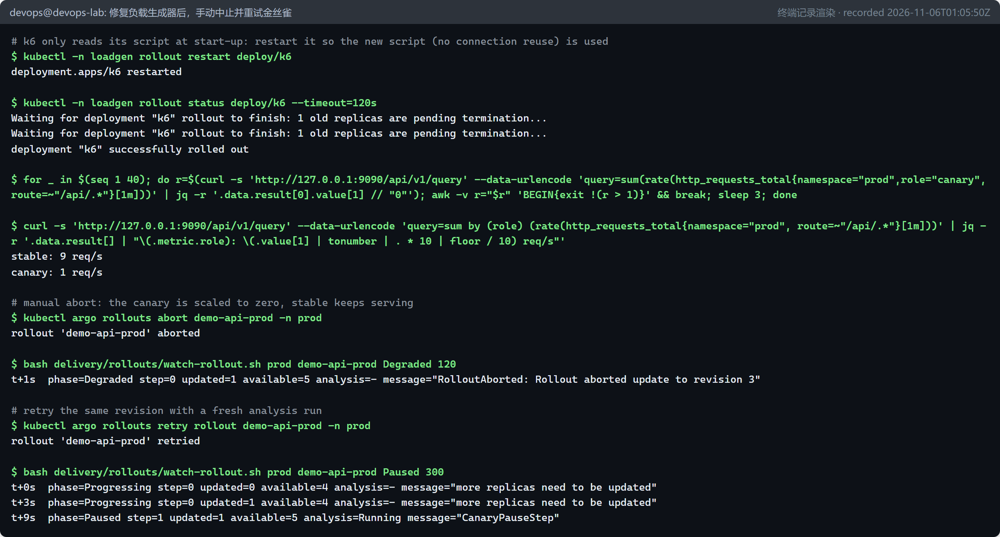
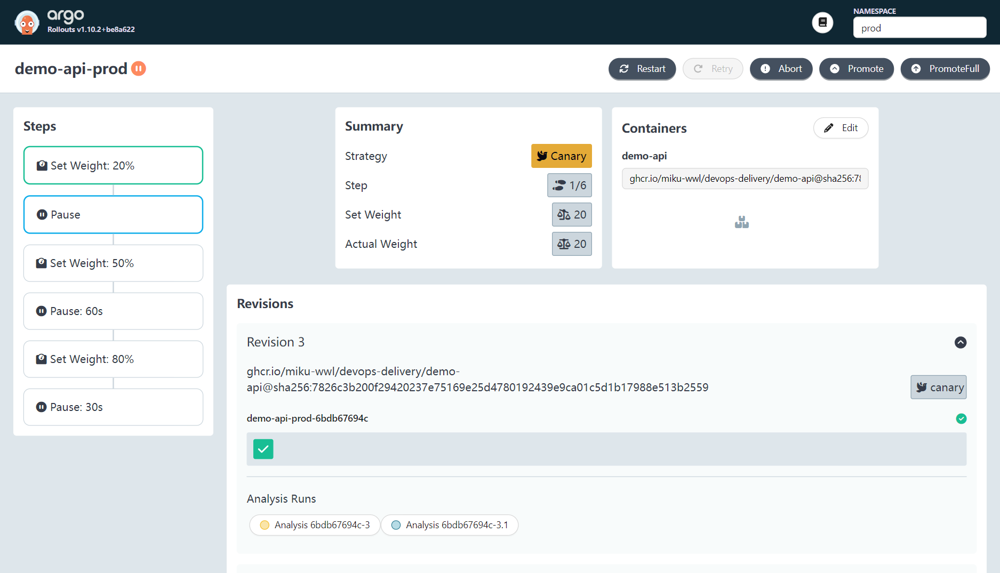
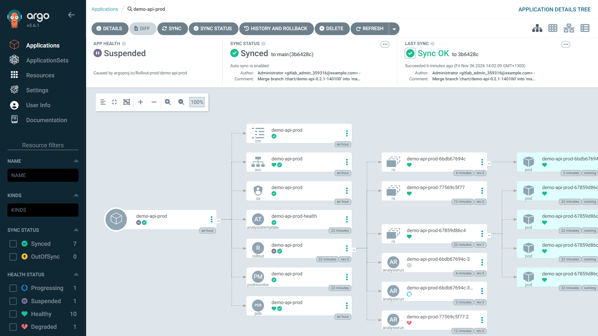
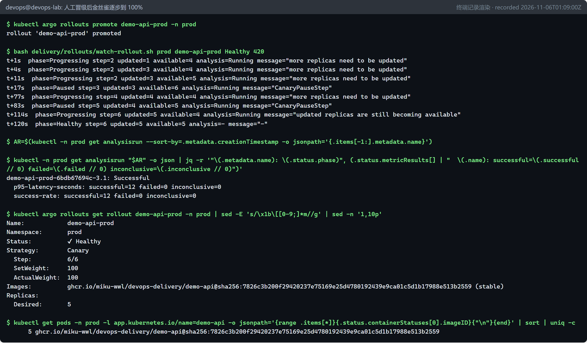
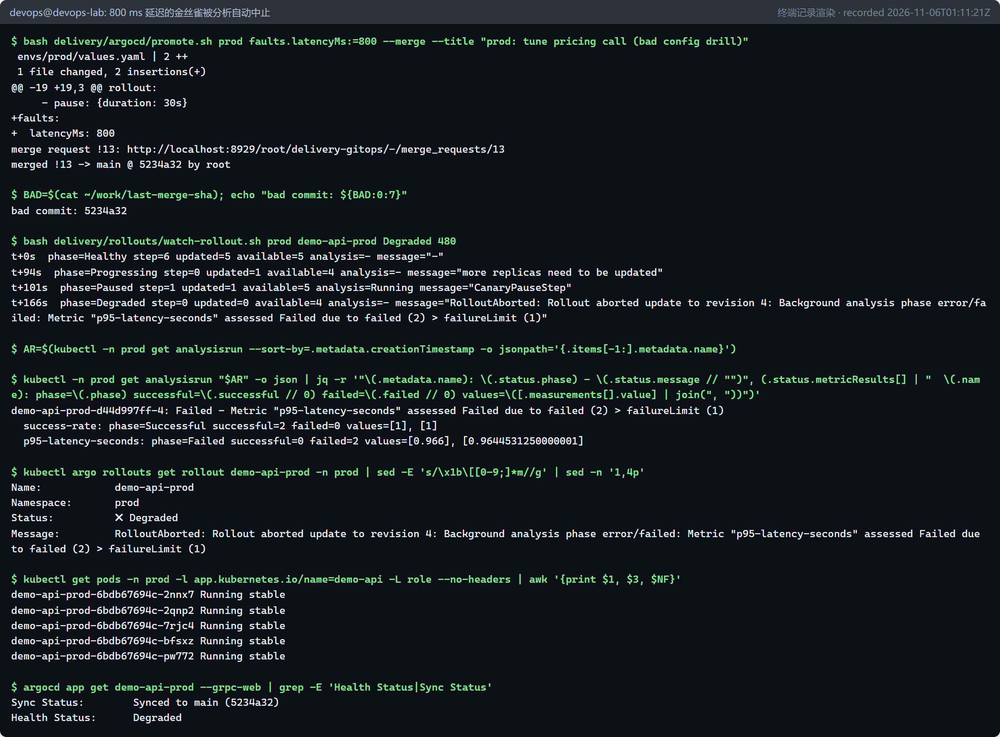
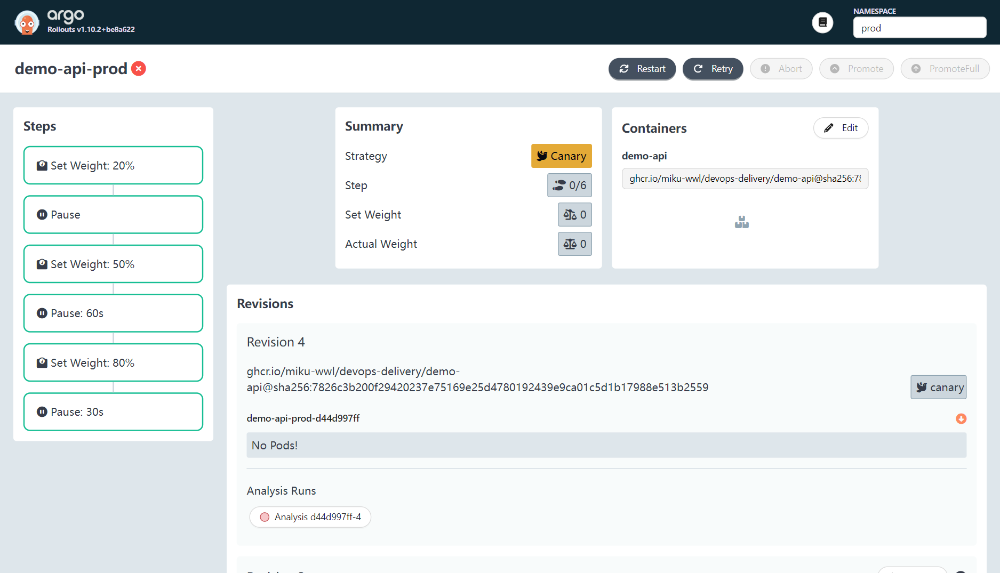
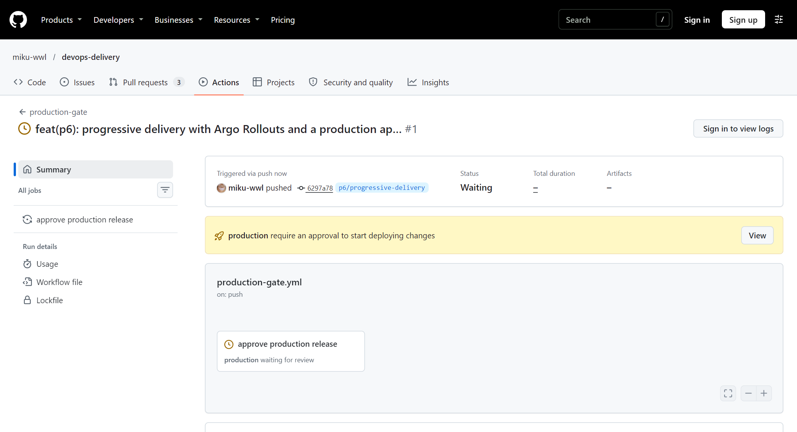

# 渐进式交付：Argo Rollouts 金丝雀与发布闸门（P6 / D6） {#ch-p6}

<div class="lead">到目前为止，一次发布要么全部成功，要么全部失败。而生产事故中相当大的一部分恰恰由变更引起。渐进式交付把“一次切换”变成“小步试探”：先让少量流量使用新版本，用真实指标判断它是否健康，健康就继续扩大，不健康就自动撤回。本章用 Argo Rollouts 实现基于 Prometheus 指标的金丝雀发布，经历了一次“误杀好版本”的真实事故并修复它，验证了人工晋级、手动中止/重试、自动中止坏版本三种路径，最后用 GitHub Deployment Environment 加上一道人工审批闸门。</div>

## 本章目标与产出

| 产出 | 位置 |
|---|---|
| 监控栈（Prometheus、Grafana、Alertmanager） | `delivery/monitoring/` |
| Argo Rollouts 控制器安装与时间线观察脚本 | `delivery/rollouts/` |
| Chart 0.2.1：Rollout、AnalysisTemplate、PodMonitor | `delivery/helm/demo-api/templates/` |
| 环境补丁（开启渐进式交付） | `delivery/gitops/patches/` |
| 负载生成器（k6） | `delivery/loadgen/k6-loadgen.yaml` |
| 生产审批闸门 | `.github/workflows/production-gate.yml`、`delivery/release/candidate.yaml` |

**验收标准（路线图 D6 / Gate G4）：** 故障版本停止晋级，稳定版恢复；记录发布版本与恢复过程。已通过：800 ms 延迟的金丝雀在 65 秒内被自动中止，金丝雀本身只服务了同期 1.4% 的请求；好版本经分析与人工晋级后全量发布（`evidence/p6/`）。**勘误：**中止时，一个新建的稳定版 Pod 读到了坏配置，潜伏约 3 小时才被第 9 章的告警发现（详见第 6 步末尾的勘误）。

## 原理 {#p6-principles}

### 发布策略对比

| 策略 | 做法 | 优点 | 缺点 |
|---|---|---|---|
| 重建（Recreate） | 先停旧版本，再起新版本 | 简单 | 有停机 |
| 滚动更新（Rolling） | 逐个替换 Pod（Kubernetes Deployment 的默认方式） | 无停机 | 一旦开始就会推进到底；没有“看指标再决定”的环节 |
| 蓝绿（Blue-Green） | 新旧两套完整环境，一次性切换流量 | 回滚快 | 需要双倍资源；切换时 100% 流量同时面对新版本 |
| 金丝雀（Canary） | 先给一小部分流量，按指标逐步扩大 | **爆炸半径小**，可用真实流量验证 | 需要可区分新旧版本的指标；流程更复杂 |

“金丝雀”一词来自煤矿工人带金丝雀下井：金丝雀对有毒气体更敏感，它出问题时，矿工还有时间撤离。

### Argo Rollouts 的工作方式

```{.mermaid caption="本章的渐进式交付闭环"}
flowchart LR
  G["配置仓库（Git）<br/>envs/prod/values.yaml"] -->|Argo CD 同步| R["Rollout demo-api-prod<br/>（替代 Deployment）"]
  R --> S["稳定版 ReplicaSet<br/>role=stable"]
  R --> C["金丝雀 ReplicaSet<br/>role=canary"]
  L["k6 负载<br/>10 req/s"] --> SVC["Service demo-api-prod"]
  SVC --> S & C
  P["Prometheus<br/>（PodMonitor 采集，<br/>带 rollouts_pod_template_hash 标签）"] -.抓取.-> S & C
  A["AnalysisRun<br/>成功率 ≥ 95%<br/>p95 < 0.5 s"] -->|PromQL，只看金丝雀| P
  A -->|失败| X["中止：金丝雀缩容为 0"]
  A -->|成功| H["等待人工晋级 / 自动推进"]
  H --> R
```

关键对象：

- **Rollout**：Argo Rollouts 的 CRD，Pod 模板与 Deployment 完全相同，额外有 `strategy.canary`。每个版本仍对应一个 ReplicaSet；`rollouts-pod-template-hash` 标签区分它们。
- **步骤（steps）**：`setWeight`（金丝雀占比）、`pause`（定时暂停，或 `pause: {}` 无限期暂停，直到人工 `promote`）、`analysis`（内联分析）等。
- **AnalysisTemplate / AnalysisRun**：模板定义“怎么判断健康”，每次发布实例化为一个 AnalysisRun。本章使用**后台分析**：从第 1 步开始持续运行，直到发布结束；任何时刻失败都会中止发布。
- **没有流量路由器时的权重**：不使用服务网格或 L7 网关时，Argo Rollouts 通过**副本数比例**近似权重。prod 设为 5 个副本，20% 就是 1 个金丝雀 Pod。要实现精确到请求的权重（例如 1%），需要接入 Istio、Gateway API、NGINX 等流量路由器。

### 只看金丝雀的指标

如果直接看整个服务的错误率，1 个坏 Pod 混在 5 个 Pod 里，信号会被稀释到原来的五分之一。正确的做法是**只度量金丝雀 Pod**：

1. PodMonitor 的 `podTargetLabels` 把 Pod 标签 `rollouts-pod-template-hash`、`role` 复制到每一条时间序列上；
2. Rollout 把最新 ReplicaSet 的哈希作为参数 `canary-hash` 传给分析（`podTemplateHashValue: Latest`）；
3. PromQL 按该标签过滤。

## 第 1 步：安装监控栈与 Argo Rollouts {#p6-install}

```bash
bash delivery/monitoring/install-monitoring.sh   # kube-prometheus-stack 92.21.1
bash delivery/rollouts/install-rollouts.sh       # Argo Rollouts v1.10.2
```

`kube-prometheus-stack` 的几个关键取值（`kube-prometheus-stack-values.yaml`）：

```yaml
# Kind runs etcd, scheduler, controller-manager and kube-proxy bound to 127.0.0.1
# inside the node container - their targets would always be "down". Skip them.
kubeEtcd: {enabled: false}
kubeScheduler: {enabled: false}
kubeControllerManager: {enabled: false}
kubeProxy: {enabled: false}
prometheus:
  prometheusSpec:
    scrapeInterval: 15s
    # Discover every ServiceMonitor/PodMonitor/PrometheusRule in the cluster,
    # not only the ones labelled with this Helm release.
    serviceMonitorSelectorNilUsesHelmValues: false
    podMonitorSelectorNilUsesHelmValues: false
    ruleSelectorNilUsesHelmValues: false
    enableFeatures: [exemplar-storage]
grafana:
  admin:
    existingSecret: grafana-admin   # created by install-monitoring.sh from ~/.lab-secrets
```

`*SelectorNilUsesHelmValues: false` 是一个常见的坑：默认情况下，kube-prometheus-stack 只选择带有本 Release 标签的 ServiceMonitor/PodMonitor，应用自己的 PodMonitor 会被**静默忽略**。Grafana 的管理员密码通过预先创建的 Secret 提供，不出现在 values 文件和命令行里。

## 第 2 步：让 Chart 支持 Rollout {#p6-chart}

为了让 Deployment 与 Rollout 渲染出**完全相同**的 Pod，先把 Pod 模板抽成一个辅助模板 `_podtemplate.tpl`，两种工作负载都 `include` 它：

```yaml
# templates/rollout.yaml（节选）
{{- if .Values.rollout.enabled }}
apiVersion: argoproj.io/v1alpha1
kind: Rollout
spec:
  replicas: {{ .Values.replicaCount }}
  template:
    {{- include "demo-api.podTemplate" . | nindent 4 }}
  strategy:
    canary:
      canaryMetadata:
        labels:
          role: canary
      stableMetadata:
        labels:
          role: stable
      analysis:
        templates:
          - templateName: {{ include "demo-api.fullname" . }}-health
        startingStep: 1
        args:
          - name: namespace
            value: {{ .Release.Namespace }}
          - name: canary-hash
            valueFrom:
              podTemplateHashValue: Latest
      steps:
        {{- toYaml .Values.rollout.steps | nindent 8 }}
{{- end }}
```

分析模板（最终版本，原因见第 4 步）：

```yaml
  metrics:
    - name: success-rate
      initialDelay: 45s
      interval: 20s
      failureLimit: 1
      inconclusiveLimit: 2
      successCondition: "len(result) > 0 && result[0] >= 0.95"
      failureCondition: "len(result) > 0 && result[0] < 0.95"
      provider:
        prometheus:
          address: http://kube-prometheus-stack-prometheus.monitoring.svc:9090
          query: |
            sum(rate(http_requests_total{namespace="{{args.namespace}}", rollouts_pod_template_hash="{{args.canary-hash}}", route=~"/api/.*", status!~"5.."}[1m]))
            /
            sum(rate(http_requests_total{namespace="{{args.namespace}}", rollouts_pod_template_hash="{{args.canary-hash}}", route=~"/api/.*"}[1m]))
    - name: p95-latency-seconds
      # 同样的结构：successCondition: result[0] < 0.5，failureCondition: result[0] >= 0.5
      query: |
        histogram_quantile(0.95, sum by (le) (rate(http_request_duration_seconds_bucket{namespace="{{args.namespace}}", rollouts_pod_template_hash="{{args.canary-hash}}", route=~"/api/.*"}[1m])))
```

- `{{args.namespace}}` 是 Argo Rollouts 的模板语法，与 Helm 的 `{{ }}` 冲突，所以在 Chart 中写成 ``{{`{{args.namespace}}`}}``，Helm 渲染后得到原样文本。
- `initialDelay: 45s`：新 Pod 刚启动时 `rate()` 还没有足够的样本，先等一等。
- `failureLimit: 1`：允许 1 次失败，第 2 次失败即中止（“失败次数 > failureLimit”）。
- **两个指标必须同时健康**：错误和延迟是两类不同的故障，后面坏版本的演练正好只有延迟问题。

## 第 3 步：通过 Git 把 Deployment 换成 Rollout {#p6-cutover}

Chart 本身的升级也走 GitOps：`update-chart.sh` 把 `delivery/helm/demo-api` 复制到配置仓库的 `charts/demo-api` 并提交合并请求。然后用 YAML 补丁为每个环境开启渐进式交付：

```yaml
# delivery/gitops/patches/prod-rollout.yaml
replicaCount: 5
podMonitor:
  enabled: true
rollout:
  enabled: true
  steps:
    - setWeight: 20
    - pause: {}   # manual gate: kubectl argo rollouts promote demo-api-prod -n prod
    - setWeight: 50
    - pause: {duration: 60s}
    - setWeight: 80
    - pause: {duration: 30s}
```

```console
$ bash delivery/argocd/promote.sh prod @$PWD/delivery/gitops/patches/prod-rollout.yaml --merge ...
merged !8 -> main @ 8b890f3 by root
$ kubectl get rollout,analysistemplate,podmonitor,deploy -n prod
NAME                                DESIRED   CURRENT   UP-TO-DATE   AVAILABLE   AGE
rollout.argoproj.io/demo-api-prod   5         5         5            5           12s
NAME                                                AGE
analysistemplate.argoproj.io/demo-api-prod-health   12s
NAME                                             AGE
podmonitor.monitoring.coreos.com/demo-api-prod   13s
```

Argo CD 创建 Rollout 后剪除（prune）了旧 Deployment。Rollout 第一次创建时直接部署 100%（没有“旧版本”可比较），整个切换没有中断服务。

::: warning
**同一个竞态，第二次出现。** dev 的补丁合并请求再次返回 HTTP 400，尽管脚本已经在等待分支出现在分支 API 中。手工重试立即成功，说明问题仍是 GitLab 的异步处理：分支 API 直接读仓库，而创建合并请求时检查的是一份**异步刷新的分支缓存**。最终的修复是把“检查前置条件”改为“对操作本身重试”：三个脚本的公共逻辑抽到 `lib.sh`，`create_mr()` 在失败时最多重试 20 次，并用 `curl --fail-with-body` 打印 GitLab 的错误信息，而不是只报一个状态码。
:::

## 第 4 步：第一次金丝雀——好版本被“误杀” {#p6-false-abort}

把 P5 第二次发布产生的新 digest（`sha256:7826c3b2...`，同样经过扫描、签名和来源证明）通过合并请求晋级到 prod。金丝雀按预期在 20% 处暂停，后台分析开始运行。两分钟后：

```console
success-rate: phase=Failed successful=0 failed=2 values=[], []
p95-latency-seconds: phase=Failed successful=0 failed=2 values=[], []
$ kubectl -n prod get rollout demo-api-prod -o jsonpath='...'
phase=Degraded abort=true message=RolloutAborted: Rollout aborted update to revision 2: Background analysis phase error/failed: Metric "success-rate" assessed Failed due to failed (2) > failureLimit (1)
```

一个好版本被中止了。注意 `values=[]`：查询结果是**空的**，并不是数值不达标。排查过程：

```console
# 1. 金丝雀 Pod 被采集过吗？（瞬时查询看不到已失效的序列，要用范围查询）
$ ... 'count by (rollouts_pod_template_hash, route) (count_over_time(http_requests_total{namespace="prod"}[15m]))'
{"hash":"67859d86c4","route":"/api/v1/orders","series":"4"}     ← 稳定版有业务流量
{"hash":"77569c5f77","route":"/healthz","series":"1"}            ← 金丝雀只有探针流量
{"hash":"77569c5f77","route":"/readyz","series":"1"}
{"hash":"77569c5f77","route":"/metrics","series":"1"}
```

金丝雀 Pod 被正常采集了，但**一个业务请求都没有收到**。原因是两个机制的叠加：

1. 负载生成器 k6 默认使用 HTTP keep-alive，长期复用 TCP 连接；
2. Kubernetes Service（kube-proxy）是 **L4 负载均衡，按连接而不是按请求分配后端**。金丝雀出现之前建立的所有连接都“钉”在稳定版 Pod 上，金丝雀永远分不到流量。

真实世界中的客户端同样大量使用连接池，这正是“基于副本数的金丝雀”最常见的失效方式。修复分两部分：

**修复一：让流量能到达金丝雀。** 本实验中让 k6 每个请求新建连接（`noConnectionReuse: true`）；生产环境的根本解决方案是使用 L7 流量路由（服务网格、Gateway API），按请求分配权重。

**修复二：区分“坏数据”和“没有数据”。** 最初的模板只有 `successCondition`，空结果被判为失败。改为三态：有数据且健康 → 成功；有数据且不健康 → **失败（中止）**；没有数据 → **不确定（Inconclusive）**，超过 `inconclusiveLimit` 时暂停发布，交给人来判断。没有证据时，既不应该放行，也不应该当作故障。

修复过程中又出现了两个小插曲，同样是真实的：

- Chart 升级到 0.2.1 后，**Rollout 自动开始了一次新的金丝雀**。原因是 Pod 模板标签中包含 `helm.sh/chart: demo-api-0.2.1`，Chart 版本一变，Pod 模板哈希就变。很多 Chart 都有这个反模式：Chart 版本这类“元数据”不应该放进 Pod 模板标签。
- 新的金丝雀分析结果为 **Inconclusive**（三态设计生效了，没有误杀），但金丝雀仍然收不到流量：只更新了 k6 的 ConfigMap，k6 Pod 并没有重启，它只在启动时读取脚本——这正是第 5 章 `checksum/config` 注解要解决的问题。



## 第 5 步：好版本——分析通过，人工晋级 {#p6-good}

重试后，金丝雀在 20% 处暂停，分析开始拿到真实数据：

```console
p95-latency-seconds: phase=Running successful=4 failed=0 inconclusive=0 values=[0.004845536857013795], [0.0048146093683584116], [0.00481012658227848], [0.0048]
success-rate: phase=Running successful=4 failed=0 inconclusive=0 values=[1], [1], [1], [1]
```



此时 Argo CD 中应用的健康状态显示为 **Suspended**——这是 Argo CD 对“暂停中的 Rollout”的标准表示，不是故障。



确认指标健康后，由人执行晋级：



## 第 6 步：坏版本——800 ms 延迟被自动中止 {#p6-bad}

模拟一次“看起来无害”的配置变更：给定价调用加了 800 ms 的延迟（`faults.latencyMs: 800`）。镜像没有变，只是配置变了——ConfigMap 的哈希改变了 Pod 模板，于是同样触发金丝雀。





**爆炸半径。** 用 Prometheus 精确计算坏金丝雀（ReplicaSet `d44d997ff`）的影响：

```console
bad canary (ReplicaSet d44d997ff): requests=121.3 slower_than_0.5s=85.3
all prod API requests in the same 10 min: 5933.4
```

坏版本只服务了 121 个请求，其中 85 个超过 0.5 秒（85/121 ≈ 70%，正好是 POST 下单请求在负载中的占比，GET 请求不经过定价调用）。占同期全部请求的 **1.4%**。如果用滚动更新直接发布，这个比例会是 70%，而且没有任何机制会自动停下来。

**回到 Git。** 中止之后，Argo CD 显示 `Synced` 但 `Degraded`：集群做了正确的事（保持稳定版），但 Git 中声明的仍是坏配置。用 `revert.sh` 撤销那次合并：

```console
$ bash delivery/argocd/revert.sh 5234a32 --merge
merged !14 -> main @ d6225fa by root
$ bash delivery/argocd/wait-sync.sh demo-api-prod "" 300
t+0s  revision=5234a32 sync=Synced health=Degraded operation=Succeeded
t+126s  revision=d6225fa sync=Synced health=Healthy operation=Succeeded
```

revert 后的 Pod 模板与稳定版 ReplicaSet 完全一致，Rollout 直接恢复为 Healthy，不需要再走一遍金丝雀。

::: danger
**勘误（在第 9 章中发现）。** 上面的“爆炸半径”只统计了金丝雀 ReplicaSet `d44d997ff`，漏掉了一个更严重的副作用。

坏配置写在所有 ReplicaSet **共用**的 ConfigMap 里。金丝雀在 01:14:07 前后被中止时，稳定版 ReplicaSet 从 4 个副本扩回 5 个，新建的**稳定版** Pod `demo-api-prod-6bdb67694c-pw772`（01:14:11 启动）读到的仍是坏配置 `FAULT_LATENCY_MS=800`，因为这时 Git 回滚还没有发生（回滚在 01:15 之后合并，约两分钟后才同步到集群）。回滚之后 ConfigMap 恢复为 0，Rollout 也显示 Healthy，但环境变量只在容器启动时读取，这个 Pod 一直带着 800 ms 的延迟运行。

上文 01:14:30 测量时，它才启动 19 秒，所以“稳定版慢请求数”仍是 0。直到约 3 小时后，第 9 章新加的延迟告警才发现它：这期间它处理的 15662 个下单请求全部慢于 0.5 秒，占 4 小时窗口内 prod 全部下单请求（86680 个）的 18%。

本章“只影响 1.4% 的请求”“稳定版恢复”的结论因此是不完整的。根因分析与修复（Chart 0.3.1：把发布配置写进 Pod 模板）见第 9 章，正式的事故复盘见第 12 章。
:::

## 第 7 步：GitHub Deployment Environment 审批闸门 {#p6-approval}

Argo Rollouts 的 `pause: {}` 是集群内的人工闸门；很多组织还要求在 CI/CD 平台上留下“谁批准了哪个版本进入生产”的记录。GitHub 的 Deployment Environment 提供这种能力：

```json
{
  "wait_timer": 0,
  "prevent_self_review": false,
  "reviewers": [ { "type": "User", "id": 38804125 } ],
  "deployment_branch_policy": { "protected_branches": false, "custom_branch_policies": true }
}
```

（再加上分支策略：只有 `main` 和本实验的 `p6/*` 分支可以向 `production` 部署。）工作流中的作业声明 `environment: production`，GitHub 就会在作业开始前停下来，等待必需的审阅者批准：

```yaml
jobs:
  approve:
    name: approve production release
    environment:
      name: production
      url: https://github.com/${{ github.repository }}/attestations
    steps:
      - name: Verify the approved candidate and record the decision
        run: |
          gh attestation verify "oci://${image}@${digest}" --repo "${GITHUB_REPOSITORY}" ...
```

```console
$ gh run view 42142945642 --json status,conclusion,event,headBranch
{"conclusion":"","event":"push","headBranch":"p6/progressive-delivery","status":"waiting"}
$ gh api repos/miku-wwl/devops-delivery/actions/runs/42142945642/pending_deployments --jq '...'
{"current_user_can_approve":true,"environment":"production","reviewers":["miku-wwl"],"wait_timer":0}
```



::: note
**审批留给人。** 这道闸门的意义在于由人做出决定。本次自动执行只负责建立闸门并证明它会拦住作业；是否批准，由仓库所有者在 GitHub 页面上决定。批准后，作业会验证候选 digest 的来源证明并写下发布记录。
:::

## 常见问题

**Q1：金丝雀分析一直没有数据。**
先确认金丝雀 Pod 是否收到业务流量（按 `rollouts_pod_template_hash` 统计请求数）。长连接客户端 + L4 负载均衡会让金丝雀“饿死”；用 L7 流量路由，或至少确保客户端会建立新连接。

**Q2：应该用 `successCondition` 还是 `failureCondition`？**
两个都写。只写成功条件时，“没有数据”会被当作失败；只写失败条件时，“没有数据”会被当作成功——两者都危险。两者都写，无数据就是 Inconclusive。

**Q3：每次升级 Chart 都会触发一次发布。**
Pod 模板标签里包含 Chart 版本（`helm.sh/chart`）。只在顶层对象的 labels 中放 Chart 版本，Pod 模板中只放稳定标签与应用版本。

**Q4：Argo CD 显示 Suspended 或 Degraded，是出问题了吗？**
Suspended = Rollout 正在暂停（等待人工晋级或定时暂停）；Degraded = Rollout 被中止。后者需要处理：如果是坏版本，在 Git 中回滚；如果是误判，`kubectl argo rollouts retry`。

**Q5：副本数很少时，20% 怎么算？**
没有流量路由时，金丝雀副本数向上取整。2 个副本时 20% 实际是 50%，这也是 prod 改为 5 个副本的原因。

**Q6：HPA 能和 Rollout 一起用吗？**
可以，HPA 的 `scaleTargetRef` 指向 Rollout（本 Chart 的 `hpa.yaml` 已按 `rollout.enabled` 自动切换）。

## 本章小结

- 渐进式交付用“小比例试探 + 指标判断”替代“一次切换”；关键是只度量金丝雀自己的指标。
- 第一次金丝雀因为“金丝雀收不到流量 + 无数据被当作失败”而误杀了好版本——排查与修复（逐请求建连、三态判定）比一次成功的演示更有价值。
- 好版本：分析 12/12 成功，人工晋级后 120 秒全量；坏版本：p95 0.966 秒，65 秒内被自动中止，金丝雀本身只服务了 1.4% 的请求；Git 回滚使系统回到 Synced/Healthy。
- **勘误：** 坏配置放在共享 ConfigMap 中，中止时新建的一个稳定版 Pod 读到了它，约 3 小时内拖慢了 15662 个下单请求。“Healthy”不等于每个 Pod 都正常，第 9 章给出了根因与修复。
- GitHub Deployment Environment 为生产发布加了一道由人决定的审批闸门。
