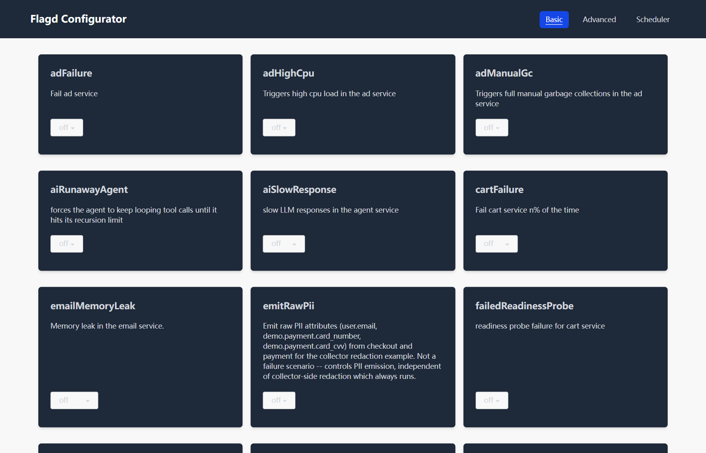
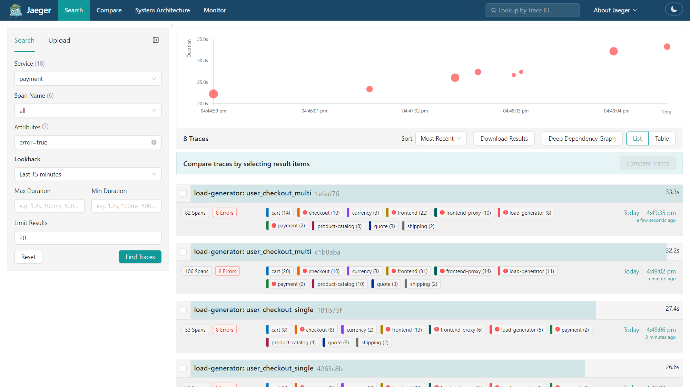
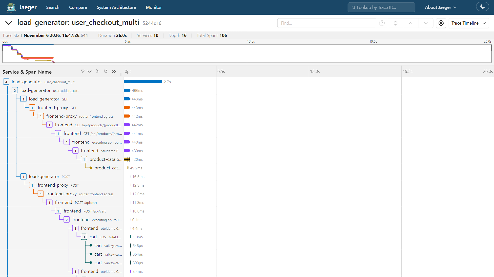
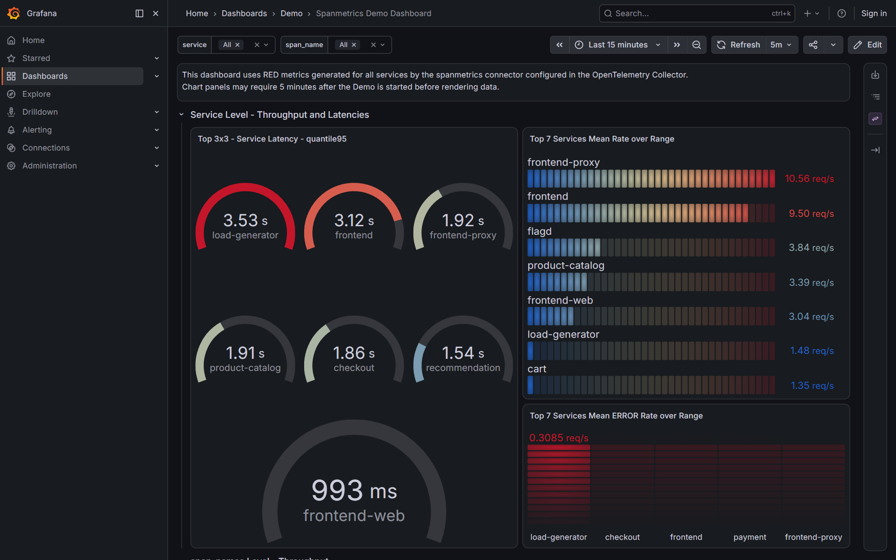
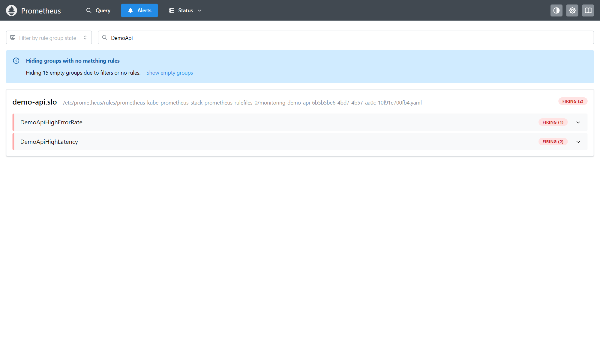
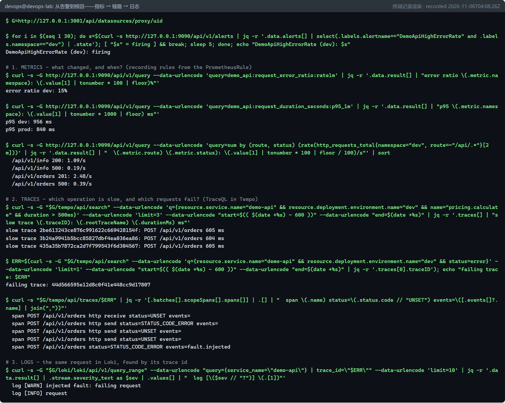
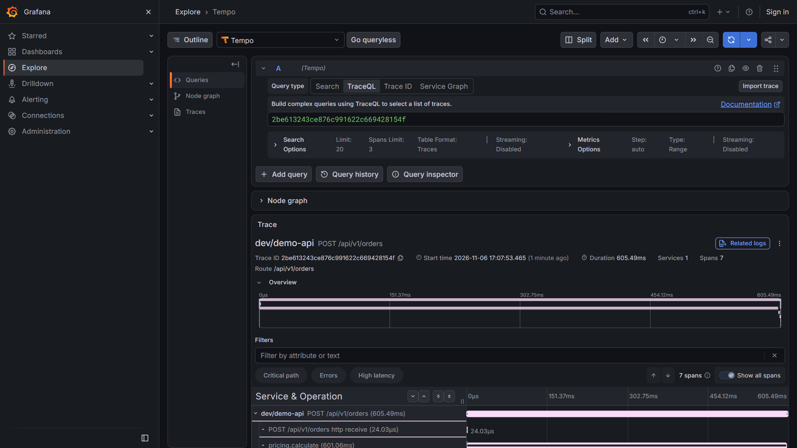
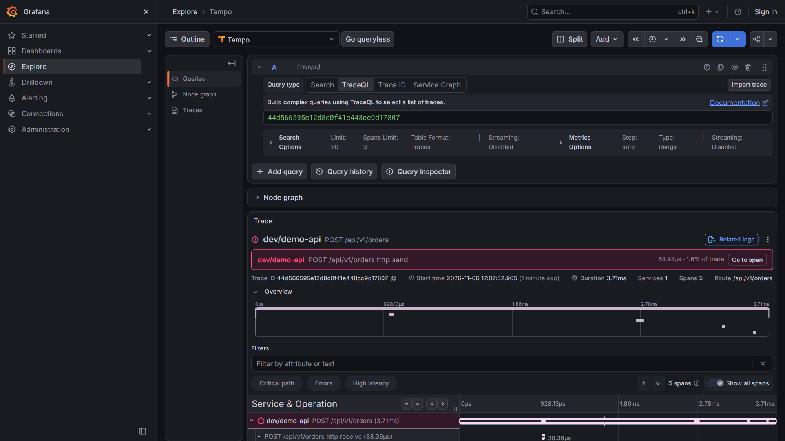
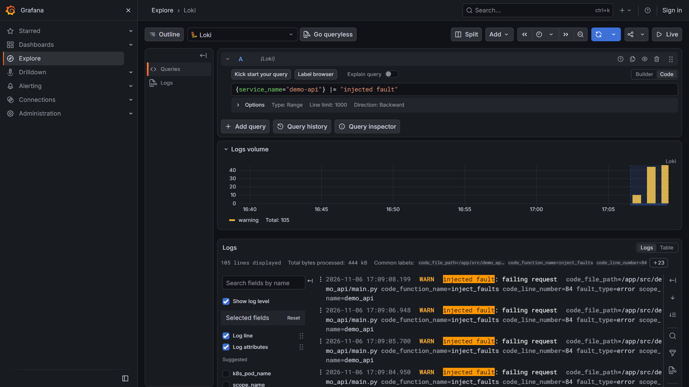
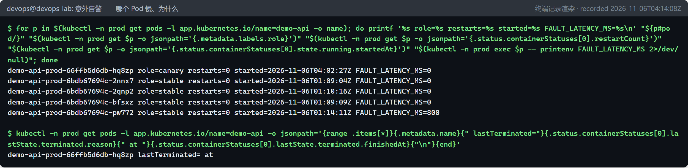

# 可观测性：OpenTelemetry、指标、链路与日志（P7 / D7 / O1） {#ch-p7}

<div class="lead">前面的章节解决了“怎么交付”和“交付的东西可不可信”。本章回答第三个问题：<strong>线上出了问题，你能多快知道、多快找到原因？</strong>我们先在官方 OpenTelemetry Demo（十多个服务组成的网上商店）里注入一次支付故障，用链路、指标、日志三种信号定位它；再给 demo-api 加上 OpenTelemetry，搭建 Collector + Tempo/Loki/Prometheus/Grafana 遥测管道，演练“从告警到根因”。演练过程中，新加的告警还意外发现了一个潜伏三小时的真实生产问题——它来自第 8 章的一个设计缺陷。</div>

## 本章目标与产出

| 产出 | 位置 |
|---|---|
| 官方 OpenTelemetry Demo 3.1.0 的版本固定覆盖文件 | `observability/otel-demo/lab.env` |
| demo-api 的 OpenTelemetry 埋点（链路 + 日志）与测试 | `app/src/demo_api/telemetry.py`、`app/tests/test_telemetry.py` |
| OpenTelemetry Collector 配置 | `observability/otel-collector/values.yaml` |
| 遥测后端（Tempo、Loki、Prometheus、Grafana） | `observability/lgtm/lgtm.yaml` |
| 告警与记录规则 | `observability/alerts/demo-api-rules.yaml` |
| 一键安装脚本 | `observability/install-observability.sh` |
| Chart 0.3.0 / 0.3.1（OTel 环境变量；发布配置移入 Pod 模板） | `delivery/helm/demo-api/` |

**验收标准（路线图 O1 / Gate G5）：** 能解释 Logs/Metrics/Traces 各自回答什么问题，并在一次 HTTP 5xx 或高延迟演练中用至少两类信号定位故障。已通过：官方 Demo 的支付故障与 demo-api 的错误/延迟故障，都用指标、链路、日志三类信号定位到根因（`evidence/p7/`）。

## 原理 {#p7-principles}

### 监控与可观测性

**监控（Monitoring）**回答预先想好的问题：“错误率超过 5% 了吗？”“磁盘快满了吗？”它依赖你事先知道要看什么。**可观测性（Observability）**是系统的一种属性：仅凭系统对外输出的数据，就能回答**事先没有想到的**问题——“为什么只有金卡会员的订单失败？”“为什么五个 Pod 里只有一个慢？”本章后半部分的意外发现，正是一个事先没人想到要问的问题。

### 三种信号各自回答什么

| 信号 | 本质 | 擅长回答 | 不擅长 | 本项目中的实现 |
|---|---|---|---|---|
| **指标（Metrics）** | 按时间聚合的数值 | “有没有问题、多严重、从什么时候开始？”（趋势、告警） | 单个请求的细节 | Prometheus：`http_requests_total`、`http_request_duration_seconds` |
| **链路（Traces）** | 一次请求经过的所有操作（span）及其父子关系、耗时 | “慢在哪一步、错在哪个服务？” | 长期趋势（数据量大，常被采样） | OpenTelemetry → Tempo / Jaeger |
| **日志（Logs）** | 离散事件的文字记录 | “当时具体发生了什么、错误信息是什么？” | 跨服务关联（除非带上 trace_id） | JSON 日志 → OTLP → Loki / OpenSearch |

三者的威力在于**关联**：指标告诉你“出事了”，链路告诉你“在哪里”，日志告诉你“为什么”；把它们串起来的钥匙是 **trace_id**。

常用的指标方法论：**RED**（Rate 速率、Errors 错误、Duration 耗时，面向请求型服务，第 3 章 demo-api 就是按它设计的）和 **USE**（Utilization 利用率、Saturation 饱和度、Errors 错误，面向资源，如 CPU、内存、磁盘）。

### OpenTelemetry

OpenTelemetry（OTel）是 CNCF 的可观测性标准，目标是“埋点一次，发往任何后端”。它由几部分组成：

| 组成 | 作用 |
|---|---|
| **API / SDK** | 应用中创建 span、记录日志与指标的库；SDK 负责采样、批处理与导出 |
| **自动埋点（Instrumentation）** | 为常见框架（FastAPI、HTTP 客户端、数据库驱动……）自动生成 span |
| **OTLP** | OpenTelemetry 的传输协议（gRPC 4317 / HTTP 4318），三种信号共用 |
| **Collector** | 独立的遥测处理程序：**receivers**（接收）→ **processors**（处理）→ **exporters**（导出），以 **pipeline** 组织；还可以用 **connector** 从一种信号生成另一种（例如从 span 生成 RED 指标） |
| **语义约定（Semantic Conventions）** | 统一的属性名，例如 `service.name`、`http.route`、`k8s.pod.name` |
| **上下文传播** | W3C `traceparent` 请求头在服务之间传递 trace_id 与父 span，跨服务的 span 才能拼成一条链路 |

```{.mermaid caption="本章 demo-api 的遥测数据流"}
flowchart LR
  subgraph APP["demo-api Pod（dev / prod）"]
    SDK["OTel SDK<br/>FastAPI 自动埋点<br/>+ pricing.calculate 等业务 span"]
    M["/metrics<br/>prometheus_client"]
  end
  SDK -- "OTLP/HTTP :4318<br/>traces + logs" --> COL["OpenTelemetry Collector<br/>memory_limiter → k8sattributes → batch"]
  COL -- "Prometheus 抓取<br/>按 Pod 注解发现" --> M
  COL -- OTLP --> LGTM
  subgraph LGTM["grafana/otel-lgtm"]
    T["Tempo（链路）"]
    L["Loki（日志）"]
    P2["Prometheus（指标）"]
    G["Grafana<br/>关联：trace ↔ log ↔ metric"]
  end
  KPS["kube-prometheus-stack<br/>Prometheus（告警规则）<br/>Alertmanager"] -- "PodMonitor 抓取" --> M
```

## 第 1 步：官方 OpenTelemetry Demo 3.1.0 {#p7-otel-demo}

[OpenTelemetry Demo](https://opentelemetry.io/docs/demo/) 是 OTel 社区维护的“天文用品网上商店”（Astronomy Shop）：十几个微服务用 Go、Java、.NET、Node.js、Python、Rust 等多种语言编写，全部接入 OpenTelemetry，附带负载生成器、Jaeger、Prometheus、Grafana、OpenSearch，以及一组可以随时打开的**故障开关**（feature flags）。它是学习分布式链路追踪的最好材料。

### 启动：几个真实的小问题

3.1.0 把 Compose 拆成了多个文件。官方 Makefile 的 `start-minimal` 目标实际执行的是：

```makefile
start-minimal:
	$(DOCKER_COMPOSE_CMD) $(DOCKER_COMPOSE_ENV) $(DOCKER_COMPOSE_FILES_CORE) $(DOCKER_COMPOSE_FILES_OBSERVABILITY) $(DOCKER_COMPOSE_FILES_EXTRAS) up --force-recreate --remove-orphans --detach
# DOCKER_COMPOSE_ENV=--env-file .env --env-file .env.override
# 即 compose.yaml（核心服务）+ compose.observability.yaml（Jaeger/Grafana/Prometheus/OpenSearch）+ compose.extras.yaml
```

完整模式（`make start`）还会加上 `compose.full.yaml`，多出的正是 `kafka`、`accounting`、`fraud-detection` 三个服务——最小模式不需要 Kafka，也就省下了它们的内存。实际启动时遇到了四件事：

1. **不运行未经审阅的脚本。** 第一次尝试“克隆仓库后直接 `make start-minimal`”被执行环境的权限策略拒绝。改为：只克隆（不执行任何东西）→ 用 `docker compose config --images` 审阅将要运行的每一个镜像 → 直接用 `docker compose` 启动。
2. **镜像标签是可变的 `latest-*`。** 发布版的 `.env` 中 `DEMO_VERSION=latest`，于是镜像解析为 `ghcr.io/open-telemetry/demo:latest-ad` 等。用匿名拉取令牌逐页查询 GHCR 的标签列表（共 15249 个标签），确认存在 `3.1.0-ad`、`3.1.0-payment` 等发布标签后，用覆盖文件固定版本（官方用 `.env.override` 做同样的事，这里把覆盖文件放进本项目仓库，便于审阅和复用）：

```bash
# observability/otel-demo/lab.env
DEMO_VERSION=3.1.0
IMAGE_VERSION=3.1.0
# Envoy's admin port defaults to 10000, which a Windows service ("YunDetectService")
# already listens on; with WSL mirrored networking the lab shares Windows' ports.
ENVOY_ADMIN_PORT=10001
```

3. **端口冲突。** 第一次启动时，24 个容器都起来了，唯独 `frontend-proxy`（Envoy）报 `failed to bind host port 0.0.0.0:10000/tcp: address already in use`。占用者在 Windows 一侧：在 PowerShell 中执行 `Get-NetTCPConnection -LocalPort 10000 -State Listen`，显示 `127.0.0.1:10000` 由一个名为 YunDetectService 的进程（PID 7576）监听。WSL 的**镜像网络模式**让 Linux 与 Windows 共用同一套端口，Windows 已占用的端口，WSL 里的 Docker 就绑定不了。没有去动别人的服务，而是把 Envoy 的管理端口改为 10001，重建 `frontend-proxy` 后首页返回 HTTP 200，25 个容器全部运行。
4. **内存。** 用 `docker compose config --format json` 汇总 25 个服务的内存上限，合计 6819 MiB（约 6.7 GiB）。为留出余量，演练期间暂停了本地 GitLab（运行时约占 3.1 GiB）：Argo CD 会暂时连不上配置仓库，但已部署的应用不受影响。

完整的操作命令（在 WSL 中执行；`$REPO` 指本项目仓库的路径）：

```bash
# 1. 只克隆指定的发布标签，不执行仓库里的任何脚本
git clone -q --depth 1 --branch 3.1.0 https://github.com/open-telemetry/opentelemetry-demo.git ~/work/opentelemetry-demo
cd ~/work/opentelemetry-demo

# 2. 审阅：将要运行哪些镜像？内存预算多少？
COMPOSE="docker compose --env-file .env --env-file $REPO/observability/otel-demo/lab.env -f compose.yaml -f compose.observability.yaml -f compose.extras.yaml"
$COMPOSE config --images | sort
$COMPOSE config --format json | jq -r '[.services[] | (.deploy.resources.limits.memory // .mem_limit // 0) | tonumber] | "services: \(length), sum of memory limits: \((add / 1048576) | floor) MiB"'

# 3. 启动（约 5 分钟，大部分时间在拉取镜像）
$COMPOSE up --detach --quiet-pull --remove-orphans

# 4. 演练结束后清理
$COMPOSE down --remove-orphans
```

浏览器入口都经由 Envoy 的 8080 端口：商店 `http://localhost:8080/`、Jaeger `http://localhost:8080/jaeger/ui`、Grafana `http://localhost:8080/grafana/`、故障开关界面 `http://localhost:8080/feature`。

另一个值得注意的细节：镜像已经是 3.1.0，但 span 上的 `service.version` 仍显示 3.0.0（Prometheus 中 spanmetrics 指标的 `service_version="3.0.0"`）。发布版的 `.env` 第 2 行是 `IMAGE_VERSION=3.0.0`，第 44 行 `OTEL_RESOURCE_ATTRIBUTES=...service.version=${IMAGE_VERSION}` 引用了它。合理的解释是：Compose 解析 `.env` 时就用它自己的 `IMAGE_VERSION=3.0.0` 展开了这一行，后面覆盖文件里的 `IMAGE_VERSION=3.1.0` 只影响尚未展开的引用（例如镜像标签）。这不影响演练，但提醒我们：**资源属性里的版本号要和实际运行的镜像核对，不能想当然。**

```console
$ curl -s http://localhost:8080/jaeger/ui/api/services | jq -r '.data | sort | join(", ")'
ad, cart, checkout, currency, email, flagd, frontend, frontend-proxy, frontend-web, image-provider, load-generator, payment, product-catalog, quote, recommendation, shipping, telemetry-docs
```


### 注入故障：paymentFailure

Demo 的故障开关由 flagd（OpenFeature 的参考实现）提供。`compose.yaml` 把仓库的 `src/flagd/` 目录挂载到容器的 `/etc/flagd`，并以 `start --uri file:./etc/flagd/demo.flagd.json` 启动 flagd，所以开关就定义在这个 JSON 文件里；也可以在浏览器里打开 `http://localhost:8080/feature/` 查看和切换：



`paymentFailure` 让支付服务按比例拒绝扣款：

```json
{
  "defaultVariant": "off",
  "description": "Fail payment service charge requests n%",
  "state": "ENABLED",
  "variants": { "10%": 0.1, "100%": 1, "25%": 0.25, "50%": 0.5, "75%": 0.75, "90%": 0.95, "off": 0 }
}
```

在 03:45:01Z 用 `jq` 把 `defaultVariant` 改为 `"50%"`，然后等待负载生成器产生下单流量：

```bash
cd ~/work/opentelemetry-demo
jq '.flags.paymentFailure.defaultVariant = "50%"' src/flagd/demo.flagd.json > /tmp/flags.json \
  && cat /tmp/flags.json > src/flagd/demo.flagd.json
```

flagd 会监视标志源文件的变化，不需要重启。值得一提的是，本次在 flagd 的日志里**没有**找到 reload 一类的字样（`grep` 退出码为 1），但随后 Jaeger 里很快出现了失败的支付链路。判断故障开关是否生效，要看系统的实际表现，而不是日志里有没有某句话。

::: note
**关于截图上的时间。** 本章的浏览器截图显示的是 Windows 本地时区（新西兰夏令时，UTC+13），终端记录统一使用 UTC。例如 Jaeger 截图中的 16:47 对应终端记录中的 03:47Z。
:::

### 用三种信号定位

**链路（Jaeger）。** 搜索 `payment` 服务中 `error=true` 的链路：



打开其中一条，按 span 列出带错误标记的环节和错误信息：

```console
frontend | executing api route (pages) /api/checkout | 13 INTERNAL: failed to charge card: could not charge the card: rpc error: code = Unknown desc = Payment request failed. Invalid token. demo.user_context.loyalty_level=gold
checkout | oteldemo.PaymentService/Charge |
checkout | oteldemo.CheckoutService/PlaceOrder | could not charge the card: rpc error: code = Unknown desc = Payment request failed. Invalid token. demo.user_context.loyalty_level=gold
```

错误从 payment 一路向上传播到 checkout、frontend，链路清楚地标出了**源头**是 `PaymentService/Charge`。这条链路共有 106 个 span、跨 10 个服务：



**指标（Span Metrics）。** Demo 的 Collector 用 `spanmetrics` 连接器从 span 自动生成 RED 指标。5 分钟内各服务的错误 span 数：

```console
load-generator: 42 error spans
checkout: 7 error spans
frontend: 7 error spans
payment: 7 error spans
frontend-proxy: 3 error spans
```

payment、checkout、frontend 各 7 个——正是同一批失败请求在三层上的投影（load-generator 的 42 个中还包括了前面 frontend-proxy 没启动时的失败）。



**日志（OpenSearch）。** 用同一个 trace_id 查日志，找到 37 条记录，其中包含根因：

```console
log records with this trace id: 37
frontend | - | Checkout payment declined
payment | - | Payment request failed. Invalid token. demo.user_context.loyalty_level=gold
payment | - | Charge request received.
```

### 恢复验证：一次“被查询参数误导”的教训

03:50:23 把开关改回 `off`。等了 3 分钟，再用 Jaeger 的 HTTP API 统计“最近 2 分钟内 payment 带错误的链路”：

```console
$ curl -s 'http://localhost:8080/jaeger/ui/api/traces?service=payment&tags=%7B%22error%22%3A%22true%22%7D&lookback=2m&limit=100' | jq '"payment traces with error=true in the last 2 min: \(.data | length)"'
"payment traces with error=true in the last 2 min: 9"
```

看起来故障没有消失。可是直接向 flagd 求值，它返回的已经是 `{"value":0, "reason":"STATIC", "variant":"off"}`；payment 自己的日志里，最后一条 “Invalid token” 出现在 03:49:39，比关闭开关的时刻还早。那这 9 条是从哪里来的？

答案在 Jaeger 的源码里。`lookback` 是 Jaeger **Web 界面**用的参数，界面会把它换算成 `start`/`end` 再请求后端。链路搜索 API（`/api/traces`）只认 `start`/`end`（Unix 微秒），没有 `start` 时默认往回查 48 小时：

```go
// jaeger v2.19.0: cmd/jaeger/internal/extension/jaegerquery/internal/query_parser.go
func (p *queryParser) parseTime(r *http.Request, paramName string, units time.Duration) (time.Time, error) {
	formValue := r.URL.Query().Get(paramName)
	if formValue == "" {
		if paramName == startTimeParam {
			return p.timeNow().Add(-1 * p.traceQueryLookbackDuration), nil
		}
		return p.timeNow(), nil
	}
	...
// default_params.go: defaultTraceQueryLookbackDuration = time.Hour * 24 * 2
// 'lookbackParam' 只在依赖关系（dependencies）和指标（metrics）查询中解析
```

也就是说，那条命令统计的其实是“Demo 启动以来所有失败的支付链路”。`lookback=2m` 被**悄无声息地忽略**了：没有报错，结果看上去也完全合理（`evidence/p7/jaeger-api-lookback.log`）。

改为按每个 Charge span 自己的开始时间、以关闭开关的时刻为界来统计，结论就清楚了：

```console
{ "period": "before flag off", "charge_spans": 44, "failed": 16 }
{ "period": "after flag off",  "charge_spans": 20, "failed": 0 }
last payment failure in the payment log: 03:49:39Z
```

::: warning
**两条教训。** ① 验证“是否已恢复”时，要按事件本身的时间戳划分前后，并用多个独立来源交叉核对（这里是 flagd 的实际取值、服务自己的日志和 span 的时间）。② 看似合理的数字可能来自一个被忽略的参数。调用 API 之前先查清它支持哪些参数；结果可疑时换一个窗口（例如 1 分钟和 1 小时）再查一次，数字完全不变，就说明窗口根本没有生效。
:::

## 第 2 步：为 demo-api 加入 OpenTelemetry {#p7-instrument}

```python
# app/src/demo_api/telemetry.py（节选）
def configure_telemetry(app: FastAPI, settings: Settings) -> bool:
    """Instrument the app. Global providers are installed once per process."""
    global _providers_installed
    if not os.getenv("OTEL_EXPORTER_OTLP_ENDPOINT"):
        return False
    if not _providers_installed:
        resource = build_resource(settings)
        tracer_provider = TracerProvider(resource=resource)
        tracer_provider.add_span_processor(BatchSpanProcessor(OTLPSpanExporter()))
        trace.set_tracer_provider(tracer_provider)

        logger_provider = LoggerProvider(resource=resource)
        logger_provider.add_log_record_processor(BatchLogRecordProcessor(OTLPLogExporter()))
        logging.getLogger().addHandler(
            LoggingHandler(level=logging.INFO, logger_provider=logger_provider)
        )
        _providers_installed = True
    FastAPIInstrumentor.instrument_app(app, excluded_urls=EXCLUDED_URLS)
    return True
```

设计要点：

- **由标准环境变量开关。** 只有设置了 `OTEL_EXPORTER_OTLP_ENDPOINT` 才启用；测试和本地运行不需要任何 Collector。SDK 会自动在端点后追加 `/v1/traces`、`/v1/logs`。
- **Resource 标识“我是谁”。** `service.name`、`service.version`、`deployment.environment.name`，再合并环境变量 `OTEL_RESOURCE_ATTRIBUTES` 中的 `k8s.pod.name` 等。
- **自动埋点 + 业务 span。** FastAPI 自动埋点为每个请求生成服务端 span；健康检查和指标抓取被排除，避免噪声。业务逻辑中手工增加两个子 span，让链路能显示**时间花在哪里**：

```python
with tracer.start_as_current_span("pricing.calculate") as span:
    span.set_attribute("order.sku", body.sku)
    span.set_attribute("order.quantity", body.quantity)
    if settings.fault_latency_ms:
        span.add_event("fault.injected", {"fault.type": "latency", "fault.latency_ms": settings.fault_latency_ms})
        await asyncio.sleep(settings.fault_latency_ms / 1000)
    ...
with tracer.start_as_current_span("orders.store"):
    order = store.create(body.sku, body.quantity, unit_price, total)
```

- **日志带上 trace_id。** JSON 日志格式化器从当前 span 中取出 W3C 格式的 trace_id/span_id；同时日志也经 OTLP 发出，后端自动获得链路上下文。

测试用 `InMemorySpanExporter` 捕获 span，不需要任何后端：

```python
def test_order_request_produces_nested_business_spans():
    client = traced_client()
    assert client.post("/api/v1/orders", json={"sku": "BOOK-001", "quantity": 2}).status_code == 201
    spans = {s.name: s for s in EXPORTER.get_finished_spans()}
    assert {"pricing.calculate", "orders.store", "POST /api/v1/orders"} <= spans.keys()
    pricing, server = spans["pricing.calculate"], spans["POST /api/v1/orders"]
    assert pricing.parent.span_id == server.context.span_id
```

```console
25 passed in 6.12s
Required test coverage of 90.0% reached. Total coverage: 93.52%
```

（未覆盖的 13 行是“已配置 OTLP 端点”的启用路径，它在集群中被真实验证。）推送到 `p7/observability` 分支后，第 7 章的发布流水线自动构建、扫描、签名并证明了新镜像 `sha256:9f45ec00…`。

## 第 3 步：遥测管道——Collector 与 LGTM {#p7-pipeline}

后端使用 Grafana Labs 官方的 `grafana/otel-lgtm` 一体化镜像：内含 Collector、Prometheus、Tempo、Loki 和 Grafana，并预先配置好三种信号之间的关联跳转。它适合学习与开发环境；生产环境会把各组件分开部署并配置持久化存储。

在它前面放一个我们自己配置的 OpenTelemetry Collector（官方 Helm Chart 0.178.2，contrib 镜像 0.163.2），这是生产中最常见的结构——应用只认识 Collector，后端可以随时更换：

```yaml
presets:
  kubernetesAttributes:
    enabled: true   # k8sattributes processor + 所需 RBAC
config:
  receivers:
    otlp:
      protocols:
        grpc: {endpoint: "${env:MY_POD_IP}:4317"}
        http: {endpoint: "${env:MY_POD_IP}:4318"}
    prometheus:
      config:
        scrape_configs:
          - job_name: demo-api
            kubernetes_sd_configs:
              - role: pod
                namespaces: {names: [dev, prod]}
            relabel_configs:
              - source_labels: [__meta_kubernetes_pod_annotation_prometheus_io_scrape]
                action: keep
                regex: "true"
              - source_labels: [__meta_kubernetes_pod_ip, __meta_kubernetes_pod_annotation_prometheus_io_port]
                action: replace
                regex: (.+);(.+)
                replacement: $$1:$$2
                target_label: __address__
  processors:
    memory_limiter: {check_interval: 1s, limit_percentage: 80, spike_limit_percentage: 25}
    batch: {}
  exporters:
    otlphttp/lgtm: {endpoint: http://lgtm.observability.svc:4318}
    debug: {verbosity: basic}
  service:
    pipelines:
      traces:  {receivers: [otlp], processors: [memory_limiter, k8sattributes, batch], exporters: [otlphttp/lgtm, debug]}
      logs:    {receivers: [otlp], processors: [memory_limiter, k8sattributes, batch], exporters: [otlphttp/lgtm]}
      metrics: {receivers: [otlp, prometheus], processors: [memory_limiter, batch], exporters: [otlphttp/lgtm]}
```

- **`memory_limiter` 放在最前面。** 后端变慢时，Collector 会主动拒绝新数据，而不是吃光内存被 OOM 杀死。
- **`k8sattributes`** 根据来源 Pod 的 IP 补全 `k8s.namespace.name`、`k8s.deployment.name` 等属性。
- **Collector 里也能跑 Prometheus 抓取。** 用 Pod 注解（`prometheus.io/scrape`，第 5 章 Chart 已经加上）发现目标；`$$` 是因为 Collector 会展开 `$` 开头的环境变量。
- **`batch`** 把数据攒批后发送，显著减少网络请求。

告警规则交给 kube-prometheus-stack 中的 Prometheus（它负责 Alertmanager 的告警路由），先用**记录规则**预先计算 RED 信号，再在其上写告警：

```yaml
        - record: demo_api:request_error_ratio:rate1m
          expr: |
            sum by (namespace) (rate(http_requests_total{route=~"/api/.*", status=~"5.."}[1m]))
            /
            sum by (namespace) (rate(http_requests_total{route=~"/api/.*"}[1m]))
        - alert: DemoApiHighErrorRate
          expr: demo_api:request_error_ratio:rate1m > 0.05
          for: 1m
          labels: {severity: page}
        - alert: DemoApiHighLatency
          expr: demo_api:request_duration_seconds:p95_1m > 0.5
          for: 1m
          labels: {severity: ticket}
```

`for: 1m` 表示条件必须连续满足 1 分钟才从 pending 变为 firing，避免一次抖动就把人叫醒。

## 第 4 步：通过 GitOps 在 dev 开启遥测 {#p7-enable}

Chart 0.3.0 在 Pod 模板中加入 OTel 环境变量，并用 **Downward API** 把 Pod 名和命名空间注入为资源属性：

```yaml
        - name: OTEL_EXPORTER_OTLP_ENDPOINT
          value: "http://otel-collector.observability.svc:4318"
        - name: POD_NAME
          valueFrom: {fieldRef: {fieldPath: metadata.name}}
        - name: POD_NAMESPACE
          valueFrom: {fieldRef: {fieldPath: metadata.namespace}}
        # Kubernetes expands $(VAR) references to variables defined earlier in the list.
        - name: OTEL_RESOURCE_ATTRIBUTES
          value: "k8s.pod.name=$(POD_NAME),k8s.namespace.name=$(POD_NAMESPACE)"
```

同一版本还修正了第 8 章发现的反模式：Pod 模板标签中不再包含 Chart 版本（以后升级 Chart 不会再无谓地触发发布）。dev 通过补丁开启遥测，并关闭金丝雀分析——dev 是自动部署环境，故障演练注入的问题需要留在那里供排查（prod 保留分析闸门）。

部署后验证三种信号都已到达后端：

```console
# traces (Tempo, TraceQL): recent demo-api traces from dev
GET /api/v1/info  10 ms  trace=83dca639a39a0493fca37b7066c06f92
POST /api/v1/orders  3 ms  trace=307a1ee487f3ab81d749b6e623ebae28
# logs (Loki)
order created
request
log lines with a trace_id (last hour): 200
# metrics (Prometheus in LGTM): scraped by the collector from the pods' /metrics endpoint
prod: 10.5 req/s
dev: 4 req/s
```

（日志查询设置了 `limit=200`，所以这里的 200 是上限，表示“至少 200 条”。）

## 第 5 步：故障演练——从告警到根因 {#p7-drill}

模拟一次“看起来正常”的配置变更。MR !17 的标题是 “dev: new pricing client timeout settings (drill)”（新的定价客户端超时设置），实际内容却给 dev 引入了 20% 的错误和 600 ms 的延迟：

```bash
bash delivery/argocd/promote.sh dev faults.errorRate:=0.2 faults.latencyMs:=600 --merge \
  --title "dev: new pricing client timeout settings (drill)"
```

04:05:37 合并（配置仓库 `fa135cf`），Argo CD 约 40 秒后同步。之后告警依次出现。Prometheus 的 `activeAt` 是条件**开始成立**（进入 pending）的时刻，条件持续满足 1 分钟（`for: 1m`）后才变为 firing：

```console
DemoApiHighErrorRate [pending] since 04:07:20Z  demo-api in dev: 16.78% of API requests fail
DemoApiHighLatency [firing] since 04:01:05Z  demo-api in prod: p95 latency 836.3ms
DemoApiHighLatency [firing] since 04:06:50Z  demo-api in dev: p95 latency 958.4ms
```



第二行是 **prod** 的延迟告警，不在演练计划之内，第 6 步专门分析。先按“指标 → 链路 → 日志”的顺序排查 dev：



两个关键的查询语言：

```text
# TraceQL（Tempo）：找出耗时超过 500 ms 的定价操作
{resource.service.name="demo-api" && resource.deployment.environment.name="dev" && name="pricing.calculate" && duration > 500ms}

# LogQL（Loki）：用 trace_id 找到同一个请求的日志
{service_name="demo-api"} | trace_id="44d566595e12d8c0f41e448cc9d17807"
```







把三种信号放在一起：指标显示错误和延迟从 04:06 前后开始，正是 `fa135cf` 同步到 dev 之后；链路显示时间花在 `pricing.calculate` 上，失败请求带有 `fault.injected` 事件；日志给出了同一请求的 “injected fault: failing request”。三者共同指向配置变更 `fa135cf`。用 `bash delivery/argocd/revert.sh fa135cf --merge` 撤销（MR !18，配置仓库 `9d2430c`）后，dev 的告警在 04:13:27 全部清除，p95 回到 4 ms。

## 第 6 步：一次真实的意外告警 {#p7-real-incident}

演练中的第二条延迟告警来自 **prod**：p95 为 836 ms，条件从 04:01:05 起成立。告警规则本身也是刚刚才有的：安装脚本在 Collector 就绪（04:00:15）后才创建 PrometheusRule。也就是说，规则生效后不到一分钟，prod 的告警就成立了。问题早已存在，只是此前没有规则去发现它。

**先排除最近的变更。** prod 在本章唯一的变更是 Chart 0.3.0 升级（MR !15，04:01:23 之后合并）：它触发了一次金丝雀发布，此刻停在第 1 步（20% 流量）等待人工晋级。但告警在这次合并**之前**就已成立。再按 ReplicaSet 和接口拆分延迟：

```console
$ kubectl argo rollouts get rollout demo-api-prod -n prod
Status:          ॥ Paused
Message:         CanaryPauseStep
  Step:          1/6
  SetWeight:     20
$ kubectl -n prod get configmap demo-api-prod -o jsonpath='{.data}'
{"FAULT_ERROR_RATE":"0","FAULT_LATENCY_MS":"0"}
# p95：先按 ReplicaSet（stable / canary），再按接口拆分（PromQL 见 evidence/p7/prod-latency-investigate.log）
p95 hash=6bdb67694c role=stable: 852 ms
p95 hash=66ffb5d6db role=canary: 4 ms
p95 /api/v1/orders: 872 ms
p95 /api/v1/info: 4 ms
```

新的金丝雀（`66ffb5d6db`）只有 4 ms，可以排除。

慢的是**稳定版**，并且只有下单接口慢、多出约 800 ms——这正是第 8 章坏版本 `FAULT_LATENCY_MS=800` 的特征，而那次变更早已在 Git 中回滚，ConfigMap 里也是 0。逐个检查 Pod 实际的环境变量：



**根因。** 第 8 章的坏版本只改了配置，配置来自所有 ReplicaSet **共用的同一个 ConfigMap**：

1. 坏版本合并后，ConfigMap `demo-api-prod` 中的 `FAULT_LATENCY_MS` 变成 800；
2. 金丝雀分析失败，Argo Rollouts 中止发布，把稳定版 ReplicaSet 从 4 个副本**扩回 5 个**；
3. 新建的那个**稳定版** Pod 在启动时读取了 ConfigMap——此时 Git 中的坏配置还没有回滚，于是它拿到了 800；
4. 之后 Git 回滚把 ConfigMap 改回了 0，但环境变量只在容器启动时读取，这个 Pod 一直带着 800 ms 的延迟运行。

**影响。**

```console
pod demo-api-prod-6bdb67694c-pw772 (started 01:14:11Z), POST /api/v1/orders served: 15662, slower than 0.5 s: 15662
all prod POST /api/v1/orders in the same 4 h: 86680
```

这个 Pod 从 01:14:11 运行到 04:14 被删除，约 3 小时。在查询的 4 小时窗口内，prod 一共处理了 86680 个下单请求，其中 **15662 个（18%）** 落在这个 Pod 上，而且全部慢于 0.5 秒（注入的固定延迟是 800 ms）。第 8 章当时的结论是“坏金丝雀 65 秒内被自动中止，只影响了 1.4% 的请求”，这是不完整的（第 8 章已加勘误）：Rollout 的状态是 Healthy，但其中一个 Pod 已被污染。当时还没有延迟告警，问题就这样潜伏了下来，直到本章加入告警才被发现。

**缓解与修复。**

- 缓解：删除被污染的 Pod，ReplicaSet 重建的新 Pod 读取到正确的配置（0）。
- 修复（Chart 0.3.1）：把发布配置从共享的 ConfigMap 移入 **Pod 模板的 `env`**。这样每个 ReplicaSet 都携带自己的配置，被中止的金丝雀永远不会把配置“泄漏”给稳定版。ConfigMap 对象**再保留一个版本**：由 Chart 0.3.0 及更早版本创建的 ReplicaSet 仍通过 `envFrom` 引用它，立即删除的话，这些 Pod 在下次重建时就会启动失败。这是“先扩展、后收缩”（expand/contract）的迁移方式。渲染结果可以直接验证：`--set faults.latencyMs=800` 时，Rollout 的 Pod 模板里 `envFrom` 为 `null`，`FAULT_LATENCY_MS` 以 `value: "800"` 直接写在 `env` 中。
- 修复版本照常走金丝雀：分析 3/3 通过，人工晋级后全量；04:20:05 所有 DemoApi 告警清除，prod 与 dev 的 p95 都是 4 ms。

::: principle
**三条教训。** ① 没有告警不等于没有问题——本次故障在加上延迟告警之前就已存在了 3 小时。② “Rollout 显示 Healthy”只说明控制器认为期望状态已达成，并不代表每个 Pod 都在按你以为的配置运行；要用按 Pod、按 ReplicaSet 拆分的指标去验证。③ 被多个版本共享的可变配置（ConfigMap、Secret）与金丝雀发布天然冲突：配置应当与 Pod 模板一起版本化，或者使用带内容哈希的不可变 ConfigMap。
:::

## 关于 O0 视频

路线图指定的辅助视频（Abhishek Veeramalla《Learn Observability in 5 Hours》）由用户自行观看，本手册不转述其内容。

## 常见问题

**Q1：链路里只有服务端 span，看不到业务步骤。**
自动埋点只覆盖框架边界。在关键业务操作周围手工创建子 span（如本章的 `pricing.calculate`），并加上有意义的属性。

**Q2：日志和链路关联不起来。**
确认日志中带有与链路相同格式的 trace_id（32 位十六进制），且日志是在 span 的上下文中写出的；使用 OTLP 发送日志时，SDK 会自动附带链路上下文。

**Q3：Collector 自己的内存不断上涨直至被杀。**
把 `memory_limiter` 放在每条 pipeline 的第一个处理器，并设置 Pod 的内存上限。

**Q4：Collector 配置中的 `$1` 不生效。**
Collector 会把 `$` 当作环境变量展开，正则替换中的 `$1` 要写成 `$$1`。

**Q5：Prometheus 告警一直是 pending。**
`for:` 规定条件需要连续满足的时长；若指标在这段时间内抖动回落，计时会重新开始。

**Q6：用 Jaeger API 查“最近 N 分钟”的链路，结果却包含更早的错误。**
`lookback` 只是 Jaeger Web 界面的参数，`/api/traces` 会忽略它；没有 `start` 时，API 默认查询过去 48 小时。用 API 时请显式传入 `start`/`end`（Unix 微秒）。验证恢复时，按 span 和日志自身的时间戳统计。

## 本章小结

- 指标回答“有没有、多严重”，链路回答“在哪里”，日志回答“为什么”；trace_id 把三者连在一起。
- 在官方 OpenTelemetry Demo 中，支付故障被 Jaeger 链路、spanmetrics 指标和 OpenSearch 日志三种信号一致地定位到 `PaymentService/Charge`。
- demo-api 接入 OpenTelemetry 后，经 Collector 把链路、日志、指标送入 Tempo、Loki、Prometheus；一次 20% 错误 + 600 ms 延迟的演练按“告警 → 指标 → 链路 → 日志”在几分钟内找到根因。
- 新加的告警还发现了一个真实的潜伏问题：共享 ConfigMap 使中止的金丝雀把坏配置泄漏给了稳定版，3 小时内拖慢了 18% 的生产订单。缓解、修复与验证的全过程都有证据，第 12 章会为它写一份正式的事故复盘（RCA）。
