# 商业可观测性平台：Datadog 学习路径与动手实验（P8 / D8 / O2） {#ch-p8}

<div class="lead">前一章用开源组件（OpenTelemetry、Prometheus、Tempo、Loki、Grafana）自己搭起了可观测性管道。本章换一个视角：看一个成熟的商业平台如何把同样的问题“产品化”。学习材料是 Datadog Learning Center 的三条免费学习路径（Core Skills、Configuration、Site Reliability Engineer，共 14 门课）。所有课程内容都读完了，并在两门课的实验环境里亲手安装、配置了 Datadog Agent。其余需要登录 Datadog 网页界面的实验，因为一个明确的规则限制没有完成。本章会如实交代做了什么、没做什么，以及为什么。</div>

## 本章目标与产出

| 产出 | 位置 |
|---|---|
| 三条学习路径的报名记录与平台记录的进度 | `evidence/p8/learning-center-progress.md` |
| “Agent on a Host”实验 5 个挑战的终端证据 | `evidence/p8/agent-host-*.png` |
| “Agent on Docker”实验 2 个挑战的终端证据 | `evidence/p8/agent-docker-*.png` |
| Datadog 概念与本项目开源栈的对照 | 本章各节、[对照表](#p8-mapping) |

**验收标准（路线图 D8 / O2，Gate G6）：** 路线图要求用本人的 Learning Center 账号完成学习路径。实际状态是 **PARTIAL**：14 门课的全部 56 篇讲义已读完并由平台记录；两门 Agent 实验的终端部分（共 7 个挑战）通过了实验平台的自动检查。依赖 Datadog 网页登录的实验部分、各课的反馈问卷和认证考试需要你本人完成，见[本章最后](#p8-todo)。

**学完本章，你应当能够：**

- 用标签和统一服务标签（`env`、`service`、`version`）组织遥测数据，并把它们对应到 OpenTelemetry 的资源属性；
- 说出 Datadog Agent 的组成与配置优先级，在主机和容器中安装、配置 Agent 及其集成；
- 区分五种指标类型，知道哪些可以跨主机聚合、哪些不能；
- 把 monitor、SLO、燃烧率告警、事故管理流程对应到本书的开源实现上，并据此判断商业平台与自建方案的取舍。

## 学习方式与边界 {#p8-method}

本章的所有网页操作，都是通过 Claude in Chrome 扩展在你自己的 Microsoft Edge 中进行的（浏览器标识为 `Edg/156.0.0.0`），使用的是你已经登录的 Learning Center 会话。

Learning Center 的课程由两类内容组成：

- **讲义（lesson）**：讲概念，读完后在课程播放器底部点“Mark Lesson Complete & Continue”记为完成。
- **实验（lab）**：嵌在课程页里的 Instruqt 实验环境。点击 Launch 后约 5 分钟，平台会准备好一台装有演示应用 **Storedog**（一个卖贴纸的电商网站）的 Linux 虚拟机，并分配一个 **Datadog 试用组织（trial organization）**。左侧是终端、IDE 和应用页面，右侧是分步说明。每个挑战（challenge）结束时点 **Check**，平台在虚拟机里运行检查脚本，通过后才能进入下一个挑战。10 分钟无操作，实验会话就会过期。

几条边界在开始前就确定了，执行中也一直遵守：

- **不注册 Datadog SaaS，不启用付费功能。** 实验用的试用组织由实验平台自动创建，账号有效期 14 天，所有实验共用。
- **不在登录页输入密码。** 实验的网页部分要求用试用账号的用户名和密码登录 `app.datadoghq.com`。这一步无论是否得到授权，Claude 都不能做。本次会话里也没有可以代为填写的密码管理器工具。所以，凡是必须在 Datadog 网页上完成的步骤都没有做，**也没有点“下一步”假装完成**。
- **密钥不经手。** 实验虚拟机已经把 API key、Application key 放在环境变量（`DD_API_KEY`、`DD_APP_KEY`）里。所有需要密钥的命令都引用环境变量，从不把密钥值打出来。凡是会显示密钥的输出，都先用 `sed` 打码再截图。
- **问卷不代填。** 每门课最后的反馈问卷问的是你个人的意见，留给你本人填写。
- **只记录平台确认的进度。** 讲义在读完内容后才标记完成。实验以平台的 Check 结果为准。

::: warning
**一个实际的坑：浏览器窗口不能最小化。** 浏览器自动化要截图，而 Edge 窗口最小化后不再渲染页面，截图会一直超时。本次两次遇到这种情况，第一次用 Windows API 在不抢焦点的前提下恢复了窗口。实验终端是 canvas 绘制的，读不到文字，只能看截图。所以窗口被最小化时，实验就无法继续。读讲义、标记完成、调用 API 都只需要 JavaScript，不受影响。
:::

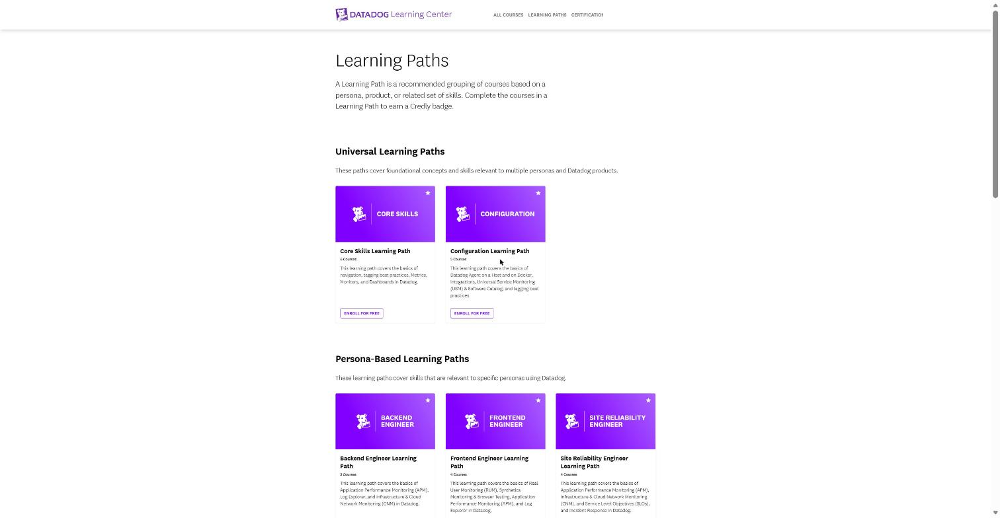

三条路径共 14 门不重复的课程（Tagging Best Practices 同时属于前两条路径）：

| 路径 | 课程 |
|---|---|
| Core Skills | Datadog Quick Start、Tagging Best Practices、Getting Started with Metrics、Getting Started with Monitors、Introduction to Dashboards、Getting Started with Notebooks |
| Configuration | Tagging Best Practices、The Datadog Agent on a Host、The Datadog Agent on Docker、Getting Started with Integrations、Getting Started with Universal Service Monitoring |
| Site Reliability Engineer | Getting Started with Incident Management、Getting Started with APM Metrics & Traces、Getting Started with Infrastructure and Cloud Network Monitoring、Getting Started with SLOs |

下面先按主题讲原理（每个主题都会和第 9 章的开源栈对照），再讲两个动手实验。

## 原理一：标签与统一服务标签 {#p8-tags}

在 Datadog 里，一个数据点由**名称、数值、时间戳和一组标签**组成。标签有两种写法：

- **单值标签**，如 `staging`：只能用来**过滤**。
- **键值标签**，如 `env:staging`：既能过滤，也能按键（`env`）**分组**。

因此课程推荐一律使用键值标签。每多一个键，数据就多一个可以切分的维度。这与 Prometheus 的 label、OpenTelemetry 的 resource attribute 是同一个思想。

Datadog 保留了几个**有固定含义的标签键**，用来在指标、链路、日志之间建立关联：

| 保留键 | 用途 | 第 9 章的对应物 |
|---|---|---|
| `host` | 把指标、链路、进程、日志关联到同一台主机 | `host.name` / `k8s.pod.name` |
| `device` | 按设备或磁盘区分数据 | — |
| `source` | 日志的来源技术，决定自动套用哪条日志处理管道 | Loki 的 `service_name` 等标签 |
| `env` | 环境 | `deployment.environment.name` |
| `service` | 服务名 | `service.name` |
| `version` | 版本 | `service.version` |
| `team` | 资源的负责团队 | — |

其中 `env`、`service`、`version` 三者合称**统一服务标签（Unified Service Tagging）**。只要三类信号都带上同样的这三个标签，就能“按部署版本观察同一个服务”。第 8 章的金丝雀分析做的正是这件事：按 ReplicaSet 拆分指标，比较新旧版本。

课程还给出了一套标签分类，用来思考“需要打哪些标签”：

- **原生标签**：从云厂商等集成自动继承，如 `region`、`availability-zone`、`instance-type`。这个机制叫 integration inheritance。
- **范围标签**：`env`、`datacenter`。
- **功能标签**：`service`、`role`、`database`。
- **归属标签**：`team`、`owner`。
- **业务标签**：`business_unit`、`cost_center`，用于成本分摊。
- **客户标签**：`customer.region`、`product.name`。
- **监控控制标签**：如 `datadog:monitored`，决定哪些云资源要被采集。

**最佳实践**的核心是**全组织统一命名**。课程举了一个反例：同一个指标上同时出现 `app`、`app_name`、`application`、`application_name` 四种键，结果任何一个键都无法覆盖全部数据。解决办法是建立中心化的标签规范，并像配置一样管理它。本项目的 Helm Chart 在所有对象上统一打 `app.kubernetes.io/*` 标签（第 5 章），是同一个原则。

## 原理二：Datadog Agent 的结构与配置 {#p8-agent}

Agent 是一个开源的守护进程，安装在主机上（或以容器方式运行在主机旁），负责收集数据并发送给 Datadog。它由几个协作的进程组成：

```{.mermaid caption="Datadog Agent 的组成与数据流（根据课程与实验中的 status 输出整理）"}
flowchart LR
  subgraph HOST["主机 / 节点"]
    APP["应用进程<br/>（ddtrace 等追踪库）"]
    subgraph AGENT["Datadog Agent"]
      COL["Collector<br/>每约 15 s 运行一次 check<br/>（cpu、disk、redisdb、postgres……）"]
      DSD["DogStatsD<br/>UDP 8125：自定义指标"]
      LOGS["Logs Agent<br/>tail 文件 / 读容器 stdout"]
      TRACE["Trace Agent<br/>8126：接收 APM 链路"]
      PROC["Process Agent<br/>实时进程"]
      SP["system-probe<br/>eBPF：USM / CNM"]
      FWD["Forwarder<br/>批量 + 重试队列"]
    end
  end
  APP -- spans --> TRACE
  APP -- 自定义指标 --> DSD
  COL --> FWD
  DSD --> FWD
  PROC --> FWD
  SP --> PROC
  FWD -- HTTPS --> INTAKE["Datadog 接收端<br/>（按 site，如 datadoghq.com）"]
  LOGS -- HTTPS --> INTAKE
  TRACE -- HTTPS --> INTAKE
```

要点：

- **只出不进。** 所有连接都由 Agent 主动向 Datadog 发起（TCP/UDP 出站），Datadog 从不反向连接 Agent。Agent 在本机监听的端口（8126 链路、8125 DogStatsD 等）应当用防火墙只开放给可信来源，否则任何人都能往你的账号里写数据。
- **配置的三个来源，优先级从高到低**：Remote Configuration（Agent 定期向 Datadog 拉取可远程下发的配置）> 环境变量（`DD_*`）> `datadog.yaml`。实验里 `env: agent-host-lab` 就来自环境变量 `DD_ENV`，安装脚本还把它写进了 `datadog.yaml`。
- **集成（check）也是 YAML 配置。** 每个集成在 `/etc/datadog-agent/conf.d/<名称>.d/` 下有自己的目录：
  - `conf.yaml.default`：核心检查的默认配置，自动生效；
  - `conf.yaml.example`：带注释的样例；
  - 放入或改名得到 `conf.yaml` 就启用该检查；
  - `auto_conf.yaml`：供容器自动发现使用。
- **常用命令。** `datadog-agent status` 查看整体健康状况（各检查、Forwarder、日志、APM）；`config` 查看最终生效的配置；`configcheck` 列出每个检查的配置来源；`check <名称>` 手动运行单个检查；`flare <case-id>` 打包配置和日志发给技术支持，打包时会去除密码、API key 等敏感信息，上传前还会请你确认。
- **日志级别**用 `log_level`（容器里用 `DD_LOG_LEVEL`）设置，可选 `OFF`、`CRITICAL`、`ERROR`、`WARN`、`INFO`、`DEBUG`、`TRACE`，默认 `INFO`。`DEBUG` 只在排障时短时间打开。

**容器中的 Agent**需要“看见”宿主机和其他容器，靠的是把宿主机资源挂载进 Agent 容器：

- `/var/run/docker.sock`：读取容器元数据和日志；
- `/proc`、`/sys/fs/cgroup`：宿主机和容器的资源用量；
- `/`（只读挂到 `/host/root`）：用于进程和网络数据。

需要 eBPF 的功能（USM、CNM）还要额外的内核能力（`SYS_ADMIN`、`NET_ADMIN` 等），以及 `pid: host`。在 Kubernetes 中，同样的 Agent 以 DaemonSet 运行，每个节点一个。

**自动发现（Autodiscovery）**解决的是“容器会在主机间漂移”这个问题。Agent 监听容器的创建和销毁事件，用模板为匹配的容器动态生成检查配置。模板可以写在容器的标签里，例如 Agent 7.36 以上版本的格式：

```yaml
labels:
  com.datadoghq.ad.checks: '{"redisdb": {"instances": [{"host": "%%host%%", "port": "6379", "password": "%%env_REDIS_PASSWORD%%"}]}}'
```

`%%host%%` 运行时替换为容器的 IP，`%%env_X%%` 替换为 Agent 进程的环境变量 `X`。密码因此不必写进标签。这与 Prometheus 的 `kubernetes_sd_configs` 加 relabel（第 9 章 Collector 配置）是同一类机制。

## 原理三：指标的五种类型 {#p8-metrics}

一个指标点只有**时间戳和数值**，单位放在指标的元数据里。单个点几乎没有意义，**持续采集并聚合**之后，才能看出常态、趋势和异常，进而做预测。

Datadog 指标的来源：

- **Agent**：主机、容器、APM、网络指标。
- **核心集成**：随 Agent 发布，源码在 `integrations-core` 仓库。
- **DogStatsD**：StatsD 协议（以 UDP 发送的文本行）加上 Datadog 扩展，例如标签。
- **800 多个其他集成**。
- **由日志、APM span、RUM 事件生成的指标。**
- **自定义指标**：经 HTTP API、DogStatsD 或自定义 check 提交。

五种类型，以及它们在 Prometheus 中的近似对应：

| Datadog 类型 | 含义 | 回答的问题 | Prometheus 近似物 |
|---|---|---|---|
| count | 时间窗口内事件的总数 | 过去 2 小时一共报错多少次？ | `increase(counter[2h])` |
| rate | 每秒事件数（总数 ÷ 秒数） | 错误比上周更频繁吗？ | `rate(counter[5m])` |
| gauge | 窗口内的最后一个值，像仪表盘读数 | 现在内存用了多少？ | gauge |
| histogram | 单个主机上的值分布，派生出 avg、count、median、p95、max | 这台机器上请求延迟的 p95？ | histogram（`histogram_quantile`） |
| distribution | **跨所有主机**全局聚合的分布，可算任意百分位 | 整个服务这周的 p99.9 延迟？ | 跨实例 `sum by (le)` 后再求分位数 |

histogram 和 distribution 的区别，正是第 9 章计算 p95 时要先 `sum by (le)` 再 `histogram_quantile` 的原因：百分位不能先在各实例上算好再取平均。

## 原理四：集成的三种形态 {#p8-integrations}

| 类型 | 工作方式 | 例子 |
|---|---|---|
| 基于 Agent | Agent 内的 Python check 类定期运行；核心集成随 Agent 发布，社区集成在 `integrations-extras`，需要另行安装 | Docker、Nginx、Redis、PostgreSQL、Kafka |
| 基于认证（crawler） | 你在 Datadog 中配置凭据，由 Datadog 调用对方 API 拉取数据 | AWS（IAM Role + CloudFormation）、Azure、GCP、Slack、PagerDuty |
| 库集成 | 在应用代码中引入追踪库，数据先发给本机 Agent | ddtrace（Python、Ruby、Java、Node.js……） |

云集成可以用标签过滤采集范围：`datadog:monitored` 只采集带该标签的资源，`!env:staging` 排除测试环境；排除优先于包含。这对控制成本很重要。

## 原理五：监控（Monitor）与告警 {#p8-monitors}

**先监控什么。** 服务看 **RED**（Rate、Errors、Duration），基础设施看 CPU、内存、磁盘。这和第 3 章给 demo-api 设计的指标、第 9 章的告警规则完全一致。

**有哪些类型。** Datadog 有 20 多种 monitor，包括 metric、APM、logs、anomaly（基于历史的异常检测）、Database Monitoring、Error Tracking、RUM、Synthetic、Cloud Network、host、integration、service check 等。

**怎么创建。** 可以在 UI 中用表单创建，也可以克隆已有的、套用模板、从其他产品页面直接创建，还可以用 **HTTP API** 或 **Terraform** 以代码方式管理。后两种正是本项目一贯的做法：配置进 Git、经评审合并。

**表单的五个部分：**

1. **检测方法**：阈值、变化量、异常等。
2. **查询**：要计算的值，以及按什么维度分组。按组分别告警（multi alert），每个主机或服务各自独立告警。
3. **告警条件**：告警阈值和警告阈值、评估窗口，以及**数据缺失时**怎么处理（对应 Prometheus 的 `absent()`）。
4. **通知**：名称和消息支持变量，可以通知邮件、Teams、Slack、PagerDuty 等。还可以设置优先级 P1–P5 和 monitor 自己的标签。注意 monitor 的标签不是指标的标签，它用来检索和归类告警。
5. **权限与审计**：谁可以修改这条 monitor，修改时是否发出审计事件。

**monitor 状态页**有三张图：

- **评估数据**：每次评估的结果，对应 Prometheus 规则的 `for` 和评估间隔；
- **原始数据**：查询的原始曲线；
- **状态转换**：按组显示何时进入告警。

下方的事件时间线可以直接静音（mute）、手动解除（resolve）、宣告事故、触发自动化工作流。计划维护时用 **downtime** 预先静音。第 9 章的 PrometheusRule 加 Alertmanager 能做到同样的事，只是没有现成的界面。

## 原理六：仪表盘与 Notebook {#p8-dashboards}

**仪表盘**由组件（widget）组成，常用的有三种：

- **时序图**：看一个值随时间的变化；
- **数值**：看当前值；
- **说明与链接**：补充上下文，或链接到运行手册。

很多集成自带开箱即用的仪表盘，组件可以直接复制粘贴到自己的仪表盘里（Datadog Clipboard）。**模板变量**让同一个仪表盘可以按 `env`、`service`、`team` 等标签切换，不必为每个团队各做一份。Grafana 的 dashboard variable 是同一概念。

**Notebook** 是“可执行的调查记录”：把日志、指标、链路、SLO 的查询和 Markdown 文字放在同一个文档里，团队可以一起编辑，也可以套用模板，比如事后复盘模板。Notebook 本身永久保存，但它引用的遥测数据仍受保留期限制，过了保留期，图表就会变空。课程中的 Notebook 还集成了 AI 助手（Bits Chat），可以总结内容、按描述生成新的单元格。

## 原理七：APM 与分布式追踪 {#p8-apm}

APM 收集两类数据：

- **链路指标**：请求数、错误数、延迟。按 **100% 的请求**计算，不受链路采样影响。
- **链路（trace）**：单个请求经过各服务的完整路径，可能被采样。

一条链路由多个 **span** 组成，用**火焰图**展示：横条的长度是耗时，上下的嵌套是调用关系。第 9 章 Grafana 中的 `pricing.calculate` span 就是这样一眼看出来的。

span 上有两类元数据，区分开很重要：

| | span 标签（tags） | span 属性（attributes） |
|---|---|---|
| 描述什么 | 运行环境：容器、主机、Kubernetes 部署、`env`、`service` | 请求内容：`http.url`、`customer.id`、`error.message` |
| 用途 | 判断问题出在应用还是环境 | 深挖某一类请求 |

在 Trace Explorer 中，用 `@` 前缀查询属性（如 `@http.url`），`env`、`service`、`operation_name`、`trace_id` 等保留属性可以直接查。任何标签或属性都可以设为 facet，用来过滤和分组。

服务页面的图表可以切换为 **“按版本”** 查看请求数、错误率和延迟，这正是部署后比较新旧版本的方式。还可以切换为 **Apdex**：0 到 1 之间的用户满意度分数，1 表示所有请求都在满意阈值内。**下游耗时占比**（sublayer）则告诉你，一个慢服务的时间到底花在了哪个下游依赖上。

## 原理八：基础设施、网络与 USM {#p8-infra}

**基础设施监控**的对象分四类：主机、容器、进程、无服务器函数。只要在主机上部署了 Agent，CPU、内存、磁盘、网络等指标会自动出现在 **Host Map** 和 **Infrastructure List** 中。可以按标签过滤和分组，也可以为每台主机各建一条 multi-alert monitor。

**云网络监控（CNM）**解决的是“每个组件单独看都健康，但它们之间的通信有问题”。它借助 system-probe 的 eBPF 采集任意标签之间（服务、容器、可用区……）的连接，关注以下指标：

- **RTT**：往返时延；
- **TCP 重传**：丢包的信号；
- **DNS 解析的延迟和失败**；
- **跨区流量**：与成本有关。

尽管名字里有 Cloud，本地机房和混合环境同样适用。

**通用服务监控（USM）**用 eBPF 在内核网络栈中解析 HTTP(S)、HTTP/2、gRPC 流量，**不改一行代码**就能得到每个服务入站和出站的 RED 指标，新服务部署后会被自动发现。前提是服务带有统一服务标签，或者至少有 `app`、`short_image`、`container_name` 这类容器标签。发现的服务自动登记到 **Software Catalog**，里面集中了负责人、联系方式、上下游依赖和遥测数据。事故发生时，靠它能立刻找到该联系谁。

## 原理九：SLO、错误预算与燃烧率 {#p8-slo}

**SLO（服务等级目标）**是对服务可靠性的可量化承诺，例如“30 天内 99.5% 的下单请求成功”。Datadog 支持三种 SLO：

| 类型 | 计算方式 | 适合 |
|---|---|---|
| 基于指标 | 好事件数 ÷ 总事件数 | 请求成功率这类简单指标 |
| 基于 monitor | monitor 处于 OK 状态的时间比例 | 多区域等复杂场景 |
| 时间片（time slice） | 把时间切成小片（如每 5 分钟），统计达标的片数 | 不想让短时间的严重故障被长期平均值稀释 |

**好的 SLI（服务等级指标）**有三个特征：

- 反映**用户是否满意**；
- 随用户满意度**线性变化**；
- 取值在 **0%–100%** 之间。

常见的反模式：

- **用户不关心的指标**，如 CPU 使用率。这类指标适合做 monitor，不适合做 SLI。
- **过于复杂的组合公式**。
- **看到也无法采取行动的指标**，如“自动扩缩组里有几台机器”。

**错误预算 = 1 − 目标。** 目标 99.5%，错误预算就是 0.5%。预算的意义在于“允许失败多少”，可以用来决定是继续发布新功能，还是停下来修稳定性。可以在用掉一定比例时告警，例如 7 天内用掉 50% 发警告、用掉 75% 正式告警。

**燃烧率 = 实际错误率 ÷ 错误预算。**

- 燃烧率为 **1**：在 SLO 周期结束时恰好用完预算；
- 燃烧率为 **2**：用一半时间就耗尽；
- 燃烧率为 **10**：只用十分之一的时间就耗尽。

以 demo-api 为例：若 SLO 是 30 天 99.5%，第 9 章演练中 dev 的错误率约 15%，燃烧率就是 15% ÷ 0.5% = 30，整个月的预算一天就会烧完。

**燃烧率告警**通常同时使用一个长窗口（以小时计）和一个短窗口（以分钟计），两个窗口都超过阈值才告警：

- **长窗口**保证是持续的问题，而不是一次抖动；
- **短窗口**保证问题仍在发生，恢复后能很快解除告警。

两个常用的换算：

- **阈值的算法**：在长窗口内消耗掉预算的某个比例，对应的燃烧率 = 该比例 × SLO 周期 ÷ 长窗口。课程的例子是 7 天 SLO、1 小时内耗掉 10% 的预算，燃烧率 = 0.1 × 168 h ÷ 1 h = 16.8。
- **短窗口的取法**：课程建议起步取长窗口的一半，再按团队需要调整。Google SRE Workbook 的多窗口方案常用长窗口的 1/12，例如 1 h 配 5 min。

第 12 章会在 Prometheus 中为 demo-api 实现这套燃烧率告警。

## 原理十：事故管理 {#p8-incident}

课程把事故管理归纳为五个支柱：

1. **生命周期。** 一次事故依次经历四个阶段：
   - **影响**：问题出现，被告警或用户报告发现；
   - **事故**：宣告事故，开始调查和缓解；
   - **稳定**：影响已经止住，继续观察；
   - **跟进**：复盘，落实改进项。
2. **严重级别。** SEV-1 是全面中断，需要全员响应；SEV-5 是无用户影响的小问题。判断标准要事先定义好，事故中才能快速、一致地定级。
3. **角色**分三组：
   - **指挥**：事故指挥官（Incident Commander）负责协调和决策，不一定亲自动手排查；
   - **联络**：对内、对外分别通报进展，免得排查的人被频繁打断；
   - **执行**：最熟悉相关系统的工程师负责定位和修复。
4. **文化。** 不追责（blameless），只关心系统和流程哪里出了问题；对自己负责的服务有主人翁意识；**降低宣告事故的门槛**，把 SEV-2 降级为 SEV-3，远比追赶一个被忽视了 30 分钟的 SEV-1 容易。
5. **事后分析。**
   - **复盘文档**包括：摘要、时间线、根因（往往不止一个）、促成因素、每项都有负责人和期限的改进项。
   - **度量指标**：MTTD（发现用时）、MTTA（响应用时）、MTTR（恢复用时）、复发率、误报率。

Datadog 把这些放进同一个平台：

- 从 monitor、图表或 Slack **直接宣告事故**；
- 自动生成**时间线**，排查中的关键图表钉到**工作台**；
- 用 **Status Page** 对外通报；
- 一键生成 **AI 复盘草稿**；
- 用**分析仪表盘**跟踪 MTTD/MTTR。

第 9 章发现的真实问题会在第 12 章按这套方法写成复盘。

## 动手实验一：The Agent on a Host {#p8-lab-host}

实验环境是一台 Ubuntu 虚拟机 `agent-host`，上面运行着 Storedog。nginx、Next.js 前端、Rails 后端和 worker、Python Flask 折扣服务、广告服务运行在 Docker 容器中，Redis 和 PostgreSQL 直接装在主机上。任务是在这台主机上安装并配置 Agent。

::: note
**实验会话过期了一次。** 做到第 3 个挑战时，对话暂停超过 10 分钟，实验会话过期。点 “Restart track” 会得到一台全新的虚拟机，于是从第 1 个挑战重新做了一遍。下面的截图来自两次运行（Agent 的安装和状态检查来自第一次，其余来自第二次），每一步都通过了平台的检查。
:::

### 挑战 1：安装 Agent

实验说明的标准做法是：登录 Datadog 网页，在 *Integrations → Install Agents → Linux* 页面选择 API key，复制生成的一行安装命令。网页登录这一步做不了。好在实验主机已经导出了 `DD_API_KEY`、`DD_SITE`、`DD_ENV` 等环境变量。下面只打印变量名，不打印值：

```console
root@agent-host:~/lab# env | grep -oE '^(DD|DATADOG)_[A-Z_]*' | sort
DD_AGENT_HOST
DD_API_KEY
DD_APPLICATION_ID
DD_APP_KEY
DD_CLIENT_TOKEN
DD_ENV
DD_HOSTNAME
DD_SITE
DD_TAGS
```

官方安装脚本本来就从环境变量读取 API key 和站点，所以可以直接运行，key 不经过键盘：

```bash
bash -c "$(curl -fsSL https://install.datadoghq.com/scripts/install_script_agent7.sh)" > /tmp/agent-install.log 2>&1
echo "install exit=$?"
```

安装后，Agent 以 systemd 服务 `datadog-agent` 运行：

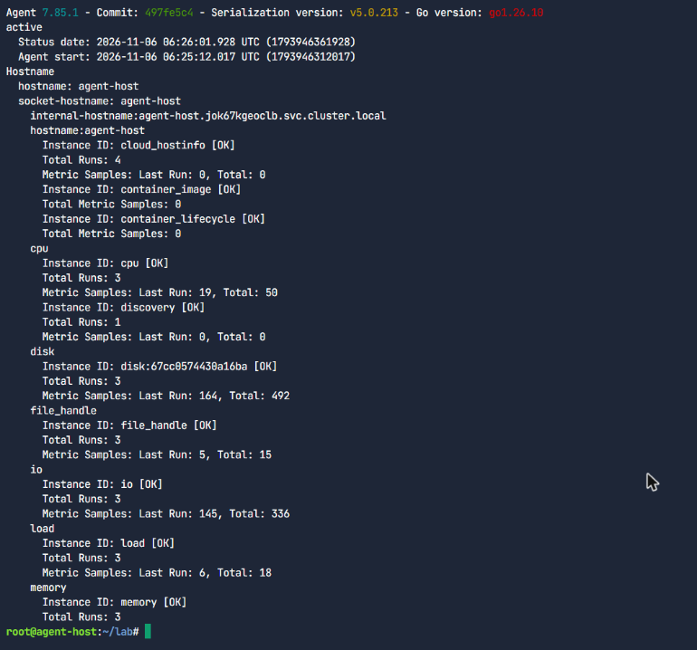{height=125mm}

点 Check，平台确认 Agent 已安装并在运行，进入下一个挑战。

### 挑战 2：用 status 和 config 检查 Agent

`datadog-agent status` 的 **Forwarder** 部分是判断“数据有没有发出去”的第一现场。下面的输出中，API key 的后几位已经用 `sed` 打码：

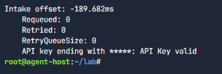

```console
  Transaction Successes
  =====================
    Total number: 63
    Successes By Endpoint:
      check_run_v1: 11
      intake: 4
      metadata_v1: 7
      process: 30
      series_v3: 11
```

`datadog-agent config` 显示的是**最终生效**的配置，包括默认值和来自环境变量的值：

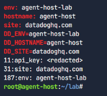

### 挑战 3：开启实时进程（Live Processes）

很多功能默认是关闭的，需要在 `datadog.yaml` 中显式开启。实验原本是在 IDE 中取消注释，这里改为追加一段等效的配置：先确认文件里没有未注释的同名键，再追加并重启 Agent：

```bash
F=/etc/datadog-agent/datadog.yaml
grep -nE '^process_config:' $F || printf '\nprocess_config:\n  process_collection:\n    enabled: true\n' >> $F
systemctl restart datadog-agent
datadog-agent config | grep -A1 '^  process_collection:'
```

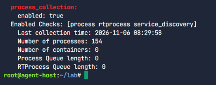

### 挑战 4：收集日志与链路

日志默认不采集。开启后，`BytesSent` 却一直是 0：Agent 以低权限用户 `dd-agent` 运行，而 Docker 的 socket 只对 `docker` 组开放。把它加进 `docker` 组就解决了：

```bash
printf '\nlogs_enabled: true\nlogs_config:\n  container_collect_all: true\n' >> /etc/datadog-agent/datadog.yaml
usermod -a -G docker dd-agent && systemctl restart datadog-agent
```

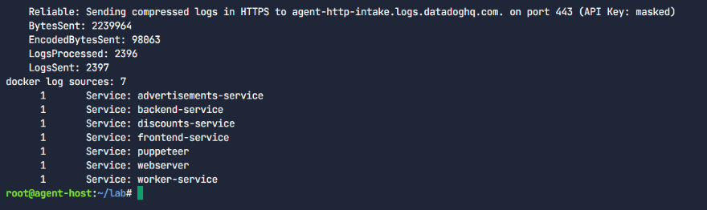

链路同样：Storedog 的服务早已用 ddtrace 埋点，一直在尝试发送链路。但 Agent 默认只接收本机（localhost）来的链路，而容器在自己的网络里，所以要打开非本机流量：

```bash
printf '\napm_config:\n  apm_non_local_traffic: true\n' >> /etc/datadog-agent/datadog.yaml
systemctl restart datadog-agent
```

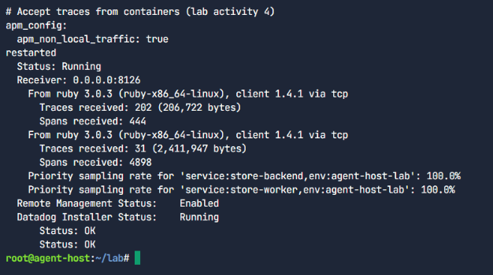

### 挑战 5：配置 Redis 与 PostgreSQL 集成

先用 `configcheck` 看清楚每个检查的配置从哪里来：

- 核心检查来自 `conf.d/<名称>.d/conf.yaml.default`；
- nginx 等检查的来源是 `container:docker://…`，即由自动发现生成。

**Redis。** Redis 设有密码，检查配置里需要填写它。实验说明里直接给出了密码，但仍然不手工输入：实验主机的 `/etc/redis/redis.conf` 里本来就有 `requirepass`，于是让 shell 读出这个值并写入配置，屏幕上只显示打码后的结果：

```bash
D=/etc/datadog-agent/conf.d/redisdb.d
PW=$(sed -n 's/^requirepass[[:space:]]\{1,\}//p' /etc/redis/redis.conf | head -1)
printf 'init_config:\n  service: redis\ninstances:\n  - host: localhost\n    port: 6379\n    password: "%s"\nlogs:\n  - type: file\n    path: /var/log/redis/redis-server.log\n    source: redis\n    service: redis\n' "$PW" > $D/conf.yaml
unset PW; chown dd-agent:dd-agent $D/conf.yaml; chmod 640 $D/conf.yaml
usermod -a -G adm dd-agent        # Redis 日志属于 redis:adm，权限 660（rw-rw----）
systemctl restart datadog-agent
```

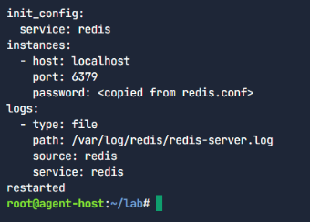

![redisdb 检查 [OK]：每次运行 100 个指标样本，识别出 Redis 6.0.16；Redis 日志文件的采集状态为 OK（实验终端截图）](../../evidence/p8/agent-host-08-redisdb-check.png)

**PostgreSQL。** 实验在启动时已经建好了监控专用的数据库用户 `datadog`，建用户的 SQL 在 `/root/restore.sql` 里，同样让 shell 读取密码。日志配置用到一条**多行规则**：以日期开头的行才算一条新日志，避免把多行 SQL 错误拆成好几条。

```bash
D=/etc/datadog-agent/conf.d/postgres.d
PW=$(sed -nE "s/^create user datadog with password '([^']*)';.*/\1/Ip" /root/restore.sql | head -1)
printf 'init_config:\ninstances:\n  - host: localhost\n    username: datadog\n    password: "%s"\nlogs:\n  - type: file\n    path: /var/log/postgresql/postgresql-14-main.log\n    source: postgresql\n    service: database\n    log_processing_rules:\n      - type: multi_line\n        pattern: %s\n        name: new_log_start_with_date\n' \
  "$PW" '\d{4}\-(0?[1-9]|1[012])\-(0?[1-9]|[12][0-9]|3[01])' > $D/conf.yaml
unset PW; chown dd-agent:dd-agent $D/conf.yaml; chmod 640 $D/conf.yaml
usermod -a -G postgres dd-agent
systemctl restart datadog-agent
```

正则作为 `printf` 的参数传入，而不是写在格式串里，以免反斜杠被 `printf` 解释。

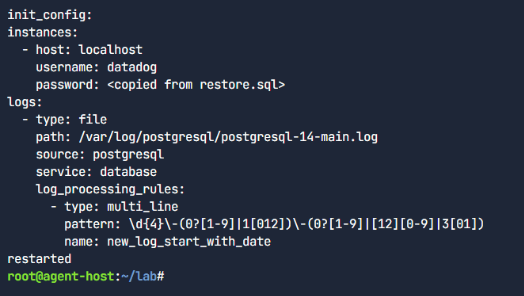

![postgres 检查 [OK]：每次运行 194 个指标样本，并上报了数据库监控（DBM）元数据；日志采集状态 OK（刚启动，暂无新日志）（实验终端截图）](../../evidence/p8/agent-host-10-postgres-check.png)

### 挑战 6：在 Datadog 中浏览数据（未完成）

最后一个挑战是登录 Datadog 网页，开启日志管理，然后浏览指标、日志和仪表盘。这一步需要网页登录，**没有做**。作为替代，用实验主机上的 Application key 调用 Datadog 官方 API，确认数据确实到达了：

```bash
H=(-H "DD-API-KEY: $DD_API_KEY" -H "DD-APPLICATION-KEY: $DD_APP_KEY")
curl -s "${H[@]}" "https://api.$DD_SITE/api/v1/hosts?filter=agent-host" | jq ...
curl -s "${H[@]}" -G "https://api.$DD_SITE/api/v1/query" --data-urlencode 'query=avg:system.cpu.user{host:agent-host}' ...
```

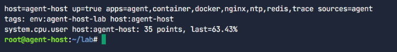

这证明了数据链路是通的，但它**不等于**完成了网页实验，所以这门课的实验课时没有标记为完成。

## 动手实验二：The Agent on Docker {#p8-lab-docker}

这次 Storedog 完全容器化（Redis 和 PostgreSQL 也在容器里），用 Docker Compose 编排。任务是把 Agent 作为一个服务加进 `docker-compose.yml`。

### 挑战 1：加入 Agent 服务

`/root/lab/docker-compose.yml` 中预留了 `# paste agent block here` 标记。把实验给出的服务定义写入临时文件，再用 `sed` 插入到标记之后：

```yaml
  dd-agent:
    image: registry.datadoghq.com/agent:7.77.2
    environment:
      - DD_API_KEY            # 只写变量名：Compose 从当前 shell 环境传入值，不落盘
      - DD_HOSTNAME
      - DD_ENV
      - DD_LOGS_ENABLED=true
      - DD_LOGS_CONFIG_CONTAINER_COLLECT_ALL=true
      - DD_PROCESS_AGENT_ENABLED=true
      - DD_CONTAINER_LABELS_AS_TAGS={"my.custom.label.team":"team"}
      - DD_APM_NON_LOCAL_TRAFFIC=true
      - DD_DOGSTATSD_NON_LOCAL_TRAFFIC=true
      - DD_SYSTEM_PROBE_NETWORK_ENABLED=true
      - DD_SYSTEM_PROBE_SERVICE_MONITORING_ENABLED=true
      - HOST_ROOT='/host/root'
    pid: "host"
    volumes:
      - /var/run/docker.sock:/var/run/docker.sock:ro
      - /proc/:/host/proc/:ro
      - /sys/fs/cgroup/:/host/sys/fs/cgroup:ro
      - /sys/kernel/debug:/sys/kernel/debug
      - /:/host/root:ro
      - /etc/passwd:/etc/passwd:ro
      - /etc/group:/etc/group:ro
      - /etc/os-release:/etc/os-release
    cap_add: [SYS_ADMIN, SYS_RESOURCE, SYS_PTRACE, NET_ADMIN, NET_BROADCAST, NET_RAW, IPC_LOCK, CHOWN]
    security_opt:
      - apparmor:unconfined
```

逐项理解这段配置：

- 主机上的配置文件，在这里全部换成了**环境变量**。
- `DD_CONTAINER_LABELS_AS_TAGS` 把容器标签转换为 Datadog 标签。
- 两个 `DD_SYSTEM_PROBE_*` 开启 CNM 和 USM。它们依赖 eBPF，所以才需要 `pid: host`、额外的内核能力（cap_add）和 AppArmor 豁免。

```bash
sed -i '/# paste agent block here/r /tmp/agent-block.yml' docker-compose.yml
docker compose config -q && echo "compose file valid"
docker compose up -d dd-agent          # 只启动 Agent，不必重启整个应用
```

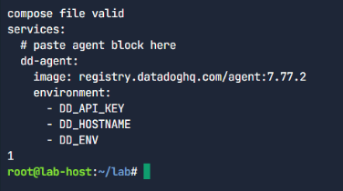

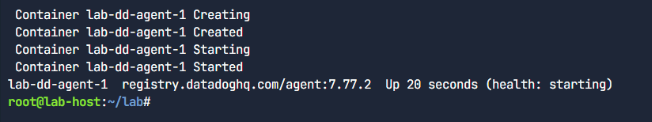

点 Check 后，平台确认 Agent 容器在运行。

### 挑战 2：在容器里运行 Agent 命令

命令改为在容器里执行：`docker compose exec dd-agent agent status`。

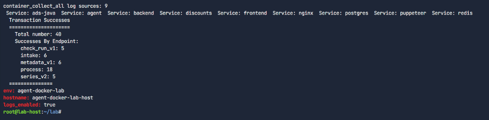

### 挑战 3 与 4：浏览数据、补充服务标签（未完成）

第 3 个挑战又是网页浏览，同样用 API 看了一遍。下面这次输出的截图没能保存（当时 Edge 窗口被最小化），文字直接抄自实验终端：

```console
host=agent-docker-lab-host up=true apps=
running containers: 16
  lab-advertisements-1  service:advertisements-service
  lab-backend-1  service:backend-service
  ...
  lab-ads-java-1  service:ads-java
  lab-backend-1  service:backend
  lab-discounts-1  service:discounts
logs found (page of 5): 5
```

这次输出揭示了两件事：

- **试用组织是共用的。** 上一个实验的容器（`service:backend-service` 等）和这一个实验的容器（`service:backend` 等）同时出现在列表里。
- **服务标签需要补充。** 这一个实验的容器没有显式设置服务标签，`service` 只是从镜像名推导出来的。这正是第 4 个挑战（用容器标签补充统一服务标签）要解决的问题。

第 3 个挑战没有点“下一步”，第 4 个挑战也没有开始。

## 对照：Datadog 与本项目的开源栈 {#p8-mapping}

| 关注点 | Datadog | 本项目（第 7–9 章） |
|---|---|---|
| 采集端 | Datadog Agent（含 DogStatsD、trace-agent、system-probe） | OpenTelemetry SDK + Collector；Prometheus 抓取 |
| 自动发现 | Autodiscovery，用容器标签声明模板 | `kubernetes_sd_configs` + relabel，按 Pod 注解发现 |
| 统一标签 | `env` / `service` / `version` | `deployment.environment.name` / `service.name` / `service.version` |
| 指标 | count、rate、gauge、histogram、distribution | counter、gauge、histogram（`histogram_quantile`） |
| 链路 | APM、Trace Explorer、火焰图 | Tempo、TraceQL、Grafana 链路视图 |
| 日志 | Log Management、Log Explorer | Loki、LogQL |
| 告警 | Monitor（多种类型）、downtime | PrometheusRule（`for`）、Alertmanager |
| 仪表盘 | Dashboard、模板变量、Notebook | Grafana dashboard 与变量 |
| SLO | 基于指标、基于 monitor、时间片 SLO，燃烧率告警 | 记录规则 + 燃烧率规则（第 12 章实现） |
| 无埋点服务指标 | USM（eBPF） | —（需要应用埋点） |
| 网络 | CNM（eBPF） | — |
| 事故管理 | Incident Management、Status Page、AI 复盘 | Git 中的 RCA 文档（第 12 章） |
| 部署门禁 | Synthetic 测试 + `datadog-ci` | k6 合成测试门禁（第 11 章） |

两者的取舍很清楚。商业平台把采集、存储、关联、告警、事故流程整合在一起，开箱即用，并有 eBPF 这类“零埋点”的能力；代价是费用、数据出境和厂商绑定。开源栈处处要自己组装和运维，但每一层都可以替换，数据留在自己手里。理解了第 9 章的原理，再看 Datadog 的每个产品都不难找到对应物；反过来，Datadog 的产品划分也是一份很好的“开源栈还缺什么”的清单。

## 常见问题

**Q1：Agent 装好了，但 Datadog 里看不到数据。**
先看 `datadog-agent status` 的 Forwarder 部分：API key 是否有效、事务是否成功、有没有重试。再确认 `site` 与账号所在站点一致（如 `datadoghq.com` 或 `datadoghq.eu`），以及出站防火墙放行了对应的接收域名。

**Q2：进程或容器数为 0，容器日志 `BytesSent: 0`。**
Agent 以 `dd-agent` 用户运行，读不到 `docker.sock`。执行 `usermod -a -G docker dd-agent` 后重启。在容器里运行的 Agent，则要确认已挂载 `/var/run/docker.sock`。

**Q3：应用发了链路，APM 却收不到。**
Agent 默认只接收本机的链路。来自容器或其他主机的流量，需要设置 `apm_config.apm_non_local_traffic: true`（容器中用 `DD_APM_NON_LOCAL_TRAFFIC=true`），并确认应用连接的是 Agent 的 8126 端口。

**Q4：集成检查正常，但它的日志没有采集上来。**
检查日志文件的属主和权限。Redis 日志属于 `redis:adm`，PostgreSQL 日志属于 `postgres` 组，要把 `dd-agent` 加入相应的组。

**Q5：多行日志（如 SQL 错误、Java 异常栈）被拆成了很多条。**
用 `log_processing_rules` 中的 `multi_line` 规则，以“新日志的开头”（通常是时间戳）作为分界。

**Q6：实验做到一半，提示 “Your session expired”。**
实验会话 10 分钟无操作就过期。点 “Restart track” 会得到一台全新的虚拟机，只能从头再做。试用组织和账号 14 天内不变。

**Q7：浏览器自动化截图一直超时。**
确认 Edge 窗口没有被最小化，并且当前活动的标签页就是要操作的那个。窗口最小化或标签页在后台时，页面不渲染。

## 学习进度与需要你本人完成的事项 {#p8-todo}

平台记录的进度（`/enrollments`）：

| 课程 | 进度 | 课程 | 进度 |
|---|---|---|---|
| Getting Started with Integrations | 75% | Introduction to Dashboards | 66% |
| Getting Started with SLOs | 71% | Getting Started with Metrics | 66% |
| Getting Started with Monitors | 71% | Tagging Best Practices | 66% |
| The Agent on a Host | 66% | Getting Started with APM Metrics & Traces | 62% |
| The Agent on Docker | 66% | Getting Started with Infrastructure and CNM | 50% |
| Getting Started with Incident Management | 66% | Getting Started with Notebooks | 50% |
| Getting Started with USM | 66% | Datadog Quick Start | 50% |

每门课剩下的都是实验课时和反馈问卷，**没有一门课已经完成，也没有领取任何证书或徽章**。需要你本人做的事：

1. **登录一次实验用的 Datadog 试用账号。** 打开任一课程的实验，在左侧终端或右侧 “Log in to Datadog” 步骤中可以看到用户名和密码，在 `app.datadoghq.com/account/login` 登录即可。之后各实验的网页部分都可以继续，可以由你自己完成，也可以登录后让我接着做。
2. **完成两个 Agent 实验的剩余挑战。** “Agent on a Host”只剩第 6 个挑战（网页浏览）；“Agent on Docker”剩第 3、4 个挑战。注意实验会话可能已经过期，需要重启并重做终端部分，命令都在本章里。
3. **填写各课的反馈问卷。** 问卷完成后课程才会到 100%，并发放结课证书。
4. **认证考试**（若打算参加）由你本人报名和完成。

## 练习 {#p8-exercises}

::: exercise
1. **（理解）** 统一服务标签 `env`、`service`、`version` 分别对应 OpenTelemetry 的哪些资源属性？在本项目中，它们是在哪里设置的？如果只缺少 `version`，哪些分析就做不了？
2. **（原理）** 某服务的 10 台主机各自用 histogram 类型在本地算出 p95 后上报。能不能把 10 个 p95 取平均，作为全局的 p95？为什么 distribution 类型可以给出正确的全局百分位？这与第 9、12 章 PromQL 中“先 `sum by (le)`、再 `histogram_quantile`”的写法是什么关系？
3. **（计算）** 一个 7 天的 SLO，目标 99.9%。希望“1 小时内消耗 5% 的预算”时立即呼叫，燃烧率阈值是多少？对应的 1 小时错误率是多少？
4. **（动手，需要你本人登录实验的试用组织）** 为 Storedog 的一个服务建立基于指标的 SLO 和燃烧率 monitor，把参数与第 12 章 Prometheus 中的规则逐项对照。
5. **（设计）** 对照表中 USM、CNM 这两行，开源栈一栏是空的。如果要在开源栈中补上“无需埋点的服务指标与网络可见性”，有哪些候选方案？它们分别需要什么前提条件？
6. **（思考）** 选择商业平台还是自建开源栈，除了费用，还要考虑哪些因素？分别描述一个更适合 Datadog 的团队，和一个更适合自建的团队。
:::

参考答案见附录 B。

## 本章小结

- Datadog 的核心组织方式是**标签**，`env`、`service`、`version` 三个统一服务标签把指标、链路、日志关联起来，和 OpenTelemetry 的资源属性一一对应。
- Agent 由 Collector、Forwarder、Logs Agent、Trace Agent、Process Agent、system-probe 等协作完成采集，配置按“远程配置 > 环境变量 > `datadog.yaml`”的优先级生效。在两个实验里，它从零开始被安装、开启了进程、日志、链路，接入了 Redis 和 PostgreSQL 集成，每一步都通过了平台的自动检查。
- 指标的五种类型、RED 监控、燃烧率告警、事故管理的生命周期和角色，都可以直接迁移到开源栈上，后面几章会用到。
- 网页登录这一步按规则没有代做，相关实验如实标为未完成；只有平台确认过的进度才算数。
