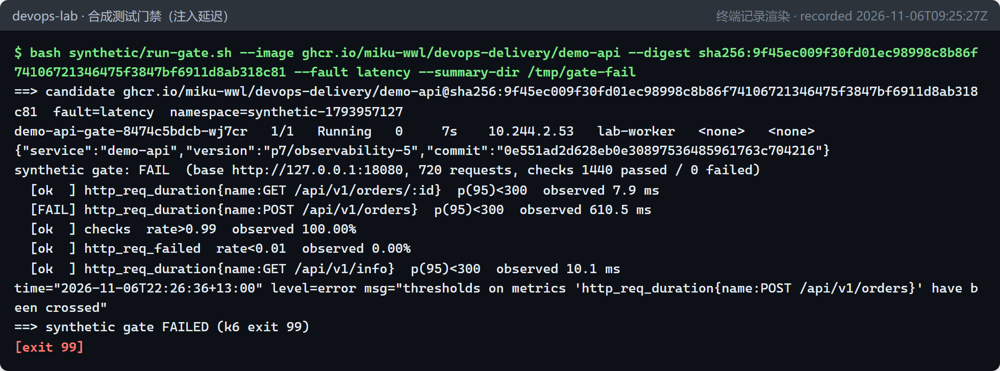
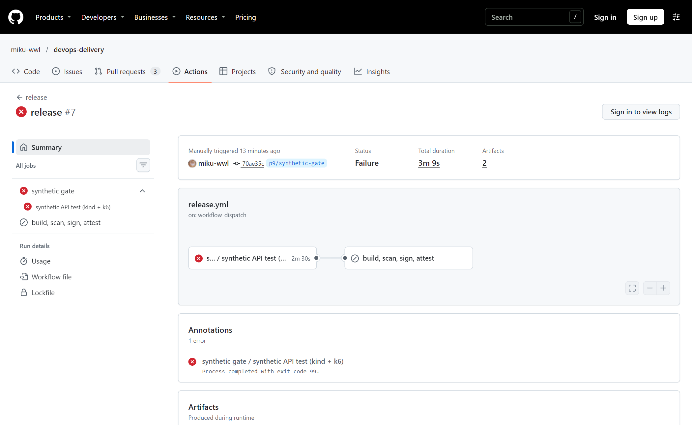
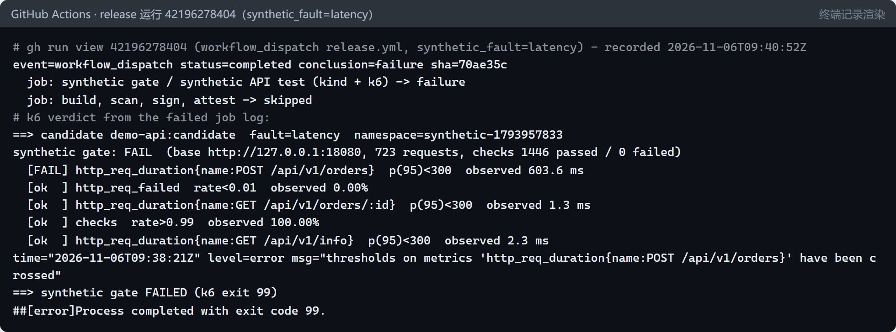
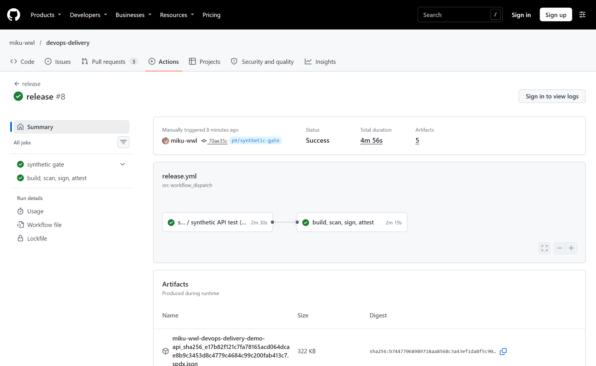

# 发布前的合成测试门禁：在 CI 中用 Kind + k6 拦住坏版本（P9 / D9） {#ch-p9}

<div class="lead">第 8 章的金丝雀在生产环境用真实流量做最后一道把关；第 9 章的告警在问题发生后通知人。能不能在镜像推送、签名之前就发现问题？本章在 CI 里为每个候选版本临时搭一个 Kubernetes 集群（Kind），把它部署上去，再用 k6 模拟用户的完整操作。只要有一个阈值不达标，发布作业就不会运行。三次真实的流水线运行展示了“通过 → 被拦截 → 恢复后通过”的完整过程。</div>

## 本章目标与产出

| 产出 | 位置 |
|---|---|
| k6 合成测试脚本（用户旅程 + 阈值） | `synthetic/k6/api-check.js` |
| 门禁脚本：部署候选版本 → 测试 → 清理 | `synthetic/run-gate.sh` |
| 可复用工作流：CI 中的 Kind 集群 + 门禁 | `.github/workflows/synthetic-gate.yml` |
| 发布流水线改为“先过门禁再发布” | `.github/workflows/release.yml` |
| 工具安装脚本（固定版本、校验 SHA256） | `automation/ci/install-gate-tools.sh` |
| Datadog Synthetic 方案（模板，未运行） | `synthetic/datadog/` |

**验收标准（路线图 D9，Gate G7 的开源部分）：** 合成测试失败时阻断发布，恢复后通过。已通过：注入延迟的运行中发布作业被跳过（运行 42196278404），恢复后的运行中发布作业正常执行（运行 42196846132）。Datadog 版本因为没有 Datadog 账号，状态为 **NOT_RUN**。

## 原理 {#p9-principles}

### 测试左移，以及“合成测试”在其中的位置

越早发现问题，修复越便宜。本项目的流水线已经有好几层检查。各层能发现的问题不同，没有一层可以替代其他层：

| 层次 | 在哪里运行 | 能发现 | 发现不了 |
|---|---|---|---|
| 单元测试（第 3 章） | CI，几秒钟 | 函数逻辑错误 | 部署、配置、网络、性能 |
| 镜像冒烟测试（第 3 章） | CI，单个容器 | 镜像能否启动 | Kubernetes 中的行为、持续负载 |
| 漏洞扫描（第 7 章） | CI | 已知 CVE | 功能和性能问题 |
| **合成测试门禁（本章）** | CI 中的临时集群 | 按真实部署方式运行时，用户旅程是否正确、是否够快 | 只在生产配置或真实流量下出现的问题 |
| 金丝雀分析（第 8 章） | 生产环境，部分流量 | 生产环境中的真实退化 | 发布前的任何问题 |
| 告警（第 9 章） | 一直在运行 | 已经发生的问题 | 预防问题 |

**合成测试（synthetic test）**用脚本模拟用户操作，不依赖真实用户的流量。它有两种用法：

- **合成监控**：在生产环境 7×24 小时定期运行，用来更早发现故障。Datadog Synthetic、各种拨测服务属于这一类。
- **合成测试门禁**：在发布流水线里，对候选版本运行一次，结果决定能不能发布。本章做的是这一种。

### 测什么：用户旅程，而不是单个接口

一次迭代就是一次完整的**用户旅程**：

1. 查询服务信息；
2. 下单；
3. 用返回的订单号读回订单。

每一步都有**断言**（k6 中叫 check）：状态码、返回字段，以及一条业务规则（总价 = 单价 × 数量）。“读回订单”这一步验证的是写入确实生效了，单独测试每个接口发现不了这类问题。

### 怎么判定：阈值就是门禁

k6 有两个容易混淆的概念：

- **check（断言）**：记录每次断言成功还是失败，**本身不会让测试失败**。
- **threshold（阈值）**：对整个运行期间的指标提出要求。只要有一个不满足，k6 就以退出码 **99** 结束，CI 步骤随之失败。

本章设置了三类阈值，和第 9 章、第 10 章的 SLO 思路一致：

| 阈值 | 含义 |
|---|---|
| `checks: rate>0.99` | 功能：99% 以上的断言成立 |
| `http_req_failed: rate<0.01` | 可用性：网络错误和 4xx、5xx 响应少于 1% |
| `http_req_duration{name:...}: p(95)<300` | 性能：每个接口的 p95 延迟不超过 300 ms |

延迟阈值是按接口设置的：请求打上 `name` 标签，阈值引用 `指标{name:...}`。如果对所有接口一起算 p95，一个接口变慢可能被另外两个快接口平均掉。

### 负载模型：为什么用固定到达率

k6 的执行器分两类：

- **封闭模型**（closed model，如 `constant-vus`）：固定数量的虚拟用户，每个用户做完一次才开始下一次。被测服务变慢时，请求速率会**自动降低**，掩盖了问题。
- **开放模型**（open model，如 `constant-arrival-rate`）：不管服务快慢，每秒都启动固定数量的新迭代，就像真实用户不会因为网站慢就少来。

真实的线上流量更接近开放模型，所以本章使用 `constant-arrival-rate`：每秒 4 次旅程，持续 60 秒。

### 为什么在 CI 里搭临时集群

也可以拿一个长期存在的预发环境（staging）来测，但它会被前一次测试、别人的部署和残留的数据影响。每次测试新建一个**用完即删的 Kind 集群**，候选版本就运行在干净、可重复的环境中，而且与生产环境同样使用 Helm Chart 部署。

代价是时间：在 GitHub 托管的运行器上，门禁作业约 2 分 30 秒，其中创建集群约 1 分钟。

## 实现 {#p9-impl}

```{.mermaid caption="发布流水线：合成测试门禁成为发布作业的前置条件"}
flowchart LR
  P["push / workflow_dispatch<br/>（可选：synthetic_fault）"] --> G
  subgraph G["synthetic-gate.yml（可复用工作流）"]
    T["安装 kind / kubectl / helm / k6<br/>（固定版本 + SHA256 校验）"] --> B["构建候选镜像<br/>demo-api:candidate"]
    B --> K["kind create cluster<br/>（node 镜像按 digest 固定）<br/>kind load docker-image"]
    K --> R["run-gate.sh<br/>helm install → port-forward → k6"]
  end
  R -- "全部阈值通过（退出码 0）" --> REL["release 作业<br/>扫描 → 推送 → SBOM → 证明 → 签名"]
  R -- "任一阈值失败（退出码 99）" --> X["release 作业被跳过<br/>什么都不推送、不签名"]
```

### k6 脚本

```javascript
export const options = {
  scenarios: {
    journeys: { executor: 'constant-arrival-rate', rate: 4, timeUnit: '1s', duration: '60s',
                preAllocatedVUs: 8, maxVUs: 40 },
  },
  thresholds: {
    checks: ['rate>0.99'],
    http_req_failed: ['rate<0.01'],
    'http_req_duration{name:GET /api/v1/info}': [`p(95)<${P95_MS}`],
    'http_req_duration{name:POST /api/v1/orders}': [`p(95)<${P95_MS}`],
    'http_req_duration{name:GET /api/v1/orders/:id}': [`p(95)<${P95_MS}`],
  },
};

export default function () {
  const info = http.get(`${BASE}/api/v1/info`, { tags: { name: 'GET /api/v1/info' } });
  check(info, { 'info: status 200': (r) => r.status === 200, /* ... */ });
  const created = http.post(`${BASE}/api/v1/orders`, JSON.stringify({ sku: 'BOOK-001', quantity }), /* ... */);
  const ok = check(created, {
    'order: status 201': (r) => r.status === 201,
    'order: total = unit_price x quantity': (r) => Math.abs(Number(r.json('total')) - Number(r.json('unit_price')) * quantity) < 0.005,
  });
  if (!ok) return;
  const read = http.get(`${BASE}/api/v1/orders/${created.json('id')}`, { tags: { name: 'GET /api/v1/orders/:id' } });
  check(read, { 'read-back: same order': (r) => r.json('id') === created.json('id') /* ... */ });
}
```

读订单的 URL 中带有订单号，如果不打 `name` 标签，每个订单号都会成为一个单独的时间序列。`name: 'GET /api/v1/orders/:id'` 把它们归为一类。这和 Prometheus 中按路由模板而不是原始 URL 打标签（第 3 章）是同一个道理。

脚本最后的 `handleSummary()` 把结果写成三份：

- 终端上的一段文字；
- `k6-summary.json`：完整数据，上传为 CI 产物；
- `k6-summary.md`：一张表格，追加到 GitHub 作业的 Summary 页面。

### 门禁脚本 run-gate.sh

```bash
kubectl create namespace "$NS"                         # 每次一个新的命名空间：synthetic-<时间戳>
kubectl label namespace "$NS" pod-security.kubernetes.io/enforce=restricted
helm upgrade --install demo-api-gate delivery/helm/demo-api -n "$NS" \
  --set image.repository=... --set image.tag=...      # 或 --set image.digest=sha256:...
  --set environment=staging [--set-json faults.latencyMs=600] --wait --timeout 3m
kubectl -n "$NS" port-forward svc/demo-api-gate 18080:80 &
k6 run -e BASE_URL=http://127.0.0.1:18080 synthetic/k6/api-check.js; rc=$?
# trap EXIT：停止 port-forward、helm uninstall、删除命名空间
exit $rc
```

候选版本使用**与生产完全相同的 Helm Chart**，也遵守同一套 Pod 安全标准（restricted）。`--fault` 参数通过 Chart 的 `faults` 值注入故障，用于演练。

### 工作流

`synthetic-gate.yml` 是一个**可复用工作流**（`workflow_call`），也可以单独手动触发。`release.yml` 调用它，并让发布作业依赖它：

```yaml
jobs:
  synthetic:
    name: synthetic gate
    uses: ./.github/workflows/synthetic-gate.yml
    with:
      fault: ${{ inputs.synthetic_fault || 'none' }}   # 手动触发时可以注入故障，push 时为 none
  release:
    name: build, scan, sign, attest
    needs: synthetic                                   # 门禁失败 → 本作业被跳过
```

安全细节延续第 7 章的做法：

- 第三方 Action 按 commit SHA 固定；
- kind、kubectl、helm、k6 的版本取自 `automation/lab/versions.env`（与本地实验环境相同），下载后先校验发布方提供的 SHA256；
- Kind 的节点镜像按 digest 固定；
- 手动触发的 `fault` 输入经环境变量传给脚本，不直接拼进 shell 命令，防止脚本注入。

工作流先用 actionlint 检查（包括对 `run:` 脚本运行 shellcheck），零错误后才提交。

## 在实验集群中试运行 {#p9-local}

同一个脚本可以对着本地的 Kind 集群运行，镜像使用已经签名的 GHCR 镜像（按 digest）。

健康的候选版本：

```console
synthetic gate: PASS  (base http://127.0.0.1:18080, 723 requests, checks 1446 passed / 0 failed)
  [ok  ] http_req_failed  rate<0.01  observed 0.00%
  [ok  ] http_req_duration{name:POST /api/v1/orders}  p(95)<300  observed 11.0 ms
  [ok  ] http_req_duration{name:GET /api/v1/info}  p(95)<300  observed 11.1 ms
  [ok  ] http_req_duration{name:GET /api/v1/orders/:id}  p(95)<300  observed 8.9 ms
  [ok  ] checks  rate>0.99  observed 100.00%
==> synthetic gate PASSED
```

注入延迟（`--fault latency`，定价调用慢 600 ms）：



这正是延迟阈值存在的意义：服务**功能完全正确**，单元测试和冒烟测试都会通过，但用户每次下单要多等 0.6 秒。只看“对不对”的测试发现不了“慢不慢”的问题。

## 三次真实的流水线运行 {#p9-ci}

**运行 A：推送触发，通过。** 推送 `p9/synthetic-gate` 分支后，发布流水线运行（42195568852）。门禁作业通过，三个接口的 p95 都在 3 ms 以内；之后发布作业构建、扫描、推送镜像 `sha256:27919359…`，生成 SBOM 和来源证明。

**运行 B：注入故障，发布被阻断。** 手动触发发布流水线，`synthetic_fault=latency`（42196278404）：





这次运行没有推送任何镜像，也没有生成任何签名。坏版本根本没有进入镜像仓库，后面的 GitOps、金丝雀也就无从谈起。

**运行 C：去掉故障，恢复通过。** 再次手动触发，`synthetic_fault=none`（42196846132）：



::: note
**同一个 commit，两个不同的 digest。** 运行 A 和运行 C 都构建自 commit `70ae35c`，得到的镜像却分别是 `sha256:27919359…` 和 `sha256:e17b82f1…`。原因是构建参数里有运行编号（`APP_VERSION=...-<run_number>`），镜像层里还有时间戳。这说明当前的构建**不是可复现的**（reproducible build），所以第 7 章坚持按 digest 而不是按 commit 追踪制品，只有 digest 才唯一确定一个镜像。想做到可复现，需要固定时间戳（如设置 `SOURCE_DATE_EPOCH`），并去掉所有随构建变化的输入。
:::

## 门禁拦不住什么 {#p9-limits}

门禁测试的是“候选镜像 + Chart 默认值”，而且只有 60 秒的轻负载，以下问题它发现不了：

- **只在生产配置下出现的问题。** 第 8 章的坏版本只改了 GitOps 仓库里的配置（`faults.latencyMs: 800`），镜像根本没有变，这条流水线不会被触发。
- **只在生产规模下出现的问题。** 例如连接池耗尽、慢慢累积的内存泄漏。
- **依赖生产数据或外部依赖的问题。**

所以门禁不能替代金丝雀和告警，三者是互补的。第 12 章会把整条链串起来演练一遍：代码经过门禁发布，配置故障被生产金丝雀拦下。

## Datadog Synthetic 方案（NOT_RUN） {#p9-datadog}

思路与开源版本相同，区别在于测试定义和执行放在 Datadog 中：

1. 在 Datadog 中定义 Synthetic API 测试，比如“GET /api/v1/info 返回 200 且 500 ms 内响应”“下单返回 201”。可以用 UI、API 或 Terraform 创建。
2. CI 中照常部署候选版本，然后运行 `datadog-ci synthetics run-tests`。它让 Datadog 执行指定的测试，并等待结果。
3. CI 运行器上的地址是私有的，Datadog 的托管探测点访问不到。`datadog-ci` 的**隧道**（Continuous Testing tunnel）建立一条从运行器出发的加密通道，再用 `startUrl` 覆盖，把测试指向这个私有地址。
4. 测试失败时命令以非零状态退出，阻断发布作业。

`synthetic/datadog/` 中放了配置模板（`datadog-ci.json`、`demo-api.synthetics.json`），`datadog-ci` 版本固定为 5.25.0。因为没有可用于 CI 的 Datadog 账号，这些模板**没有运行过**，选项名以对应版本的官方文档为准。第 10 章实验用的试用组织只能在 Learning Center 的实验环境里使用，不能拿到 CI 中。

和开源方案相比，Datadog 方案的好处是：同一套测试既能在 CI 中做门禁，又能在生产环境 7×24 小时做合成监控，结果和 APM 链路自动关联。代价是费用，以及测试定义保存在 SaaS 中而不是 Git 中（除非用 Terraform 管理）。

## 常见问题

**Q1：k6 报告阈值失败，但所有 check 都通过了。**
check 和阈值是两回事。check 只记录结果，阈值才决定是否失败。本章的延迟演练正是这种情况：功能全对，但 p95 超标。

**Q2：怎么对单个接口设置延迟阈值？**
给请求打标签，例如 `tags: { name: 'POST /api/v1/orders' }`，再在阈值中引用 `http_req_duration{name:POST /api/v1/orders}`。阈值里的标签必须和请求上的标签逐字一致。

**Q3：门禁在 CI 中偶尔失败（flaky）。**
先确认问题出在被测服务还是测试环境：查看 port-forward 是否中断、Pod 是否重启、运行器是否过载。阈值要留出合理的余量，本章健康版本的 p95 约 2–11 ms，阈值是 300 ms。阈值只用来判断问题，不能当作性能基准测试。

**Q4：为什么不用 GitHub 运行器自带的 kind 和 helm？**
运行器镜像里的版本会随时间变化。固定版本并校验 SHA256，CI 和本地环境用的就是同一套工具，也能防止下载的二进制被篡改。

**Q5：门禁应该放在 PR 阶段还是发布阶段？**
都可以。放在 PR 阶段，反馈更早，并且可以设为必需检查，阻止合并。放在发布阶段，则能保证任何被推送的镜像都通过了门禁。本项目选择了后者，因为修改仓库的规则集需要仓库所有者操作。

## 本章小结

- 合成测试门禁在 CI 中用临时 Kind 集群部署候选版本，用 k6 运行完整的用户旅程。功能、可用性、按接口的延迟三类阈值，任何一个不满足都以退出码 99 失败。
- 发布作业通过 `needs` 依赖门禁。三次真实运行分别是：通过并发布、注入延迟后发布被跳过、恢复后通过并发布，满足了验收标准。
- 延迟故障下所有功能断言都通过，只有延迟阈值发现了问题；同一个 commit 构建出两个不同的 digest，说明构建还不可复现。
- 门禁发现不了只在生产配置或生产规模下出现的问题，所以金丝雀和告警仍然必不可少。
