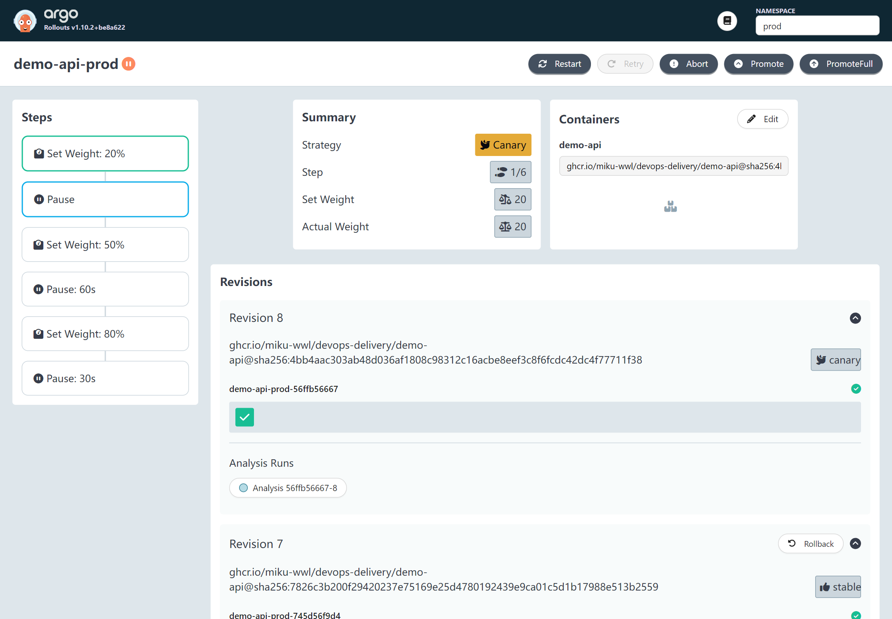
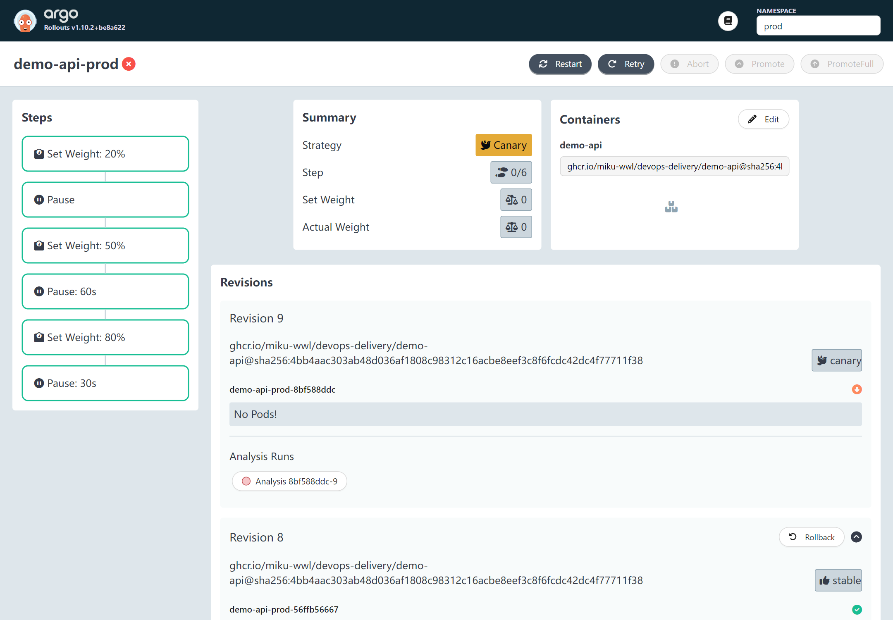
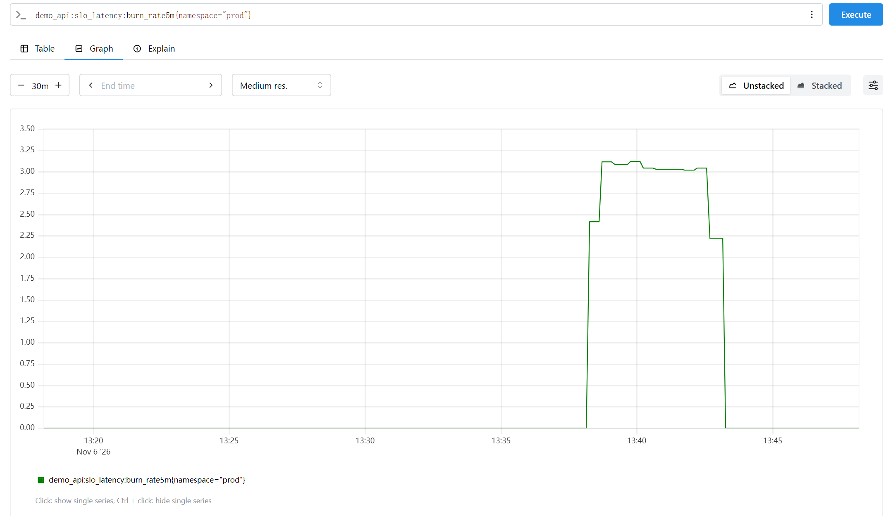
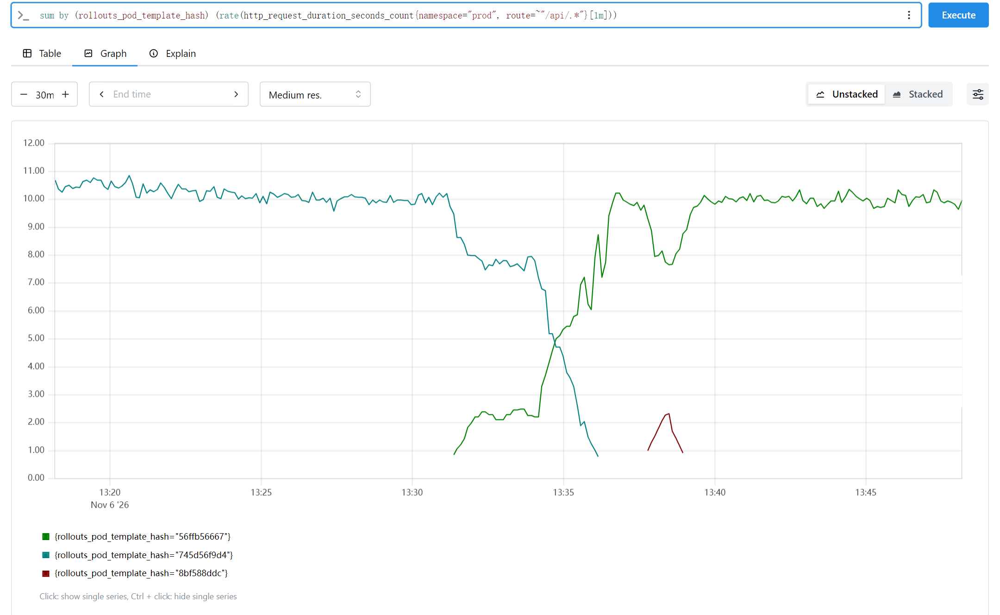

# 交付闭环综合演练与事故复盘：从一次提交到 RCA（P10 / O3） {#ch-p10}

<div class="lead">前面的章节分别搭好了交付链条上的每一个环节。本章把它们串起来，做两次完整的演练。第一次，一个真实的小功能从提交出发，依次经过 CI、合成测试门禁、漏洞扫描、签名与证明、GitOps、dev 验证、prod 金丝雀和人工闸门，最终全量上线；途中，CI 还揭出了三个阶段之前遗留下来的安全配置问题。第二次，一个“看起来无害”的配置变更进入 prod，被金丝雀分析自动中止，这一次稳定版没有像第 8 章那样被污染。最后，用 SLO 和错误预算衡量两次事件的代价，并按无责复盘的方法写出两份事故报告。</div>

## 本章目标与产出

| 产出 | 位置 |
|---|---|
| SLO 记录规则与多窗口燃烧率告警 | `observability/alerts/demo-api-slo.yaml` |
| 演练用的真实功能：X-Request-ID（含测试） | `app/src/demo_api/main.py`、`app/tests/` |
| CI 揭出的安全问题的修复 | `observability/lgtm/lgtm.yaml`、`delivery/loadgen/k6-loadgen.yaml`、`delivery/policies/tests/` |
| 两份事故复盘（RCA） | `docs/rca/INC-20261106-01-*.md`、`docs/rca/INC-20261106-02-*.md` |
| 演练证据（终端记录、截图） | `evidence/p10/` |

**验收标准（PHASE_PLAN P10）：** 延迟故障版本被中止并回滚；输出测试环境的事故 RCA。已通过：带 800 ms 延迟配置的金丝雀在分析开始 65 秒后被自动中止（13:38:26 UTC），用 Git 回滚后于 13:45:27 恢复 Synced + Healthy；两份 RCA 见本章[“两次事件的对比与复盘”](#p10-rca)一节。

## 原理 {#p10-principles}

### 交付闭环：每道关卡防的是什么

“闭环”是指：变更从提交出发，经过一系列自动或人工的关卡到达生产；生产中的信号（指标、告警、SLO）反过来决定这个变更继续、中止还是回滚；事后的复盘再改进关卡本身。下表把前面各章的关卡排成一列。读这张表时要注意最后一列：每道关卡只防一类问题，所以不能用一道关卡代替另一道。

| 关卡 | 本项目的实现 | 主要防住 | 章节 |
|---|---|---|---|
| 质量门禁 | ruff、pytest、覆盖率 ≥ 90%、镜像冒烟测试 | 逻辑错误、镜像无法启动 | 3、4 |
| 仓库安全扫描 | Trivy：依赖漏洞、泄露的密钥、IaC 错误配置 | 不安全的依赖和配置进入仓库 | 3、7 |
| 合成测试门禁 | 临时 Kind 集群 + k6 用户旅程 | 部署后的功能或性能退化 | 11 |
| 镜像扫描 | 推送前的 Trivy 镜像门禁 | 带可修复高危漏洞的镜像 | 7 |
| 签名与证明 | Cosign 无密钥签名、SLSA 来源证明、SBOM | 被篡改或来源不明的镜像 | 7 |
| 准入控制 | Kyverno 验证签名和来源 | 未签名的镜像进入集群 | 7 |
| GitOps | 合并请求 → Argo CD 同步 | 未经审阅的变更、配置漂移 | 6 |
| 金丝雀与分析 | Argo Rollouts + Prometheus 分析 + 人工闸门 | 生产中的退化扩散到全部流量 | 8 |
| 可观测性与 SLO | 指标、链路、日志；燃烧率告警 | 漏网的问题长期无人知晓 | 9、12 |
| 复盘 | 无责 RCA 与行动项 | 同类问题再次发生 | 12 |

### SLI、SLO 与错误预算

**SLI**（服务水平指标）是“好事件 ÷ 有效事件”的比例；**SLO**（服务水平目标）是这个比例在一段时间内应当达到的值。本项目为 demo-api 定义了两个 SLO，统计范围都是 dev 和 prod 中 `/api/` 开头的请求：

| SLO | 好事件 / 全部事件 | 目标（30 天） | 错误预算 |
|---|---|---|---|
| 可用性 | 非 5xx 的请求 / 全部请求 | 99.5% | 0.5% |
| 延迟 | 0.5 秒内完成的请求 / 全部请求 | 99% | 1% |

**错误预算**是 1 − SLO，也就是“允许出错的比例”。它把可靠性和发布速度放到同一个单位下：预算还多的时候，可以放心地频繁发布、做实验；预算快用完时，冻结风险较大的发布，先修可靠性。SLO 从来不定为 100%：那既做不到，也会让任何变更都显得不可接受。

预算也可以换算成绝对数量。prod 平均每秒约 10.3 个 API 请求，30 天约 2,668 万个；延迟预算的 1% 就是约 **266,800 个慢请求**（`evidence/p10/drill-4-slo.log`）。后面衡量两次事件的代价时都用这个数。

### 燃烧率：把“预算消耗的速度”变成告警

**燃烧率**（burn rate）是某个时间窗口内的坏事件比例与错误预算比例之比：

```text
燃烧率 b = 窗口内坏事件比例 ÷ (1 − SLO)

  b = 1     预算恰好用 30 天
  b = 14.4  30 天 ÷ 14.4 ≈ 2.1 天用完
```

在流量大致平稳的前提下，长度为 w 的窗口内消耗的预算占比是：

```text
消耗占比 = b × w ÷ T          （T = 30 天 = 720 小时）

推导：窗口内坏事件 = 坏事件比例 × 窗口内请求数 = b × (1 − SLO) × N × (w ÷ T)
      30 天的预算   = (1 − SLO) × N               （N 为 30 天的请求总数）
      两者相除即得 b × w ÷ T
```

于是告警阈值可以按“多快消耗多少预算”反推。Google SRE Workbook 推荐的两档：

| 档位 | 含义 | 燃烧率阈值 | 长窗口 / 短窗口 | 持续 | 处理 |
|---|---|---|---|---|---|
| 快速燃烧 | 1 小时消耗 2% 的预算 | 0.02 × 720 ÷ 1 = **14.4** | 1h / 5m | 2m | 立即呼叫（page） |
| 慢速燃烧 | 6 小时消耗 5% 的预算 | 0.05 × 720 ÷ 6 = **6** | 6h / 30m | 15m | 工单（ticket） |

**为什么要两个窗口同时满足？** 长窗口保证问题足够显著，不会因为一分钟的抖动就半夜叫醒人；短窗口（长窗口的 1/12）保证问题消失后告警能很快恢复，不会因为长窗口里还留着旧的坏事件而一直响下去。

::: principle
**阈值告警看不见“少数请求持续变慢”。** 第 9 章的 `DemoApiHighLatency` 在 1 分钟的 p95 超过 0.5 秒时告警。设想 4% 的请求稳定地慢于 0.5 秒：p95 落在其余 96% 的快请求里，告警永远不会响；但延迟预算只有 1%，燃烧率是 4，7.5 天就会用完，慢速燃烧告警（6h 与 30m 都超过 6 倍）也不会响，这正是要靠预算报表和 SLO 评审发现的情形。反过来，一次被自动中止的短暂故障，阈值告警会响（本章演练 B 就是这样），燃烧率告警则不会。燃烧率告警回答的是“照这个速度，我们会不会违背对用户的承诺”，而不是“此刻某个数是不是超标了”。
:::

### 直方图分位数是估计值

Prometheus 的直方图只记录落入每个区间（bucket）的请求数，`histogram_quantile()` 先找到目标分位所在的区间，再在区间内**线性插值**。本项目的区间边界是 0.005、0.01、0.025、0.05、0.1、0.25、0.5、1、2.5、5 秒。

演练 B 中，金丝雀约 70% 的请求（下单）耗时约 0.80 秒，全部落在 (0.5, 1] 区间；其余 30% 很快。p95 位于这个区间内 (0.95 − 0.30) ÷ 0.70 ≈ 93% 的位置，插值结果是 0.5 + 0.93 × 0.5 ≈ **0.96 秒**。分析实际测得 0.961 秒和 0.962 秒，而真实延迟只有约 0.80 秒。

这不是错误，而是精度有限：分位数的精度由区间宽度决定。SLO 用的是另一种算法：**“慢于 0.5 秒的比例”直接用 `le="0.5"` 区间的计数相除**。0.5 恰好是一个区间边界，所以这个比例是精确的。设计直方图时，要让 SLO 阈值和告警阈值都落在区间边界上。

### 无责复盘

复盘的目的是改进系统，而不是追究个人。人一定会犯错；好的系统让错误难以发生、容易发现、影响有限。一份 RCA 通常包括：

- **摘要**：发生了什么、影响多大、怎么解决的，三五句话说清楚。
- **时间线**：每一行都要有时间和证据来源；从中可以算出 **MTTD**（从开始到检测）和 **MTTR**（从开始到恢复；也有从检测开始算的口径，复盘中要写明）。
- **影响**：尽量用精确的数字，例如按 Pod 统计的请求数，而不是“部分用户受影响”。
- **根因分析**：5 Whys 是常用的方法，但它是一条直线，容易停在“某人操作失误”。本章的写法是区分**根本原因**和**促成因素**：前者去掉后问题就不会发生，后者让问题更严重或更难发现。
- **检测与响应评价**：做得好的和待改进的都要写。
- **行动项**：分为预防、检测、缓解三类，每项都有负责人和状态。没有行动项的复盘只是一份事故描述。

## SLO 规则的实现 {#p10-slo-rules}

规则写在一个 PrometheusRule 中，分两组：先用**记录规则**（recording rule）预先算出各窗口的坏事件比例，再用告警规则引用它们。记录规则的名字遵循 Prometheus 推荐的 `级别:指标:操作` 格式。

下面的摘录为了便于阅读，把表达式拆成了多行，并用 `…` 代替重复出现的标签选择器 `namespace=~"dev|prod", route=~"/api/.*"`；仓库中的文件是完整的单行写法。

```yaml
- record: demo_api:sli_errors:ratio_rate5m
  # "or 0 * <全部请求>"：窗口内没有任何 5xx 时得到 0，而不是“无数据”
  expr: |
    ( sum by (namespace) (rate(http_requests_total{…, status=~"5.."}[5m]))
      or 0 * sum by (namespace) (rate(http_requests_total{…}[5m])) )
    / sum by (namespace) (rate(http_requests_total{…}[5m]))

- record: demo_api:sli_slow:ratio_rate5m
  # 0.5 是直方图的区间边界，所以“慢于 0.5 秒的比例”是精确值
  expr: |
    1 - sum by (namespace) (rate(http_request_duration_seconds_bucket{…, le="0.5"}[5m]))
      / sum by (namespace) (rate(http_request_duration_seconds_count{…}[5m]))
# ……30m、1h、6h 同理；另有 burn_rate5m、burn_rate1h，供看板和复盘使用

- alert: DemoApiLatencyFastBurn
  expr: |
    demo_api:sli_slow:ratio_rate1h > (14.4 * 0.01)
    and demo_api:sli_slow:ratio_rate5m > (14.4 * 0.01)
  for: 2m
  labels: {severity: page, slo: latency}
```

几处值得注意的写法：

- **先求和再相除。** `sum by (namespace)` 先把所有 Pod 的计数加起来，再算比例，得到的是“全部请求中的坏请求比例”。如果先算每个 Pod 的比例再取平均，流量小的 Pod 会被过度加权。
- **空的分子。** 第一版规则在没有 5xx 的环境里返回“无数据”而不是 0：分子的序列根本不存在，除法的结果也就不存在。燃烧率告警对“无数据”不会报错，但看板会出现断线，复盘时也无法引用。`or 0 * 分母` 在分子为空时用一个同标签、值为 0 的序列补上。
- **规则生效有延迟。** 修改后第 75 秒查询，结果仍是旧的（`evidence/p10/slo-rules-2.log`）；又过了约 20 秒，基线中所有比例都正常出现（`slo-baseline.log`）。PrometheusRule 要经过 Operator 生成 ConfigMap、kubelet 把 ConfigMap 同步到 Pod 的卷（这一步本身就可能需要一分钟左右）、config-reloader 通知 Prometheus 重新加载，再等一个评估周期，才会生效。

基线中有一个看似异常的值：prod 最近 6 小时的慢请求比例是 1.03%，略高于 1% 的预算。它其实是第 9 章那次真实事故的“尾巴”：6 小时窗口（03:48–09:48）里包含了被污染的 Pod 运行的最后约 26 分钟（直到 04:14）。那段时间约 14% 的请求变慢（1/5 的 Pod × 70% 的下单请求），26 ÷ 360 × 14% ≈ 1.0%，与测量值基本吻合。

## 演练 A：一个好版本走完整条链 {#p10-good}

```{.mermaid caption="演练 A：提交 85b3a49 的完整路径（时间为 UTC）"}
flowchart TB
  subgraph B["① 构建与验证（09:57–10:16）"]
    direction LR
    C["提交<br/>85b3a49"] --> GATE["合成测试门禁<br/>2 分 50 秒"] --> REL["扫描与签名<br/>1 分 50 秒"] --> VER["消费者验证<br/>digest ← 提交"]
    C --> CI["ci.yml<br/>security 失败"] --> FIX["修复 5b3e829<br/>CI 全部通过"]
  end
  subgraph D["② dev（10:17）"]
    direction LR
    DEV["MR !20<br/>59 秒 Healthy"] --> E2E["端到端验证<br/>请求 ID → 日志 → 链路"]
  end
  subgraph P["③ prod（13:29–13:35）"]
    direction LR
    PROD["MR !21<br/>金丝雀 20%"] --> HUMAN{"人工闸门<br/>13:33:40"} -- 晋级 --> FULL["100%<br/>分析 12/12"]
  end
  B --> D --> P
```

### 功能：每个请求一个 X-Request-ID

演练需要一个真实、可测试、上线后能验证的变更。这里选的是请求 ID：服务给每个请求一个 ID，放进响应头、访问日志和服务端 span。用户报告问题时只要报出这个 ID，就能找到对应的日志和链路。

```python
REQUEST_ID_HEADER = "X-Request-ID"
# 调用方的 ID 只在“短而简单”时沿用，否则换成新的，客户端无法把任意文本写进日志和 span
_SAFE_REQUEST_ID = re.compile(r"[A-Za-z0-9._-]{1,64}")


def request_id_for(request: Request) -> str:
    incoming = request.headers.get(REQUEST_ID_HEADER, "")
    if _SAFE_REQUEST_ID.fullmatch(incoming):
        return incoming
    return uuid.uuid4().hex

# 中间件中：
request_id = request_id_for(request)
trace.get_current_span().set_attribute("request.id", request_id)   # 当前 span 就是服务端 span
...
response.headers[REQUEST_ID_HEADER] = request_id
log.info("request", extra={..., "request_id": request_id})
```

几个设计要点：

- **为什么有了 trace ID 还要请求 ID？** trace ID 是链路系统内部的标识，遥测关闭时就不存在；请求 ID 不依赖遥测，并且会返回给调用方，可以出现在工单、客户端日志和网关日志里。两者都记在同一行日志中，就把它们关联了起来。
- **不信任外部输入。** 调用方可以自带 ID（方便跨服务传递），但只接受 1–64 个安全字符，其余一律替换。测试用 `pytest.mark.parametrize` 覆盖了空值、空格、超长、JSON 片段和 `<script>`。
- **出错时也要有 ID。** 注入 500 错误的测试验证了响应头和访问日志中仍然带有 ID：最需要 ID 的恰恰是失败的请求。

本地 ruff 与 pytest 全部通过（34 个测试，覆盖率 93.87%，`evidence/p10/app-tests.log`）。

### CI 在阶段分支上的第一次运行：旧问题浮出水面

推送后，发布流水线自动运行；质量门禁 `ci.yml` 只在“向 main 发起的 PR”和“推送到 main”时触发，所以手动触发了一次。结果 lint、test、镜像构建都通过，`security` 作业失败：

```console
job: security -> failure
job: python / test -> success
job: python / lint -> success
job: container image -> success
delivery/loadgen/k6-loadgen.yaml (kubernetes)
KSV-0014 (HIGH): Container 'k6' of Deployment 'k6' should set 'securityContext.readOnlyRootFilesystem' to true
delivery/policies/tests/admission-test-pods.yaml (kubernetes)
KSV-0014 (HIGH): Container 'app' of Pod 'sig-test-digest' should set 'securityContext.readOnlyRootFilesystem' to true
（另外两个测试 Pod 同样）
observability/lgtm/lgtm.yaml (kubernetes)
KSV-0014 (HIGH): Container 'lgtm' of Deployment 'lgtm' should set 'securityContext.readOnlyRootFilesystem' to true
KSV-0118 (HIGH): deployment lgtm in observability namespace is using the default security context, which allows root privileges
```

这 7 个问题与本次提交无关，分别来自第 7 章（P5）、第 8 章（P6）和第 9 章（P7）新增的文件（`evidence/p10/ci-run-1-security-fail.log`）。它们一直没被发现，原因在触发条件：各阶段的分支是层层叠加的（stacked），PR 的目标分支不是 main，`ci.yml` 从来没有在这些分支上运行过。**门禁只在被触发时才有效。**

修复的原则是“修，而不是忽略”。加 `.trivyignore` 例外很容易，但这三个文件都有真实的修复办法：

- k6 和准入测试 Pod 只需加上 `readOnlyRootFilesystem: true`。
- LGTM（grafana/otel-lgtm）默认以 root 运行。改为 UID 10001、只读根文件系统、禁止提权、丢弃全部 capabilities，并为可写目录挂载 emptyDir。

LGTM 的修改先在一个强制 `restricted` Pod 安全标准的临时命名空间里试。第一次，Pod 就绪了，但启动日志里少了 Tempo。打开 Tempo 的日志后看到：

```console
level=error msg="module failed" module=live-store err="... failed to create shutdown marker directory: mkdir /var/tempo: read-only file system"
```

Tempo 3 会在 `/var/tempo` 创建一个目录，这个路径不在镜像文档提到的 `/data` 下。只读根文件系统的价值正在于此：它把所有“未声明的写入”变成显式的失败。为 `/var/tempo` 加一个 emptyDir 后，第二次 6 个组件全部启动（`lgtm-hardening-test-1.log`、`-2.log`）。之后再应用到实验集群，确认负载和遥测都正常（`hardening-verify.log`），重新运行准入测试，结果不变（`admission-retest.log`）。

本地复查也踩了一个坑：直接扫描 Windows 磁盘上的工作区，5 分钟后超时，因为工作区里还有大量未跟踪、被 `.gitignore` 忽略的目录（例如 Ansible 集合）。CI 扫描的是干净的检出。改为用 `git ls-files` 复制出受版本控制的文件再扫描，3 秒完成，结果干净（`trivy-repo-scan-2.log`）。提交修复（`5b3e829`）后，CI 重跑 4 个作业全部通过（42201262422）。

### 发布流水线与消费者验证

推送 `85b3a49` 时，发布流水线已经自动运行（42198984873）：合成测试门禁 723 个请求全部通过，三个接口的 p95 ≤ 2.1 ms；随后发布作业依次完成 Trivy 镜像门禁、推送、SBOM、来源证明、SBOM 证明、Cosign 签名，并按消费者的方式自检（`release-run.log`）。产物是镜像 `sha256:4bb4aac3…`。

晋级前，在流水线之外再验证一次（`verify-cosign.log`、`verify-attestation.log`）：

```console
$ cosign verify "$IMG" --certificate-identity-regexp "^https://github.com/miku-wwl/devops-delivery/\.github/workflows/release\.yml@refs/heads/" \
    --certificate-oidc-issuer https://token.actions.githubusercontent.com
Verification for ghcr.io/miku-wwl/devops-delivery/demo-api@sha256:4bb4aac3… --
  - The cosign claims were validated
  - Existence of the claims in the transparency log was verified offline
  - The code-signing certificate was verified using trusted certificate authority certificates
$ gh attestation verify "oci://$IMG" --repo miku-wwl/devops-delivery ...
{"predicateType":"https://slsa.dev/provenance/v1","runInvocationURI":".../actions/runs/42198984873/attempts/1",
 "sourceRepositoryDigest":"85b3a49c7a25849861368913e9372a80ffa3cbe2","sourceRepositoryRef":"refs/heads/p10/closed-loop"}
```

来源证明把镜像 digest 和提交 `85b3a49`、运行 42198984873 绑定在一起：将要部署的东西，正是刚才审阅和测试过的代码构建出来的。

### dev：GitOps 发布与端到端验证

```bash
bash delivery/argocd/promote.sh dev image.digest=sha256:4bb4aac3… --merge \
  --title "dev: X-Request-ID (85b3a49), release run 42198984873"
```

合并请求 !20 合并后，Argo CD 同步，dev 的金丝雀（50% → 暂停 30 秒）自动完成，59 秒后 Healthy（`chain-1-dev.log`）。

**第一次冒烟测试失败了：** 下单返回 201，但响应里没有 `X-Request-ID`，日志里也找不到这个请求。直接进 Pod 请求，却能拿到响应头，说明新代码在运行。问题出在路径上：

```console
$ docker ps --format "{{.Names}}\t{{.Ports}}" | grep demo-api
demo-api-dev	127.0.0.1:18081->8080/tcp
$ kubectl -n dev port-forward svc/demo-api-dev 18081:80
Forwarding from [::1]:18081 -> 8080
$ curl -s http://127.0.0.1:18081/api/v1/info
{"service":"demo-api","version":"gl-4","commit":"dd38a063"}
```

第 4 章 GitLab 部署任务创建的 Docker 容器 `demo-api-dev` 占用了 `127.0.0.1:18081`。`kubectl port-forward` 绑定 IPv4 失败，但 IPv6 的 `[::1]:18081` 绑定成功，所以它**没有退出**，看起来一切正常；curl 访问 `127.0.0.1`，打到的是那个旧容器（版本 `gl-4`）。教训有两条：先看 port-forward 自己的输出，确认它监听在哪个地址；测试前先请求一次 `/api/v1/info`，确认回答你的是哪个版本。

换到空闲端口 18090 后，调用方的 ID 被原样返回，不安全的 ID 被替换（`chain-2-dev-smoke.log`）：

```console
$ curl -s -D - -o /dev/null -H "X-Request-ID: p10-smoke-2" ... http://127.0.0.1:18090/api/v1/orders
HTTP/1.1 201 Created
x-request-id: p10-smoke-2
$ curl -s -D - -o /dev/null -H "X-Request-ID: <script>" http://127.0.0.1:18090/api/v1/info
x-request-id: 0faac77562c4400e88cb480f5cef1760
```

最后验证功能的真正目的：用一个 ID 找到这个请求的全部信号（`chain-3-dev-correlation.log`）：

```console
$ kubectl -n dev logs $P --since=15m --tail=-1 | grep '"request_id": "p10-smoke-2"' | jq -c ...
{"msg":"request","method":"POST","route":"/api/v1/orders","status":201,"request_id":"p10-smoke-2","trace_id":"95c27aad59b11273612c0dbd6e7956ef"}
loki: msg=request trace_id=95c27aad59b11273612c0dbd6e7956ef pod=demo-api-dev-7cc65cccc7-ll2wb
tempo search: trace 95c27aad59b11273612c0dbd6e7956ef POST /api/v1/orders 3 ms
server span: POST /api/v1/orders request.id=p10-smoke-2 http.method=POST http.route=/api/v1/orders http.status_code=201
```

这一步还有两个容易误判的地方：

- `kubectl logs -l <选择器>` 在不指定 `--tail` 时，每个 Pod 只输出**最后 10 行**。dev 每秒有 4 个请求，十几秒前的日志早已不在其中。按 Pod 名查询，或加上 `--tail=-1`。
- 请求发出 15 秒后用 TraceQL 搜索，结果为空；两分钟后再搜，就能找到。Tempo 要等一条链路结束并写入可搜索的存储后才能搜到它；按 trace ID 直接读取没有这个延迟。

### prod：金丝雀、分析与人工闸门

```bash
bash delivery/argocd/promote.sh prod image.digest=sha256:4bb4aac3… --merge \
  --title "prod: X-Request-ID (85b3a49), verified in dev"
```

合并请求 !21 合并后约 73 秒，Argo CD 才发现新的提交（它默认定期轮询 Git）。随后 Rollout 创建 revision 8，以 20% 的权重运行金丝雀（5 个 Pod 中的 1 个），后台分析开始，并停在人工闸门：



晋级前，先看分析的数据（`chain-4-prod-canary.log`）：

```console
demo-api-prod-56ffb56667-8: Running
  success-rate: phase=Running successful=5 failed=0 values=[1], [1], [1], [1], [1]
  p95-latency-seconds: phase=Running successful=5 failed=0 values=[0.00475], [0.00475], ...
```

判断依据：成功率 100%，金丝雀 p95 约 4.75 ms，dev 已经验证过功能。于是 13:33:40 执行 `kubectl argo rollouts promote`，Rollout 依次经过 50%（暂停 60 秒）、80%（暂停 30 秒），13:35:37 全量；整个过程中后台分析一直在运行，结束时 12 次测量全部成功（`chain-5-prod-promote.log`）。

**整条链用了多长时间？** 从提交（09:57:51）到 prod 全量（13:35:37）共 3 小时 38 分钟，但其中 10:19–13:26 约 3 小时 7 分钟是会话中断，不能算作流程耗时。其余约 30 分钟分为：门禁与发布 4 分 45 秒（与 CI 并行）；修复 CI 揭出的问题约 17 分钟，这是最大的一段，属于计划外的返工；dev 合并与同步约 1 分钟；dev 端到端验证约 2 分钟；prod 从合并到全量约 6 分钟，其中 Argo CD 轮询约 1 分钟，人工观察分析数据 2 分 45 秒。

## 演练 B：一次“看起来无害”的配置变更 {#p10-bad}

第 11 章说过，只改配置的变更不会构建镜像，也就不经过合成测试门禁。演练 B 正是这种情况：一个标题为“pricing call tuning”（定价调用调优）的合并请求，把 prod 的 `faults.latencyMs` 设为 800。第 8 章做过同样的演练，当时中止后留下了一个被污染的稳定版 Pod，潜伏了 3 小时；第 9 章的 Chart 0.3.1 修复了这个问题。本次演练也是对这个修复的验证。

### 变更与自动中止

```console
$ bash delivery/argocd/promote.sh prod faults.latencyMs:=800 --merge --title "prod: pricing call tuning (P10 bad config drill)"
+faults:
+  latencyMs: 800
merged !22 -> main @ 10a6786 by root
$ bash delivery/rollouts/watch-rollout.sh prod demo-api-prod Degraded 480
t+0s  phase=Degraded step=0 ... message="RolloutAborted: Rollout aborted update to revision 9: Background analysis
      phase error/failed: Metric "p95-latency-seconds" assessed Failed due to failed (2) > failureLimit (1)"
demo-api-prod-8bf588ddc-9: Failed
  success-rate: phase=Successful successful=2 failed=0 values=[1]@13:38:06, [1]@13:38:26
  p95-latency-seconds: phase=Failed successful=0 failed=2 values=[0.9614392621993645]@13:38:06, [0.9617647058823529]@13:38:26
$ argocd app get demo-api-prod --grpc-web | grep -E "Health Status|Sync Status"
Sync Status:        Synced to main (10a6786)
Health Status:      Degraded
```

成功率始终是 1，只有延迟不合格：这次故障不会产生任何错误，只看错误率的分析会放过它。



注意截图中 revision 9 与 revision 8 是**同一个镜像**。Rollout 的版本由整个 Pod 模板决定，Chart 0.3.1 把配置写进了 Pod 模板，所以只改配置也会产生新的 revision，并完整地走一遍金丝雀流程。

### 时间线

下表按时间排列各方的记录：Rollout 事件、AnalysisRun 的测量时间和 Prometheus 的告警序列（UTC，2026-11-06）。

| 时间 | 距金丝雀创建 | 事件 | 来源 |
|---|---|---|---|
| 13:36:08 | — | MR !22 合并（`10a6786`） | `drill-1-bad-config.log` |
| 13:37:14 | 0 s | Argo CD 同步，Rollout 创建 revision 9 的 ReplicaSet `8bf588ddc`（20%） | Rollout 事件 |
| 13:37:21 | 7 s | 后台分析开始（先等待 45 秒的初始延迟） | AnalysisRun |
| 13:38:00 | 46 s | 阈值告警 `DemoApiHighLatency` 进入 pending | 告警序列 |
| 13:38:06 | 52 s | 第一次测量：p95 0.961 s，失败 | AnalysisRun |
| **13:38:26** | **72 s** | 第二次测量失败，2 > failureLimit 1 → **自动中止**；稳定版扩回 5 个 | Rollout 事件 |
| 13:39:00 | 106 s | `DemoApiHighLatency` firing（问题已被缓解 34 秒） | 告警序列 |
| 13:43:37 | — | 中止后 4 分钟：稳定版慢请求 0，5xx 0 | `drill-2-blast-radius.log` |
| 13:43:56 | — | `git revert`（MR !23） | `drill-3-revert.log` |
| 13:45:27 | — | Synced + Healthy | `drill-3-revert.log` |

从金丝雀创建到中止 72 秒，其中分析本身用了 65 秒（45 秒初始延迟 + 一个 20 秒间隔）。第 8 章“65 秒内被自动中止”指的就是分析开始到中止这一段。合并后要等约 1 分钟 Argo CD 才同步，这段时间里坏配置还没有生效，但也没有任何东西能拦住它。

### 中止时，稳定版有没有被污染？

这是本次演练最重要的检查。中止时，稳定版要从 4 个副本扩回 5 个，会新建一个 Pod，第 8 章的问题就出在这个新 Pod 上（`drill-2-blast-radius.log`）：

```console
POD                              CREATED                HASH         FAULT_LATENCY_MS
demo-api-prod-56ffb56667-gr7cz   2026-11-06T13:34:53Z   56ffb56667   0
demo-api-prod-56ffb56667-kdrzz   2026-11-06T13:30:47Z   56ffb56667   0
demo-api-prod-56ffb56667-klpxl   2026-11-06T13:33:40Z   56ffb56667   0
demo-api-prod-56ffb56667-nl8wl   2026-11-06T13:38:26Z   56ffb56667   0     ← 中止时新建
demo-api-prod-56ffb56667-nqlv6   2026-11-06T13:33:40Z   56ffb56667   0
RS                         DESIRED   FAULT_LATENCY_MS
demo-api-prod-56ffb56667   5         0
demo-api-prod-8bf588ddc    0         800
```

13:38:26 中止的同一秒新建的 `nl8wl` 读到的是 0：配置属于各自 ReplicaSet 的 Pod 模板，坏值只存在于金丝雀的模板里。只看配置还不够，再看行为：中止后 4 分钟内，稳定版慢于 0.5 秒的请求为 **0**。整个演练窗口（12 分钟）按 ReplicaSet 统计：

```console
all API requests, last 12 min, by ReplicaSet:      slower than 0.5 s:
  745d56f9d4: 1412.59                                745d56f9d4: 0
  56ffb56667: 5594.67                                56ffb56667: 0
  8bf588ddc: 137.67                                  8bf588ddc: 90.67
5xx, last 12 min: 0
```

（`increase()` 会按窗口边界外推，所以结果带小数，表示约 138 个请求、约 91 个慢请求。）

### 用 SLO 衡量代价





`drill-4-slo.log` 给出了完整的数字：

```console
peak latency burn rate during the drill (5m window / 1h window), page threshold 14.4:
  prod : 3.121
  prod : 0.245
  DemoApiHighLatency firing: 13:39:00 .. 13:39:00
  DemoApiHighLatency pending: 13:38:00 .. 13:38:45
  KubePodNotReady pending (demo-api-prod-56ffb56667-nl8wl): 13:38:45 .. 13:38:45
  TargetDown pending (prod/demo-api-prod): 13:38:45 .. 13:38:45
30-day budget: 266,800 slow requests
P10 drill (canary, aborted after 72 s): 91 slow -> 0.034% of the budget
P7 incident (poisoned stable pod, 3 h): 15,662 slow -> 5.870% of the budget
```

三点解读：

1. **SLO 告警没有触发，这是正确的。** 5 分钟燃烧率峰值 3.1，1 小时只有 0.245，远低于 14.4。这次故障消耗了 0.034% 的月度预算，不值得叫醒任何人。
2. **阈值告警触发了，但来得太晚。** `DemoApiHighLatency`（1 分钟 p95 > 0.5 秒，持续 1 分钟）在 13:39:00 firing，此时金丝雀已经被自动中止 34 秒。它如果配置为呼叫值班人员，就是一次纯粹的噪声。这正是“按症状阈值告警”与“按预算消耗告警”的区别。
3. **同样的坏配置，两种结局。** 第 8 章那次，共享 ConfigMap 让坏配置泄漏到稳定版，消耗了 5.87% 的预算；这一次，配置随 Pod 模板版本化，代价只有其 1/170。

### 用 Git 回滚

自动中止保护了集群，但 Git 中仍然写着 800。Argo CD 此时的状态是 **Synced + Degraded**：集群中的 Rollout 对象与 Git 一致（Synced），但 Rollout 自身报告发布失败（Degraded）。这颗“雷”必须由人来拆：如果有人在 prod 的 values 里再改任何别的东西，新的 revision 会再次带上 800，金丝雀会再被中止一次。

```console
$ bash delivery/argocd/revert.sh 10a6786 --merge
merged !23 -> main @ 39ee3f2 by root
$ bash delivery/argocd/wait-sync.sh demo-api-prod "" 300
t+81s  revision=39ee3f2 sync=OutOfSync health=Degraded operation=Running
t+84s  revision=39ee3f2 sync=Synced health=Healthy operation=Succeeded
```

回滚后，Pod 模板与稳定版完全相同，Rollout 直接回到 Healthy，**没有重启任何 Pod**（Pod 名称前后一致，`drill-3-revert.log`）。

## 两次事件的对比与复盘 {#p10-rca}

| | INC-20261106-01（第 9 章发现的真实问题） | INC-20261106-02（本章演练 B） |
|---|---|---|
| 变更 | prod `faults.latencyMs: 800`（第 8 章的演练） | 同样的配置 |
| 配置的存放方式 | 所有 ReplicaSet 共享的 ConfigMap（Chart ≤ 0.3.0） | 各 ReplicaSet 的 Pod 模板（Chart 0.3.1） |
| 金丝雀 | 分析开始约 65 秒后自动中止 | 分析开始 65 秒后自动中止 |
| 中止时新建的稳定版 Pod | 读到 800，被污染 | 读到 0 |
| 慢请求 | 15,662 | 约 91 |
| 持续时间 | 约 3 小时 | 72 秒 |
| 30 天延迟预算消耗 | 5.87% | 0.034% |
| 检测（MTTD） | 2 小时 47 分钟，靠刚加上的告警 | 72 秒，靠金丝雀分析 |
| SLO 燃烧率告警 | 当时还不存在 | 未触发（峰值 3.1 < 14.4，符合预期） |

两份完整的 RCA 在仓库的 `docs/rca/` 中，下面是它们的要点。

### INC-20261106-01：被中止的金丝雀把坏配置留给了稳定版

**时间线要点（UTC）：** 01:14:11 被污染的 Pod 启动（事件开始）→ 01:15–01:17 Git 回滚，ConfigMap 恢复为 0，但该 Pod 的环境变量不变 → 04:01:05 新加的延迟告警条件成立（检测）→ 04:14:08 逐个检查 Pod 的环境变量，确认根因 → 约 04:14:50 删除该 Pod（缓解）→ 04:20:05 Chart 0.3.1 全量，告警全部清除（修复）。

**5 Whys：**

1. 为什么 18% 的下单请求变慢 3 小时？一个稳定版 Pod 带着 800 ms 的延迟配置运行。
2. 为什么稳定版 Pod 有坏配置？它在中止扩容时新建，启动时从共享 ConfigMap 读取了还没回滚的坏值；环境变量只在启动时读取一次。
3. 为什么配置放在共享 ConfigMap？第 5 章的 Chart 假设同一时刻只有一个版本（滚动更新）；金丝雀让两个版本长时间并存，打破了这个假设。
4. 为什么 3 小时没人发现？当时只有只看金丝雀的分析；Rollout 的 Healthy 只表示副本数达标，不代表每个 Pod 的配置正确。
5. 为什么演练的验证漏掉了？验收只看“分析是否中止”，没有在中止后按 Pod 检查稳定版的实际配置与延迟。

**根本原因：** 渐进式交付期间，多个版本共享一份可变配置。**促成因素：** 没有覆盖全体 Pod 的延迟告警；验证只看控制器状态。

**行动项：** Chart 0.3.1 把配置写入 Pod 模板（预防，已完成）；全体 Pod 的告警与 SLO 燃烧率告警（检测，已完成）；本章演练验证修复（已完成）；运行手册增加“中止后按 Pod 检查”（检测，已完成，见下文）；删除遗留的 ConfigMap（清理，待办）。

### INC-20261106-02：坏配置被金丝雀分析自动中止

**根本原因（演练设定）：** 未经验证的配置变更直接进入 prod：配置仓库的合并请求没有任何自动检查。**限制影响的因素：** 金丝雀 + 自动分析 + 按版本隔离的配置。

**待改进：** ① 阈值告警在自动缓解之后才 firing，是噪声，分页应只用燃烧率告警；② Argo CD 轮询使同步延迟约 1 分钟（合并后 66 秒、回滚后 81 秒），可以用 Git webhook 缩短到几秒；③ 配置变更缺少左移检查，`envs/prod` 中的 `faults.*` 应当在合并请求阶段就被拒绝（本章练习 3）。

### 运行手册：发布中止或回滚之后

两次事件共同的教训是：**自动化给出的结论（“已中止”“Healthy”）要用独立的信号去核实。** 每次中止或回滚之后，按顺序检查：

1. `kubectl argo rollouts get rollout <名称>`：确认稳定版 revision 和副本数。
2. 按 Pod 查看实际生效的配置（环境变量、挂载的配置文件），重点看**中止或回滚之后新建的 Pod**。
3. 按 ReplicaSet（`rollouts_pod_template_hash`）分别查看错误率和延迟，确认稳定版没有异常。
4. 确认 Git 与集群一致：坏的变更已经 revert，Argo CD 为 Synced + Healthy，而不是 Synced + Degraded。
5. 记录影响：受影响的请求数、持续时间、消耗的错误预算。
6. 如果影响超出金丝雀本身，按事故流程处理并写 RCA。

## 这条链还缺什么 {#p10-gaps}

演练也暴露了链条的薄弱处，按“影响 × 改动成本”排序：

| 缺口 | 现状 | 改进方向 |
|---|---|---|
| 配置变更没有门禁 | 配置仓库的合并请求没有任何检查 | 合并请求流水线中用 yq 或 conftest 校验策略，例如 prod 不允许故障注入 |
| 门禁的触发范围 | `ci.yml` 只覆盖 main；叠加的阶段分支漏掉了 7 个高危问题 | 对所有分支的推送运行 lint/test/security，或让每个分支都通过 PR 进入 main |
| 分页告警 | 阈值告警在自动缓解后才 firing | 分页只用 SLO 燃烧率告警，阈值告警降为工单或看板 |
| 同步延迟 | Argo CD 轮询，约 1 分钟 | 配置 Git webhook |
| 生产审批 | 本地用 `kubectl argo rollouts promote` 人工晋级；GitHub Environments 审批闸门（第 8 章）仍在等待所有者批准 | 把人工晋级接入审批流程，并留下审计记录 |
| 构建可复现性 | 同一提交两次构建的 digest 不同（第 11 章） | 固定时间戳等构建输入（`SOURCE_DATE_EPOCH`） |

## 常见问题

**Q1：分析报告的 p95 是 0.96 秒，可注入的延迟只有 0.8 秒，是不是测错了？**
没有测错，这是直方图分位数的精度问题：p95 落在 (0.5, 1] 区间内，`histogram_quantile` 在区间内线性插值。见本章“直方图分位数是估计值”。判断“是否慢于 0.5 秒”要用区间计数，这个结果是精确的。

**Q2：Argo CD 显示 Synced，同时又是 Degraded，到底正常还是不正常？**
两者描述的是不同的事情：Synced 表示集群中的对象与 Git 一致，Degraded 来自 Rollout 的健康检查，表示发布被中止。此时集群运行的是安全的稳定版，但 Git 中的期望状态是错误的，必须回滚 Git。

**Q3：阈值告警 firing 了，燃烧率告警却没有，哪个是对的？**
都“对”，但回答的是不同的问题。阈值告警说“此刻 p95 超过 0.5 秒”；燃烧率告警说“照这个速度，30 天的承诺是否会被违背”。只有后者适合用来叫醒人。

**Q4：`kubectl port-forward` 显示 “Forwarding from [::1]:18081”，请求却打到了别处？**
IPv4 的 127.0.0.1:18081 已被其他进程占用，绑定失败，而 IPv6 的绑定成功，所以 port-forward 继续运行。用 `ss -ltnp | grep 18081` 或 `docker ps` 查看占用者，换一个空闲端口；测试前先请求版本接口，确认回答你的是谁。

**Q5：`kubectl logs -l app=...` 找不到刚刚的请求？**
使用标签选择器时，`kubectl logs` 默认每个 Pod 只输出最后 10 行。加上 `--tail=-1`（配合 `--since`），或者按 Pod 名查询。

**Q6：刚发出的请求，在 Tempo 里搜不到？**
链路要等结束、经过一段空闲期并写入可搜索的存储后才能搜到，通常需要几十秒。如果已经知道 trace ID（例如从日志中拿到），直接按 ID 读取没有这个延迟。

**Q7：修改了 PrometheusRule，查询结果还是旧的？**
规则要经过 Operator、ConfigMap、kubelet 同步卷、config-reloader 和一次评估周期才生效，一两分钟的延迟很常见。可以在 Prometheus 的 `/api/v1/rules` 中确认规则的表达式是否已经更新。

**Q8：修复安全扫描的问题时，为什么不直接把它们加到 `.trivyignore` 里？**
例外应当用在“确实无法修复，或者风险已被接受”的情形，并写明原因和到期时间。这三处都能真正修复，而且修复过程（只读根文件系统暴露出 Tempo 的隐藏写入路径）本身就提高了系统的透明度。

## 练习 {#p10-exercises}

::: exercise
1. **（计算）** 把可用性 SLO 改为 99.9%，其他不变。快速燃烧告警的燃烧率阈值还是 14.4 吗？1 小时窗口内的错误率要达到多少才会触发？按 prod 每秒 10.3 个请求计，30 天的预算是多少个失败请求？
2. **（分析）** 假设 4% 的请求稳定地慢于 0.5 秒。`DemoApiHighLatency` 会触发吗？延迟预算多久用完？两档燃烧率告警各自会不会触发？如果都不会，你打算靠什么发现这种问题？
3. **（动手）** 为配置仓库写一个合并请求检查：`envs/prod/values.yaml` 中的 `faults.errorRate` 和 `faults.latencyMs` 必须为 0 或不存在，否则流水线失败；然后把它设为合并的必要条件。用本章的坏配置验证它能拦住。
4. **（设计）** `DemoApiHighLatency` 在本章成了噪声。给出两种改法（例如改为工单级别、改用更长的窗口），说明各自的代价。
5. **（复盘）** 为“第一次冒烟测试打到了旧容器”写一份简短的 5 Whys，并给出两条预防措施。
6. **（思考）** 演练 A 除去中断约 30 分钟。哪些时间花在等待上，哪些花在验证上？如果要缩短到 15 分钟以内，你会改哪里？代价是什么？
:::

参考答案见附录 B。

## 本章小结

- 一个真实的功能（X-Request-ID）走完了整条交付链：门禁、扫描、签名与证明、GitOps、dev 端到端验证、prod 金丝雀与人工闸门。请求 ID 把访问日志、Loki 日志和 Tempo 链路串到了一起。
- 第一次在阶段分支上运行 CI，就揭出了 P5–P7 遗留的 7 个高危配置问题。修复时，只读根文件系统暴露了 Tempo 写入 `/var/tempo` 这个未声明的路径。门禁只在被触发时才有效。
- 一次“看似无害”的配置变更在分析开始 65 秒后被自动中止。中止时新建的稳定版 Pod 读到了正确的配置，第 8 章的问题已被 Chart 0.3.1 修复，并经实际验证。
- SLO 把两次事件放到同一把尺子上：同样的坏配置，一次消耗 5.87% 的月度预算，一次只消耗 0.034%。燃烧率告警正确地保持了安静，阈值告警则在问题解决后才响。
- 两份无责 RCA 记录了时间线、根因、促成因素和行动项；运行手册新增了“中止之后核实稳定版”的步骤。
