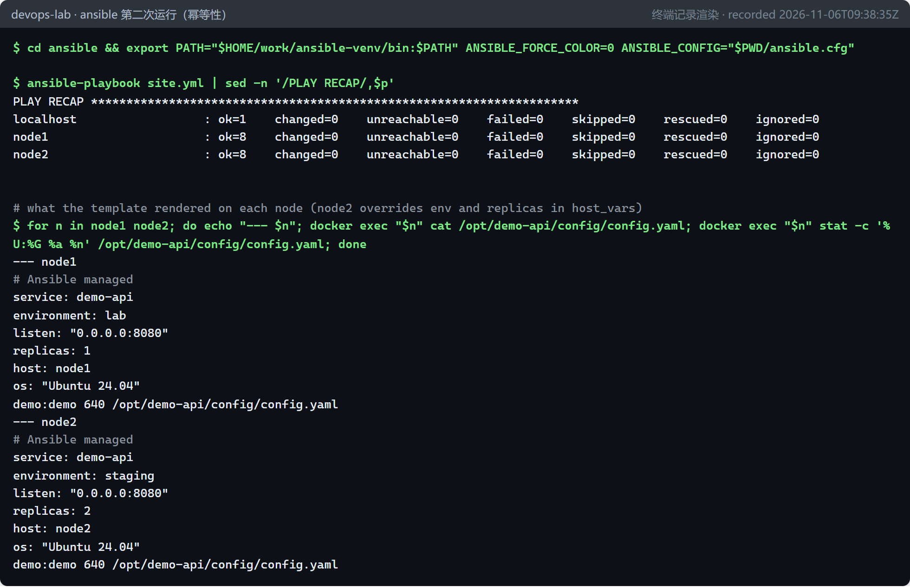
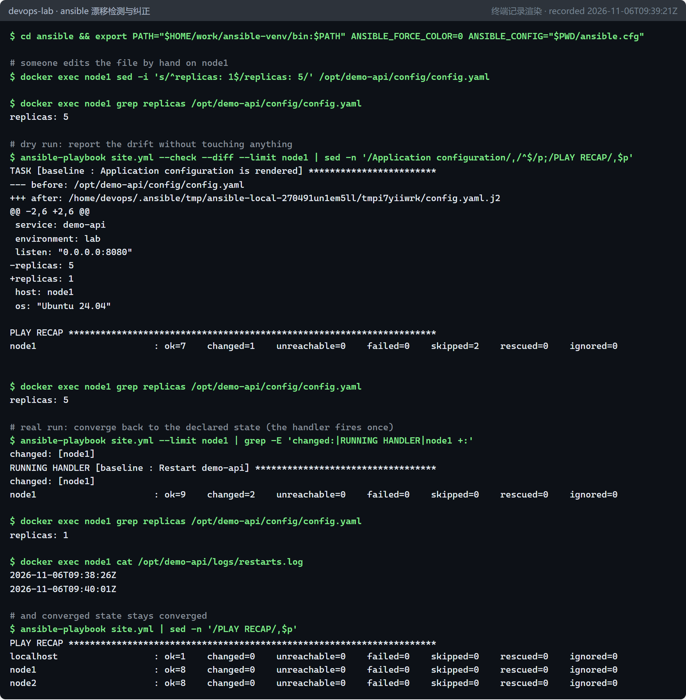

# 配置管理：用 Ansible 实现幂等的服务器配置（P11 / D10，选修） {#ch-p11}

<div class="lead">前面的章节都在管理 Kubernetes 里的工作负载。Kubernetes 本身是声明式的：写下期望状态，控制器负责收敛。但很多环境里仍然有一台台“服务器”：虚拟机、裸机、网络设备。管理它们的经典工具就是 Ansible。本章用两个容器模拟两台服务器，写一个包含角色、模板、handler 和按主机变量的 playbook，验证路线图的验收标准：<strong>第二次执行时 changed=0</strong>。之后再演示配置漂移的检测与纠正。</div>

## 本章目标与产出

| 产出 | 位置 |
|---|---|
| Ansible 项目（配置、Inventory、playbook、角色） | `ansible/` |
| 控制节点依赖（固定版本） | `ansible/requirements.txt`、`ansible/collections/requirements.yml` |
| 四次运行的终端记录 | `evidence/p11/` |

**验收标准（路线图 D10）：** 第二次执行 `changed=0`。已通过：首次运行 node1、node2 各 changed=8，第二次运行全部 changed=0（`evidence/p11/run-2-idempotent.log`）。

**学完本章，你应当能够：**

- 解释声明式与命令式的区别，以及幂等性为什么是配置管理的基石；
- 说清一个 Ansible 任务在托管节点上是如何执行、如何判断 `changed` 的；
- 编写带 Inventory、角色、模板、handler 和按主机变量的 playbook，并让它的第二次运行 `changed=0`；
- 用 `--check --diff` 检测配置漂移，并把 Ansible 与 GitOps、不可变基础设施放在同一张图里比较。

## 原理 {#p11-principles}

### 声明式与幂等性

写一段 shell 脚本 `useradd demo`，第一次运行成功，第二次就会报“用户已存在”。脚本描述的是**动作**。Ansible 的模块描述的是**状态**：`user: name=demo state=present` 的意思是“确保存在一个叫 demo 的用户”。模块先检查当前状态，只有不符合时才去修改，并报告 `changed`。

**幂等性**（idempotence）是指：同一个操作执行一次和执行多次，结果相同。它是配置管理的基石：

- 可以放心地反复执行，比如定时运行，或者在 CI 中运行；
- `changed` 的数量本身就是信号：对一台已经收敛的服务器再运行一次，应该没有任何变化；如果有，说明有人手工改过，或者 playbook 本身写得不幂等。

这和第 6 章 Argo CD 的“自愈”是同一个思想，只是对象从 Kubernetes 资源换成了服务器上的文件、软件包和用户。

### Ansible 的组成

```{.mermaid caption="Ansible 的工作方式：控制节点上的 playbook 通过连接插件在托管节点上执行模块"}
flowchart LR
  subgraph CTRL["控制节点（WSL 中的 Python 虚拟环境）"]
    CFG["ansible.cfg"] --> PB["site.yml<br/>（play → role → task）"]
    INV["Inventory<br/>lab_nodes: node1, node2<br/>host_vars/node2.yml"] --> PB
  end
  PB -- "连接插件<br/>community.docker.docker<br/>（docker exec，无需 SSH）" --> N1["node1<br/>ubuntu:24.04 容器"]
  PB -- " " --> N2["node2<br/>ubuntu:24.04 容器"]
  N1 -. "模块在节点上用 python3 运行，<br/>返回 JSON：changed / ok / failed" .-> PB
```

| 概念 | 说明 | 本章的例子 |
|---|---|---|
| 控制节点 | 运行 Ansible 的机器，只需要 Python | WSL 中的 `~/work/ansible-venv` |
| 托管节点 | 被管理的机器，**无需安装 agent**，只需要 Python（`raw` 模块除外） | `node1`、`node2` 容器 |
| Inventory | 主机清单和分组，以及每台主机、每个组的变量 | `inventory/lab.yml`、`host_vars/node2.yml` |
| 连接插件 | 怎么连接托管节点，默认是 SSH | `community.docker.docker`（docker exec） |
| Playbook / Play | 把一组主机映射到一组任务 | `site.yml` 中的 3 个 play |
| 模块 | 幂等的操作单元 | `apt`、`user`、`file`、`template`、`copy` |
| 角色（role） | 可复用的任务、默认变量、模板、handler 的标准目录结构 | `roles/baseline/` |
| Handler | 被 `notify` 的任务。只有在通知它的任务确实发生了变化时才运行，并且在 play 结束时只运行一次 | 配置变化后重启服务 |
| 集合（collection） | 模块和插件的发布单位，用 `ansible-galaxy` 安装 | `community.docker` 5.4.0 |

::: principle
**一个任务在托管节点上是怎么执行的。** 对每个任务，Ansible 在控制节点上把模块代码和参数打包成一个自包含的 Python 程序（AnsiballZ），经连接插件传到托管节点的临时目录（开启 pipelining 时直接经标准输入传入），用节点上的 python3 执行，读取它输出的 JSON（`changed`、`failed` 和返回值），最后清理临时文件。这解释了三件事：

- 托管节点需要 Python，只有 `raw` 例外，因为它直接执行命令、不经过模块；
- 幂等是**模块自己实现的**：模块先读取当前状态，与参数描述的期望状态比较，只有不同才修改，并返回 `changed: true`；
- check 模式也要模块自己支持：支持的模块只比较、不修改。

连接插件只负责“传文件、执行命令”，所以把 SSH 换成 `docker exec`，playbook 一行都不用改。
:::

**变量的优先级**（只列本章用到的几层，从低到高）：角色的 `defaults/main.yml` → Inventory 中的 `group_vars` → `host_vars` → 命令行 `-e`。本章在角色默认值中设置 `demo_api_env: lab`，再在 `host_vars/node2.yml` 中把 node2 改成 `staging`，所以同一个模板在两台主机上渲染出不同的结果。

## 动手实验 {#p11-lab}

### 准备控制节点

```bash
python3 -m venv ~/work/ansible-venv
~/work/ansible-venv/bin/pip install -r ansible/requirements.txt     # ansible-core 2.20.11, docker 7.2.0
cd ansible
export PATH="$HOME/work/ansible-venv/bin:$PATH"
export ANSIBLE_CONFIG="$PWD/ansible.cfg"                            # 原因见下一小节
ansible-galaxy collection install -r collections/requirements.yml -p ./collections
```

### 一个真实的坑：ansible.cfg 被忽略了

第一次运行时没有设置 `ANSIBLE_CONFIG`，结果失败了：

```console
[WARNING]: Ansible is being run in a world writable directory (/mnt/d/workshop/nov/devops-delivery/ansible), ignoring it as an ansible.cfg source.
[WARNING]: No inventory was parsed, only implicit localhost is available
...
[ERROR]: Task failed: object of type 'dict' has no attribute 'lab_nodes'
```

原因：仓库在 Windows 盘上，WSL 以 drvfs 挂载，所有目录在 Linux 看来都是“所有人可写”（777）。如果 Ansible 自动加载这种目录里的 `ansible.cfg`，任何人都可以放一个恶意配置进来，比如改掉连接参数、插件路径。所以 Ansible 选择忽略它。结果就是 Inventory 没有被读取，`groups['lab_nodes']` 不存在。官方给出的做法是用 `ANSIBLE_CONFIG` 显式指定配置文件，把项目放到 Linux 原生路径下同样可以。

### Playbook 的结构

`site.yml` 包含三个 play，体现了“先能连上，再谈配置”的顺序：

```yaml
- name: Managed nodes exist (containers standing in for VMs)
  hosts: localhost
  connection: local
  tasks:
    - name: Node containers are running
      community.docker.docker_container:
        name: "{{ item }}"
        image: "{{ node_image }}"          # ubuntu:24.04@sha256:...（按 digest 固定）
        command: sleep infinity
        state: started
      loop: "{{ groups['lab_nodes'] }}"

- name: Bootstrap Python on fresh nodes (raw - modules need python3 first)
  hosts: lab_nodes
  gather_facts: false                      # 收集 facts 本身就需要 Python
  tasks:
    - name: Python 3 is installed
      ansible.builtin.raw: >-
        test -x /usr/bin/python3 && echo present ||
        (apt-get update -qq && DEBIAN_FRONTEND=noninteractive apt-get install -y -qq python3 >/dev/null && echo installed)
      register: python_bootstrap
      changed_when: "'installed' in python_bootstrap.stdout"

- name: Baseline configuration
  hosts: lab_nodes
  roles:
    - baseline
```

`raw` 直接在节点上执行命令，不需要 Python，所以可以用来安装 Python 本身。它不是幂等模块，这里用 `test -x ... ||` 让它幂等，再用 `changed_when` 让它如实报告是否发生了变化。这是让命令类任务“讲真话”的通用写法。

`baseline` 角色的任务都是幂等模块：

```yaml
- name: Base packages are present
  ansible.builtin.apt:
    name: "{{ base_packages }}"            # ca-certificates, curl
    state: present
    update_cache: true
    cache_valid_time: 3600                 # 1 小时内不重复刷新索引，否则每次都会报 changed
- name: Service user exists
  ansible.builtin.user: {name: "{{ app_user }}", group: "{{ app_group }}", system: true, shell: /usr/sbin/nologin}
- name: Application configuration is rendered
  ansible.builtin.template:
    src: config.yaml.j2
    dest: "{{ app_home }}/config/config.yaml"
    owner: "{{ app_user }}"
    mode: "0640"
  notify: Restart demo-api                 # 只有文件内容真的变了才通知
```

`cache_valid_time` 这一行很容易被忽略：没有它，`update_cache: true` 每次都会刷新软件包索引并报告 changed，playbook 就永远做不到 changed=0。

### 首次运行与第二次运行

首次运行时：localhost 创建了 2 个容器（changed=1）；两台节点各有 8 项变化：安装 Python、软件包、组、用户、目录、配置模板、logrotate 文件，以及最后触发的 handler。

```console
PLAY RECAP *********************************************************************
localhost                  : ok=1    changed=1    unreachable=0    failed=0
node1                      : ok=9    changed=8    unreachable=0    failed=0
node2                      : ok=9    changed=8    unreachable=0    failed=0
```

第二次运行，什么都不需要改：



### 配置漂移：发现与纠正

模拟有人登录 node1，把 `replicas` 手工改成 5：

- `--check --diff` 是 dry run。它显示文件当前内容与模板渲染结果的差异，并报告 changed=1，但**不修改任何东西**，适合在 CI 里定期运行，及早发现漂移。
- 正式运行把文件改回声明的状态，handler 被通知并执行一次（`restarts.log` 多了一行）。
- 之后再运行，又回到 changed=0。



## 与本项目其他部分的关系

- **Ansible 与 Argo CD**：都是“期望状态 + 收敛”。Argo CD 持续运行、自动收敛；Ansible 默认按需运行，要定期运行或在 CI 中运行，才能接近持续收敛。
- **用 Ansible 搭建实验环境**：第 2 章的 `bootstrap-root.sh` 是命令式脚本，靠 `id ... || useradd`、`test -f` 一类判断实现幂等。用 Ansible 重写会更简洁、更可读，还能直接 dry run。第 10 章 Datadog 课程也提到，Agent 可以用 Ansible、Chef、Puppet 等工具批量部署。
- **不可变基础设施**：容器镜像和 Kubernetes 是“换掉而不是修改”，Ansible 是“原地收敛”。现实中两者常常并存：用 Ansible 管理节点的操作系统层，在节点上运行不可变的容器。

::: tip
**走向工程化。** 本章只覆盖了核心概念。真实项目中还会用到：`ansible-lint` 做静态检查（与第 3 章的 ruff、actionlint 同样的思路）；Molecule 在临时容器或虚拟机中测试角色，验证“首次收敛 + 第二次 changed=0”；`ansible-vault` 加密 Inventory 中的密码和密钥，不让明文进入 Git；以及在 CI 中定期运行 `--check --diff`，把漂移报告当作告警。
:::

## 常见问题

**Q1：日志里出现 “ignoring it as an ansible.cfg source”。**
当前目录对所有人可写（例如 WSL 中 `/mnt/c`、`/mnt/d` 下的目录）。用 `export ANSIBLE_CONFIG=/path/to/ansible.cfg` 显式指定，或者把项目放到 Linux 原生文件系统中。

**Q2：第二次运行仍然有 changed。**
找出报告 changed 的任务。常见原因：

- `command`、`shell` 任务没有写 `changed_when`；
- `apt` 设置了 `update_cache: true` 却没有 `cache_valid_time`；
- 模板里有每次都会变化的内容，例如时间戳；
- 文件权限写成了数字而不是字符串，比如 `mode: 0644`。要写成 `"0644"`。

**Q3：模块报错说找不到 Python。**
新装的系统可能没有 Python。先在 `gather_facts: false` 的 play 中用 `raw` 安装，或者在 Inventory 中用 `ansible_python_interpreter` 指定 Python 路径。

**Q4：`--check` 模式下有任务被跳过。**
`raw`、`command`、`shell` 等不支持 check 模式，会被跳过，dry run 不包含它们的效果。

## 练习 {#p11-exercises}

::: exercise
1. **（理解）** 为什么 `apt` 任务设置了 `update_cache: true` 却没有 `cache_valid_time` 时，playbook 永远做不到 changed=0？再列举两种会破坏幂等的常见写法。
2. **（原理）** 把连接插件从 SSH 换成 `docker exec`，playbook 为什么不用改？模块是怎样在托管节点上执行并判断 `changed` 的？
3. **（动手）** 新建 `inventory/group_vars/lab_nodes.yml`，写入 `demo_api_replicas: 3`。先预测 node1、node2 渲染出的 `replicas` 各是多少，再运行验证，并用变量优先级解释结果。
4. **（动手）** 用 Ansible 重写第 2 章 `bootstrap-root.sh` 中“创建用户、写 sudoers、添加 Docker 软件源”这几步。与原脚本相比，可读性和 dry run 能力有什么差别？
5. **（排障）** 第二次运行仍然报告 changed=1，来自一个 `command` 任务。说明两种修正方法。
6. **（思考）** Ansible 的“按需推送、原地收敛”和 Argo CD 的“持续拉取、自动收敛”相比，在漂移检测上有什么不同？怎样让 Ansible 更接近持续收敛？
:::

参考答案见附录 B。

## 本章小结

- 幂等性是配置管理的核心：模块描述状态而不是动作，`changed` 的数量就是“系统偏离期望状态多少”的度量。
- 实验中，首次运行两台节点各有 8 项变化，第二次运行全部 changed=0，满足验收标准；手工制造的漂移被 `--check --diff` 发现，随后被纠正。
- 一个安全设计带来的真实故障：drvfs 目录看起来对所有人可写，Ansible 因此拒绝加载其中的 `ansible.cfg`，需要用 `ANSIBLE_CONFIG` 显式指定。
