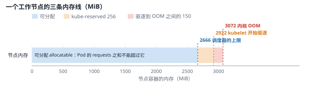

# 平台基线：在一台电脑上模拟三可用区集群（E0） {#ch-e0}

<div class="lead">第二册的所有实验都运行在同一台笔记本上。要让这些实验有意义，第一步不是安装更多软件，而是先回答三个问题：这台机器到底有多少资源；“节点”和“可用区”在这里指什么；哪些数字是内核真正执行的限制，哪些只是调度器的记账。本章建立一个 1 个控制面、3 个工作节点的集群 `ent`，把每个工作节点做成一台“4 核 3 GiB 的小虚拟机”，并逐层测量它的资源占用。测量中有两个发现会贯穿全书：kubelet 看不到节点容器的真实大小；Kind 默认根本不做内存驱逐。</div>

::: opener
::: q
**工程问题**

一台 16 线程、虚拟机只分得 15.3 GiB 内存的笔记本，怎样当作“三个可用区、每个节点 4 核 3 GiB”的集群来做实验——并且让调度器、kubelet 和内核对“这个节点有多大”的看法一致？
:::
::: k
**实测结论**

- Kind 的节点是容器：不加修正时，kubelet 认为每个节点拥有整台虚拟机的 15642 MiB 内存，而且 Kind 默认关闭了内存驱逐。
- 修正之后三条线对齐：调度器按 2666 MiB 放 Pod，kubelet 在 2922 MiB 开始驱逐，内核在 3072 MiB 才动用 OOM killer。
- 集群创建用了 43 秒，脚本可以重复执行；CPU 用 cpuset 固定，而不是用配额限制，避免了周期性的限流。
:::
:::

## 本章目标与产出

| 产出 | 位置（相对于 `v2/`） |
|---|---|
| 集群创建脚本（渲染 Kind 配置、节点尺寸、镜像缓存、负载均衡） | `platform/cluster/create.sh` |
| API 审计策略 | `platform/cluster/audit-policy.yaml` |
| 分层资源测量脚本 | `platform/cluster/measure.sh` |
| 暂停与恢复 v1 集群 | `platform/cluster/v1-lab.sh` |
| 渲染后的集群配置与全部测量记录 | `evidence/e0/` |

**验收标准（PLAN E0）：** 集群可重复创建；资源预算来自实测。已通过：脚本可重复执行（第二次执行只补齐缺失的部分，见 `evidence/e0/cluster-create-rerun.log`），本章的预算表中每个数字都有测量记录。

**学完本章，你应当能够：**

- 说清楚 Windows、WSL2 虚拟机、Docker、Kind 节点容器、Pod 这五层的关系，以及每一层由谁限制资源；
- 写出节点可分配资源（allocatable）的公式，并解释驱逐信号 `memory.available` 是怎样算出来的；
- 区分三种“资源真相”：内核执行的限制、调度器记的账、kubelet 的驱逐判断；
- 为一台共享的机器设计资源预算，并标出哪些是真实的、哪些是模拟的。

## 原理 {#e0-principles}

### 一台机器上的“多台机器”

第一册已经用过 Kind（第 2 章）：每个 Kubernetes 节点是一个 Docker 容器，容器里运行 systemd、containerd 和 kubelet，Pod 是这个容器里的又一层容器。第二册仍然这样做，但要把它当作一台台“机器”来对待，所以必须先看清楚这几层是怎样嵌套的：

```{.mermaid caption="本章的实验环境是四层嵌套：Windows、WSL2 虚拟机、作为“节点”的 Docker 容器、Pod。每一层的上限都约束它里面的所有进程；三个工作节点各自固定在 4 个 CPU 上，内存由内核限制在 3 GiB。"}
flowchart TB
  subgraph WIN["Windows 11（31.3 GiB 内存，8 核 16 线程）"]
    subgraph VM["WSL2 虚拟机 devops-lab（15.28 GiB，16 个 vCPU）"]
      D["dockerd / containerd"]
      subgraph CP["ent-control-plane（CPU 0-3，内存不限）"]
        S["etcd · kube-apiserver · scheduler · controller-manager"]
      end
      subgraph W1["ent-worker · zone-a（CPU 4-7，3 GiB）"]
        K1["kubelet · containerd"] --> P1["Pod"]
      end
      subgraph W2["ent-worker2 · zone-b（CPU 8-11，3 GiB）"]
        K2["kubelet · containerd"] --> P2["Pod"]
      end
      subgraph W3["ent-worker3 · zone-c（CPU 12-15，3 GiB）"]
        K3["kubelet · containerd"] --> P3["Pod"]
      end
      G["GitLab · 镜像缓存 · 负载均衡（envoy）"]
    end
  end
```

每一层都可以限制下一层的资源，但限制的手段不同：

| 层 | 谁决定它的大小 | 手段 |
|---|---|---|
| WSL2 虚拟机 | Windows 的 WSL 配置（默认为主机内存的 50%） | 虚拟机的内存与 vCPU 数 |
| 节点容器 | 本章的 `create.sh` | cgroup v2：`cpuset.cpus` 固定 CPU，`memory.max` 限制内存 |
| Pod 与容器 | Pod 的 requests / limits | kubelet 在节点容器内部再建一层 cgroup |

这里的关键是 cgroup 的嵌套：子 cgroup 的用量计入父 cgroup，**任何一层的上限都约束它下面的所有进程**。节点容器的 `memory.max` 是 3 GiB，那么这个节点上所有 Pod、加上 kubelet 和 containerd 自己，合起来不能超过 3 GiB，超过时由内核的 OOM killer 在这个节点内部挑一个进程杀掉。

### kubelet 眼中的节点

问题在于，kubelet 并不知道自己被关在一个 3 GiB 的容器里。它通过 cAdvisor 读取 `/proc/meminfo` 和 `/proc/cpuinfo` 来确定节点的容量（capacity），而这两个文件在容器中**没有被隔离**，显示的是整个虚拟机的数值。于是每个工作节点都会声称自己有 16 个 CPU、15.28 GiB 内存，三个节点加起来就是 48 个 CPU、46 GiB 内存，而真实的机器只有三分之一。调度器只相信 kubelet 上报的数字，它会把 Pod 放到一个早已满了的节点上。

```{.mermaid caption="问题的根源：kubelet 的“容量”来自整台虚拟机的 /proc/meminfo，真正执行的上限却在节点容器的 cgroup 上。不修正的话，调度器以为每个节点有 15 GiB，驱逐阈值永远不会触发，最先出手的只能是内核的 OOM killer。"}
flowchart LR
  M["/proc/meminfo<br/>MemTotal 15642 MiB<br/>整台虚拟机"]:::ghost --> CA["cAdvisor"] --> K["kubelet<br/>capacity = 15642 MiB"]
  K --> AL["allocatable =<br/>capacity − 预留 − 驱逐阈值"]
  AL --> S["调度器<br/>按 allocatable 放 Pod"]
  CG["节点容器的 cgroup<br/>memory.max = 3072 MiB"]:::bad -. "kubelet 不读它" .-> K
  CG --> OOM["内核 OOM killer<br/>在 3072 MiB 执行"]:::bad
```

kubelet 对外公布的是**可分配资源（allocatable）**，计算公式是：

$$\text{allocatable} = \text{capacity} - \text{kube-reserved} - \text{system-reserved} - \text{驱逐阈值（eviction-hard）}$$

`kube-reserved` 留给 kubelet、containerd 等节点组件，`system-reserved` 留给操作系统；驱逐阈值则是“剩余内存低于这个值就开始驱逐 Pod”的那条线（只对内存这类不可压缩的资源有意义）。调度器只把 Pod 的 **requests** 之和与 allocatable 比较，从不看实际用量。

驱逐（eviction）是 kubelet 自己的保护机制：它每隔一段时间（默认 10 秒）计算一次信号

$$\text{memory.available} = \text{capacity} - \text{workingSet}$$

其中 workingSet 是节点根 cgroup 的内存用量减去可以随时回收的非活跃文件页（`inactive_file`）。信号低于阈值时，kubelet 按 QoS 等级和超出 requests 的程度选择 Pod 驱逐。它和内核 OOM 的区别在于：驱逐是“有序撤离”，Pod 会被优雅终止、在别处重建，节点会被打上 `MemoryPressure` 污点，不再接收新 Pod；OOM 则是“当场击毙”，内核杀掉一个进程，不通知任何人，Pod 的容器以 137 退出后原地重启。

### 让 kubelet 看到真实的尺寸

既然 kubelet 读到的容量是假的，就用它能理解的参数把“不属于这个节点的部分”扣掉。以 4 个 CPU、3072 MiB 的节点为例（虚拟机的 MemTotal 为 15642 MiB）：

- **CPU**：`system-reserved cpu = 16 - 4 = 12`，再扣 `kube-reserved cpu = 250m`，allocatable 为 3.75 个 CPU。这 12 个 CPU 是“幻影容量”，节点并不拥有它们。
- **内存**：幻影容量不能放进 `system-reserved`，因为驱逐信号是相对于 capacity 计算的。如果驱逐阈值仍是默认的 100 MiB，只有 workingSet 超过 15542 MiB 时才会驱逐，而内核早在 3072 MiB 时就动手了。所以要把阈值本身平移：希望在用量达到 2922 MiB（离内核上限还有 150 MiB）时开始驱逐，就设

$$\text{memory.available} < 15642 - 2922 = 12720\ \text{MiB}$$

  此时 allocatable 为 $15642 - 256 - 12720 = 2666$ MiB。



这样，三种“资源真相”第一次对齐了：内核在 3072 MiB 执行硬限制；kubelet 在 2922 MiB 开始有序驱逐；调度器最多把 2666 MiB 的 requests 放到这个节点上，剩下的 256 MiB 留给节点组件。`create.sh` 在执行时读取 `nproc` 和 `/proc/meminfo` 计算这些值，所以换一台机器也成立。

::: principle
**三种资源真相。** 讨论“节点有多少内存”时，要先问是谁的视角。**内核**执行 cgroup 的上限，超过就 OOM，不讲道理；**调度器**只做 requests 的加法，它不知道实际用量；**kubelet** 用实际用量（workingSet）对照驱逐阈值，在内核动手之前有序地腾出空间。生产事故中常见的“节点明明还有空间却调度不上”“明明 requests 很小却被 OOM”，都是把这三者混为一谈的结果。
:::

## 设计 {#e0-design}

### 资源预算

预算从实测出发。暂停第一册的 `lab` 集群之前，虚拟机已用 8188 MiB、可用 7454 MiB；暂停后已用 3517 MiB、可用 12124 MiB，三个 v1 节点释放了约 4.6 GiB（`evidence/e0/v1-pause.log`）。剩下的主要是 GitLab（2.98 GiB），第二册继续用它托管 GitOps 配置仓库。

| 层 | 空集群实测 | 预算 | 性质 |
|---|---|---|---|
| 虚拟机自身（内核、systemd、dockerd） | 约 0.5 GiB | 0.6 GiB | `[真实]` |
| GitLab、Runner、推送用镜像仓库 | 3.0 GiB | 3.0 GiB，压测期间可停止 | `[真实]` |
| 4 个拉取缓存、负载均衡控制器 | 0.08 GiB | 0.1 GiB | `[真实]` |
| 控制面节点 | 0.70 GiB | 不设上限，目标 ≤ 1.5 GiB，持续测量 | `[真实]` |
| 3 个工作节点 | 0.14–0.20 GiB/个 | 3 × 3 GiB，由内核强制 | `[模拟]` 节点尺寸 |
| 余量（页缓存、k6、工具进程） | — | ≥ 1.2 GiB | — |

空集群的数字来自 `evidence/e0/baseline.log`：创建 60 秒后，控制面节点 699 MiB，三个工作节点分别为 199、142、139 MiB，虚拟机已用 4656 MiB、可用 10985 MiB。合计接近 15.28 GiB 的上限，说明预算是紧的。为此定一条规则：**压测与故障实验开始前，若虚拟机可用内存低于 1 GiB，先停止 GitLab**（Argo CD 暂时无法拉取配置，但已部署的应用不受影响）。

CPU 的分配见下表。这颗 Ryzen 7 8845HS 有 8 个同构的 Zen 4 核心，每个核心两个硬件线程（0/1 是核心 0，2/3 是核心 1，以此类推，见 `evidence/e0/host.log` 中的 `lscpu` 输出），所以每个工作节点固定两个完整的物理核心，彼此不共享执行单元：

| 节点 | 可用区 | CPU（cpuset） | 物理核心 | 内存上限 |
|---|---|---|---|---|
| ent-control-plane | — | 0-3 | 0、1 | 不限 |
| ent-worker | zone-a | 4-7 | 2、3 | 3 GiB |
| ent-worker2 | zone-b | 8-11 | 4、5 | 3 GiB |
| ent-worker3 | zone-c | 12-15 | 6、7 | 3 GiB |

为什么用 cpuset 固定 CPU，而不是用 `--cpus 4` 这样的配额？配额是“每 100 ms 最多用 400 ms 的 CPU 时间”，进程仍然看得到 16 个 CPU。Go 等运行时会按 16 个 CPU 启动工作线程，然后在配额用完时被集体暂停（throttling），这是容器环境特有的问题，真实的 4 核虚拟机不会这样。cpuset 让节点里的进程只看到 4 个 CPU（下文的测量证实了这一点），更接近一台小虚拟机。

主机上的 GitLab、Docker 守护进程和 Windows 自身不受 cpuset 约束，它们的活动会给测量带来噪声。后面每个性能实验都会记录同时段的负载与 PSI（压力停滞信息），并在结论中注明。

### 可用区是什么，不是什么

三个工作节点带有标签 `topology.kubernetes.io/zone=zone-a/b/c`、`topology.kubernetes.io/region=local-1` 和 `node.kubernetes.io/instance-type=sim-4c3g`。这些都是云上节点的标准标签，调度器的拓扑分布约束、存储的拓扑感知、服务的拓扑感知路由都依赖它们，所以后面的实验可以原样使用。

但它们是 `[模拟]` 的：三个“可用区”共享同一个内核、同一块磁盘、同一个网桥和同一个电源。真实可用区之间有独立的供电与网络，有 1–2 毫秒的往返延迟，会整体失效。本书在故障实验中用停止节点容器、注入网络分区来模拟可用区故障，所得结论只适用于“控制面与调度如何反应”，不适用于“真实数据中心如何失效”。

### 网络与入口

第一册的集群在 Docker 网络 `kind` 上。第二册用环境变量 `KIND_EXPERIMENTAL_DOCKER_NETWORK=kind-ent` 把 `ent` 放在独立的网络 `kind-ent`（172.20.0.0/16）上，两个集群的地址互不干扰，`lab` 以后恢复时不会因为 IP 被占用而出问题。GitLab 和推送用镜像仓库同时接入两个网络。

云上的 `LoadBalancer` Service 由云厂商的负载均衡器实现，它在集群之外。`cloud-provider-kind` 模拟了这一点：它作为一个容器运行在虚拟机上，监视所有 Kind 集群中 `type: LoadBalancer` 的 Service，为每个 Service 启动一个 envoy 容器，并把这个容器的 IP 写回 Service 的 `status.loadBalancer`。读取它生成的配置（`evidence/e0/node-view-details.log`），可以看到它的行为和云上的网络负载均衡器（L4）几乎一样：

- 监听器是 `tcp_proxy`，只转发 TCP 连接，不解析 HTTP；
- 后端是三个工作节点的 NodePort，策略为 `RANDOM`；控制面节点带有 `node.kubernetes.io/exclude-from-external-load-balancers` 标签，被排除在外；
- 健康检查访问每个节点上 kube-proxy 的 `:10256/healthz`，每 2 秒一次；
- `healthy_panic_threshold` 为 0：没有健康的后端时直接拒绝连接，而不是“死马当活马医”地随机转发。

启动时设置 `--gateway-channel disabled`，关闭它自带的 Gateway API 实现，第 3 章（E2）由 Istio 提供 Gateway API。

### 镜像供应：拉取缓存

每个节点独立拉取镜像。三个工作节点加一个控制面，同一个镜像要从互联网下载四次；第 8 章（E7）的灾难恢复演练还要整个重建集群。Docker Hub 对匿名拉取有频率限制。企业里的做法是在内网放一个拉取缓存（Harbor、Artifactory、Nexus 的代理仓库）。这里用 Distribution（`registry:3.1.2`）的代理模式为 docker.io、ghcr.io、quay.io、registry.k8s.io 各起一个缓存，再在每个节点的 `/etc/containerd/certs.d/<registry>/hosts.toml` 中声明：

```toml
server = "https://registry-1.docker.io"

[host."http://mirror-docker:5000"]
  capabilities = ["pull", "resolve"]
```

containerd 先试缓存，缓存不可用时回退到 `server`，所以缓存故障不会让集群拉不到镜像（只是变慢）。四个缓存都经过了验证：从节点拉取一个小镜像后，对应缓存的存储目录中出现了这个仓库（`evidence/e0/baseline.log`）。

### 审计日志

第 6 章（E5）要回答“谁在什么时候做了什么”，这依赖 API Server 的审计日志，而审计策略只能在 API Server 启动时指定，所以在建集群时就配置好。策略（`platform/cluster/audit-policy.yaml`）按“第一条匹配的规则生效”的顺序写，原则是：

1. 丢弃高频而无价值的请求：健康检查、API 发现、事件、租约（leader 选举和节点心跳）、认证与授权审查；
2. Secret、ConfigMap、令牌和 `exec`：无论谁操作，只记元数据，**永远不记请求体**，否则审计日志本身就成了泄密的渠道；
3. 系统组件（ServiceAccount、节点、控制器）：读操作不记，写操作只记元数据；
4. 人的写操作：记请求体；对 RBAC、准入策略、NetworkPolicy 的写操作，请求和响应都记；
5. 其余（人的读操作）：只记元数据。

实测的结果符合预期：集群创建后约 7.5 分钟内记录了 1077 个事件，其中 Metadata 1003 个、Request 44 个、RequestResponse 30 个，文件约 1.2 MB；`kubernetes-admin` 删除命名空间的事件带有请求体，创建 Secret 的事件没有（`evidence/e0/audit-volume.log`）。日志按 100 MB 轮转、保留 5 个，最多占用约 600 MB。

## 实现与验证 {#e0-build}

### 创建集群

`create.sh` 先渲染 Kind 配置（渲染结果保存在 `evidence/e0/ent-cluster.rendered.yaml`），然后创建集群、启动镜像缓存、配置每个节点的 containerd、设置节点容器的 CPU 与内存、启动负载均衡控制器，最后安装 metrics-server。工作节点的 kubelet 参数通过 Kind 的 JSON 6902 补丁追加到 `JoinConfiguration` 中：

```yaml
kubeadmConfigPatchesJSON6902:
  - group: kubeadm.k8s.io
    version: v1beta4          # Kubernetes 1.31 起，kubeadm 的参数列表是 name/value 数组
    kind: JoinConfiguration
    patch: |
      - op: add
        path: /nodeRegistration/kubeletExtraArgs/-
        value: {name: system-reserved, value: "cpu=12"}
      - op: add
        path: /nodeRegistration/kubeletExtraArgs/-
        value: {name: eviction-hard, value: "memory.available<12720Mi,nodefs.available<0%,..."}
```

为什么用 JSON 6902 的 `add ... /-`（追加到数组末尾），而不是 Kind 更常见的合并补丁？因为 Kind 生成的 `kubeletExtraArgs` 已经是一个数组（含 `node-ip`、`provider-id`、`node-labels`），合并补丁会把整个数组替换掉，节点就丢了自己的 IP 设置。同样的原因，API Server 的审计参数也是追加的。`eviction-hard` 必须完整地写出所有信号：命令行参数会整体替换配置文件中的 `evictionHard`，而 Kind 在配置文件里把磁盘相关的信号设为 `0%`（关闭磁盘驱逐，因为节点容器看到的是整个主机的磁盘）。

集群创建用了 43 秒（`evidence/e0/cluster-create.log`）。第一次执行时有一个缺陷：`docker inspect -f '{{json .NetworkSettings.Networks."kind-ent"}}'` 在 Go 模板中是非法的（带连字符的名字不能作为字段名），命令报错，而脚本把“报错”当成了“已连接”，于是没有把 GitLab 和镜像仓库接入新网络。修正为 `{{json (index .NetworkSettings.Networks "kind-ent")}}` 后再执行一次，脚本只补做了缺失的步骤（`evidence/e0/cluster-create-rerun.log`）。这个小插曲说明了幂等脚本的价值：可以放心地重复执行。

### kubelet 的有效配置

写进配置的参数不一定生效，要看 kubelet 实际在用什么。kubelet 的 `/configz` 端点返回合并了配置文件和命令行参数之后的有效配置（`evidence/e0/baseline.log`）：

```text
== ent-control-plane
{"kubeReserved":null,"systemReserved":null,
 "evictionHard":{"imagefs.available":"0%","nodefs.available":"0%","nodefs.inodesFree":"0%"}, ...}
== ent-worker
{"kubeReserved":{"cpu":"250m","memory":"256Mi"},"systemReserved":{"cpu":"12"},
 "evictionHard":{"imagefs.available":"0%","memory.available":"12720Mi","nodefs.available":"0%",...},
 "evictionMinimumReclaim":{"memory.available":"100Mi"}, ...}
```

工作节点的参数全部生效。控制面节点的输出揭示了一个容易被忽略的事实：**Kind 默认的 kubelet 配置里没有 `memory.available` 阈值**。Kind 为了关闭磁盘驱逐写了 `evictionHard`，而只要设置了 `evictionHard`，kubelet 就不再为其中没写的信号套用默认值（默认的 `memory.available<100Mi` 也就消失了）；控制这一行为的字段 `mergeDefaultEvictionSettings` 在这里是 `false`（`evidence/e0/node-view-details.log`）。结果是默认的 Kind 集群**从不因为内存压力驱逐 Pod**，内存耗尽时只有内核 OOM。在 Kind 上做的“驱逐实验”如果没有先检查这一点，结论很可能是错的。第 5 章（E4）的驱逐实验就建立在本章设置的阈值上。

节点上报的容量与可分配资源也与计算一致：

```text
NODE                ZONE     CAP_CPU   ALLOC_CPU   CAP_MEM      ALLOC_MEM
ent-control-plane   <none>   16        16          16017492Ki   16017492Ki
ent-worker          zone-a   16        3750m       16017492Ki   2730068Ki
```

16017492 KiB 正是虚拟机的 15642 MiB；2730068 KiB 是 2666 MiB。驱逐信号也来自节点自己的 cgroup，而不是整个虚拟机：`ent-worker` 的 workingSet 为 199 MiB，`memory.available` 为 15442 MiB（= 15642 − 199，取整），与从节点 cgroup 文件直接算出的 201 MiB、`docker stats` 显示的 199.1 MiB 一致。这一点很重要：如果 kubelet 用的是虚拟机的整体内存，那么一个节点的压力会让所有节点同时驱逐。

### 节点内部的 cgroup 树

进入节点容器，可以看到 kubelet 建立的层级（`evidence/e0/cgroup-tree.log`）：

```text
.                                                       memory.max=3221225472   ← Docker 设置的节点上限（3 GiB）
kubelet.slice                                           memory.max=max
kubelet.slice/kubelet-kubepods.slice                    memory.max=16133476352  ← capacity - kube-reserved
kubelet.slice/kubelet-kubepods.slice/...-burstable      memory.max=max
kubelet.slice/kubelet-kubepods.slice/...-besteffort     memory.max=max
```

kubelet 给所有 Pod 的总 cgroup（kubepods）设置的上限是 capacity − kube-reserved − system-reserved = 15642 − 256 = 15386 MiB，比节点本身的 3 GiB 大得多，所以实际起作用的是节点容器的上限。这也验证了前面的推理：在 kubelet 看不到真实容量的环境里，**驱逐阈值是唯一能在内核 OOM 之前起作用的保护**。

OOM 的优先级（`oom_score_adj`，越小越不容易被杀）同样反映了 kubelet 的策略：containerd、kubelet、kube-proxy 为 −999，kindnet 为 −997。kindnet 和 kube-proxy 的 QoS 等级分别是 Burstable 和 BestEffort，按 QoS 本应排在前面被杀，但它们使用 `system-node-critical` 优先级类（`evidence/e0/node-view-details.log`），kubelet 对关键 Pod 一律给 −997；kube-proxy 进程启动后又按自己的默认值 `oomScoreAdj=-999` 改写了一次。

### 从 Pod 里看节点

在 `ent-worker` 上的 Pod 里执行几个命令（`evidence/e0/smoke.log`）：

```text
$ nproc                                  → 4
$ grep -c ^processor /proc/cpuinfo       → 16
$ cat /sys/fs/cgroup/cpuset.cpus.effective → 4-7
$ head -1 /proc/meminfo                  → MemTotal: 16017492 kB
```

`nproc` 通过 `sched_getaffinity` 得到 4，这是 cpuset 的效果；但 `/proc/cpuinfo` 仍列出 16 个处理器，`/proc/meminfo` 仍显示整个虚拟机的内存。应用如果用后两者来决定线程池大小或堆大小，就会严重高估。现代运行时大多已改为读取 cgroup 或 CPU 亲和性（例如 JVM 的容器支持、Go 1.25 起的容器感知 GOMAXPROCS），但 Python 的 `os.cpu_count()` 在这个 Pod 里返回 16，`len(os.sched_getaffinity(0))` 和 Python 3.13 新增的 `os.process_cpu_count()` 才返回 4（`evidence/e0/node-view-details.log`）。第 4 章（E3）设置 Uvicorn 的进程数时会用到这一点。

### 负载均衡器的第一秒

冒烟测试（`platform/cluster/smoke.yaml`）在三个可用区各放一个 Pod，前面放一个 LoadBalancer Service。拓扑分布约束把三个 Pod 分别放到了三个节点上，负载均衡器拿到了 IP 172.20.0.12。但第一次测试的 30 个请求中，**9 个没有响应，其余 21 个全部落在同一个 Pod 上**（`evidence/e0/smoke.log`）。

稍后再测，60 个请求经负载均衡器分布为 21/23/16，直接访问一个节点的 NodePort 分布为 15/26/19，都是均匀的。为了弄清第一次发生了什么，又单独重建 Service，从创建那一刻起计时（`evidence/e0/lb-cold-start.log`）：IP 在 4.5 秒后分配；随后的 40 个请求全部成功，但前 2 秒内几乎只落在两个 Pod 上，第三个 Pod 在第 6.43 秒才第一次出现；之后的 90 个请求分布为 34/25/31。

可以确定的部分是：envoy 在第一次健康检查通过之前没有可用的后端，又没有恐慌路由，这期间的连接会被直接拒绝；第一次测试时 Deployment 和 Service 是同时创建的，比第二次多了 Pod 启动的过程。不能完全确定的是请求在前几秒集中的原因，可能与各节点的 kube-proxy 在不同时刻写入转发规则有关，本次没有采集足以证实的数据。对运维的启示是确定的：**新建的负载均衡器需要预热时间**，切换流量（例如蓝绿发布切换 DNS）之前要先确认健康检查已通过，并用真实请求验证分布。

### 暂停与恢复第一册的集群

第一次暂停 `lab` 时用了 `docker stop` 的默认超时（10 秒）：节点容器的 systemd 收到停止信号后要依次停止所有 Pod、containerd 和 kubelet，10 秒内没有完成，Docker 发出 SIGKILL，容器以 137 退出（`evidence/e0/v1-pause.log`）。这相当于给三台机器同时断电。

第一册的成果不能因此受损，所以立刻做了一次恢复检查（`evidence/e0/v1-restart-check.log`）：启动后 API Server 最初返回 `Forbidden: unknown`（它在 RBAC 缓存就绪之前就开始应答，脚本已改为先等待 `/readyz`）；随后三个节点 Ready，42 个 Pod 全部 Running，两个 Argo CD 应用均为 Synced/Healthy。etcd 的预写日志保证了断电后的一致性。之后改用 120 秒超时正常停止，用时 1 分 30 秒。

## 局限：这个集群不是什么 {#e0-limits}

::: prod
| 方面 | 本环境 | 真实生产 |
|---|---|---|
| 节点 | Docker 容器，共享一个内核 | 独立的虚拟机或物理机，内核故障互不影响 |
| 节点容量 | kubelet 读到的是整个虚拟机，靠参数修正 | kubelet 读到的就是真实容量 |
| 可用区 | 只是标签；共享磁盘、网桥和电源；区间无延迟 | 独立的故障域，区间有 1–2 ms 延迟 |
| 磁盘 | 所有节点共用一块 NVMe，磁盘驱逐已关闭 | 每个节点有自己的磁盘与 IOPS 上限 |
| 负载均衡 | 主机上的一个 envoy 容器 | 高可用的托管服务，有自己的扩缩容与配额 |
| 噪声 | Windows、GitLab、Docker 与实验共享机器 | 专用的节点池，但会有邻居租户 |
:::

这些差异不会让本书的实验失去意义，但决定了结论的边界：调度、驱逐、控制器的行为是真实的 Kubernetes 行为；吞吐量、延迟这类绝对数字只属于这台机器。

## 常见问题

**Q1：为什么不直接调大 WSL 的内存？** 可以，在 Windows 的 `%UserProfile%\.wslconfig` 中设置 `memory=20GB` 后执行 `wsl --shutdown` 即可。但这会改变主机的系统配置，影响所有 WSL 发行版，属于机器所有者的决定，本书没有这样做，而是在默认的 15.28 GiB 内设计预算。如果你调大了内存，只需重新执行 `create.sh`，阈值会按新的 MemTotal 自动计算。

**Q2：控制面节点为什么不设内存上限？** API Server 的内存随对象数量、CRD 数量和 watch 连接数增长，静态 Pod 的 OOM 优先级又不高。在 3 GiB 的上限下，一旦超出，内核可能先杀 API Server，整个集群随之失去控制。本书选择不设上限、持续测量，把控制面的容量问题留给第 11 章（E10）在独立的集群上研究。

**Q3：`cloud-provider-kind` 需要挂载 Docker 套接字，安全吗？** 能访问 Docker 套接字就等于拥有虚拟机的 root 权限。这里它是 Kubernetes SIG 官方维护的组件，只在本地实验环境运行；在共享或生产环境中，不应该把 Docker 套接字交给任何容器。

**Q4：恢复 `lab` 集群时要注意什么？** `ent-ccm` 会监视所有 Kind 集群，它被设置为把负载均衡器放在 `kind-ent` 网络上，对 `lab` 不适用（第一册也没有使用 LoadBalancer）。同时运行两个集群还会超出内存预算。建议先停止 `ent`（`docker stop -t 120` 依次停止四个节点），再执行 `v1-lab.sh start`。

## 练习 {#e0-exercises}

::: exercise
1. **（计算）** 把工作节点改为 2 个 CPU、4 GiB 内存，驱逐余量仍为 150 MiB，kube-reserved 不变。写出 `system-reserved` 和 `eviction-hard` 的值，以及节点的 allocatable。虚拟机的 MemTotal 仍为 15642 MiB。
2. **（分析）** 一个节点上 Pod 的 requests 之和为 2.5 GiB，实际用量为 2.8 GiB。此时 kubelet 会做什么？如果某个 Pod 在 3 秒内又分配了 400 MiB，接下来最可能发生什么？为什么？
3. **（动手）** 在一个默认配置的 Kind 集群中，用 `/configz` 确认没有 `memory.available` 阈值；然后只用 kubeadm 补丁（不用命令行参数）为所有节点加上 `memory.available<500Mi`，并说明为什么仍要保留磁盘相关的三个 `0%`。
4. **（设计）** 本章用 cpuset 固定 CPU。列出改用 `--cpus 4`（配额）后，节点内的 Go 程序、Python 多进程程序和 CPU 密集型 Pod 的行为会有什么不同，各举一个可以观测到差异的指标。
5. **（排查）** 新建的 LoadBalancer Service 前几秒的请求部分失败。列出你会依次检查的三个地方，以及每个地方用什么命令或日志确认。
6. **（思考）** 审计策略把 Secret 的所有操作都只记录元数据。审计人员提出：“我们需要知道 Secret 的值被改成了什么，才能判断是否被篡改。”你如何在不把密文写进审计日志的前提下满足这个需求？
:::

参考答案见附录。

## 本章小结

- `ent` 集群由 1 个控制面和 3 个工作节点组成，三个节点带有 `[模拟]` 的可用区标签；每个工作节点由内核限制为 4 个固定 CPU、3 GiB 内存，相当于一台小虚拟机。
- kubelet 读到的容量是整个虚拟机的。用 `system-reserved` 扣掉幻影 CPU、用平移后的 `memory.available` 阈值扣掉幻影内存，使内核限制（3072 MiB）、驱逐起点（2922 MiB）和调度上限（2666 MiB）三者对齐，`/configz` 与节点状态证实全部生效。
- 测量发现 Kind 默认不做内存驱逐：设置了 `evictionHard` 就不再套用默认的 `memory.available` 阈值。
- 空集群占用约 1.2 GiB；加上 GitLab，虚拟机可用内存约 11 GiB，预算是紧的，压测前要检查余量。
- 负载均衡器、拉取缓存和审计日志都已就绪并经过验证；新建的负载均衡器在最初几秒可能拒绝连接或分布不均。
- 第一册的集群被暂停，经过一次意外的强制停止后已验证可以完整恢复。
