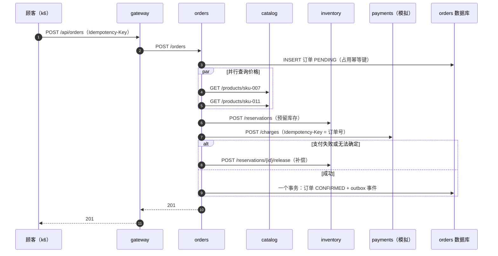
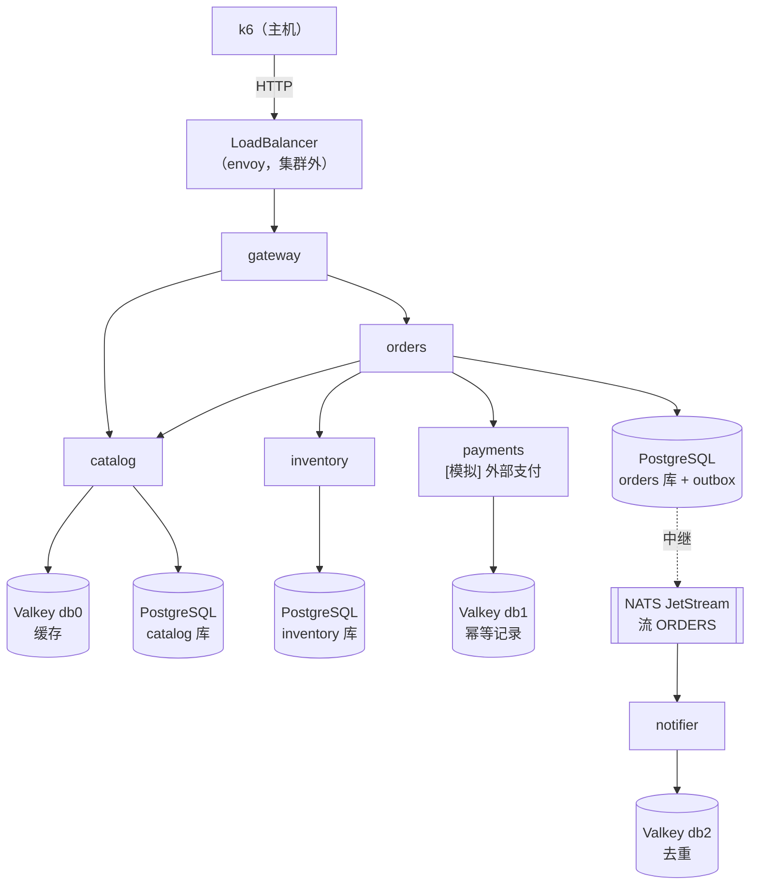
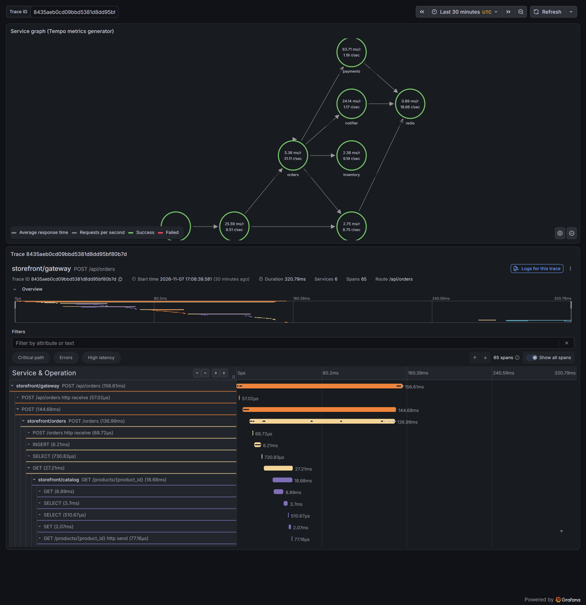
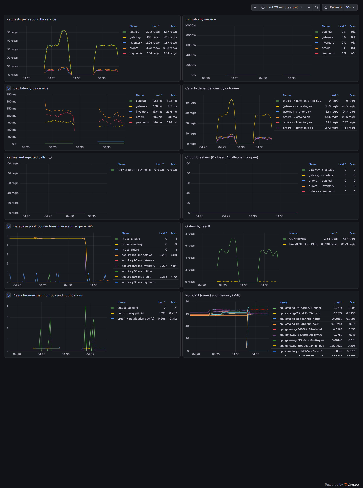

# 多服务系统：storefront 与它的平台（E1） {#ch-e1}

<div class="lead">第一册只有一个服务。真实的系统由许多服务组成，它们通过网络同步调用，通过消息异步协作，各自拥有数据。本章搭建第二册的被测系统 storefront：六个服务、一个三实例 PostgreSQL 集群、一个 Valkey、一个三节点 NATS JetStream 集群，外加 Prometheus、Tempo、Loki 组成的可观测性平台，全部由 Argo CD 从 Git 部署。系统刻意做得“小而完整”：一笔订单要经过价格查询、库存预留、支付、确认和异步通知，涉及分布式系统中最常见的几个难题——部分失败、重复请求、双写、跨服务追踪。第一次部署就暴露了八个问题，本章把它们连同证据一起记录下来，这比一次顺利的部署更有教学价值。</div>

## 本章目标与产出

| 产出 | 位置（相对于 `v2/`） |
|---|---|
| 六个服务的源代码与测试（一个镜像） | `apps/storefront/` |
| GitOps 配置仓库的内容（平台组件、服务 Chart、环境配置） | `gitops/` |
| 引导脚本（密钥、镜像、配置仓库、Argo CD） | `platform/bootstrap/` |
| 看板即代码 | `platform/dashboards/gen.py` |
| 负载脚本与分布统计 | `experiments/load/` |
| 测试、收敛、链路、负载与排障的全部记录 | `evidence/e1/` |

**验收标准（PLAN E1）：** 一笔订单的完整链路（同步 + 异步）在 Tempo 中可见；单元测试与集成测试通过。已通过：订单 `f9c9a183` 的链路包含 6 个服务、65 个 span，从网关的请求一直延续到通知服务消费消息（`evidence/e1/one-order-trace.log`）；28 个测试（其中 4 个使用真实的 PostgreSQL、Valkey 和 NATS）全部通过，覆盖率 89%（`evidence/e1/app-tests-3.log`）。

**学完本章，你应当能够：**

- 说明同步调用和异步消息各自带来的耦合，以及为什么“写数据库再发消息”是错的；
- 用 saga、补偿、幂等键和事务性 outbox 实现一个跨服务的业务流程，并指出它在哪些情况下仍会出错；
- 说出超时、截止时间、重试、重试预算、熔断、舱壁分别回答什么问题，并估算重试的放大倍数；
- 让链路追踪跨过消息队列，并从一条链路中读出时间花在了哪里；
- 用 app-of-apps、同步波次和 ApplicationSet 从 Git 引导一个完整的平台；
- 把“第一次部署出的问题”当作数据：每个问题都有现象、证据、根因、修复和回归测试。

## 原理 {#e1-principles}

### 拆分服务的代价

把一个程序拆成多个服务，换来的是独立部署、独立伸缩和故障隔离；付出的代价是：原来的函数调用变成了网络调用，原来的一个数据库事务变成了多个数据库各自的事务。网络调用会失败、会变慢、会成功了却没有返回结果；多个事务无法一起提交或一起回滚。微服务设计的大部分技巧，都是在处理这两个代价。

服务之间有两种协作方式：

| | 同步调用（HTTP） | 异步消息（NATS JetStream） |
|---|---|---|
| 调用方是否等待 | 等待结果 | 只等消息被可靠保存 |
| 时间耦合 | 被调用方必须此刻可用 | 消费方可以晚一点再处理 |
| 失败的传播 | 被调用方慢，调用方跟着慢（第 7 章研究级联故障） | 消费方慢，消息积压，生产方不受影响 |
| 适合 | 需要结果才能继续：价格、库存、支付 | 不影响当前请求的后续工作：通知、统计 |

storefront 两种都用。下单必须知道价格、库存和支付结果，所以是同步调用；发通知不应让顾客等待，所以是异步消息。

### 跨服务的业务流程：saga

下单涉及三个服务的数据：库存（inventory）、支付（payments）、订单（orders）。没有一个事务能同时覆盖它们。**saga** 的做法是把流程拆成一串本地事务，每一步失败时，用**补偿动作**撤销已经完成的步骤。storefront 采用编排式（orchestration）saga，由 orders 服务按顺序指挥：



saga 不提供隔离性：在补偿完成之前，其他请求能看到“库存已预留、订单尚未确认”的中间状态。这在电商中可以接受（预留本来就是暂时的），在转账这类场景中则需要更强的设计。

### 幂等键与“模糊结果”

网络调用有第三种结局：请求发出去了，没收到回答。可能是对方根本没收到，也可能是对方已经处理完、回答在路上丢了。这叫**模糊结果**（ambiguous outcome）。对查询来说重试无害；对“扣款”来说，盲目重试可能扣两次钱。

解决办法是**幂等键**：调用方为每个业务操作生成一个唯一的键，随请求发送；服务端记住每个键的结果，同一个键再来时直接返回第一次的结果。storefront 在三处使用它：

1. 顾客 → gateway → orders：`Idempotency-Key` 由客户端生成，orders 用数据库的唯一约束占用它（`INSERT ... status='PENDING'`）。并发的重复请求中只有一个能插入成功，其余返回已有的订单（`200` 和 `Idempotent-Replayed: true`）。
2. orders → inventory：预留以订单号为主键，重复预留返回已有结果。
3. orders → payments：以订单号为幂等键。payments 还为每个键加了一把带过期时间的锁：同一个键的两个请求同时到达时（典型情形：调用方超时后重试，而第一次请求还在处理），第二个得到 `409`，必须稍后再问，而不是两个都去扣款。

幂等键把“重试是否安全”这个问题，从“调用方猜测对方的状态”变成了“服务端保证”。本章后面的排障记录中，正是它让一次真实的错误没有变成重复扣款。

### 双写问题与事务性 outbox

订单确认后要发一个 `OrderConfirmed` 事件。最直接的写法是“提交数据库事务，然后发消息”。这是错的：两步之间进程可能崩溃，消息就丢了；反过来“先发消息再提交”，事务可能回滚，消息却已发出。两个系统无法原子地一起写，这叫**双写问题**。

**事务性 outbox** 把消息先当作数据写进同一个数据库：

```sql
BEGIN;
UPDATE orders SET status = 'CONFIRMED', total_cents = $2 WHERE id = $1;
INSERT INTO outbox (event_id, subject, payload, headers) VALUES (...);
COMMIT;   -- 订单和事件要么都在，要么都不在
```

一个独立的中继（relay）读取 outbox 中未发布的行，发布到 NATS，再把它们标为已发布。中继可能在“发布成功”和“标记完成”之间崩溃，于是同一事件会再发一次：outbox 提供的是**至少一次**投递。重复由两层处理：消息携带 `Nats-Msg-Id`（等于事件 ID），JetStream 在 2 分钟的去重窗口内丢弃相同 ID 的消息；消费方再按事件 ID 去重。多个 orders 副本都运行中继，`SELECT ... FOR UPDATE SKIP LOCKED` 让它们各取不同的行，不会同时处理同一行。

### 韧性原语：每一个回答一个问题

服务 A 调用服务 B 时，B 可能慢、可能错、可能不在。共享库 `storefront.common` 为每次调用依次检查：

| 原语 | 回答的问题 | storefront 的默认值（resilient 模式） |
|---|---|---|
| 超时 | 一次尝试最多等多久？ | 1 秒 |
| 截止时间传播 | 整个请求还剩多少时间？ | gateway 设 3 秒，经 `X-Deadline-Ms` 向下传递 |
| 重试（带全抖动的指数退避） | 值得再试吗？什么时候？ | 最多 2 次，仅对幂等调用 |
| 重试预算 | 系统还负担得起重试吗？ | 重试最多占请求量的 20% |
| 熔断器 | 对方此刻是不是坏了？ | 最近 20 次中至少 10 次、失败率 ≥ 50% 则断开 5 秒 |
| 舱壁 | 最多允许多少个调用同时等待它？ | 64 |

另有一个 **naive 模式**（`RESILIENCE_MODE=naive`）：30 秒超时、不加抖动地立即重试 3 次、没有预算、没有熔断和舱壁。它是第 7 章（E6）故障传播实验的对照组。

为什么需要重试预算？设调用链有 $n$ 层，每层最多重试 $r$ 次，最深一层在最坏情况下收到的请求是用户请求的 $(1+r)^n$ 倍。naive 模式下 gateway → orders → payments 两层各重试 3 次，就是 $4^2 = 16$ 倍：依赖本来只是慢，被重试活活压垮。预算把每一层的额外负载限制在 20%，两层合计不超过 $1.2^2 = 1.44$ 倍。全抖动（每次退避取 $[0, \min(上限, 基数 \times 2^k)]$ 中的随机值）则避免大量客户端在同一时刻一起重试。

截止时间传播解决的是另一种浪费：用户在 3 秒后已经放弃，下游却还在为这个请求查数据库。每个服务从请求头读出截止时间，给每次下游调用的超时取“自己的超时”和“剩余时间”中较小的那个；时间已经用完，就直接失败（`deadline`），不再发出调用。

### 追踪如何跨过消息队列

HTTP 调用的链路由 OpenTelemetry 自动传递：客户端在请求头中写入 `traceparent`，服务端读出它作为父上下文。消息队列没有这种自动机制，storefront 手工完成三步：

1. 下单请求在写 outbox 时，把当时的上下文（`traceparent`）存进 outbox 行的 `headers` 列；
2. 中继发布时，以这个上下文为父，创建一个 `PRODUCER` 类型的 span（`send orders.confirmed`），并把新的上下文写进 NATS 消息头；
3. 通知服务读出消息头，以它为父创建 `CONSUMER` span（`process orders.confirmed`）。

结果是：一笔订单从网关请求到通知发出，在 Tempo 中是同一条链路，事件在 outbox 和流中等待的时间也直接显示为 span 之间的空隙。

## 系统设计 {#e1-design}

### 服务与数据



| 组件 | 规格 | 说明 |
|---|---|---|
| gateway、catalog、inventory、payments、orders | 各 2 个副本，requests 50m CPU / 96 Mi | 同一个镜像，启动命令选择服务 |
| notifier | 1 个副本 | 第 5 章（E4）由 KEDA 按积压伸缩 |
| PostgreSQL（CloudNativePG 1.30.1） | 3 个实例，每个可用区一个，PostgreSQL 18 | 每个服务一个数据库、一个登录角色（共享集群上的“每服务一库”） |
| Valkey 9.1.3 | 1 个实例，AOF 持久化，`maxmemory-policy noeviction` | 三个逻辑库三种用途，见下文 |
| NATS 2.15.2 | 3 节点 JetStream 集群（Raft），流 ORDERS 3 副本 | 文件存储，去重窗口 2 分钟 |

Valkey 的三种用途对“丢失”的容忍度完全不同：catalog 的缓存丢了只是变慢；payments 的幂等记录丢了可能导致重复扣款；notifier 的去重记录丢了会重复发通知。所以淘汰策略选 `noeviction`：内存满时写入失败（catalog 能容忍），而不是悄悄淘汰幂等记录。生产环境应把缓存和“记录”放在不同的实例上，本章的排障记录会再次说明这一点。

### 每个服务的运维面

所有服务共享同一套运维接口（`common/web.py`），这是平台对服务的“契约”：

- `/healthz`：存活探针，只说明进程能应答，**从不检查依赖**；
- `/readyz`：就绪探针，启动完成、未在关闭、自身就绪检查通过（例如数据库连接池可用）；
- `/metrics`：RED 指标（按路由模板计数的请求数、错误、延迟直方图）和依赖调用指标（按结果计数的尝试、重试、被拒绝的调用、熔断器状态、舱壁占用、连接池等待）；
- `/admin/faults`：`[注入]` 故障的开关（延迟、错误率），供第 7 章使用；
- 每个请求的 `X-Request-ID` 和 trace ID 都写进 JSON 日志。

Pod 的安全上下文全部加固：非 root（UID 10001）、只读根文件系统、去掉所有 capability、`RuntimeDefault` seccomp；ServiceAccount 不挂载令牌（服务不需要访问 Kubernetes API）。停止时先 `preStop` 等待 5 秒，让端点的删除传播到各节点，再由 uvicorn 在 20 秒内处理完已接收的请求。

### 平台从 Git 引导

第一册的配置仓库只放了一个服务的部署配置。第二册把整个平台都放进 Git（`gitops/`，发布到本地 GitLab 的 `root/platform-gitops`）：

```text
gitops/
  bootstrap/root.yaml            唯一需要手工 apply 的清单：根应用
  bootstrap/argocd-values.yaml   Argo CD 本身的 Helm 参数（引导时安装）
  platform/apps/                 每个平台组件一个 Application（带同步波次）
  platform/values/               各组件的 Helm 参数
  platform/manifests/            Valkey、PostgreSQL 集群、看板等清单
  charts/storefront-service/     通用服务 Chart
  envs/prod/storefront/          环境配置：common.yaml + 每个服务一个文件
```

**app-of-apps**：根应用指向 `platform/apps/`，那里的每个文件又是一个 Application。重建平台只需要两步：安装 Argo CD，apply 根应用。**同步波次**决定顺序：先装带 CRD 的 kube-prometheus-stack（波次 −3），再装 CloudNativePG 运营商（−2），然后是 Tempo、Loki、Collector、NATS、Valkey（−1），PostgreSQL 集群（0），最后是服务（1）。波次能起作用有一个前提：Argo CD 自 1.8 起默认不评估子 Application 的健康状态，根应用会把所有子应用视为立即就绪。`argocd-values.yaml` 用一段 Lua 健康检查恢复了它，这一点很容易被忽略。

**ApplicationSet** 为 `envs/*/storefront/services/*.yaml` 中的每个文件生成一个 Application：增加一个服务就是增加一个文件。第 9 章（E8）会在同一机制上增加 staging 环境。

**密钥不进 Git。** 数据库角色密码、Grafana 管理员密码由 `bootstrap.sh` 用 `openssl rand` 生成，保存在 WSL 的 `~/.lab-secrets/v2/`（权限 600），直接创建为 Kubernetes Secret；Argo CD 读取配置仓库用的是只读、30 天过期的项目访问令牌。第 6 章（E5）会把这些密钥移到外部密钥管理系统。

## 实现要点 {#e1-code}

### 一次依赖调用的完整流程

`common/upstream.py` 的核心循环按固定顺序做检查（有删节）：

```python
async def request(self, method, path, *, json=None, headers=None):
    headers = {**context.outgoing_headers(), **(headers or {})}   # 请求 ID 与截止时间
    idempotent = method in ("GET", "HEAD") or "Idempotency-Key" in headers
    if self.budget:
        self.budget.deposit()                       # 每个请求为预算存入 0.2 个令牌
    async with self.bulkhead:                       # 舱壁满了立即失败，不排队
        return await self._attempts(method, path, json, headers, idempotent)

async def _attempts(self, method, path, json, headers, idempotent):
    attempt = 0
    while True:
        remaining = context.remaining_seconds()
        if remaining is not None and remaining <= 0:
            raise self._reject("deadline")          # 上游已放弃：不再发出调用
        if self.breaker and not self.breaker.allow():
            raise self._reject("circuit_open")      # 熔断：快速失败
        timeout = min(self.policy.timeout_s, remaining or inf)
        ...                                          # 发出一次尝试，记录结果与耗时
        if outcome == "ok":
            return resp
        retryable = outcome in ("timeout", "connect_error") or status in {429, 500, 502, 503, 504}
        if not (idempotent and retryable and attempt < self.policy.retries):
            break
        if self.budget and not self.budget.try_withdraw():
            break                                   # 预算用完：放弃重试
        attempt += 1
        await asyncio.sleep(self.policy.backoff(attempt))   # 全抖动退避
```

失败最终变成 `UpstreamError`，由统一的异常处理器转换为状态码：熔断、舱壁满、预算用完返回 `503`（附 `Retry-After`），超时和截止时间用完返回 `504`，连接失败和重试后仍错误返回 `502`。调用方因此能从状态码区分“对方过载、请稍后”和“对方坏了”。

### saga 的失败分支

orders 的下单函数中，每一个可能失败的步骤都写明了补偿（`orders/main.py`）：

```python
try:
    r = await up["inventory"].request("POST", "/reservations", ...)
except UpstreamError as e:
    await release(order_id)       # 没收到回答，不代表没预留：照样补偿（释放是幂等的）
    await fail(order_id, "FAILED", f"inventory {e.kind}", 503, total)
    raise
...
if p.status_code == 402:          # 支付被拒
    await release(order_id)
    return await fail(order_id, "PAYMENT_DECLINED", "declined by provider", 402, total)
if p.status_code != 201:          # 409：同一个键的另一次尝试还在进行，结果未知
    await release(order_id)
    return await fail(order_id, "FAILED", f"payments HTTP {p.status_code}", 503, total)
```

最后一个分支是一个有意保留的缺口：支付结果未知时订单被标为失败、库存被释放，但那次仍在进行的扣款可能随后成功。真实系统用**对账**（reconciliation）补上：定期查询支付服务（`GET /charges/{key}`），把“已扣款却失败”的订单找出来退款或补单。第 7 章（E6）会让这个缺口真实地出现。

### 测试

测试分三层（`evidence/e1/app-tests-3.log`）：

- **韧性原语**：退避的指数增长与上限、预算把 100 个请求的重试限制在 20 次、熔断器的状态机（含半开状态的试探失败）、舱壁拒绝而不排队；
- **依赖调用**（用 `httpx.MockTransport` 模拟对方）：503 后重试成功、没有幂等键的 POST 不重试、预算阻止重试风暴（10 个请求只重试 2 次，而不是 30 次）、熔断后不再发出调用、截止时间被传递、过期的截止时间立即失败；
- **服务**：把真实的 catalog、inventory、payments 应用在进程内连起来，测试 saga 的成功、重放、缺货、拒付补偿和支付不可达的补偿；
- **集成**（`compose.test.yaml` 提供 PostgreSQL 18.6、Valkey 9.1.3、NATS 2.15.2）：迁移只执行一次；30 个并发预留争抢 5 件库存，恰好 5 个成功、25 个得到 409，库存不会被超卖；一笔订单经 outbox、NATS 到达通知服务。

## 验证 {#e1-verify}

### 第一次从 Git 收敛

引导脚本用了 2 分 41 秒（生成密钥、构建并推送镜像、创建配置仓库与只读令牌、安装 Argo CD、apply 根应用，`evidence/e1/bootstrap.log`）。之后的一切由 Argo CD 完成，`wait-apps.sh` 记录了时间线（`evidence/e1/converge.log`）：

| 时刻 | 事件 |
|---|---|
| t+0 s | 根应用开始同步，波次 −3：kube-prometheus-stack |
| t+161 s | 波次 −2：CloudNativePG 运营商 |
| t+188 s | 波次 −1：Tempo、Loki、Collector、NATS、Valkey |
| t+261 s | 波次 0：PostgreSQL 集群 pg-main |
| t+698 s | pg-main 就绪；波次 1：ApplicationSet 生成 6 个服务应用 |
| t+735 s | 15 个应用全部 Synced + Healthy |

整个平台从 Git 到可用用了 735 秒，其中 PostgreSQL 集群就占了 437 秒（t+261 到 t+698）。第一个副本的初始化日志停在一行：`pg_basebackup: initiating base backup, waiting for checkpoint to complete`。主库自己的检查点日志给出了完整的答案（`evidence/e1/pg-checkpoints.log`）：

```text
03:54:52.034  checkpoint starting: force wait                       ← 第一个副本的 pg_basebackup 请求
03:59:22.339  checkpoint complete: wrote 2900 buffers (35.4%) ... write=269.958 s, total=270.306 s
04:00:09.532  checkpoint starting: force wait                       ← 第二个副本
04:00:09.625  checkpoint complete: wrote 0 buffers (0.0%) ... total=0.094 s
04:05:09.742  checkpoint starting: time   ... wrote 177 buffers ... write=17.729 s
04:10:09.111  checkpoint starting: time   ... wrote  93 buffers ... write=9.367 s
```

`pg_basebackup` 默认请求一个“平缓”（spread）检查点。平缓检查点在进度领先计划时，每写一个缓冲区就休眠 100 毫秒，计划的终点是 `checkpoint_completion_target × checkpoint_timeout` = 0.9 × 5 分钟 = 270 秒。所以它的耗时约为“脏缓冲区数 × 0.1 秒”，最多 270 秒：后面几次定时检查点 93 个缓冲区用了 9.4 秒、177 个用了 17.7 秒，正好符合。第一个副本加入时，主库刚完成 initdb 和三个数据库的创建，有 2900 个脏缓冲区，检查点被拉满到 270 秒；第二个副本加入时没有脏缓冲区，检查点只用了 0.094 秒，副本在 48 秒后就启动了（`evidence/e1/pg-join-timing.log`：两个副本实例分别在 03:59:26 和 04:00:14 启动）。

结论：**新建副本的耗时可能被一个与数据量无关的检查点主导。**`pg_basebackup --checkpoint=fast` 可以避免等待，代价是一次集中的写入；另一种做法是从备份或卷快照创建副本，第 8 章（E7）计算“重建一个副本需要多久”时会再回到这里。

### 一笔订单的完整链路

通过负载均衡器下一单，然后用订单号在 Tempo 中搜索（TraceQL `{ span.order.id = "..." }`），再把链路打印成树（`experiments/e1/trace_tree.py`，`evidence/e1/one-order-trace.log`，节选）：

```text
65 spans, 6 services: catalog, gateway, inventory, notifier, orders, payments; total 320.8 ms
      0.0 ms    156.6 ms  gateway   SERVER   POST /api/orders
     12.4 ms    137.0 ms      orders    SERVER   POST /orders  order.status=CONFIRMED
     26.1 ms     27.2 ms        orders    CLIENT   GET                     ← 两个价格查询并行
     27.7 ms     41.9 ms        orders    CLIENT   GET
     72.1 ms     25.4 ms        orders    CLIENT   POST                    ← 预留库存
     85.6 ms      2.7 ms            inventory CLIENT UPDATE stock SET available = available - $2 ...
     99.7 ms     36.2 ms        orders    CLIENT   POST                    ← 支付
    138.3 ms      0.9 ms        orders    CLIENT   BEGIN;
    142.6 ms      1.9 ms        orders    CLIENT   INSERT INTO outbox ...
    144.7 ms      1.9 ms        orders    CLIENT   COMMIT;
    267.2 ms     10.0 ms        orders    PRODUCER send orders.confirmed   ← 中继发布
    283.0 ms     37.8 ms          notifier  CONSUMER process orders.confirmed
```

几个值得注意的地方：

- 顾客在 156.6 ms 时已经拿到了 `201`；事件在 outbox 中等了约 118 ms（144.7 ms 提交，267.2 ms 发布）才被中继取走，又过了约 6 ms 被通知服务开始处理。这两段等待就是异步解耦的代价，在链路中直接可见。中继在 outbox 为空时每 200 ms 轮询一次，这解释了大部分等待。
- 同一个请求的日志也带着同一个 trace ID（`8435aeb0...`）和请求 ID（`e1-trace-demo`），可以在 Loki 中按任一个查到这笔订单在每个服务中的日志。
- 用同一个幂等键重复下单，得到 `200` 和 `Idempotent-Replayed: true`，没有产生第二笔订单。



### 基线流量

k6 以开放模型（constant-arrival-rate，每秒固定数量的迭代，不因系统变慢而减少）运行 5 分钟：70% 浏览（列表 + 一个商品）、25% 下单、5% 查询订单。k6 运行在主机上，固定在控制面所用的 CPU 0-3，不占用工作节点的 CPU。结果（`evidence/e1/baseline-k6.txt`）：

```text
rate=20/s duration=5m iterations=6001 dropped=0
requests=10183 (34.6/s) failed=0.00%
browse: p50=10.4 p95=17.0 p99=27.5 max=93.6 ms
order:  p50=107.7 p95=216.2 p99=291.2 max=789.2 ms
checks: 100.00% passed
```

`dropped=0` 说明负载生成器跟上了设定的速率，结果可信（开放模型下，生成器自己跟不上时会丢弃迭代，这是判断压测是否有效的第一个指标）。下单的延迟主要来自 `[模拟]` 的支付服务：对数正态分布、中位数 40 ms、p99 250 ms，理论上的 p95 为 146.2 ms（`evidence/e1/latency-buckets.log`），再加上价格查询、库存预留和两次数据库事务。此时各 Pod 的 CPU 用量只有 0.004–0.16 核（`evidence/e1/baseline-distribution.log`），系统远未饱和，第 4 章（E3）会一直加压到拐点。

服务端的直方图给出的是估计值，精度取决于桶的边界（第一册第 9 章）。这里有一个现成的对照：同一个支付服务的 p95，旧的桶（100 ms 与 250 ms 之间没有边界）估计为 213 ms，加密后的桶估计为 165 ms，理论值是 146 ms 加上约 4 ms 的 Valkey 操作；连接池等待的 p95，旧桶（第一个桶是 0–5 ms）恒为 4.75 ms，新桶为 0.22 ms（同一记录）。看板截图中可以看到这个台阶出现在新版本上线的那一刻。



## 排障记录：第一次部署暴露的问题 {#e1-debug}

系统第一次真正运行，就暴露了一组单元测试和集成测试都没有发现的问题。它们都是真实发生的，每一个都留下了证据。

| # | 现象 | 根因 | 修复 | 证据 |
|---|---|---|---|---|
| 1 | notifier 启动后重启两次 | 它比 orders 先启动，流 ORDERS 还不存在，`pull_subscribe` 抛出 `stream not found`，进程退出 | 等待流出现（指数退避），期间就绪探针返回 503；增加回归测试 | `converge.log`、`app-tests-2.log` |
| 2 | Argo CD 控制器被 OOM 杀死 3 次，无人察觉 | 启动时同步整个集群的资源缓存，内存峰值超过 768 Mi 的上限（内核日志 `anon-rss:783016kB`，启动后 6 秒被杀） | 上限 1 GiB、请求 512 Mi、`GOMEMLIMIT=850MiB`、并行处理数 10/5；以同样的触发条件验证 | `argocd-oom.log` |
| 3 | 一个节点的工作集达到可分配内存的 86% | 多个组件的 requests 远低于实际用量（Tempo 请求 192 Mi，实际 719 MiB），调度器按 requests 把它们放到了同一节点 | 按实测调整 requests；去掉不需要的边车（Loki 规则边车单独就占 71 MiB） | `rightsize.log` |
| 4 | 每个依赖调用都打一行日志 | httpx 以 INFO 级别记录每个出站请求，一笔订单 4 行 | httpx 日志级别改为 WARNING | `one-order-trace.log` |
| 5 | Tempo 的服务依赖图是空的 | 打开了指标生成器，但它的处理器要在 `overrides` 中按租户启用，默认一个都没有 | 启用 `service-graphs` 和 `span-metrics` | `tempo-service-graph.log`、`tempo-service-graph-after.log` |
| 6 | 看板上出现一次 orders → payments 的 HTTP 500 | payments 在保存支付结果后释放幂等锁，Valkey 读超时（200 ms）使请求失败；orders 的重试命中已保存的结果，被“重放” | 释放锁改为尽力而为（锁本来就会过期）；Valkey 超时按用途区分：缓存 0.2 s，记录 1 s；增加回归测试 | `app-tests-3.log` |
| 7 | 连接池等待的 p95 恒为 4.75 ms；payments 的 p95 为 213 ms | 直方图桶太粗：所有观测值都落在第一个桶（0–5 ms），插值得到 0.95 × 5 ms；100–250 ms 之间没有边界 | 连接池等待改用亚毫秒级的桶，延迟桶加密：分别变为 0.22 ms 和 165 ms | `latency-buckets.log` |
| 8 | 同一服务两个副本的 CPU 相差十几倍 | 见下一节 | 留给第 3 章（E2） | `baseline-distribution.log` |

第 6 条值得多说几句。一次本可以变成“重复扣款”的事故，因为幂等键而只是一次多余的错误：payments 已经保存了扣款结果，只是在释放锁时超时，返回了 500；orders 按策略重试（带同一个幂等键），payments 直接返回已保存的结果。修复的关键在于区分 Valkey 在不同服务中的角色：对 catalog 它是可以丢弃的缓存，超时应该短，宁可绕过它；对 payments 它是记录，超时太短反而制造错误。**同一个依赖，在不同的调用方那里可能需要不同的超时。**

第 2 条说明了平台组件本身也需要容量规划。Argo CD 的应用控制器为它管理的集群维护一份完整的资源缓存，内存随集群中对象和 CRD 的数量增长，而不是随应用数量增长；它被杀死后会自动重启、重新同步，表面上一切正常，只有内核日志和容器的 `lastState` 记录了这件事。**一个会自己恢复的组件，可能长期带着问题运行而无人知道。**

第 3 条中有一个容易被忽略的约束：Tempo、Prometheus、Loki 和 PostgreSQL 使用 local-path 存储，卷建在某一个节点上，Pod 只能调度到那个节点。调整 requests 只影响以后的调度，不会把它们搬走。**存储的位置是调度的约束。**

### 负载在副本之间严重不均

基线的 5 分钟内，各服务两个副本承担的请求比例（服务端计数，`experiments/load/distribution.sh`，`evidence/e1/baseline-distribution.log`）：

| 服务 | 调用方 | 副本 A | 副本 B |
|---|---|---|---|
| catalog | 2 个 gateway Pod + 2 个 orders Pod | 49.0% | 51.0% |
| gateway | k6 的大量连接（经负载均衡器） | 57.4% | 42.6% |
| orders | 2 个 gateway Pod | 91.3% | 8.7% |
| inventory | 2 个 orders Pod | 92.1% | 7.9% |
| payments | 2 个 orders Pod | 88.3% | 11.7% |

kube-proxy 的负载均衡发生在 TCP 连接建立的时候（第一册第 5 章），而调用方的 HTTP 客户端会复用连接（keep-alive）。每个调用方 Pod 只保持少数几个连接，之后的请求都沿着这些连接走，落到哪个副本取决于连接建立时的随机选择。表中的规律与此一致：调用方和连接越多（catalog、gateway），分布越均匀；只有两个调用方 Pod 的服务严重倾斜。而且倾斜会沿调用链传递：承担了 91% 订单的那个 orders 副本，也发出了绝大部分对 inventory 和 payments 的调用。这不是 storefront 的缺陷，而是 L4 负载均衡与长连接的固有矛盾。第 3 章（E2）先在压测期间统计每个 Pod 实际持有的连接来证实这个解释，再用服务网格的 L7 负载均衡解决它。

### 一次意外：主机重启之后

本章的工作被一次会话中断打断，WSL 虚拟机随之关闭。下一次启动时，平台“自己恢复”的过程又暴露了三件事（`evidence/e1/v1-came-back.log`、`cp-restart.log`、`reboot-pg-failover.log`、`reboot-pg-after.log`）：

1. **已暂停的第一册集群自己启动了。** Kind 创建节点容器时使用 `--restart=on-failure:1`，而 Docker 文档写明，手动 `docker stop` 只是暂停重启策略，到 Docker 守护进程重启为止；节点的 systemd 停止时退出码是 130，算作“失败”。三个 v1 节点于是随虚拟机一起启动，多占了约 5 GiB 内存。`v1-lab.sh stop` 现在会先把重启策略改为 `no`，`start` 时再恢复。
2. **ent 的控制面没有回来。** 两次 `wsl.exe` 调用之间有几秒钟没有会话，WSL 终止了发行版，所有容器被正常关闭；再次启动时，Docker 按重启策略拉起控制面，却因为 systemd 还没清理完上一次的 cgroup 作用域（`unable to start unit docker-….scope ... got failed`）而失败，且 `on-failure:1` 只重试一次。工作节点都在运行，API Server 却不可达。手动 `docker start` 后 12 秒恢复。
3. **PostgreSQL 发生了一次计划外的故障转移。** 控制面恢复后，CloudNativePG 运营商发现主库 pg-main-1“不健康”（实例刚刚重启），立即把 pg-main-3 提升为主库（事件 `FailingOver`、`FailoverTarget`），旧主库作为副本重新加入。新主库在时间线 2 上，三个实例全部就绪；4071 笔订单都在，outbox 中没有未发布的事件，新的下单请求正常。由于关机时没有流量，没有写入处于风险中。

第 3 条说明，一次“整个集群重启”在运营商眼里与“主库故障”无法区分：主库只是还没启动完，就被换掉了。CloudNativePG 的 `failoverDelay` 可以让它多等几秒再判断，代价是真正的故障时恢复变慢。第 8 章（E7）会有意地制造主库故障，测量这个取舍。

## 局限

- 数据库、缓存和消息系统都运行在集群内，与服务共享三个模拟节点；它们的性能数字不代表托管数据库或专用服务器。
- payments 是 `[模拟]` 的外部服务，延迟是按对数正态分布（中位数 40 ms、p99 250 ms）人为生成的，用来代表第三方的不可控延迟。
- saga 没有实现对账；支付结果未知时，系统会把订单标为失败，这在第 7 章被有意利用。
- 服务数量（6 个）远少于真实企业系统，但通信模式（同步扇出、异步事件、共享缓存、共享数据库集群）具有代表性。

## 常见问题

**Q1：为什么六个服务用一个镜像？** 它们共享同一个代码库和依赖；一个镜像意味着只构建、扫描、签名一次。每个服务仍然有自己的 Deployment 和镜像标签，可以独立发布：只给 orders 换一个新标签，其他服务不受影响。代价是任何一个服务的代码改动都会产生新的镜像标签（本章标签取最后一次修改 `apps/storefront` 的提交）。

**Q2：为什么就绪探针不检查所有依赖？** 第一册第 5 章讲过：依赖一抖动，所有副本同时变为未就绪，整个服务从负载均衡中消失，比依赖本身的故障还严重。storefront 的就绪检查只看“自己能否工作”：连接池是否可用（catalog、inventory、orders），是否已连上消息系统并完成订阅（notifier）。

**Q3：outbox 中继每 200 ms 轮询一次，为什么不用 PostgreSQL 的 LISTEN/NOTIFY 或 CDC？** 轮询最简单、最容易理解，代价是平均约 100 ms 的额外延迟和空闲时的少量查询。对通知这种场景足够。延迟敏感的系统常用变更数据捕获（CDC，例如 Debezium 读取 WAL）代替轮询。

**Q4：Valkey 为什么不做高可用？** 单实例是有意的简化，也是一个已知的单点。第 7 章会让它失效，观察 catalog（降级）、payments（失败）、notifier（暂停）三种不同的反应，这正好说明了“同一个依赖，不同的角色”。

## 练习 {#e1-exercises}

::: exercise
1. **（计算）** 调用链为 client → gateway → orders → payments，三层调用方都采用 naive 策略（失败后立即重试 3 次）。payments 完全不可用时，一个用户请求最多会让 payments 收到多少次请求？换成 resilient 策略（每层最多重试 2 次、重试预算 20%）后，在稳态下最多多少？
2. **（分析）** orders 在“提交订单与 outbox”之后、返回响应之前崩溃。客户端会看到什么？它重试时会发生什么？事件会不会丢失、会不会重复？
3. **（设计）** 为 saga 写一个对账任务：找出“支付已成功、订单却是 FAILED”的情况并修复。说明它查询什么、多久运行一次、修复动作是什么，以及如何保证修复本身是幂等的。
4. **（动手）** 把 outbox 中继的空闲轮询间隔从 200 ms 改为 1 秒，用 `trace_tree.py` 对比一笔订单的 PRODUCER span 与 COMMIT 之间的间隔，并在看板上观察 `outbox delay p95` 的变化。
5. **（排障）** 某个服务的 `upstream_rejected_total{reason="bulkhead_full"}` 突然增长，而依赖服务的延迟正常。列出三种可能的原因和区分它们的方法。
6. **（思考）** Argo CD 控制器被 OOM 杀死后自动恢复，应用状态始终显示 Synced/Healthy。你会为平台组件建立什么样的监控或告警，让这类“自愈掩盖的故障”被发现？
7. **（设计）** 本章的同步波次让服务等待 PostgreSQL 完全就绪（三个实例），用了 437 秒。服务其实只需要主库可用。给出两种缩短等待的办法，并说明各自的风险。
:::

参考答案见附录。

## 本章小结

- storefront 由六个服务组成，同步调用用于需要结果的步骤，异步消息用于后续工作；数据按服务划分到 PostgreSQL 的不同数据库，缓存与记录共用一个 Valkey（已知的简化）。
- saga 加补偿处理跨服务的业务流程；幂等键让重试变得安全；事务性 outbox 解决双写问题，配合消息 ID 去重实现“至少一次 + 去重”。
- 韧性原语各回答一个问题：超时、截止时间、重试、预算、熔断、舱壁；naive 模式保留为第 7 章的对照组。
- 平台从 Git 引导：两步重建，735 秒收敛，其中 PostgreSQL 副本因为平缓检查点占了 437 秒。
- 一笔订单的链路跨越 6 个服务和一次消息传递，outbox 与流的等待时间在链路中直接可见。
- 第一次部署暴露的八个问题都留下了证据并已修复；负载在副本之间严重不均，这是 L4 负载均衡遇上长连接的必然结果，下一章用服务网格解决。
- 一次意外的主机重启表明，“自动恢复”本身也会出错：暂停的集群被重启策略拉起，控制面因 cgroup 竞争没有回来，PostgreSQL 把正在启动的主库当作故障并完成了一次计划外的故障转移（无数据丢失）。
