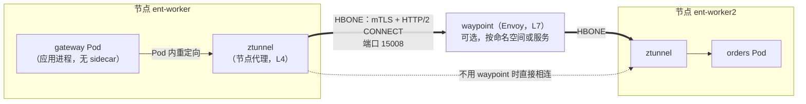
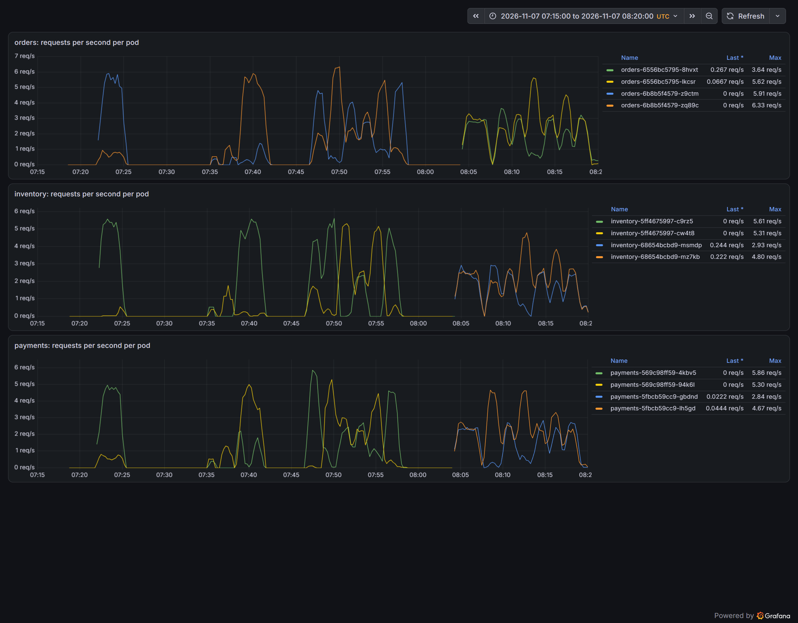
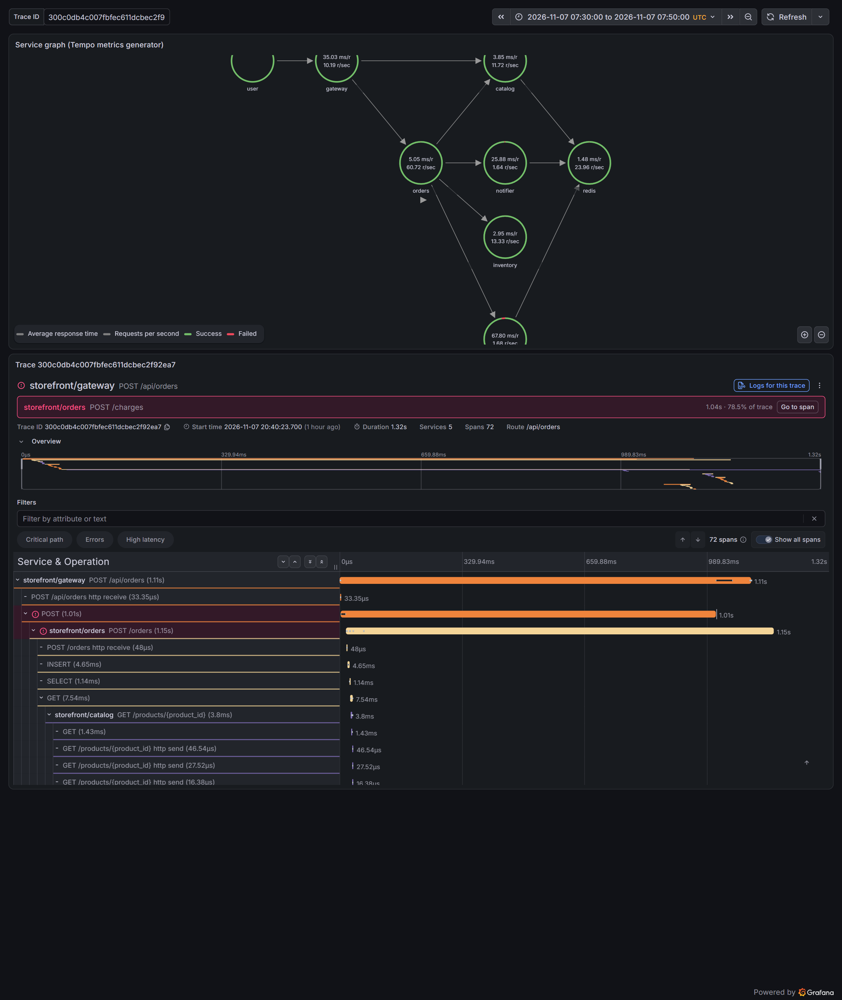

# 服务网格：身份、加密与 L7 流量（E2） {#ch-e2}

<div class="lead">上一章留下了两个问题：服务之间的流量是明文的，任何能接触到节点网络的人都能读到请求头和订单内容；负载在副本之间严重不均，一个副本承担了九成以上的请求。服务网格同时回答这两个问题，但它不是免费的：多了一层代理，就多了一层延迟、一层资源开销，以及一层“你没有配置、它却在做”的默认行为。本章用 Istio 的 ambient 模式给 storefront 加上网格，每一步都与上一步做对照测量：线上抓包证明加密，连接普查证明失衡的原因，交替进行的 A/B 实验测量网格的真实代价，故障注入揭示重试在不同层之间的叠加。</div>

## 本章目标与产出

| 产出 | 位置（相对于 `v2/`） |
|---|---|
| Istio 1.31.4 ambient、Gateway API v1.6.3 的 GitOps 配置 | `gitops/platform/apps/istio.yaml`、`gitops/platform/values/` |
| 命名空间加入网格、waypoint、网格监控 | `gitops/platform/manifests/namespaces/`、`gitops/platform/manifests/mesh/` |
| 实验脚本：连接普查、线上抓包、单跳成本、交替 A/B、重试叠加 | `experiments/load/connections.sh`、`experiments/e2/` |
| 全部测量记录 | `evidence/e2/` |

**验收标准（PLAN E2）：** 有网格时长连接上的请求均匀分布；mTLS 有抓包或指标证据。已通过：经过 waypoint 后，各服务两个副本承担的请求在 46.9%–53.1% 之间，而无网格时 inventory 为 97.1% / 2.9%（`evidence/e2/mode-ambient-l7.log`、`mode-none.log`）；加入网格后，节点线上可读的服务间请求行从 140 行变为 0（`evidence/e2/capture-compare.log`）。

**学完本章，你应当能够：**

- 说明服务网格把哪些能力从应用代码中移出来，sidecar 与 ambient 两种数据面的结构差异；
- 解释 HBONE、SPIFFE 身份和 mTLS 如何在不修改应用的情况下加密并认证服务间的流量，并用抓包验证；
- 区分 L4 与 L7 负载均衡，用连接普查和请求分布证明长连接下 L4 失衡的原因；
- 设计能控制漂移的性能对照实验（交替 A/B、微基准、按跳分解），测量网格的真实代价；
- 识别不同层次的重试如何叠加，以及网格默认行为带来的“看不见的”重试；
- 预判开启 STRICT mTLS 会让哪些不在网格中的调用方失效。

## 原理 {#e2-principles}

### 网格把什么从应用里拿走

上一章的共享库为每个服务实现了超时、重试、熔断、指标和链路追踪。这在一个团队、一种语言的系统里可行；当一个企业有几十个团队、五六种语言时，同样的能力要实现五六遍，版本还各不相同。服务网格把一部分网络能力下沉到应用之外的代理中：

| 能力 | 应用库能做 | 网格能做 | 谁更合适 |
|---|---|---|---|
| 服务间加密与身份认证 | 很难（每个服务管理证书） | 自动签发、轮换证书，透明加密 | 网格 |
| 按身份的访问控制 | 需要自己验证调用方 | 基于身份与 L7 属性的策略 | 网格 |
| L7 负载均衡、流量拆分 | 客户端负载均衡（各语言各写一遍） | 统一实现 | 网格 |
| 统一的 RED 指标 | 每个服务自己暴露 | 代理统一产生 | 两者互补 |
| 超时、重试、熔断 | 知道业务语义（是否幂等、能否降级） | 不知道语义，只看状态码 | **应用为主**，网格谨慎使用 |
| 链路追踪的上下文传递 | 必须由应用转发 `traceparent` | 只能生成自己的 span | 应用 |

最后两行是本章实验要证明的要点：网格不知道一个 POST 能不能重试，也无法替应用传递追踪上下文。

### sidecar 与 ambient

Istio 有两种数据面。**sidecar 模式**在每个 Pod 里注入一个 Envoy 容器，所有进出流量都经过它：每个 Pod 多一个进程，加入或升级网格都要重启 Pod。**ambient 模式**把网格拆成两层：



- **ztunnel**（零信任隧道）是每个节点一个的 L4 代理，用 Rust 编写。istio-cni 节点代理在每个加入网格的 Pod 的网络命名空间里写入 iptables 规则，把出站流量重定向到 15001、入站流量重定向到 15006、DNS 重定向到 15053，再把 Pod 交给 ztunnel 接管。ztunnel 负责 mTLS、L4 授权和 TCP 指标，不解析 HTTP。
- **waypoint** 是可选的 Envoy 代理，按命名空间或服务部署。只有需要 L7 能力（按请求的负载均衡、路由、重试、L7 授权、HTTP 指标）时，流量才经过它。

加入网格只需要给命名空间打标签 `istio.io/dataplane-mode=ambient`，**不重启任何 Pod**；需要 L7 时再部署 waypoint，并用 `istio.io/use-waypoint` 标签让流量经过它。

### HBONE 与工作负载身份

ztunnel 之间用 **HBONE**（HTTP-Based Overlay Network Environment）通信：一条到对端节点 15008 端口的 mTLS 连接，其中每个应用连接是一个 HTTP/2 `CONNECT` 流。证书由 istiod 签发，标识的是**工作负载身份**而不是 IP：

```text
spiffe://cluster.local/ns/storefront/sa/orders
```

身份来自 Pod 的 ServiceAccount。这正是第 2 章给每个服务一个独立 ServiceAccount 的原因：网格里的授权策略写的是“谁”（身份），而不是“从哪个 IP 来”（IP 会变）。

### L4 与 L7 负载均衡

kube-proxy 和 ztunnel 都在**连接**建立时选择后端。一个调用方保持 $k$ 条长连接，每条连接随机落到 $N$ 个副本之一，之后它的所有请求都沿着这些连接走。当 $k$ 很小（第 2 章的连接普查显示只有 1–3 条）时，“所有连接恰好落到同一个副本”的概率并不小：$k=2$、$N=2$ 时是 $2 \times (1/2)^2 = 50\%$。再考虑到每条连接承载的请求数不同，失衡几乎是必然的。

waypoint 在**请求**层面做负载均衡：它终止客户端的 HTTP 连接，为每个请求重新选择后端（Istio 默认使用最少请求算法 `LEAST_REQUEST`），自己与每个后端维持连接池。代价是多一跳 Envoy，以及 HTTP 解析的开销。

另一种思路是让客户端定期关闭长连接（例如每 N 个请求或每 T 秒重建一次），用更多的连接建立换来更均匀的分布；gRPC 的客户端负载均衡则是在客户端为每个请求选择后端。这些都是不用网格时的替代方案。

## 安装：从 Git 部署网格 {#e2-install}

### 选择版本

版本的选择记录在 `platform/versions.env` 中，每一条都有理由：

- **Istio 1.31.4**，而不是已经发布 16 天的 1.31.3。通常我倾向于避开刚发布一两天的版本，但 1.31.4 修复了 GHSA-rr2c-p22p-6r9r（CVSS 8.2）：在 ambient 模式下，一个运算符优先级错误会让端口级的 STRICT PeerAuthentication 被跳过，明文流量可以到达本应只接受 mTLS 的端口。这恰好是本章要验证的能力，安全修复优先于“发布时间”。
- **Gateway API v1.6.3**，而不是最新的 v1.7.0：Istio 1.31 的 `go.mod` 依赖的是 `sigs.k8s.io/gateway-api v1.6.0`。CRD 的版本应与实现它的控制器相匹配，v1.6 线的最新补丁是 1.6.3。选择 experimental 通道，是因为本章要用的 HTTPRoute 重试（GEP-1731）在 v1.6 中还属于实验特性（v1.7 才进入 standard 通道）。
- **Helm 仓库已经迁移。** 旧地址 `istio-release.storage.googleapis.com/charts` 的索引停在 1.30.8，1.31 的 Chart 只在新地址 `blob.istio.io/istio-release/charts` 上，`gcr.io` 上的 OCI 地址也没有 1.31.4（`evidence/e2/chart-repos.log`）。依赖外部仓库的平台要预期这种迁移，企业里通常会把 Chart 镜像到自己的制品库。

### Chart 的默认值是为大集群准备的

四个 Chart 的默认资源请求（`helm show values`）：istiod 500m CPU / 2 GiB，ztunnel 每个节点 200m / 512 Mi，istio-cni 每个节点 100m / 100 Mi。在本书的集群上，仅请求就会占去约 4.5 GiB 内存；更危险的是 ztunnel 以 `system-node-critical` 优先级运行，节点放不下时它会**抢占**应用的 Pod，而不是自己挂起。本书先设置很小的请求，安装后按实测修正。

一切由 Argo CD 完成：`gateway-api-crds` 和 `istio-base`（波次 −6）、`istiod` 和 `istio-cni`（−5）、`ztunnel`（−4）。安装后空载时的实测（`evidence/e2/istio-install.log`）：

| 组件 | 实例数 | 内存（每个） | Chart 默认请求（每个） |
|---|---|---|---|
| istiod | 1 | 49 MiB | 2048 Mi |
| ztunnel | 4（每节点） | 4 MiB | 512 Mi |
| istio-cni | 4（每节点） | 15–17 MiB | 100 Mi |

空载的 ztunnel 只用 4 MiB，这是 Rust 实现的节点代理的优势；作为对照，sidecar 模式下每个 Pod 的 Envoy 通常要几十 MiB。有负载时 ztunnel 的用量会上升，后文的测量中有记录。

### 安装中遇到的两件小事

- **一次 HTTP 403。** 第一次把配置推送到 GitLab 时被拒绝（`RPC failed; HTTP 403`），一分钟后用完全相同的命令重试成功。令牌有效、权限正确、项目可访问，原因没有找到。记录在案，不做推测。
- **健康状态停留在旧值。** `gateway-api-crds` 应用同步完成后一直显示 Progressing，原因指向 CRD `referencegrants`，而这个 CRD 早已是 Established。读 Argo CD 3.6.1 的 CRD 健康检查脚本可以确认：Established 的 CRD 应判为 Healthy。手动刷新后 10 秒内变为 Healthy。可以确定的是，健康状态是在 CRD 刚创建、尚未 Established 的那一刻计算的，之后约 1.5 分钟没有被重新评估；更深的原因没有核实。后面的同步波次在此期间一直在等待，**一个过时的健康状态会阻塞整条波次链**。

## 实验 1：线上看到了什么 {#e2-wire}

加密要在线上验证，而不是相信配置。`experiments/e2/capture.sh` 在节点 ent-worker 的网络命名空间里运行 tcpdump（一个 netshoot 容器加入节点容器的网络命名空间），抓取 eth0 上 10 秒的流量，同时通过负载均衡器发出 40 次商品查询和 40 次下单。eth0 上的包都是发往或来自**其他节点**的 Pod 的，也就是跨节点的服务间流量。

加入网格前后各抓一次（`evidence/e2/capture-compare.log`）：

| | 发往 8080 的包 | 发往 15008（HBONE）的包 | 线上可读的服务间请求行 | 线上可读的外部请求行 |
|---|---|---|---|---|
| 无网格 | 501 | 0 | 140（`GET /products/{id}` 76、`POST /reservations` 64） | 68 |
| ambient | 234 | 342 | **0** | 56 |

无网格时，请求行和请求头（`X-Request-ID`、`Idempotency-Key`）在线上一览无余（`evidence/e2/capture-none.log`）。加入网格后，服务之间的请求全部进入 15008 端口的 mTLS 隧道，线上再也读不到。

但还有 56 行明文：它们都是 `/api/...` 路径，即从负载均衡器进来的外部请求。负载均衡器（集群外的 envoy 容器）不在网格中，它经 NodePort 把明文转发给 gateway Pod 所在的节点，这一段跨节点的流量仍是明文，到达目的 Pod 后才由 ztunnel 接收。**网格只保护网格内部的流量。**入口要么使用网格内的入口网关，要么在边缘终止 TLS；第 6 章（E5）会在 STRICT 模式下完整地解决这个问题。

加入网格不需要重启：命名空间打上标签后，istio-cni 在几秒内为每个已经在运行的 Pod 写入重定向规则并交给 ztunnel（`evidence/e2/enrol.log` 中各 Pod 的启动时间和重启次数都没有变化，istio-cni 的日志见 `evidence/e2/enrol-cni.log`）。

## 实验 2：为什么负载不均 {#e2-balance}

### 连接普查

第 2 章把副本间的失衡归因于“L4 负载均衡 + 长连接”，但没有直接证据。证据要从“谁和谁保持着连接”中找。这里有一个陷阱：在**客户端** Pod 里查看连接表，看到的目的地址是 Service 的 ClusterIP，因为 kube-proxy 的地址转换（DNAT）发生在节点的网络命名空间里，Pod 看不到转换后的后端。所以 `experiments/load/connections.sh` 在每个**服务端** Pod 里读取 `/proc/net/tcp`（镜像中没有 `ss` 和 `netstat`，用 Python 解析），列出连到 8080 端口的已建立连接，再把对端 IP 映射回 Pod 名称。

无网格时，压测进行到第 120 秒的普查结果（节选，`evidence/e2/mode-none.log`）：

```text
server pod (port 8080)         client                                   established
inventory-5ff4675997-c9rz5     orders-6b8b5f4579-zq89c                  1
inventory-5ff4675997-c9rz5     orders-6b8b5f4579-z9ctm                  1
orders-6b8b5f4579-z9ctm        gateway-5476f9c8fb-rh4wf                 1
orders-6b8b5f4579-z9ctm        gateway-5476f9c8fb-xhv76                 3
orders-6b8b5f4579-zq89c        gateway-5476f9c8fb-rh4wf                 1
payments-569c98ff59-4kbv5      orders-6b8b5f4579-z9ctm                  2
payments-569c98ff59-94k6l      orders-6b8b5f4579-zq89c                  1
gateway-5476f9c8fb-rh4wf       10.240.1.1                               11
```

两个 orders 副本各自只保持一条到 inventory 的连接，而这两条连接恰好都落在了副本 c9rz5 上；另一个 inventory 副本没有任何连接。同一轮的请求分布中，c9rz5 承担了 97.1%（剩下的 2.9% 来自偶尔新建的连接）。这就是失衡的直接原因。

普查还顺带揭示了一件事：gateway 的对端不是负载均衡器，而是节点地址（10.240.1.1 是节点在 Pod 网段上的网关地址）。经 NodePort 进入的流量在 `externalTrafficPolicy: Cluster` 下被做了源地址转换，**真实的客户端 IP 丢失了**，这对按客户端限流和审计都有影响（第 6 章）。

### 三种模式下的分布

同样的负载（20 次迭代/秒，3 分钟），三种模式下每个服务两个副本承担的请求比例（`evidence/e2/mode-none.log`、`mode-ambient-l4.log`、`mode-ambient-l7.log`）：

| 服务 | 无网格 | ambient L4（ztunnel） | ambient L7（waypoint） |
|---|---|---|---|
| catalog | 14.4% / 85.6% | 57.8% / 42.2% | 50.0% / 50.0% |
| gateway | 53.5% / 46.5% | 50.7% / 49.3% | 49.4% / 50.6% |
| orders | 87.4% / 12.6% | 11.2% / 88.8% | 46.9% / 53.1% |
| inventory | 97.1% / 2.9% | 97.2% / 2.8% | 49.7% / 50.3% |
| payments | 86.7% / 13.3% | 15.0% / 85.0% | 48.2% / 51.8% |

结论很清楚：

- **ztunnel 不改变分布。**它是 L4 代理，同样在连接建立时选择后端，L4 模式下的失衡与无网格时同一个量级，只是哪个副本“中签”不同。加密与身份认证并不附带负载均衡的改善。
- **waypoint 让所有服务回到接近 50/50。**L7 模式下的连接普查显示，每个后端 Pod 的对端都只剩下 waypoint（每个后端 2–4 条连接）：客户端的长连接终止在 waypoint 上，waypoint 为每个请求重新选择后端。
- gateway 在三种模式下都比较均匀，因为它的调用方是 k6 的大量连接（经负载均衡器），连接数多，随机分配本身就接近均匀。这与 $k$ 越大越均匀的推论一致。



这满足了本章的验收标准：有网格（L7）时，长连接上的请求均匀分布。

## 实验 3：网格的代价，以及如何测准它 {#e2-cost}

### 第一次测量是错的

最直接的做法是分别跑一次“无网格”和“ambient L4”，比较结果。两次运行相隔 15 分钟（`evidence/e2/mode-none.log`、`mode-ambient-l4.log`）：

| | 无网格（07:21） | ambient L4（07:38） | 差 |
|---|---|---|---|
| 浏览 p50 / p95 | 10.8 / 19.2 ms | 14.8 / 27.7 ms | +4.0 / +8.5 ms |
| 下单 p50 / p95 | 106.0 / 225.0 ms | 138.4 / 253.4 ms | **+32.4** / +28.4 ms |

下单路径慢了 32 ms，这比通常所说的“每跳亚毫秒级”大了两个数量级。在下结论之前，先做三件事来检验它。

**一、按跳分解。** `experiments/e2/compare-windows.sh` 从 Prometheus 取两个时间窗口内每个服务的服务端耗时、每个依赖调用的客户端耗时和每种 SQL 语句的耗时（`evidence/e2/compare-none-l4.log`，节选）：

```text
== server side
  p50  catalog /products/{product_id}                  2.6 ms ->      2.7 ms  (   +0.1)
  p50  orders /orders                                 93.4 ms ->    127.2 ms  (  +33.8)
== client side: one attempt of a call to a dependency
  p50  gateway -> catalog                              7.6 ms ->     10.0 ms  (   +2.4)
  p50  orders -> catalog                               8.0 ms ->     12.6 ms  (   +4.5)
  p50  orders -> inventory                            15.2 ms ->     20.3 ms  (   +5.1)
  p50  orders -> payments                             54.0 ms ->     64.5 ms  (  +10.4)
== database: SQL statements as seen by the client
  p50  orders INSERT                                   2.0 ms ->      2.5 ms  (   +0.5)
  p50  inventory UPDATE                                1.0 ms ->      1.0 ms  (   +0.0)
```

catalog 自己处理一个请求的时间没有变（2.6 → 2.7 ms），调用它的一方却多花了 2.4–4.5 ms；SQL 语句几乎不变。这说明多出来的时间在两个应用之间的路径上，而不在数据库。

**二、隔离出单跳成本。** `experiments/e2/hop_cost.py` 在一个 Pod 里对同一个目标连续做 2000 次往返（复用一条连接），分别从网格内（storefront 命名空间）和网格外（e2-bench 命名空间）的客户端发起，目标分别是网格内的 catalog Pod 和网格外的 Valkey，组成 2×2 的对照（`evidence/e2/hop-cost-ambient.log`、`hop-cost-ambient-2.log`）：

| p50 往返时间 | 客户端在网格内 | 客户端在网格外 | 差 |
|---|---|---|---|
| Valkey `PING`（服务端在网格外，只经过客户端的 ztunnel） | 339 / 372 / 356 µs | 170 / 252 / 174 µs | 约 +0.1–0.2 ms |
| HTTP `/healthz`（服务端在网格内） | 2007 / 1706 / 1623 µs | 1572 / 1878 / 1082 µs | −0.2 至 +0.5 ms，噪声量级 |
| 每次新建连接再请求 | 10.9 ms | 10.9 ms | 0 |
| 16 条连接并发 | 12.0 ms | 13.8 ms | 服务端（单进程）成为瓶颈 |

单独测量时，客户端一侧的 ztunnel 每次往返只增加约 0.1–0.2 ms，按下单路径约 30 次往返计算，最多几毫秒，解释不了 32 ms。

**三、控制漂移：交替进行 A/B。** 两次单独的运行之间，主机的状态可能已经变了（Windows 上的其他进程、温度、后台任务）。`experiments/e2/ab-mesh.sh` 用命名空间标签在两种模式之间来回切换（加入或退出网格不需要重启 Pod），每种模式 90 秒，交替 3 轮。为了不让 Argo CD 把标签改回去，实验期间暂停了两个应用的自动同步，结束时（包括中断时）自动恢复（`evidence/e2/ab-mesh.log`）：

| 轮次 | 模式 | 浏览 p50 | 浏览 p95 | 下单 p50 | 下单 p95 |
|---|---|---|---|---|---|
| 1 | 无网格 | 12.8 | 23.0 | 122.4 | 249.5 |
| 1 | ambient | 15.5 | 29.6 | 139.2 | 254.9 |
| 2 | 无网格 | 13.0 | 22.5 | 126.2 | 234.6 |
| 2 | ambient | 15.4 | 29.9 | 131.6 | 258.4 |
| 3 | 无网格 | 12.4 | 22.6 | 124.0 | 230.1 |
| 3 | ambient | 14.5 | 24.6 | 123.4 | 226.5 |

配对的差：浏览 p50 为 +2.7、+2.4、+2.2 ms，三轮一致，平均 **+2.4 ms**；浏览 p95 平均 +5.3 ms。下单 p50 为 +16.9、+5.4、−0.6 ms，三轮之间的差别比差值本身还大：在这个实验的精度下，**无法确定网格是否让下单变慢**。下单延迟主要由 `[模拟]` 支付服务的随机延迟决定，90 秒内约 450 笔订单的中位数本身就有几毫秒的抽样波动。

再看第一次测量：无网格的那次下单 p50 是 106.0 ms，而交替实验中三次无网格的结果是 122–126 ms。主机在这十几分钟里变慢了，第一次测量的“+32 ms”大部分是**漂移**，不是网格。

::: principle
**性能对比要控制漂移。**两次单独的运行之间，被测系统以外的一切都可能变了。可靠的做法是：交替（A、B、A、B……）而不是先 A 后 B；做多轮，看配对差的一致性，而不是只看平均值；用微基准隔离出单个组件的成本，再用按跳分解检查它能否解释整体的变化。当结论在不同轮次之间不一致时，如实写“在这个精度下无法确定”，比给出一个漂亮的数字更有价值。
:::

### waypoint 的代价

同样的交替方法，比较 L4（只有 ztunnel）与 L7（经过 waypoint），切换的是命名空间标签 `istio.io/use-waypoint`（`experiments/e2/ab-waypoint.sh`，`evidence/e2/ab-waypoint.log`）：

| 轮次 | 浏览 p50（L4 → L7） | 下单 p50（L4 → L7） |
|---|---|---|
| 1 | 12.9 → 13.9（+1.0） | 117.2 → 124.0（+6.8） |
| 2 | 13.0 → 14.0（+1.0） | 118.0 → 121.3（+3.3） |
| 3 | 12.6 → 14.4（+1.8） | 123.6 → 129.4（+5.8） |

waypoint 让浏览 p50 增加约 1.3 ms（一次 Envoy 转发），下单 p50 增加约 5.3 ms，三轮方向一致。下单路径上有 gateway → orders、orders → catalog、→ inventory、→ payments 四到五次经过 waypoint 的调用，每次约 1 ms，量级吻合。p95 的差在 −7.6 到 +35.1 ms 之间，同样无法确定。

资源方面，3 分钟 L7 负载期间 waypoint 用了 91m CPU、35 MiB 内存，ztunnel 每个工作节点 41–62m CPU、6–7 MiB（`evidence/e2/mode-ambient-l7.log`）。在约 34 个请求/秒的负载下，整个网格（waypoint 加四个 ztunnel）的 CPU 约 0.25 核，略少于两个最忙的 gateway Pod 之和（约 0.30 核）。

## 实验 4：重试在层与层之间叠加 {#e2-retry}

应用有自己的重试（第 2 章），网格也能重试。两层都重试时会发生什么？`experiments/e2/retry-matrix.sh` 让 payments 对每一次扣款都返回错误（`[注入]`，故障开关 `/admin/faults`），以每秒 2 笔的速度下 61 笔订单，在每个 Pod 的 `/metrics` 上读取精确的计数（Prometheus 的 15 秒抓取间隔会让小计数失真），统计每一层的调用次数（`evidence/e2/retry-matrix.log`）：

| 场景 | orders 收到的下单（每笔订单） | orders → payments（应用发出的尝试） | payments 实际收到 | 网格增加的调用 |
|---|---|---|---|---|
| S1：waypoint，payments 返回 500 | 44（0.72） | 25 | 25 | 0 |
| S2：waypoint，返回 503 | 11（0.18） | 8 | 8 | 0 |
| S3：同 S2，另加 HTTPRoute 重试 3 次 | 11（0.18） | 7 | 28 | **21（4 倍）** |
| S4：只有 ztunnel（L4），返回 503 | 11（0.18） | 6 | 6 | 0 |

这张表回答了三个问题。

**一、应用的熔断器起了主要作用。**61 笔订单中，大部分根本没有到达 payments：gateway 到 orders、orders 到 payments 的熔断器在失败率超过 50% 后断开，之后的请求被立即拒绝（`503`、`Retry-After`）。S1 是第一个场景，熔断器从闭合状态开始，放过了较多的请求；S2–S4 开始时熔断器已经断开，每 5 秒只放过少量试探。这也提醒了实验设计中的一个陷阱：**熔断器的状态会从一个场景带到下一个场景**，场景的先后顺序会影响结果。

**二、网格的显式重试按倍数放大，而且应用看不见。**S3 中，orders 发出了 7 次尝试，payments 却收到了 28 次：每次尝试在 waypoint 上被重试 3 次。orders 的重试预算和熔断器只统计它自己发出的 7 次，那 21 次额外的调用对它完全不可见。在真实的故障中，这意味着应用以为自己“只重试了一点点”，下游却在承受 4 倍的压力。如果两层都配置了重试，放大倍数是相乘的。

**三、Istio 默认并不重试 503。**我原本以为网格的默认策略会重试 503，S2 的测量结果却是 0 次额外调用。读 Istio 1.31.4 的源码（`pilot/pkg/networking/core/route/retry/retry.go`，`evidence/e2/istio-default-retry.log`）：默认策略是 `NumRetries: 2`、`RetryOn: "connect-failure,refused-stream,unavailable,cancelled,retriable-status-codes"`，但**没有设置任何可重试的状态码**，所以只有连接失败、流被拒绝等“请求还没有到达应用”的情况会被重试。这种默认是安全的：请求没有被处理过，重试不会造成重复。测量纠正了我的假设，代码中的注释也随之改正。

::: principle
**重试只放在一层，并且放在知道业务语义的那一层。**应用知道哪个调用是幂等的、哪个失败值得重试、什么时候应该降级；网格只看得到状态码。网格适合处理“请求根本没送达”的连接级失败（这正是 Istio 的默认行为），应用处理业务级的重试，并用预算和熔断器限制总量。在网格上为 5xx 配置重试之前，先确认应用没有同时在重试，并把网格的重试也计入下游的容量规划。
:::

## 实验 5：开启 STRICT 之后，什么会坏 {#e2-strict}

默认的 PERMISSIVE 模式同时接受明文和 mTLS，所以加入网格不会破坏任何东西。真正的零信任要求 STRICT：只接受 mTLS。`experiments/e2/strict.sh` 在 storefront 命名空间上临时应用 STRICT 的 PeerAuthentication（手工、限时 45 秒，随后删除），分别从三类调用方测试（`evidence/e2/strict.log`）：

| 调用方 | PERMISSIVE | STRICT | 删除后 |
|---|---|---|---|
| 网格内：gateway Pod → orders | 200 | 200 | 200 |
| 网格外：负载均衡器 → gateway | 200 | 空响应（curl 退出码 52） | 200 |
| 网格外：Prometheus → 各服务的 `/metrics` | 全部 `up=1` | 全部 `up=0` | 全部 `up=1` |

服务之间的调用不受影响；但是外部入口和监控都断了，而且是静默的：没有任何告警说“mTLS 拒绝了连接”，只是外部用户访问失败、所有服务的指标同时消失。STRICT 的前提是**所有合法的调用方都在网格里**：入口要换成网格内的入口网关，Prometheus 所在的命名空间也要加入网格（它的身份随后可以写进授权策略）。第 6 章（E5）在多租户与安全治理中完成这套改造。

## 一次真实的事故：扣了款，订单却失败了 {#e2-incident}

在 07:40:24 的一次负载中，k6 报告了一个失败的请求（失败率 0.03%）。顺着它查下去，得到了第 2 章在设计时预言过的那个缺口，而这一次它真实地发生了。

**从日志到链路。**gateway 的访问日志里有一条 `POST /api/orders 200`，耗时 1106.8 ms；同一个请求 ID 在 orders 中是 `503`（1152.1 ms），在 payments 中是 `201`（1243.0 ms）。三个服务给出了三个不同的结果。用 trace ID 取出完整的链路（`evidence/e2/ambiguous-outcome-trace.log`，节选）：

```text
      0.0 ms   1109.8 ms  gateway   SERVER   POST /api/orders
      3.2 ms   1012.1 ms    gateway   CLIENT   POST                      ← gateway 的第一次尝试，1 秒超时
     16.6 ms   1153.8 ms      orders    SERVER   POST /orders  order.status=FAILED
     39.0 ms     24.4 ms        orders    CLIENT   POST                  ← 预留库存，成功
     66.5 ms   1036.3 ms        orders    CLIENT   POST                  ← 扣款，1 秒超时
     75.0 ms   1244.8 ms          payments  SERVER   POST /charges
    992.3 ms      0.1 ms            payments  INTERNAL POST /charges http receive   ← 917 ms 后才开始读请求体
   1315.7 ms      1.4 ms            payments  CLIENT   SET           ← 保存扣款结果：approved
   1123.8 ms     17.8 ms        orders    CLIENT   POST                  ← 重试扣款：409（锁仍被持有）
   1148.2 ms     12.3 ms          inventory SERVER   POST /reservations/{order_id}/release   ← 补偿：释放库存
   1164.0 ms      3.5 ms        orders    CLIENT   UPDATE orders SET status = $2 ...  ← 订单标为 FAILED
   1060.3 ms     44.5 ms    gateway   CLIENT   POST                      ← gateway 的重试（同一个幂等键）
   1098.9 ms      2.4 ms        orders    CLIENT   SELECT ... FROM orders ...       ← 重放：返回当时的 PENDING 订单
```



**时间线。**payments 收到请求后约 917 ms 没有任何动作（原因见下一节），然后才处理并保存了“扣款成功”。orders 等不了那么久：它对 payments 的单次尝试超时是 1 秒，超时后带着同一个幂等键重试，payments 发现这个键的锁还被第一次请求持有，返回 409；orders 把 409 当作“结果不明”，释放了库存，把订单标为 FAILED。与此同时，gateway 对 orders 的单次尝试也超时了，它的重试被 orders 当作重复请求，“重放”了数据库中当时的状态：PENDING，状态码 200。k6 只接受 201 和 402，所以记了一次失败。

**最终状态**（`evidence/e2/ambiguous-outcome-2.log`、`charged-but-failed.log`）：订单 `5be7495e` 为 FAILED（`payments HTTP 409`），库存已释放；payments 中却有一笔 5625 分、状态为 approved 的扣款。顾客付了钱，却没有订单。数据库中所有 FAILED 的订单只有这一笔。

**为什么各层的保护都“正确”地失败了？**每一层的行为单独看都是对的：orders 的超时保护了自己，幂等锁防止了重复扣款，补偿释放了库存，gateway 的重放保证了幂等。问题在于“结果不明”被当成了“失败”。这是分布式系统中最典型的一类事故：

| 改进 | 做法 | 代价 |
|---|---|---|
| 超时与依赖的延迟分布对齐 | 调用支付的超时取支付服务 p99.9 以上，或者在超时后先查询结果再决定 | 慢请求占用更久 |
| 结果不明时不做终局判断 | 409 或超时后，订单保持 PENDING，查询 `GET /charges/{key}`，再决定确认或退款 | 状态机更复杂，顾客要等待 |
| 对账 | 定期找出“支付成功、订单失败”的组合并修复（第 2 章练习 3） | 修复有延迟 |
| 支付改为异步 | 下单只受理，扣款结果通过事件回来 | 系统设计改变 |

第 7 章（E6）会有意制造这类故障，并实现第二、三种改进。

## 追查：900 毫秒的停顿 {#e2-stall}

事故链条的起点是 payments 在收到请求后“发呆”了 917 ms。这不是一次性的：另外两条慢链路中，第二个 payments Pod 在同一时刻也停顿了约 900 ms（读完请求体之后），07:51:35 的 inventory 也停顿了约 892 ms（读请求体之前）。07:51:35 正处于交替实验的**无网格**轮次，所以停顿与网格无关。

**排除过的假设**（每一条都有记录）：

| 假设 | 检验 | 结果 |
|---|---|---|
| 网格造成的延迟 | 07:51:35 的停顿发生在无网格时 | 排除 |
| Valkey 的 AOF 刷盘阻塞 | Valkey 日志中没有 fsync 慢的警告 | 未发现证据 |
| 虚拟机内存不足、换页 | `pswpin` 只有 72，内存和 I/O 的压力指标很低，内核没有任务挂起的记录 | 未发现证据 |
| 连接普查的 `kubectl exec` 干扰了应用（观察者效应） | 每 20 ms 探测一次 payments 的 `/healthz`，期间 3 次 `kubectl exec` 进入同一个 Pod（`evidence/e2/exec-stall.log`） | 排除：探测的最大延迟 23.7 ms |

**加装仪表。**排除法走到尽头，就该让系统自己说话。共享库新增了一个事件循环看门狗（`common/loopwatch.py`）：一个协程每 50 ms 醒来一次，记录晚醒了多久（`event_loop_lag_seconds`）；一个独立线程在循环超过 250 ms 没有心跳时，记下循环线程当时的调用栈，并在停顿结束时报告这段时间内进程用掉的 CPU 和循环线程在运行队列上等待的时间（来自 `/proc/self/task/<tid>/schedstat`）。三个数字区分三种情形：CPU 高是在忙着计算，运行队列等待高是“想跑却没有 CPU”（例如整个虚拟机被宿主机挂起），两者都不高则是在等待 I/O 或锁。GC 回调同时记录每次垃圾回收的时长（`python_gc_pause_seconds`）。

看门狗的第一个版本自己就有缺陷：每个服务启动时都报告了一次“停顿”。心跳的起点设在应用对象创建时，而不是事件循环开始运行时，从导入模块到 uvicorn 启动的这段时间被当成了停顿；CPU 的基线又是 0，报告的是进程启动以来的全部 CPU 时间。修复后增加了回归测试（先等待 0.4 秒再启动应用，断言只报告一次故意制造的停顿），新版本启动时不再误报（`evidence/e2/app-tests-2.log`）。

**15 分钟的持续负载**（20 次迭代/秒，30588 个请求，`evidence/e2/soak-stalls.log`、`soak-gc.log`）：

- 没有任何服务的事件循环停顿超过 250 ms；晚醒超过 100 ms 的情况每个服务只有 0–2 次。
- 但找到了另一个延迟来源：catalog、gateway、orders 各做了 6–10 次完整（第 2 代）的垃圾回收，**平均每次 91–92 ms**，期间事件循环完全停止。这类服务的 p99 延迟中，有一部分就来自这里。第 4 章（E3）会测试 `gc.freeze()` 等调优手段。
- 约 900 ms 的停顿在这段时间内没有再出现。它的原因**至今没有找到**，看门狗留在每个服务中，下一次发生时会记录下调用栈和调度数据。

如实记录“没有找到原因”是这一节的要点之一。排障不总能在一次会话中结束；重要的是排除过什么、为什么排除、留下了什么手段等待下一次。

## 局限

- 所有“节点”在同一台机器上，跨节点的流量不经过真实的网络设备，没有真实的网络延迟；网格在真实网络上的相对开销会更小（网络本身更慢），绝对开销（CPU、内存）则相近。
- 负载只有约 34 个请求/秒，远低于 ztunnel 和 waypoint 的设计容量；本章测量的是低负载下每次转发的延迟，不是网格的吞吐上限。
- 只部署了一个 waypoint 副本，它是这个命名空间所有 L7 流量的单点。生产中应部署多个副本并配置 PodDisruptionBudget，或按服务部署 waypoint 以缩小故障范围。
- 外部入口仍是集群外的负载均衡器直连 gateway 服务，没有使用网格内的入口网关；第 6 章（E5）在启用 STRICT 时一起解决。

## 常见问题

**Q1：加入 ambient 网格真的不需要重启吗？** 是的，本章的记录显示加入前后各 Pod 的启动时间和重启次数都没有变化。但已经建立的连接会被重置：交替实验中每次切换模式，catalog 和 inventory 的就绪探针都会短暂失败（连接池中经过 ztunnel 的数据库连接被断开），所以实验在每次切换后等待 20 秒。生产中加入或退出网格应安排在低峰期，并确认客户端会重连。

**Q2：为什么不直接用 sidecar 模式？** sidecar 模式更成熟，L7 功能对每个 Pod 都可用；代价是每个 Pod 一个 Envoy（内存与 CPU 随 Pod 数线性增长），加入、升级网格都要重启 Pod。ambient 把常驻成本降到每个节点一个 ztunnel（空载 4 MiB），只在需要 L7 的地方付出 waypoint 的成本。本书的资源预算很紧，ambient 更合适；这也是 Istio 社区推荐的新方向。

**Q3：怎样在 L4 和 L7 之间选择？** 只需要加密和身份的服务停在 L4；需要按请求负载均衡、流量拆分（第 9 章的金丝雀）、L7 授权或 HTTP 指标的服务才使用 waypoint。本章的数据是：每次经过 waypoint 约 1 ms，换来的是负载从 97/3 回到 50/50。

**Q4：网格自带的指标能代替应用的指标吗？** 只能部分代替。waypoint 能给出每个服务的请求量、错误率和延迟（RED），但不知道业务语义（订单是被拒付还是失败）、看不到应用内部（连接池等待、重试预算、熔断器状态）。两者互补：网格提供统一的、与语言无关的基线，应用提供业务与内部状态。

## 练习 {#e2-exercises}

::: exercise
1. **（计算）** 一个客户端对一个 3 副本的服务保持 3 条长连接，每条连接独立、均匀地落到某个副本上。至少有一个副本没有任何连接的概率是多少？由此说明为什么 L4 负载均衡在连接数与副本数相当时几乎必然失衡。
2. **（分析）** 本章的连接普查为什么必须在服务端 Pod 中进行？如果只能在客户端一侧观察，用什么方法得到“客户端连接到了哪个后端 Pod”？
3. **（实验设计）** 解释交替 A/B 为什么比“先测 A、再测 B”可靠，它仍然没有控制哪些因素？你如何判断一个配对差是否可信？
4. **（排障）** 开启 STRICT 后 Prometheus 抓不到 storefront 的指标。给出两种解决方案，并分析各自的代价。
5. **（设计）** 为 storefront 制定一套重试策略：哪一层重试、对哪些失败重试、如何避免层与层之间的放大。说明你的策略在 payments 完全不可用时，最多会让 payments 收到多少请求。
6. **（复盘）** 针对“扣了款，订单却失败了”的事故，提出至少三项改进，并说明每一项分别消除了事故链条中的哪一环。
7. **（动手）** 设计一种不需要进入应用容器的连接普查方法，说明它的优缺点。
:::

参考答案见附录。

## 本章小结

- Istio 1.31.4 的 ambient 模式经 GitOps 安装；版本选择有记录（安全修复优先、CRD 与控制器版本匹配、Chart 仓库已迁移）。空载时 ztunnel 每节点 4 MiB，Chart 默认值则会请求约 4.5 GiB。
- 线上抓包证明了加密：服务间的明文请求行从 140 行变为 0，HBONE 隧道承载了跨节点的流量；来自集群外负载均衡器的入口流量仍是明文，网格只保护网格内部。
- 连接普查证明了失衡的原因：每个客户端只有 1–3 条长连接，L4 负载均衡在连接建立时就决定了一切。ztunnel 不改变这一点；waypoint 让所有服务回到约 50/50，满足本章的验收标准。
- 网格的代价要用交替实验测：ambient L4 让浏览 p50 增加约 2.4 ms，waypoint 再增加约 1.3 ms（下单约 5.3 ms）；第一次单独测量得到的“+32 ms”主要是主机漂移。
- 重试会在层与层之间相乘：网格上的显式重试让下游收到 4 倍的请求，应用的预算和熔断器却看不见；Istio 默认只重试连接级失败，不重试 503。应用的熔断器在 payments 完全失败时把 61 笔订单对它的调用压到 6 次。
- STRICT 会切断所有不在网格中的调用方：外部入口和 Prometheus 同时失效。
- 一次真实的事故（扣款成功、订单失败）完整地重现了“结果不明被当作失败”的缺口；它的起因之一是一次约 900 ms 的进程停顿。停顿的原因没有找到，但加装的看门狗找到了另一个延迟来源：平均 91 ms 的完整垃圾回收。
