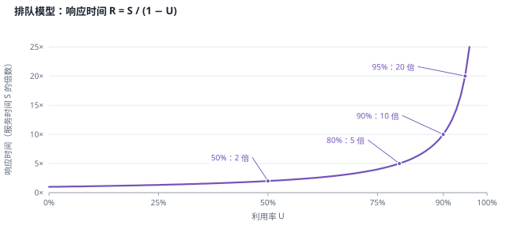
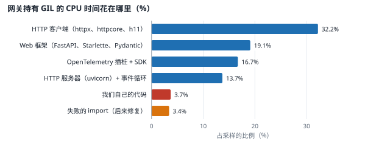
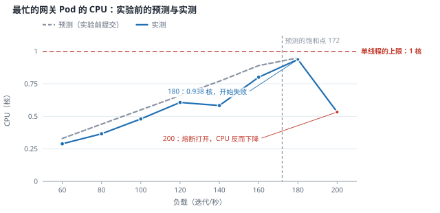
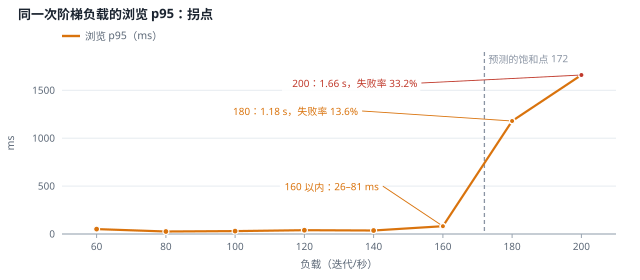
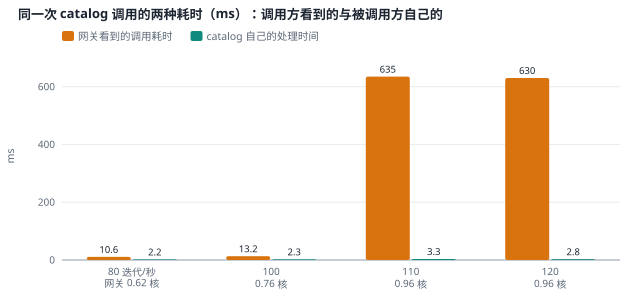
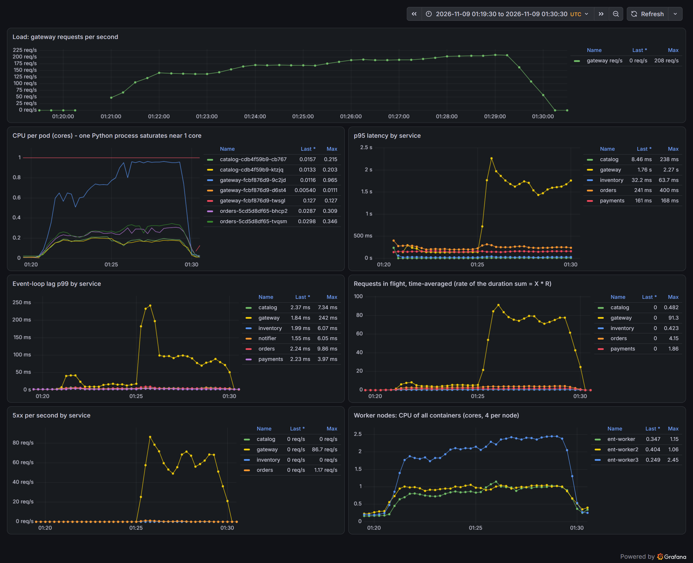

# 负载与容量规划（E3） {#ch-e3}

<div class="lead">“这套系统能扛多少流量”是每个平台团队都会被问到的问题，而大多数回答是猜的。本章用测量回答它：先量出“观测本身”要花多少资源，再用阶梯负载找到延迟的拐点和最先饱和的资源，用排队论的三条定律（利特尔定律、利用率定律、响应时间随利用率的变化）检验测量是否自洽，最后建立一个容量模型，让它预测一次还没有做过的实验，再用实验检验预测。所有数字只属于这台笔记本；可以迁移的是方法。</div>

::: opener
::: q
**工程问题**

“这套系统能扛多少流量”不该靠猜。怎样先用一个模型写下预测，再用实验检验它，并且知道第一个撑不住的是哪个组件、为什么？
:::
::: k
**实测结论**

- 预测先于实验提交：两个副本时网关最先饱和，预测的饱和点是 172 迭代/秒；实测在 180 迭代/秒，最忙的网关 Pod 用到 0.938 核，失败率 13.6%。
- 一个 Python 服务的 Pod 是单线程的事件循环，最多用满 1 个 CPU：容量由“副本数 ÷ 每个请求的 CPU 时间”决定。
- 网关的 CPU 只有 3.7% 花在我们自己的代码上；改掉一个中间件，每个请求的 CPU 少了 25%——这要靠并排对比才测得出来。
- 三个不该相信的数字都出在测量链路上：被 `increase()` 隐藏的 503、负载均衡器 1024 个文件描述符的上限、观测自身的开销。
:::
:::

## 本章目标与产出

| 产出 | 位置（相对于 `v2/`） |
|---|---|
| 按时间窗口统计资源、响应时间与排队的工具 | `experiments/e3/window_stats.py` |
| 阶梯负载（一次运行、带预热与过渡、按档位统计） | `experiments/e3/step-ramp.sh`、`experiments/load/storefront.js` |
| 不改动 Pod 的 CPU 剖析（只取持有 GIL 的样本，附线程 CPU） | `experiments/e3/profile.sh`、`experiments/e3/top_frames.py` |
| 新旧版本并排对比（金丝雀） | `experiments/e3/ab-canary.sh` |
| 容量模型，以及在实验之前提交的预测 | `experiments/e3/capacity_model.py`、`evidence/e3/capacity-prediction.md` |
| 实验环境负载均衡器的修正 | `platform/cluster/lb-limits.sh` |
| 容量看板 | Grafana “Storefront: load and saturation”（`platform/dashboards/gen.py`） |
| 全部测量记录 | `evidence/e3/` |

**学完本章，你应当能够：**

- 用利特尔定律、利用率定律检验一组性能数据是否自洽，并用它们推算系统内部看不到的量；
- 解释响应时间为什么在利用率接近 100% 时急剧上升，从而理解“拐点”和“余量”；
- 设计开放模型的阶梯负载实验，识别负载生成器自身的瓶颈；
- 找出最先饱和的资源，并理解单进程异步服务（Python 事件循环）的容量上限；
- 量化“观测”本身的成本，为采样率做出有依据的选择；
- 建立一个可验证的容量模型，并把故障域（可用区）纳入余量的计算。

本章的实验都是 `[真实]` 运行的：真实的进程、真实的请求与数据。`[模拟]` 的只有两样：三个“可用区”（同一台电脑上三个 Kind 节点的标签），以及外部支付服务 payments（延迟按对数正态分布人为生成，它决定了下单请求的大部分耗时）。本章没有 `[注入]` 任何故障：负载均衡器的崩溃、熔断器的打开和各种瞬态，都是负载本身引起的。

## 原理 {#e3-principles}

### 三条定律

容量规划不需要复杂的数学，但离不开三条朴素的关系。设一个服务在一段时间内的吞吐量为 $X$（每秒完成的请求数），平均响应时间为 $R$，平均同时在处理的请求数为 $N$：

**利特尔定律（Little's Law）：**

$$N = X \cdot R$$

它对任何稳定的系统都成立，不需要假设到达的分布。它的用途在于“三个量知道两个，就能算出第三个”，也可以用来检验测量：如果网关显示每秒 34 个请求、平均 15 ms，那么任一时刻平均只有约 0.5 个请求在处理中；如果你测到的同时在途请求是 5，说明某个数字测错了。

**利用率定律（Utilization Law）：**

$$U = X \cdot D$$

$D$ 是**服务需求**，即处理一个请求所消耗的资源时间（例如 CPU 毫秒）。一个单线程的进程，每个请求要 5 ms CPU，那么它每秒最多处理 $1/D = 200$ 个请求；在每秒 100 个请求时利用率是 50%。$D$ 可以直接从监控中算出：一段时间内的 CPU 用量除以请求数。

**响应时间随利用率增长：**最简单的排队模型（M/M/1，一个服务者、随机到达）给出

$$R = \frac{S}{1 - U}$$

其中 $S$ 是不排队时的服务时间。利用率 50% 时响应时间是 $2S$，80% 时 $5S$，90% 时 $10S$，95% 时 $20S$。真实系统的数字不会恰好如此，但形状是一样的：**在利用率接近 100% 之前，延迟就已经开始急剧上升**。这就是“拐点”，也是为什么容量规划总是给资源留出余量，而不是让它跑到 100%。



### Python 服务的特殊之处

storefront 的每个服务是一个 uvicorn 进程，所有请求都在一个事件循环线程上处理。异步让一个进程可以同时等待几百个网络调用，但**计算**只能在这一个线程上串行进行，加上全局解释器锁（GIL），一个 Pod 最多只能用满约 1 个 CPU 核。所以一个服务的容量上限近似为

$$X_{\max} \approx \frac{\text{副本数}}{D_{\text{CPU}}}$$

扩容的办法是增加副本（或每个 Pod 运行多个工作进程），而不是给 Pod 更多的 CPU 配额。第 1 章把每个节点做成了 4 核，一个节点上最多也就同时用满 4 个这样的进程。

### 开放模型与协调遗漏

负载生成有两种模型。**封闭模型**是固定数量的虚拟用户，每个用户等上一个请求完成后再发下一个：系统变慢时，请求的发送速度也随之下降，过载被“自动”掩盖了，这叫**协调遗漏**（coordinated omission）。**开放模型**按固定速率发送请求，不管系统是否跟得上，这才像真实世界中互不相识的用户。本书始终使用开放模型（k6 的 `constant-arrival-rate`）。当系统跟不上时，k6 需要越来越多的虚拟用户来维持速率；虚拟用户达到上限（`MAX_VUS`）后，它会丢弃迭代（`dropped_iterations`），这本身就是过载的信号。

### 观测不是免费的

链路追踪、指标和日志都要消耗 CPU、内存和网络：在应用里创建与序列化 span，在采集器里批处理，在后端里存储和索引。在低负载时这些开销不显眼；在容量规划中，它们和业务处理一样要计入 $D$。本章第一个实验就是测量它。

## 准备：一个可以信任的测量工具 {#e3-tools}

`experiments/e3/window_stats.py` 对任意一个时间窗口，从 Prometheus 中算出每个服务的请求速率、CPU 核数、**每个请求的 CPU 毫秒数**（即利用率定律中的 $D$）、最忙的 Pod 的 CPU、平均在途请求数（利特尔定律中的 $N$）、事件循环延迟的 p99 和连接池等待的 p95，以及每个节点和平台组件（waypoint、ztunnel、采集器、Tempo、PostgreSQL、Prometheus）的 CPU。

第一次使用它就发现了一个测量缺陷：通知服务几乎没有业务请求，在途请求数却稳定在 1.00。原因是计数器 `http_server_inflight_requests` 把 `/metrics` 也算了进去，而读取这个计数器的恰恰是一次正在进行的 `/metrics` 请求，所以它永远不会低于 1。用这样的数据检验利特尔定律，会得出完全错误的结论。修正后，运维接口不再计入在途请求，并增加了测试断言（`evidence/e3/app-tests.log`）。另一个限制是 kube-prometheus-stack 不保留 cAdvisor 中节点根 cgroup 的序列（`id="/"`），节点的 CPU 用该节点上所有容器 CPU 之和代替，不包括 kubelet 和 containerd 自身。

## 实验 1：观测的成本 {#e3-tracing}

在同样的负载（20 次迭代/秒，3 分钟）下，依次把采样率设为 1.0、0.1、1.0（A-B-A 设计：两次 A 之间的差异反映了漂移），每次都经过 Git 发布（`experiments/e3/tracing-cost.sh`，`evidence/e3/tracing-cost.log`）。每个请求的 CPU 毫秒数：

| 服务 | 采样 1.0（第一次） | 采样 0.1 | 采样 1.0（第二次） |
|---|---|---|---|
| gateway | 10.37 | 7.60 | 8.87 |
| catalog | 6.34 | 4.27 | 5.00 |
| orders | 44.99 | 31.92 | 35.88 |
| inventory | 18.73 | 12.23 | 13.48 |
| payments | 16.06 | 12.00 | 12.82 |

把采样率降到 10%，各服务每个请求的 CPU 下降约 6%–25%。两次 1.0 之间本身就相差 10%–25%，所以这个实验只能给出一个范围，不能给出精确的百分比。可以确定的是：在 Python 中，**完整的链路追踪约占业务处理 CPU 的十分之一到四分之一**，这是采样存在的理由。此后的负载实验都使用 10% 的头部采样（在入口决定，下游跟随父级的决定），第 10 章（E9）再讨论尾部采样。

真正的意外在平台组件里：

| 组件 | 采样 1.0 | 采样 0.1 | 采样 1.0 |
|---|---|---|---|
| Tempo | 1.472 核 | 1.201 核 | 1.468 核 |
| 六个服务合计 | 约 1.07 核 | 约 0.77 核 | 约 0.87 核 |

链路追踪的后端比被追踪的六个服务加起来还要“贵”，而且几乎不随采样率变化。存储十分之一的 span 不应该还要 1.2 个核。

## 实验 2：一个比业务还贵的配置错误 {#e3-tempo}

Tempo 是 Go 程序，先看它的运行时指标（`evidence/e3/tempo-gc.log`）：

```text
go_gc_gomemlimit_bytes 8.388608e+08          ← 软内存上限 800 MiB（第 2 章按实测设置的）
go_memstats_heap_alloc_bytes 1.14314336e+09  ← Go 统计的堆：1.14 GB
go_memstats_next_gc_bytes 1.143137904e+09    ← 下一次 GC 的目标：就是现在
process_resident_memory_bytes 1.31301376e+08 ← 实际驻留内存：131 MB
go_gc_duration_seconds_count 131650 → 132196 ← 30 秒内 546 次 GC
```

堆统计为 1.14 GB，超过了 800 MiB 的软上限，GC 一刻不停地试图把堆压到上限以下：每秒 18 次。可是实际驻留内存只有 131 MB，堆里的大部分东西根本没有占用物理内存。

**第一个修正（错误的）。**既然软上限带来了 GC 风暴，就去掉它。结果更糟：Tempo 启动后十几秒就被内核以 OOM 杀死（几分钟内重启了 5 次），日志停在 `completing block`（把预写日志转换为存储块），而且每次重启都重放同一份预写日志、在同一个地方被杀，陷入崩溃循环（`evidence/e3/tempo-gc-2.log`）。没有软上限时，GC 的目标是“当前堆的两倍”，真实使用的内存可以一直涨到 1 GiB 的硬上限。

**第二个修正（没有解决问题）。**把块的大小从默认的 500 MB 降到 100 MiB、时长从 30 分钟降到 5 分钟，恢复 900 MiB 的软上限。Tempo 不再崩溃，但堆仍是 1.105 GB，GC 每秒 21 次，CPU 0.84 核。块的大小不是原因。

**找到原因：看堆里装的是什么。**Go 程序可以通过 pprof 输出堆的剖析数据。按“在用字节数”排序（原始剖析数据 `evidence/e3/tempo-heap-before.pprof.txt`，统计结果 `evidence/e3/tempo-heap-top.log`）：

```text
heap profile: 63: 1078081808 [6530: 2081847848] @ heap/1048576
  1073.7 MB  main.main
     1.0 MB  ...tsdb/agent.newStripeSeries <- ...generator/storage.New
```

1073.7 MB 是在 `main.main` 中一次分配的。这是**内存压舱物**（memory ballast）：Tempo 的 Helm Chart 默认以 `-mem-ballast-size-mbs=1024` 启动，分配一块 1 GiB、从不使用的字节数组。在 Go 1.19 引入软内存上限之前，这是降低 GC 频率的常用技巧：GC 的目标是堆的两倍，一块很大的“死重”让目标变高，GC 就少了；它从不被写入，所以不占物理内存。压舱物与软上限不能同时使用：压舱物本身就超过了软上限，GC 永远达不到目标；去掉软上限，GC 的目标又变成 2 GiB 以上，真实内存在到达目标前就撞上了 1 GiB 的容器上限。

**最终修正**：关闭压舱物（`memBallastSizeMbs: 0`），软上限设为容器上限的 90%（900 MiB）。结果：

| | 压舱物 + 800 MiB | 修正后 |
|---|---|---|
| Go 堆 | 1.14 GB | 67.5 MB |
| 30 秒内 GC 次数 | 546 | 1 |
| CPU（无负载时） | 1.34 核 | 0.027 核 |
| 重启 | — | 0 |

一个配置错误占了工作节点 12 个核中的 1.3 个，比整个业务系统还多。几点值得记住：

- 它是两个各自“正确”的设置叠加出来的：Chart 的默认压舱物（在没有软上限的年代是好做法），和我在第 2 章按实测加上的软上限（在没有压舱物时是好做法）。**组合起来的行为要单独验证。**
- 它不随负载变化，所以在功能测试中看不出来，只有在按组件统计 CPU 时才显形。
- 排查的顺序是：资源统计（谁贵）→ 运行时指标（GC 频率、堆与驻留内存的差距）→ 剖析数据（堆里是什么）。在剖析数据出来之前的两次“修正”都是猜测，其中一次让情况变得更糟。
- 同一组参数中还有 `reportingEnabled: true`：Tempo 默认向 Grafana Labs 发送匿名的使用统计。本实验环境不向外部发送数据，一并关闭。第 6 章（E5）会系统地检查各组件的“回传”设置。

## 实验 3：第一次阶梯负载，以及三个不该相信的数字 {#e3-steps}

`experiments/e3/step-load.sh` 依次以每秒 20、60、100……300 次迭代各运行 2 分钟（开放模型），每一档启动一个新的 k6 进程，统计窗口跳过每档的前 30 秒。采样率 10%，storefront 版本 f3d9043（`evidence/e3/step-load-1.log`）：

| 档位（迭代/秒） | 请求/秒 | 失败率 | 浏览 p50 | 浏览 p95 | 网关 CPU（两个 Pod） | 最忙的网关 Pod | 事件循环延迟 p99 |
|---|---|---|---|---|---|---|---|
| 20 | 34.7 | 0.12% | 19.2 ms | 41.9 ms | 0.397 核 | 0.224 核 | 6.8 ms |
| 60 | 103.9 | 5.35% | 30.8 ms | 250 ms | 1.192 核 | 0.653 核 | 47 ms |
| 100 | 166.7 | 65.9% | 451 ms | 5.3 s | 1.857 核 | 0.938 核 | 403 ms |
| 140 | 238.8 | 57.8% | 286 ms | 3.5 s | 1.892 核 | 0.948 核 | 239 ms |
| 180 | 298.4 | 100% | — | 2.1 s | 0.291 核 | 0.149 核 | 66 ms |
| 220–300 | 372–441 | 100% | — | 1.3–1.7 s | 0.25–0.31 核 | 0.12–0.16 核 | 66–77 ms |

从 100 迭代/秒起，最忙的网关 Pod 停在 0.94–0.95 核：一个 Python 进程用不了第二个核，请求在事件循环里排队，循环延迟 p99 达到 403 ms。拐点在 60 与 100 之间，最先饱和的是网关。这一结论后来被验证了，但表中另有三处数字经不起追问：60 迭代/秒时网关只用了 0.65 核，却有 5% 的请求失败；180 迭代/秒以上几乎全部失败，网关的 CPU 却降到了 0.3 核；同一时段，几个与负载无关的服务“不就绪”了。三处异常分属三种不同的机制。

### 异常一：Prometheus 看不见的 503

60 迭代/秒这一档，k6 记录 226 次商品列表和 284 次商品详情失败；网关的指标中，这两个路由在整个窗口内没有一个 5xx。日志给出了时间线（`evidence/e3/step-start-burst.log`）：这一档开始后的第 1–3 秒，catalog 读 Valkey 缓存连续超时（它把超过 200 ms 的缓存读当作失败，改从数据库读）；第 3 秒，两个网关 Pod 对 catalog 的熔断器同时打开，5 秒后关闭。这 5 秒内网关直接返回 503。

503 被计数了，只是 Prometheus 算不出来。prometheus_client 在某个标签组合第一次出现时才创建那条时间序列，所以 `code="503"` 的序列诞生时已经是 118（另一个 Pod 是 106），此后再没变过。`increase()` 只能看到序列存在之后的变化，从“没有序列”到 118 的那一跳它看不到，于是结果是 0：

```text
qm2pv /api/products 503: first seen 09:32:15 = 118, at the end = 118
fdhx7 /api/products 503: first seen 09:32:30 = 106, at the end = 106
increase over the window: /api/products 503 = 0
```

118 + 106 = 224，k6 记录 226；商品详情 144 + 138 = 282，k6 记录 284。一次只在开头爆发的故障，恰好在它自己创建的序列里隐身了。对于需要告警的组合（路由 × 错误码），应在启动时预先创建并置零；Prometheus 也可以借助客户端暴露的“创建时间”在序列开头补一个零（`created-timestamp-zero-ingestion` 特性，本实验没有启用）。另一个教训是：服务端的指标不是唯一的真相，k6 在客户端一侧的失败计数才是用户看到的。

为什么每一档的开头会出现这样的爆发？每一档都是一个新的 k6 进程，120 个虚拟用户同时建立新连接，沿途所有连接池在同一时刻扩容，只给 200 ms 的缓存读首先失败。确切的机制本章没有找到（实验 3 的异常三中排除了一种猜测）。方法上的修正是：之后的阶梯负载在一个 k6 进程里完成，先用 30 秒爬升，档与档之间用 10 秒过渡，连接和连接池保持温热（`experiments/e3/step-ramp.sh`）。熔断器对这种短暂爆发的敏感度，第 7 章（E6）再讨论。

### 异常二：负载均衡器自己倒下了

180 迭代/秒这一档有 35 220 次网络层失败：23 578 次“connection refused”，9 465 次 EOF，2 106 次 “connection reset”；网关只收到每秒 85 个请求。客户端与网关之间只有一个组件：cloud-provider-kind 为 LoadBalancer 服务创建的 Envoy 容器（Envoy 1.33.2，TCP 代理）。它的日志（`evidence/e3/lb-crash.log`）：

```text
[09:38:38.275][error][envoy_bug] socket(2) failed, got error: Too many open files
[09:38:38.287][error][envoy_bug] envoy bug failure: false. Details: Client socket failure
[09:38:38.289][critical][backtrace] Caught Segmentation fault, suspect faulting address 0x0
[09:38:40.290][info][main] starting main dispatch loop
```

容器以 Docker 默认的 1024 个文件描述符（软限制）启动 Envoy；每个被代理的连接要占用两个（客户端一侧和上游一侧），约 500 个并发连接时 `socket(2)` 失败，Envoy 随后崩溃，容器里的循环 1–2 秒后重启它，所有连接中断，客户端同时重连，几秒后再次崩溃：8 分钟里崩溃了 106 次。崩溃之间的空档就是那 2 万多次 “connection refused”。

用同样的负载可以稳定复现（`evidence/e3/lb-storm-180.log`：60 秒内崩溃 11 次）。`platform/cluster/lb-limits.sh` 通过宿主机上的 PID 用 `prlimit` 把软限制提高到 65 536（同时作用于正在运行的 Envoy 和负责重启它的 bash 循环），此后所有负载脚本都先执行它。修正后重做（`evidence/e3/lb-storm-180-fixed.log`）：崩溃 0 次，网络层失败从 17 114 次降到 1 次，剩下的失败都是网关过载返回的 HTTP 错误，这才是被测系统本身的行为。

压测工具链是实验的一部分。把一个数字当作“系统的极限”之前，要检查路径上的每一个组件，包括负载生成器和负载均衡器。云上的负载均衡器没有这个特定的限制，但每一个代理都有某种上限（连接数、文件描述符、内存），要知道它们在哪里。

### 异常三：与负载无关的 Pod 也“不就绪”了

负载均衡器反复崩溃期间，ent-worker 和 ent-worker2 上所有依赖数据库的 Pod 都变成了 NotReady：catalog 的两个副本、orders 的两个副本、inventory 和 payments 各一个；ent-worker3 上的 Pod 一直就绪（`evidence/e3/lb-storm-180/readiness.log`）。探针失败是因为 `/readyz` 在 1 秒的期限内没有返回。

为了找出慢在哪一跳，复现时在每个节点上同时测量（`evidence/e3/storm-probe-180.log`、`evidence/e3/storm-net-180.log`）：

| 测量 | ent-worker / ent-worker2 | ent-worker3 |
|---|---|---|
| 节点 → Pod 的 `/healthz`（不访问依赖） | 2–7 ms | 2–6 ms |
| 节点 → Pod 的 `/readyz`（连接池 + `SELECT 1`） | 约 950 ms 或 3 s 超时 | 5–56 ms |
| Pod 内部执行 `SELECT 1`（经过本节点的 ztunnel） | 0.9–4.8 s，部分失败 | 2–7 ms |
| 节点自己的网络命名空间 → PostgreSQL（不经过 ztunnel） | 9–21 ms | — |

进程本身是健康的（`/healthz` 很快），网络也是健康的（同一台节点不经过 ztunnel 直接连数据库一直很快，网卡丢包计数为 0，catalog Pod 在整个过程中只重传了 12 个报文段）。慢的是经过本节点 ztunnel 的路径。PostgreSQL 主库和 Valkey 都在 ent-worker3 上，那里的 Pod 访问它们不需要跨节点。受影响的两个节点正是运行网关 Pod 的节点：每次 Envoy 重启，都有数百个新连接同时涌向网关，而 ztunnel 为每个 Pod 打开的监听套接字只有 128 的积压队列，网关 Pod 的网络命名空间里记录了 257 次监听队列溢出（`ListenOverflows`）。

一个自然的猜测是“同时建立大量新连接时 ztunnel 会变慢”。在没有其他负载时，从同一节点上分别位于网格内外的两个 Pod 同时向 Valkey 建立 200 个连接（`evidence/e3/burst-connect.log`），经过 ztunnel 的 p95 是 64–93 ms，不经过的是 114–123 ms：猜测被否定了。ztunnel 在这段时间没有记录任何相关的错误，它内部究竟卡在哪里，本章没有找到答案。可以确定的结论是：

- **节点级代理是同一节点上所有 Pod 的共同命运。**流向网关的连接风暴，拖慢了同一节点上 catalog 访问数据库的连接；两者在应用层面毫无关系。
- **就绪检查包含共享依赖时，所有副本会一起消失。**catalog 的两个副本恰好都在受影响的节点上（拓扑分布约束是软约束 `ScheduleAnyway`），数据库检查一失败，catalog 整个从服务中摘除，网关收到的是“no healthy upstream”。第 5 章（E4）重新审视副本分布，第 7 章（E6）讨论就绪检查应当检查什么。

## 实验 4：CPU 花在哪里——剖析、优化与金丝雀对比 {#e3-profile}

网关是第一个饱和的服务，要提高容量，要么增加副本，要么降低每个请求的 CPU 毫秒数 $D$。先看 $D$ 花在哪里。

### 剖析工具本身的陷阱

py-spy 是 Python 的采样剖析器，它从外部读取进程内存中的调用栈，不需要修改代码或重启。`experiments/e3/profile.sh` 在承载 Pod 的 Kind 节点容器中运行它（节点容器是特权容器，看得见 Pod 的进程），Pod 本身不需要任何额外权限。

第一次剖析的结果（`evidence/e3/profile-60.log`）说网关在 89% 的时间里“活跃”，而这个进程的主线程实际只用了 0.43 核。py-spy 判断线程是否空闲，依据的是操作系统的线程状态；可它在节点的 PID 命名空间里运行，解释器报告的却是 Pod 命名空间中的线程号：`py-spy dump` 显示 `Thread 1 (active): "MainThread"`，而节点上这个线程的编号是 143005（`evidence/e3/profile-method.log`，记录于另一个网关 Pod）。两者对不上，空闲的事件循环被当成了繁忙。改用 `--gil`，只保留某个线程持有 GIL 的样本：uvloop 在等待 I/O 时会释放 GIL，空闲的网关在 5 秒内只有 5 个样本，默认模式是 501 个。新的脚本同时从 `/proc` 读出每个线程在同一窗口内的 CPU 时间，两种数据可以互相核对。

### 结果：成本分散在框架里

60 迭代/秒时，网关主线程用 0.428 核，持有 GIL 的时间占 25%；其余的 CPU 花在释放了 GIL 的 C 代码里（uvloop、系统调用）。按组件划分持有 GIL 的样本（`evidence/e3/profile-gil-60-summary.log`，非阻塞模式下有四分之一到三分之一的读取失败，比例只是近似）：

| 组件 | 网关 | catalog | orders |
|---|---|---|---|
| HTTP 客户端（httpx、httpcore、h11） | 32.2% | — | 21.8% |
| Web 框架（FastAPI、Starlette、Pydantic） | 19.1% | 28.5% | 18.3% |
| OpenTelemetry 插桩 + SDK | 16.7% | 22.6% | 13.4% |
| HTTP 服务器（uvicorn）+ 事件循环的 C 代码 | 13.7% | 22.1% | 13.0% |
| 数据库驱动 / 缓存客户端 | — | 10.0% | 14.3% |
| 我们自己的代码 | 3.7% | 2.5% | 5.3% |
| 失败的 import | 3.4% | 0 | 1.7% |



没有一个突出的热点，成本散布在几十个文件里；业务代码本身只占 3%–5%，围绕它的框架、客户端和插桩才是大头。其中有两项可以几乎零风险地去掉：

- **`@app.middleware("http")`。**Starlette 用 `BaseHTTPMiddleware` 实现这种中间件，它把下游应用放进一个额外的任务里运行，再通过内存流来回传递消息。仅 `starlette/middleware/base.py` 就占网关样本的 5.6%。改写为纯 ASGI 中间件，行为不变；顺带修正了一个缺口：未处理的异常以前不计数，现在记为 500（新增一个回归测试，30 个测试通过，`evidence/e3/app-tests-2.log`）。
- **每个请求都失败一次的 `import sniffio`。**httpcore 每次创建锁或事件时都尝试 `import sniffio`；anyio 4.x 不再依赖它，镜像中没有这个包，而失败的 import 不会被缓存，每次都要沿 `sys.path` 重新搜索文件系统。依赖中加入 `sniffio==1.3.1`。

（栈中还能看到 FastAPI 0.162 自带的遥测包装层 `fastapi/telemetry`。它检测到应用已经接入 OpenTelemetry 插桩，只做透传，没有重复创建 span。）

### 效果要并排测

最直接的做法是先测旧版本、再测新版本。可是这台机器的漂移太大：同一个旧版本，在第一次阶梯负载中每个请求 11.3 ms CPU，三小时后测是 7.4 ms，差别比预期的效果还大。`experiments/e3/ab-canary.sh` 换了一种做法：复制网关的 Deployment，用新镜像起一个副本（金丝雀），标签相同，所以 Service 把流量同时分给两个旧 Pod 和一个新 Pod。三个 Pod 在同一时间、承受同一股流量，漂移对它们的影响相同；两个旧 Pod 之间的差异就是这个方法本身的噪声（A/A 对照）。

| | 旧 Pod 1 | 旧 Pod 2 | 新 Pod |
|---|---|---|---|
| 第一次（新 Pod 在另一个节点上） | 7.42 ms/请求 | 7.39 ms/请求 | 5.53 ms/请求 |
| 第二次（新 Pod 与一个旧 Pod 同节点） | 7.42 ms/请求 | 7.26 ms/请求 | 5.48 ms/请求 |

两次的 A/A 差异都在 2% 以内，新版本每个请求的 CPU 少了约 25%，服务端的 p50 延迟低 1–2 ms（`evidence/e3/ab-canary-gateway-60.log`、`evidence/e3/ab-canary-gateway-60-samenode.log`）。新版本随后经 GitOps 发布到全部六个服务（storefront fd38028）。

节省的 25% 比剖析数据暗示的（5.6% + 3.4%）多得多。剖析器只能把时间记在 Python 栈帧上，而 `BaseHTTPMiddleware` 为每个请求多创建的那个任务，以及内存流的每一次唤醒，消耗的是事件循环自身的 C 代码，甚至是在释放 GIL 之后，Python 剖析器很难归因。**剖析告诉你该看哪里，只有 A/B 对比能告诉你一个改动省了多少。**

## 实验 5：利特尔定律检验的是测量 {#e3-little}

`window_stats.py` 给出每个服务的平均在途请求数 $N$（Prometheus 每 15 秒读一次在途计数器），也能由吞吐量和平均响应时间算出 $X \cdot R$。40 迭代/秒时两者对不上（`evidence/e3/steps-run2-low/window-40.json`）：

| 服务 | 计数器的平均值 | $X \cdot R$ |
|---|---|---|
| catalog | 0.17 | 0.15 |
| 网关 | 0.76 | 1.70 |
| orders | 0.29 | 1.09 |
| payments | 0.33 | 0.63 |

对稳定的系统，利特尔定律不会错，所以错的是测量。`experiments/e3/little_check.py` 在 Pod 内部每秒读 20 次服务自己的 `/metrics`，用同一份数据算出 $N$ 和 $X \cdot R$（`evidence/e3/little-40.log`）：

| 服务 | 每秒 20 次采样的平均值 | $X \cdot R$ | 如果每 15 秒读一次，可能读到 |
|---|---|---|---|
| 网关 | 0.788 | 0.747 | 0.00–1.17 |
| orders | 0.600 | 0.631 | 0.17–1.00 |
| payments | 0.326 | 0.332 | 0.17–0.67 |

采样足够密时，两者相差不到 5%，定律成立。在途请求数每隔几毫秒就变化一次，每 15 秒读一次，一个 90 秒的窗口里每个 Pod 只有 6–7 个读数，取决于读数落在什么相位，同样的流量可以读出 0 到 1.17 之间的任何值。catalog 是一个例外：它的请求只有 2.4 ms，采样请求和业务请求共用一个事件循环，采样的时刻并不独立于被测的请求（读到 0.088，$X \cdot R$ 是 0.035）。

结论是：对变化很快的量，平均值要用时间积分来算，而不是对瞬时值抽样。对已完成的请求，`rate(http_server_request_duration_seconds_sum)` 恰好就是 $X \cdot R$，即平均在途请求数；在途计数器适合发现“卡住不动的请求”，不适合求平均。

## 实验 6：容量模型——先预测，再验证 {#e3-model}

### 模型

每个服务由若干个单线程进程组成，其中最忙的那个先饱和。设每次迭代对服务 $s$ 发出 $k_s$ 个请求，每个请求消耗 $D_s$ 毫秒 CPU，最忙的副本承担该服务 CPU 的比例为 $b_s$（负载均衡从来不是完全均匀的），那么在每秒 $X$ 次迭代时，最忙副本的 CPU 是

$$C_s = b_s \cdot k_s \cdot D_s \cdot X$$

它达到 0.95 核（实验 3 测得的单进程上限）时饱和，即 $X_{\text{sat}} = 0.95 / (b_s k_s D_s)$。全部工作节点的 CPU 用两个低负载窗口拟合成一条直线：固定部分加上每次迭代的边际 CPU。`experiments/e3/capacity_model.py` 用优化之后、负载为 20 和 40 迭代/秒时的数据（`evidence/e3/step-ramp-low.log`）得到（`evidence/e3/capacity-model.log`）：

| 服务 | $k$（请求/迭代） | $D$（ms） | $b$ | 最忙副本每次迭代的 CPU | 预测的饱和点 |
|---|---|---|---|---|---|
| gateway | 1.61 | 5.95 | 0.58 | 5.53 ms | 172 迭代/秒 |
| orders | 0.28 | 23.37 | 0.50 | 3.31 ms | 287 迭代/秒 |
| catalog | 1.69 | 3.10 | 0.52 | 2.75 ms | 345 迭代/秒 |
| inventory | 0.23 | 8.71 | 0.51 | 1.03 ms | 927 迭代/秒 |
| payments | 0.25 | 7.88 | 0.51 | 1.00 ms | 952 迭代/秒 |

工作节点合计：1.01 核，加每次迭代 32.0 ms。

在跑更高的档位之前，四条可检验的预测连同它们的容差先写进了 `evidence/e3/capacity-prediction.md` 并提交到 Git（提交 98be3f2）。先写下预测再做实验，是为了防止事后“解释”数据：任何模型都能事后拟合，只有事先的预测能被证伪。

### 验证

第二阶段在一次 k6 运行中从 60 升到 200 迭代/秒（`evidence/e3/step-ramp-high.log`）：

| 档位 | 浏览 p50 | 浏览 p95 | 失败率 | 最忙网关 Pod：实测 / 预测 | 最忙 orders Pod | 工作节点合计：实测 / 预测 |
|---|---|---|---|---|---|---|
| 60 | 13.2 ms | 51.0 ms | 0.11% | 0.289 / 0.33 核（−12%） | 0.190 核 | 3.19 / 2.93 核 |
| 80 | 11.5 ms | 26.2 ms | 5.84% | 0.366 / 0.44 核（−17%） | 0.231 核 | 3.68 / 3.57 核 |
| 100 | 13.5 ms | 29.8 ms | 0 | 0.480 / 0.55 核（−13%） | 0.301 核 | 4.56 / 4.21 核 |
| 120 | 14.9 ms | 39.5 ms | 0 | 0.607 / 0.66 核（−8%） | 0.358 核 | 5.39 / 4.85 核 |
| 140 | 14.8 ms | 36.1 ms | 0 | 0.583 / 0.77 核（−24%） | 0.391 核 | 5.64 / 5.49 核 |
| 160 | 20.9 ms | 81.4 ms | 0 | 0.801 / 0.89 核（−10%） | 0.452 核 | 6.37 / 6.13 核 |
| 180 | 130 ms | 1.18 s | 13.6% | 0.938 / 0.95 核 | 0.527 核 | 7.14 / 6.77 核 |
| 200 | 221 ms | 1.66 s | 33.2% | 0.533 核（熔断） | 0.352 核 | 4.36 核 |





逐条对照：

- **P1（最忙网关 Pod 的 CPU 随负载线性增长，误差 ±15%）：部分通过。**6 个档位中 4 个在容差之内，80 和 140 迭代/秒分别偏低 17% 和 24%。模型在每一档都偏高。网关的总 CPU 与模型相符（每次迭代 8.1–9.6 ms，模型是 9.58 ms），偏差主要来自最忙副本的份额：第一阶段是 0.58，第二阶段是 0.50–0.53。这个份额取决于 k6 的连接恰好怎样落在两个 Pod 上，是模型中最不稳定的参数。模型的偏差方向是保守的：它预测的饱和比实际早。
- **P2（网关最先饱和，在 152–192 迭代/秒之间达到 0.90 核以上）：通过。**180 迭代/秒时最忙的网关 Pod 是 0.938 核；第二忙的服务（orders）从未超过 0.53 核。
- **P3（120 迭代/秒以内浏览 p95 低于 50 ms，180 以上失败）：部分通过。**60 迭代/秒这一档的 p95 是 51.0 ms，以 1 ms 之差没有通过；80–120 迭代/秒是 26–40 ms；180 和 200 迭代/秒的 p95 达到 1.2 s 和 1.7 s，失败率 13.6% 和 33.2%，与预测一致。
- **P4（工作节点不是瓶颈，160 迭代/秒时合计 6.13 核，误差 ±15%）：通过。**实测 6.37 核（+4%），最忙的节点 2.70 核（共 4 核）。

拐点的形状与排队论一致：最忙的网关 Pod 在 0.6 核以下时，浏览延迟几乎不变（p50 13–15 ms）；0.80 核（160 迭代/秒）时 p50 升到 21 ms、p95 升到 81 ms；0.94 核（180 迭代/秒）时队列失控，网关的平均在途请求数（$X \cdot R$）从 18 跳到 98，请求等到 3 秒的截止时间耗尽，熔断器打开。网关的平均响应时间（其中约 34 ms 是等待下游的时间）在 120 迭代/秒时是 40 ms，160 时 62 ms，180 时 303 ms。按 M/M/1，请求在网关事件循环中的排队时间是 $S \cdot U/(1-U)$；以每个请求约 5 ms 的 CPU 计，利用率 0.61 时约 8 ms，0.80 时约 20 ms，实测的增量（约 6 ms 和 28 ms）与之相近。0.94 时 M/M/1 给出约 80 ms，实测增量约 270 ms：实际的上限是 0.95 核而不是 1 核，相对于这个上限，利用率已经是 0.99，排队时间趋于无穷。200 迭代/秒时，打开的熔断器把 catalog 的请求压到了 180 时的一半，网关自己的 CPU 反而下降：系统以快速失败的方式“卸载”了负载。

还有两类现象不属于模型，但真实存在（`evidence/e3/step-ramp-high-events.log`、`evidence/e3/step-ramp-high-traces.log`）：

- **60 → 80 迭代/秒的过渡中，约 2 秒内多个熔断器打开**，这一档 5.84% 的请求失败。被保留下来的链路显示，ent-worker3 上的一个 catalog Pod 在这 2 秒里做什么都慢：请求晚到 270–310 ms，一次 Redis GET 用了 140–364 ms，一次简单的 SELECT 用了 262–334 ms；同一时刻，网关重试到另一个 catalog 副本，只用了 8 ms。PostgreSQL 的检查点和 Valkey 的慢日志在这个时刻都没有异常，原因没有找到。档位切换时的这类瞬态在本章出现了三次，它们不是“冷启动”（这一次连接都是热的），而与负载的上升有关。另一个副本只用 8 ms 就答复了，这说明换一个副本重试是有效的，第 7 章（E6）会用到这一点。
- **第一档中有 11 个请求一直等到 k6 的 60 秒超时**，还有 4 个连接被重置。负载均衡器的日志记录了 3 次无法与 NodePort 建立连接（`UF,URX`），健康检查全部成功。网关从未记录过这些请求。这是本章第三次见到这种“请求消失”的尾部事件，约占请求的千分之一，原因同样没有找到。它们对 p95 几乎没有影响，却决定了 p99.9 和最大值。

### 少一个副本：第二次预测

第二阶段的偏差主要来自最忙副本的份额 $b$。只有一个网关副本时 $b = 1$，预测只取决于网关的总需求：每次迭代 1.61 × 5.95 = 9.58 ms，在 99 迭代/秒时达到 0.95 核。这次预测同样在实验之前写进 `evidence/e3/capacity-prediction.md`（P5）。副本数要通过 GitOps 改：Argo CD 开启了自愈，`kubectl scale` 的修改几秒钟后就会被改回去。`experiments/e3/one-replica.sh` 先发布 `replicas: 1`，跑完阶梯负载，再发布 `replicas: 2`；配置仓库的历史中留下了每一次改动（两次实验共四个提交）。实验做了两次，第二次加上了对网关调用下游的统计和节点 CPU 调度的测量（`evidence/e3/one-replica.log`、`evidence/e3/one-replica-2.log`）：

| 档位 | 第一次：网关 CPU | 浏览 p95 | 失败率 | 第二次：网关 CPU | 浏览 p95 | 失败率 | 预测 |
|---|---|---|---|---|---|---|---|
| 40 | 0.371 核 | 24.3 ms | 0.04% | — | — | — | 0.38 核 |
| 60 | 0.518 核 | 21.3 ms | 0 | — | — | — | 0.57 核 |
| 80 | 0.609 核 | 22.7 ms | 0 | 0.623 核 | 42.0 ms | 4.86% | 0.77 核 |
| 100 | 0.811 核 | 41.0 ms | 0 | 0.759 核 | 72.5 ms | 3.34% | 0.95 核 |
| 110 | — | — | — | 0.962 核 | 1.58 s | 33.4% | 饱和 |
| 120 | 0.815 核 | 1.14 s | 24.4% | 0.959 核 | 1.37 s | 31.2% | 饱和 |

- **P5a（40、60、80 迭代/秒时 CPU 误差在 ±15% 以内）：部分通过。**40 和 60 迭代/秒时偏差 −3% 和 −10%；80 迭代/秒时两次都偏低约 20%。
- **P5b（80 迭代/秒时低于 0.90 核，100 迭代/秒时达到 0.90 核以上）：没有通过。**100 迭代/秒时网关只有 0.76–0.81 核，仍能服务（失败 0–3%，浏览 p95 41–73 ms）；第二次在 110 迭代/秒时达到 0.96 核并饱和。按服务能力算，饱和点在 100 与 110 之间，与预测的 99 相差不到 10%；但“CPU 达到 0.90 核”这个判据没有在预测的档位出现。
- **P5c（40、60 迭代/秒时浏览 p95 低于 50 ms，120 迭代/秒时失败）：通过。**

第一次实验中，网关在 120 迭代/秒时只用到 0.815 核就已经失败了，第二次却达到了 0.96 核。0.81 核这个上限没有复现。第一次没有测量 CPU 调度，等到要分析时，那段时间的 Prometheus 数据已经被按大小的保留策略删除了，所以原因无法确定。

第二次实验回答了“饱和时请求在等什么”（`evidence/e3/one-replica-2-analysis.log`）：

| 档位 | 网关 CPU | 网关看到的 catalog 调用耗时 | catalog 自己的处理时间 | 隔舱拒绝 catalog 调用 | 网关所在节点每个 CPU 上平均等待的任务数 |
|---|---|---|---|---|---|
| 80 | 0.62 核 | 10.6 ms | 2.2 ms | 0 | 0.24–0.25 |
| 100 | 0.76 核 | 13.2 ms | 2.3 ms | 0 | 0.32–0.34 |
| 110 | 0.96 核 | 635 ms | 3.3 ms | 每秒 57.8 次 | 0.42–0.45 |
| 120 | 0.96 核 | 630 ms | 2.8 ms | 每秒 69.5 次 | 0.46–0.48 |



110 迭代/秒时，catalog 处理一个请求只要 3.3 ms，网关这边却要等 635 ms。多出来的 630 ms 都花在网关自己的事件循环里：CPU 已经用满，就绪队列很长，等待 catalog 应答的协程要排很久才能继续执行。按利特尔定律，每秒约 98 次调用、每次 0.635 秒，同时进行的调用平均约 62 个，而网关为每个下游设的隔舱上限是 64 个并发调用（`common/resilience.py`），波动时不断越过上限，于是每秒有 58–70 次调用被直接拒绝，用户看到的是快速返回的 503。饱和之后最先失败的是隔舱，不是 3 秒的截止时间（截止时间拒绝每秒只有 0.3 次）。

网关所在的 ent-worker3 上还运行着 PostgreSQL 主库、Valkey，以及 catalog、orders、inventory 的副本。它的 4 个 CPU 各忙 53%–71%，平均有 0.24–0.48 个任务在等 CPU；同一时刻的 ent-worker 只忙 34%，平均等待 0.09 个。网关主线程自己排队等 CPU 的时间没有测到：采样脚本的字段下标写错了，样本全部作废，脚本已修正。看门狗在 100 迭代/秒时报告了两次停顿，平均阻塞 337 ms，其中事件循环线程运行了 179 ms、等 CPU 26 ms，剩下约 130 ms 它既没有运行也不在等 CPU：可能阻塞在某个系统调用上，也可能在等另一个线程释放 GIL，本章没有区分出来。可以确定的是：单个网关的上限仍然是它的 CPU（0.96 核），节点上的争用增加了等待，但没有阻止它达到 0.96 核。



### 余量与可用区

本实验环境的三个节点就是三个 `[模拟]` 可用区（第 1 章）：它们共享同一个内核、同一块磁盘和同一个电源，真实可用区之间的独立性这里没有。两个网关副本分在两个可用区时，失去其中一个可用区就只剩一个副本，能承受的速率从约 170 迭代/秒降到约 100 迭代/秒。容量规划不能只看全部健康时的数字。

设定一个目标：最忙的网关进程不超过 0.7 核。由实验 6 第二阶段的数据，这时延迟还几乎不变；到 0.8 核时 p95 已经翻倍。网关每次迭代合计约 9.2 ms CPU，所以：

- 一个副本：0.7 / 0.0092 ≈ 76 迭代/秒；
- 两个副本（最忙的承担约 53%）：0.7 / (0.53 × 0.0092) ≈ 144 迭代/秒；
- 三个副本、每个可用区一个：全部健康时约 210 迭代/秒（设最忙的副本承担约 36%），失去一个可用区后还剩两个，约 144 迭代/秒。

要在失去一个可用区之后仍然满足目标，副本数必须按“可用区数 + 余量”来定，而且分布约束必须是硬性的（`whenUnsatisfiable: DoNotSchedule`）。本章使用的软约束（`ScheduleAnyway`）允许副本挤在两个可用区里，catalog 就是这样，才会在异常三中一起被摘除。第 5 章（E4）在扩缩容和调度中继续这个话题。

## 局限 {#e3-limits}

- **一台笔记本。**所有数字只属于这台机器。同一个旧版本相隔三小时测得的 CPU 开销相差 50%（11.3 ms 与 7.4 ms），k6 虽然被限制在单独的 4 个核上，内存带宽、缓存和磁盘仍与集群共享。比较两个版本时只用并排的方法，比较不同时间的数字时要先怀疑漂移。
- **负载是简化的。**固定的请求组合（70% 浏览、25% 下单、5% 查询订单），只有 18 个商品（缓存几乎总能命中），恒定的到达速率；真实流量有突发、有昼夜变化，热门商品的分布也不同。
- **模型只考虑 CPU。**在本章的负载范围内，数据库（最多 0.69 核）和连接池平时都不是瓶颈；但在档位上升的瞬态和接近饱和时（160–180 迭代/秒），catalog 读缓存超时后改读数据库，连接池从 1–2 个连接涨到 10 个，获取连接平均要等约 450 ms。缓存失效会把负载转移到数据库上，这种“回退负载”不在模型之内。
- **单进程的 Python 服务。**“每个 Pod 约 1 核”的上限来自这种架构。每个 Pod 运行多个工作进程，或使用其他语言，结论都会不同；方法（先测 $D$，再算饱和点，再验证）不变。
- **测量数据会过期。**Prometheus 的保留期配置为 3 天或 3 GiB，先到先生效：实验期间它保存了 10.8 万条序列、每秒写入约 7 500 个样本，按大小删除了三次最旧的数据块，实际只保留了约 31 小时（`evidence/e3/prometheus-retention.log`）。本章的结论都以实验当时记录的文字证据为准，事后无法再从 Prometheus 中查询那些时段。
- **剖析是近似的。**非阻塞模式下有四分之一到三分之一的采样读取失败，`--gil` 只看得到持有 GIL 的时间。
- **有三类现象没有找到原因：**档位上升时持续 1–3 秒的瞬态（本章出现了三次）；约千分之一的请求一直等到客户端超时；负载均衡器反复崩溃期间，经过 ztunnel 的连接停顿。本章只记录了它们的证据和排除过的假设。

### 从实验环境到生产环境

::: prod
| 本章的做法 | 生产环境通常的做法 | 差别意味着什么 |
|---|---|---|
| 固定的请求组合（70% 浏览、25% 下单、5% 查询订单），18 个商品 | 按生产的访问分布建模，或回放真实流量 | 缓存命中率、热点和数据量都会改变每个请求的成本 |
| 单进程的 Python 服务，一个 Pod 最多 1 核 | 多进程、多线程或编译型语言，一个 Pod 可以用多核 | “副本数 ÷ 每请求 CPU”的模型要按运行时重新标定 |
| 客户端与被测系统在同一台电脑上，k6 固定在工作节点之外的 CPU | 负载机与被测系统分开，经过真实的网络 | 本章的延迟不含真实网络；客户端自身也可能成为瓶颈 |
| 每个档位几分钟，每种配置运行一两次 | 长时间浸泡、多次重复、覆盖每日峰谷 | 内存泄漏、垃圾回收抖动和周期性任务需要更长的观测才会出现 |
:::

## 常见问题 {#e3-faq}

**为什么不直接给网关 Pod 更多的 CPU？**一个 Python 进程同一时刻只能在一个核上执行 Python 代码，最忙的网关 Pod 停在 0.94–0.95 核，再多的 CPU 配额也用不上。提高容量要靠更多的进程：更多的副本，或者每个 Pod 多个工作进程。CPU 请求与限制对调度和延迟的影响在第 5 章（E4）讨论。

**容量规划应该看平均延迟还是 p95？**两者都要看，但用途不同。平均值服从利特尔定律，可以用来检验测量、推算在途请求数；p95、p99 才反映用户的体验，也最先显示出拐点。本章的拐点判断都以 p95 和失败率为准。

**k6 的 `dropped_iterations` 什么时候出现？**开放模型下，k6 需要越来越多的虚拟用户来维持速率；虚拟用户达到 `MAX_VUS` 后，到时间却没有空闲用户可用的迭代就被丢弃。它说明系统已经过载，这时 k6 报告的延迟只代表实际发出的那部分请求。

**为什么在途请求数要用 `rate(..._sum)` 而不是在途计数器？**计数器的瞬时值每隔几毫秒变化一次，每 15 秒抓取一次只得到少数快照（实验 5）。直方图的总和是所有请求耗时的累加，它对时间的变化率恰好是平均在途请求数。

**金丝雀对比和 A/B 交替（第 3 章）有什么不同？**两者都在对抗漂移。交替实验让两种配置在相邻的时间段里轮流运行，适合不能同时存在的配置（例如网格开或关）；金丝雀让两个版本在同一时刻承受同一股流量，适合可以共存的版本，漂移被完全抵消，还能用两个旧副本做 A/A 对照。

## 练习 {#e3-exercises}

::: exercise
1. **（计算）** 一个服务每个请求消耗 6 ms CPU，由两个单进程副本承担，最忙的副本承担 58% 的 CPU，每次迭代向它发出 1.6 个请求。在每秒多少次迭代时，最忙的副本达到 0.95 核？如果增加到 3 个副本、最忙的副本承担 40%，饱和点变为多少？为什么不是原来的 1.5 倍？
2. **（分析）** 60 迭代/秒那一档，k6 记录了 510 次商品请求失败，网关指标的 `increase()` 却是 0。解释原因，并给出两种在指标层面避免这一问题的方法。
3. **（实验设计）** 为什么并排的金丝雀比“先测旧版、再测新版”可靠？金丝雀方法仍有哪些未被控制的因素？至少举出三个，并说明本章处理了其中的哪两个、如何处理的。
4. **（排障）** 负载均衡器反复崩溃期间，ent-worker 上 catalog 的就绪探针超时，而 `/healthz` 很快。列出你会依次检验的假设，以及能区分它们的测量。
5. **（计算）** 网关每秒完成 64 个请求，平均响应时间 26.5 ms，平均在途请求数是多少？Prometheus 每 15 秒抓取一次在途计数器，90 秒窗口内的平均值是 0.76。说明差异的原因，以及如何从 Prometheus 正确地得到平均在途请求数。
6. **（设计）** 本实验环境的三个节点就是三个可用区。用本章的模型和测量，计算网关在失去一个可用区后还能承受的速率；为“失去一个可用区后，最忙的网关进程不超过 0.7 核”这一目标，给出网关的副本数和分布要求。
7. **（批判）** py-spy 的默认模式说网关 89% 的时间在工作，而网关主线程只用了 0.43 核。解释原因。`--gil` 模式又会漏掉哪些 CPU？
:::

参考答案见附录。

## 本章小结

- 观测有成本：完整的链路追踪约占 Python 服务 CPU 的 6%–25%（这台机器的漂移很大，只能给出范围），之后的实验使用 10% 的头部采样。
- 配置错误可能比业务本身还贵：Tempo 的内存压舱物与软内存上限叠加，垃圾回收每秒 18 次、占用 1.34 核；看了堆剖析才找到原因，修正后降到 0.027 核。
- 第一次阶梯负载中，网关最先饱和，单个 Python 进程停在 0.94–0.95 核。表中的三处异常各有机制：熔断器返回的 503 在它们自己创建的时间序列里对 `increase()` 隐身；实验环境的负载均衡器受 1024 个文件描述符的限制，在约 500 个连接时崩溃（8 分钟 106 次），修正后为 0；在负载均衡器反复崩溃期间，同节点上经 ztunnel 访问数据库的连接停顿数秒，依赖数据库的就绪检查让 catalog 的两个副本同时被摘除（ztunnel 内部的原因没有找到）。
- 剖析之前先要验证剖析工具：py-spy 跨 PID 命名空间时把空闲当成繁忙，改为只取持有 GIL 的样本，并对照线程的 CPU 时间。成本分散在框架、客户端和插桩中，业务代码只占 3%–5%。两项零风险的修改，经金丝雀并排对比，每个请求的 CPU 少了 25%，比剖析数据暗示的多。
- 利特尔定律在密集采样下误差小于 5%；每 15 秒抓取一次的在途计数器不能用来求平均，要用 `rate(…_sum)`。
- 容量模型先提交预测、再做实验：两个副本时网关在 180 迭代/秒饱和（预测 172 ± 20），节点 CPU 误差 4%；模型中最不稳定的参数是最忙副本的份额。一个副本时，100 迭代/秒仍能服务，110 迭代/秒饱和（预测 99），但“达到 0.90 核”的判据没有在预测的档位出现。饱和后最先失败的是隔舱：网关的事件循环排队，让 3 ms 的 catalog 调用在网关看来要 635 ms。
- 失去一个可用区，网关的容量约减半（约 170 → 约 100 迭代/秒）。要在失去一个可用区后仍保证最忙的进程不超过 0.7 核，网关需要 3 个副本，并且严格地分布在 3 个可用区。
- 没有找到原因、但已记录证据和排除过的假设的现象：负载上升时 1–3 秒的瞬态，约千分之一的请求一直等到客户端超时，第一次单副本实验中 0.81 核的上限。另外，Prometheus 按大小的保留策略只留下了约 31 小时的数据：结论要靠实验当时记录的证据，而不是事后去查。
