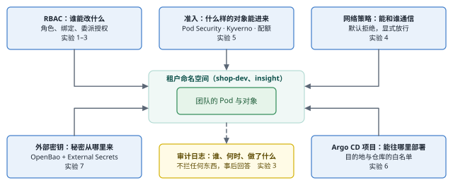
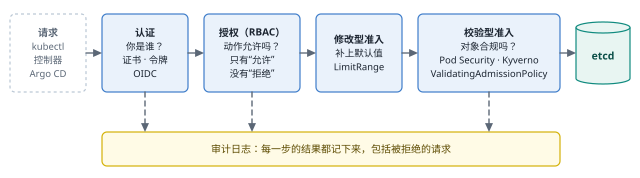
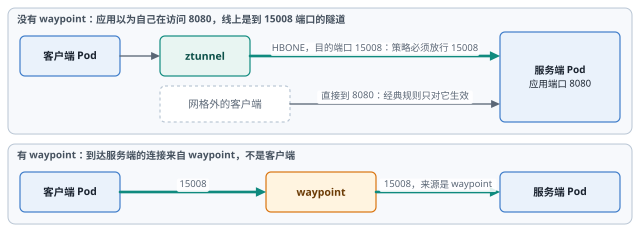
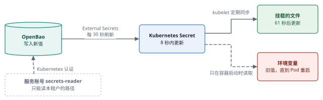

# 多租户与安全治理（E5） {#ch-e5}

到第 5 章为止，这个集群只有一个团队、一个管理员：谁都能做任何事，任何 Pod 都能连到数据库。本章把它变成多个团队共享的平台：每个人有自己的身份，每个团队只能动自己的命名空间，网络默认不通，不合规的 Pod 进不来，秘密从专门的存储中按需取得。每一道边界都用越权的尝试去测试，并用审计日志回答“谁做了什么”。

::: opener
::: q
**工程问题**

集群不再只有一个团队。怎样让每个团队只能动自己的东西——在 API、网络和密钥三个层面——并且事后能从记录里回答“谁做了什么”？
:::
::: k
**实测结论**

- 越权测试全部符合预期：Kubernetes 权限 58 项、Argo CD 权限 24 项、网络可达性 45 项；预期在施加策略之前提交。
- 能创建 Pod，就能读同一命名空间里的 Secret：RBAC 对此无能为力，边界要靠命名空间和外部密钥管理来划。
- 网格改变了 NetworkPolicy 的规则：流量到达 15008 端口，经过 waypoint 时来源是 waypoint，新策略不切断已有的连接。
- 准入引擎是全集群的依赖：单副本、不限范围的 Kyverno 重启一次，全集群 34 秒不能创建 Pod。
- 密钥轮换时，Secret 8 秒内更新，挂载的文件 61 秒后更新，环境变量要等 Pod 重启。
:::
:::

## 本章目标与产出

| 产出 | 位置（相对于 `v2/`） |
|---|---|
| 租户命名空间、RBAC 角色、配额与默认值、网络策略 | `gitops/platform/manifests/tenants/` |
| 实验用户（集群 CA 签发的客户端证书） | `platform/tenants/users.sh` |
| Kyverno 与准入策略 | `gitops/platform/apps/kyverno.yaml`、`gitops/platform/manifests/policies/` |
| OpenBao 与 External Secrets Operator | `gitops/platform/apps/secrets.yaml`、`platform/secrets/openbao-init.sh` |
| 权限矩阵、可达性矩阵、审计、准入、密钥实验 | `experiments/e5/` |
| 全部测量记录 | `evidence/e5/` |

**学完本章，你应当能够：**

- 为多个团队设计命名空间、角色和委派授权，并用测试矩阵验证“不该做的做不了”；
- 从 API 服务器的审计日志中还原一段时间内谁做了什么、为什么被允许或拒绝，并把 GitOps 的变更追溯到 Git 中的作者；
- 在服务网格中正确编写 NetworkPolicy，并知道它对已有连接不起作用；
- 比较 Kyverno（webhook）与内置的 ValidatingAdmissionPolicy，设计不会拖垮整个集群的准入策略；
- 用外部密钥存储为每个团队提供各自的秘密，并测量轮换在 Secret、挂载文件和环境变量上的传播。

本章的实验都是 `[真实]` 运行的。两个“团队”和四个用户是 `[模拟]` 的组织结构：用户是集群 CA 签发的客户端证书，不是来自企业身份系统（本环境没有单点登录）；insight 团队的服务只是一个最小的 HTTP 服务，用来检验隔离。所有密钥值都是实验中随机生成的测试值，记录中只出现它们的哈希。

## 原理 {#e5-principles}

### 身份、认证与授权

Kubernetes 不保存用户。API 服务器只验证请求者出示的凭据：客户端证书（主体名 CN 是用户名，组织 O 是组）、服务账号令牌，或者外部身份系统签发的 OIDC 令牌。认证之后，授权器（RBAC）只回答一个问题：这个用户（及其所在的组）能不能对这个资源做这个动作。RBAC 只有“允许”，没有“拒绝”：一个权限不存在，是因为没有任何角色授予它。

两条容易被忽略的规则决定了 RBAC 的实际边界：

- **防止提权。**创建 RoleBinding 时，API 服务器要求创建者本身拥有被绑定角色的全部权限，或者拥有对这个角色的 `bind` 动词。这使“团队自己管理成员”成为可能而不危险。
- **能创建 Pod，就能读命名空间里的 Secret。**Pod 可以把任何 Secret 挂载为文件或环境变量，也可以以命名空间中任何服务账号的身份运行。RBAC 对此无能为力。

### 准入

通过授权的请求还要经过准入：先是修改型（例如 LimitRange 为没有声明资源的容器补上默认值），再是校验型。内置的 Pod Security Admission 按命名空间标签执行三个级别的安全基线；更细的规则由策略引擎实现，要么是外部的 webhook（Kyverno），要么是 API 服务器内置、用 CEL 表达式编写的 ValidatingAdmissionPolicy。webhook 是一个必须在线的外部服务：它不可用时，要么拒绝请求（Fail），要么放行（Ignore）。

### 网络

Kubernetes 的网络默认全通。NetworkPolicy 按标签选择 Pod，规定允许哪些来源（入站）和目的地（出站）、哪些端口；被任何策略选中的 Pod 只接受被明确允许的流量。执行策略的是 CNI 插件（本环境是 kindnet），它决定了策略的许多细节，例如怎样对待节点自身的流量、怎样对待已经存在的连接。在服务网格中，流量的形态也变了：本环境的 ambient 网格把 Pod 之间的连接封装在端口 15008 的 HBONE 隧道里，经过 waypoint 时，目的地看到的来源是 waypoint。

### 秘密

Kubernetes 的 Secret 只是 base64 编码的对象，任何能读它、或者能在同一命名空间创建 Pod 的人都能拿到内容。外部密钥管理把秘密放在专门的存储中（本章是 OpenBao，HashiCorp Vault 的开源分支），按工作负载的身份授权，记录每一次读取，再由 External Secrets Operator 把需要的值复制成 Secret。

## 实验 1：租户与身份 {#e5-identity}

租户的结构写在 Git 中（`gitops/platform/manifests/tenants/`），由平台的 Argo CD 应用部署：

| 命名空间 | 团队 | 团队的权限 |
|---|---|---|
| storefront | team-shop（生产） | 只读和日志：生产环境的变更只经过 Git |
| shop-dev | team-shop（开发） | 开发者：管理工作负载、进入容器调试，可以把本命名空间的开发者或只读角色授予他人 |
| insight | team-insight | 同上 |

两个新命名空间都强制执行 Pod Security 的 restricted 级别，带有配额和容器默认值（按第 5 章的教训：内存给默认限制，CPU 只给默认请求，不写 `max.cpu`）。平台运维组 platform-sre 可以读整个集群（不含 Secret）并做运维操作（重启、驱逐、封锁节点、调整配额与网络策略），但不能修改 RBAC；审计组 auditors 只读，包括 RBAC 对象；只有 break-glass 组拥有集群管理员权限。

用户由 `platform/tenants/users.sh` 通过 Kubernetes 的证书签名请求接口签发（`evidence/e5/users.log`）：alice（team-shop）、bob（team-insight）、carol（platform-sre）、dave（auditors），证书有效期 7 天；carol 的 break-glass 证书另外签发，只有 1 小时。私钥和 kubeconfig 只在 `~/.lab-secrets/v2/users/` 中（权限 600），记录里只有主体、组、有效期和指纹。

证书有一个根本的局限：Kubernetes 不能吊销客户端证书，有效期就是唯一的限制。break-glass 证书过期后的请求被拒绝（`evidence/e5/rbac-matrix-5.log`，证书到期 09:32:35，09:49:01 的请求得到 `error: You must be logged in to the server (Unauthorized)`），这正是期望的行为；生产环境应当用 OIDC，账号在身份系统中停用即失效。

## 实验 2：权限矩阵 {#e5-rbac}

`experiments/e5/rbac-matrix.tsv` 在测试之前写下每个用户能做什么，`rbac-matrix.sh` 用每个用户自己的证书逐行询问 API 服务器（`kubectl auth can-i`，即 SelfSubjectAccessReview），答案来自授权器本身。

第一次运行有 3 项不符（`evidence/e5/rbac-matrix-1.log`）：carol 不能 `create pods/exec`、不能 `create pods/eviction`，alice 却能 `create serviceaccounts/token`。问题出在测试本身：`kubectl auth can-i` 把 `pods/exec` 理解为“名为 exec 的 Pod”，子资源要用 `--subresource`。carol 确实不能创建名为 exec 的 Pod，alice 确实能创建名为 token 的服务账号。更糟的是，看起来通过的 `get pods/log` 也是在测“名为 log 的 Pod”。修正写法之后，52 项全部符合（`evidence/e5/rbac-matrix-2.log`）。

实验 3 发现 `kubectl exec` 还需要 `get` 动词（见下文），角色修正后矩阵增加到 55 项；引入外部密钥管理后又增加 3 项（团队可以管理 ExternalSecret，不能管理 SecretStore，仍然不能读 Secret）。最终 58 项全部符合预期（`evidence/e5/rbac-matrix-5.log`），其中包括：

| 用户 | 请求 | 预期 | 原因 |
|---|---|---|---|
| alice | 在 storefront 进入容器 | 否 | 生产环境不给 shell |
| alice | 在 shop-dev 授予 tenant-viewer | 是 | 委派授权 |
| alice | 在 shop-dev 授予 cluster-admin | 否 | 不能授予自己没有的权限 |
| alice | 删除自己的命名空间 | 否 | 命名空间由平台管理 |
| bob | 读 storefront 的 Pod | 否 | 其他团队的命名空间 |
| carol | 驱逐 storefront 的 Pod | 是 | 运维：排空节点 |
| carol | 读 storefront 的 Secret | 否 | 读 Secret 需要 break-glass |
| dave | 列出所有 RoleBinding | 是 | 审计需要读 RBAC |
| dave | 删除 Pod | 否 | 只读 |

## 实验 3：审计日志回答“谁做了什么” {#e5-audit}

API 服务器的审计策略是第 1 章建集群时写好的（`platform/cluster/audit-policy.yaml`）：人的读操作记录元数据，写操作记录请求体，RBAC、准入和网络策略的写操作记录请求和响应；Secret、ConfigMap 和进入容器（exec）只记录元数据，以免秘密进入日志。

`experiments/e5/who-did-what.sh` 以四个用户的身份发出一组真实的请求，然后只用审计日志还原同一段时间（`evidence/e5/who-did-what.log`）。可能造成破坏、预期被拒绝的请求用 `--dry-run=server`：授权和审计与真实请求完全相同，即使角色写错了也不会改变任何东西。审计记录中有一个特别有用的字段 `authorization.k8s.io/reason`，它写明是哪个绑定、哪个角色允许了这个请求，例如 `RoleBinding "team-shop-viewer/storefront" of ClusterRole "tenant-viewer" to Group "team-shop"`。

所有越权请求都如预期被拒绝。还原出的时间线中有几处值得细看：

- **能创建 Pod，就能读 Secret。**平台在 shop-dev 中放了一个测试 Secret。alice 直接读取被拒绝（403），随后她创建了一个以环境变量引用这个 Secret 的 Pod（201），Pod 打印出的值的哈希 `91fecd34d314` 与平台写入的值相同。审计日志忠实地记录了两步，但单看任何一步都不是违规。保护 Secret 的办法是让团队根本拿不到不该有的 Secret：按命名空间隔离，Secret 只包含这个团队需要的值，由外部存储按团队授权（实验 7）。
- **“允许”不等于成功。**alice 尝试在 shop-dev 中授予自己 cluster-admin，审计记录是 `403`，授权决定却是 `allow`。授权器允许了“创建 RoleBinding”这个动作，拒绝来自 RBAC 自身的提权检查（“attempting to grant RBAC permissions not currently held”）。分析审计日志时，要看响应码，而不只是授权决定。
- **Pod Security 在 Deployment 上不拒绝。**alice 创建了一个没有 securityContext 的 Deployment，它被接受了，只返回一条警告；被拒绝的是 ReplicaSet 随后创建 Pod 的请求（`violates PodSecurity "restricted:latest"`）。审计记录在 Deployment 的创建上留下了 `pod-security.kubernetes.io/audit-violations` 注解。用户看到的是“部署成功、没有 Pod”。
- **进入容器的命令行在审计日志里。**carol 进入 storefront 的一个 Pod 时，日志中先有一条 `get pods/exec` 被拒绝（403），紧接着一条 `create pods/exec` 成功（101）：kubectl 1.37 先用 WebSocket 方式（GET，以 `get` 动词授权），被拒后回退到 SPDY（POST，`create`）。角色因此改为同时授予两个动词，之后同样的操作只有一条 `get pods/exec 101`（`evidence/e5/rbac-matrix-3.log`）。记录的 `requestURI` 包含完整的命令行（URL 编码），`command=python&command=-c&command=print%28%27carol+was+here%27%29`（`evidence/e5/who-1/audit.jsonl`）：谁在哪个 Pod 里运行了什么，元数据级别的审计就能回答，这也意味着命令行里不能出现秘密（实验 7 的脚本因此只通过标准输入传递令牌）。
- **冒用身份时两个身份都在。**管理员以 alice 的身份（`--as=alice`）列出 Pod，记录中用户是 `kubernetes-admin`，`impersonatedUser` 是 alice，授权理由是 alice 的绑定。
- **不是每个 403 都是越权尝试。**`kubectl apply` 在创建 Pod 之前读取了命名空间对象，租户没有这个权限，审计中就多了一条 403。告警规则要区分这类“噪声”。

### GitOps 的变更是谁做的

通过 Git 发生的变更，在 Kubernetes 的审计日志中只有一个身份：Argo CD 的应用控制器。给 insight 的 Deployment 加一个标签，追溯链是这样的（`evidence/e5/gitops-chain.log`）：

| 时间（UTC） | 记录 | 身份 |
|---|---|---|
| 08:35:32 | GitHub 提交 cbe7288 | Weilai Wang |
| 08:35:35 | GitLab 配置仓库提交 b511e37（发布脚本） | Platform Publisher |
| 08:35:37 | Argo CD 自动同步到 b511e37 | automated |
| 08:35:37.985 | 审计：`patch deployments insight/insight-api` | `system:serviceaccount:argocd:argocd-application-controller` |

链条是完整的，但有两处薄弱：配置仓库中的提交者是发布脚本，人的名字只在提交信息里；执行变更的控制器拥有 `* on *` 的集群权限（同一记录），Kubernetes 的授权对它不起限制作用。第一处由第 9 章（E8）的合并请求流程解决；第二处见实验 6。

## 实验 4：网络隔离 {#e5-network}

### 基线：全通

`experiments/e5/reach.sh` 在多个命名空间中放置探测 Pod，逐一尝试连接各个目标，并要求目标在应用层作答：HTTP 状态行、NATS 的 INFO 问候、Valkey 对 PING 的回复、PostgreSQL 对 SSL 请求的回复（`reach_probe.py`）。只看 TCP 握手是不够的：在 ambient 网格中，Pod 本地的 ztunnel 会先接受连接，再去连目的地。没有任何策略时，36 个组合全部可达（`evidence/e5/reach-baseline-2.log`）：任何命名空间的任何 Pod 都能直接连到 PostgreSQL、Valkey、NATS 和 Prometheus。

### 先弄清执行者：kindnet

在两个一次性的命名空间中逐条加规则（`experiments/e5/np-probe.sh`、`mesh-np.sh`），网格外的结果符合常识：默认拒绝之后连接超时，允许 8080 后恢复（`evidence/e5/mesh-np-2.log`）。服务端的就绪探针从头到尾都通过，即使在默认拒绝之下。原因在 kindnet 的 nftables 规则（`evidence/e5/kindnet-nft.log`）：只有被策略选中的 Pod 的地址进入检查集合，其报文交给用户态程序判断；节点上 root 拥有的套接字发出的报文直接放行，所以 kubelet 的探针永远不受影响；一条连接一旦被放行（或者在 Pod 被策略选中之前就已经存在），会被打上连接跟踪标签，之后的报文不再检查。

### 网格中的三条规则

网格内的第一次测试令人意外：加上默认拒绝之后，客户端仍然能访问服务端。逐一检验后得到三条规则（`evidence/e5/mesh-np-diag2-2.log`、`mesh-np-port.log`）：

| 实验 | 设置 | 结果 |
|---|---|---|
| A1 | 无策略，发一个请求 | 成功；连接跟踪中出现一条 客户端 → 服务端:15008 的连接 |
| A2 | 加默认拒绝，同一个客户端 | **成功**：还是同一条连接（同一源端口，ESTABLISHED） |
| A3 | 重建客户端 Pod（新连接） | 超时 |
| C1 | 默认拒绝 + 允许客户端访问 8080（新客户端） | 超时 |
| C2 | 默认拒绝 + 允许客户端访问 15008（新客户端） | 成功 |
| C3 | 网格外的客户端访问 8080 | 成功 |
| B1 | 有 waypoint；允许客户端 → waypoint、客户端 → 服务端 | 超时 |
| B2 | 再允许 waypoint → 服务端 15008 | 成功；连接跟踪中的来源是 waypoint 的地址 |

1. **策略不切断已有的连接。**ztunnel 为每一对 Pod 保持一条长期的 HBONE 连接，新的请求都在这条连接里复用，所以在网格中，一条新策略对已经通信过的 Pod 往往根本不起作用，直到连接因 Pod 重建等原因断开。这也意味着：策略里漏掉的规则，可能要等几小时后某个 Pod 重启才暴露出来。
2. **网格内的流量到达 15008。**只允许应用端口的“经典”规则会挡住网格内的流量；网格外的客户端则仍然到达应用端口。
3. **有 waypoint 时，服务端看到的来源是 waypoint。**允许“客户端 → 服务端”没有用。

得到这些结论之前，探测本身错了两次，都按原样保留在记录中。第一次，探测用 HTTP/1.0，waypoint（Envoy）拒绝 HTTP/1.0 并自己回复 `426 Upgrade Required`（`evidence/e5/mesh-np-diag5.log`），探测把这个回复算作“可达”，于是 waypoint 后面的结果全部偏乐观。修正后的探测使用 HTTP/1.1，并且识别代理自己生成的回复：经过 Envoy 转发的回复带有 `x-envoy-upstream-service-time` 头（`evidence/e5/probe-headers.log`），Envoy 自己的回复（426、503、403）没有。所有受影响的实验都用修正后的探测重新做了一遍。

### 平台的策略

按测得的规则，平台为三类命名空间写了策略（`gitops/platform/manifests/tenants/network.yaml`、`gitops/platform/manifests/data/networkpolicy.yaml`）：

- **租户（shop-dev、insight）：**出入都默认拒绝，只放行 DNS 和本命名空间内部。
- **storefront（网格内，有 waypoint）：**本命名空间的所有端口（覆盖 15008 和 waypoint）、monitoring 访问 8080 和 15020（指标），以及网关的 8080 对任何来源开放（负载均衡器的入口）。
- **data：**每个消费者只开放它需要的端口：storefront 访问 5432、6379、4222，Prometheus 访问三个导出器的端口，KEDA 访问 NATS 的监控端口 8222，CNPG 运维程序访问 8000 和 5432，复制和集群流量限于本命名空间。消费者是从正在运行的系统中查出来的（Prometheus 的抓取目标、KEDA 触发器的配置）。

施加策略之前，`experiments/e5/reach-expected.tsv` 写下了 45 个组合的预期并提交（cf28188）。施加之后，45 个组合全部符合（`evidence/e5/reach-after.log`）：租户只能访问 DNS 和自己；storefront 保有它的数据服务和平台服务，访问不到其他租户；任意其他命名空间只能访问公开的网关；monitoring 能访问服务的指标端口，访问不到数据库的客户端端口。

探测用的都是新连接，平台自身的连接却可能早于策略存在（规则 1）。`experiments/e5/net-validate.sh` 因此强制所有客户端重新连接：逐个替换 storefront 的每个 Pod（每个 Deployment 始终保持副本就绪），重启 KEDA、Prometheus 和 CNPG 运维程序，然后检查（`evidence/e5/net-validate.log`、`net-validate-2.log`）：20 迭代/秒、60 秒的订单流量 0 失败；data、storefront、keda 中的所有抓取目标在线；KEDA 的 ScaledObject 就绪，重启后没有错误；PostgreSQL 3/3 就绪，主库看到两个副本都在流复制；运行前后两分钟内确认的订单 305 笔、发出的通知 304 条，积压为 0。脚本本身有两处错误（通知数读错字段、复制状态问了一个副本），已修正并重新核对，原记录保留。

## 实验 5：准入策略：Kyverno 与内置策略 {#e5-admission}

Kyverno 1.19.2 经 GitOps 安装（镜像改从 ghcr.io 拉取：默认的 reg.kyverno.io 在本环境没有镜像缓存）。平台的策略只作用于带 `tenant` 标签的命名空间（`gitops/platform/manifests/policies/tenant-policies.yaml`）：镜像必须来自平台的镜像仓库并带有固定的标签（不能是 latest）；每个容器必须有内存限制和 CPU 请求；新建的租户命名空间自动获得默认拒绝的网络策略、配额和容器默认值。

`experiments/e5/admission.sh` 用 `--dry-run=server` 在 shop-dev（Kyverno）和一个绑定了同样规则的 ValidatingAdmissionPolicy（CEL 写成，API 服务器内置）的命名空间中各创建六种 Pod（`evidence/e5/admission.log`）：

| Pod | shop-dev | 内置策略的命名空间 |
|---|---|---|
| 合规 | 接受 | 接受 |
| 来自 docker.io 的镜像 | Kyverno 拒绝 | ValidatingAdmissionPolicy 拒绝 |
| 标签 latest、没有标签 | Kyverno 拒绝 | ValidatingAdmissionPolicy 拒绝 |
| 没有声明资源 | 接受，LimitRange 补上了默认值 | 接受（没有默认值） |
| 没有 securityContext | Pod Security 拒绝 | Pod Security 拒绝 |

顺序体现在结果中：LimitRange 是修改型准入，先于 Kyverno 的校验，所以没有声明资源的 Pod 带着默认值通过了“必须有资源”的规则；Pod Security 是内置插件，在 webhook 之前就拒绝了请求。

两种机制的代价不同。按 API 服务器的指标，Kyverno 的校验 webhook 平均每次 4.04 ms；内置策略只记录了做出拒绝的 3 次检查，平均 0.15 ms（它不记录放行的检查，两组数字不是同一类请求，只能说明数量级）。更重要的发现是调用次数：40 个 Pod 在 shop-dev、40 个在另一个命名空间，Kyverno 的 webhook 被调用了 80 次。它看到了每一个命名空间的每一个 Pod，包括没有任何 Kyverno 策略适用的地方。

### 当策略引擎重启时

webhook 的失败策略是 Fail：Kyverno 不在线时，请求被拒绝。`admission.sh` 删除唯一的 Kyverno 准入控制器 Pod，同时每秒在三个命名空间各创建一个合规的 Pod：

| 配置 | 删除一个准入控制器 Pod 后 |
|---|---|
| 1 个副本，webhook 覆盖除 kube-system 外的所有命名空间 | **所有命名空间**都不能创建 Pod，34 秒（09:15:54–09:16:28）；包括没有 Kyverno 策略的 storefront |
| 1 个副本，webhook 只覆盖带 `tenant` 标签的命名空间 | 两个租户命名空间 42 秒不能创建 Pod，storefront 不受影响（`evidence/e5/admission-restart-a.log`） |
| 2 个副本 + PodDisruptionBudget | 只有删除瞬间的 1 个请求失败（`evidence/e5/admission-restart-b.log`） |

单副本、覆盖全部命名空间的策略引擎，每次重启或升级都是一次全集群的“不能创建 Pod”：扩容、滚动更新、被驱逐的 Pod 重建全部失败。缩小 webhook 的范围把影响限制在需要策略的地方，多副本消除了大部分中断；即使如此，正在被删除的 Pod 仍可能让一个请求失败，调用方需要重试。新 Pod 就绪后，准入恢复所需的时间两次分别是 4 秒和 20 秒，本章没有分析差异的原因。

生成规则的表现很好：新建的租户命名空间在 1.1–1.5 秒内获得 4 个默认对象；手工删除其中一个网络策略，3 秒内被恢复（`evidence/e5/admission-generate-b.log`）。

## 实验 6：Argo CD 的项目与权限 {#e5-argocd}

Argo CD 有自己的权限：谁能查看、同步、修改哪个项目的应用。本环境没有单点登录，权限规则用与 Kubernetes 相同的组编写（`gitops/bootstrap/argocd-values.yaml`），用 `argocd admin settings rbac can` 离线检验，不需要登录（`experiments/e5/argocd-rbac.sh`）。24 项检查全部符合预期（`evidence/e5/argocd-rbac-2.log`）：team-insight 可以管理 insight 项目中的一切，看不到也同步不了 storefront；team-shop 可以查看和同步 storefront，不能修改或删除应用的定义；审计组只读；没有默认角色。第一次运行时，脚本把命令的警告和退出信息当成了答案（`argocd-rbac-1.log`），修正后重做。

项目本身的边界由 AppProject 规定：insight 项目只能部署到 insight 命名空间，只能使用平台的配置仓库，只能创建五种命名空间级的资源。三次越界尝试都被拒绝（`evidence/e5/argocd-projects.log`）：部署到 storefront 命名空间（“do not match any of the allowed destinations”）；使用外部仓库（“is not permitted in project”）；部署平台的租户配置（同步失败，命名空间、集群角色、网络策略、配额等每一项都“not permitted in project insight”），没有任何对象易主。

这道边界完全由 Argo CD 自己执行。真正向 Kubernetes 写入的是应用控制器，它拥有集群的全部权限（实验 3）。Argo CD 被攻破或配置错误时，Kubernetes 的授权不会拦住它。Argo CD 支持同步时冒用每个项目自己的服务账号（impersonation），把边界落到 Kubernetes 的 RBAC 上；这需要为所有项目（包括平台自身）配置服务账号，本章没有启用，列为待办。

## 实验 7：外部密钥管理 {#e5-secrets}

OpenBao 2.7.2 和 External Secrets Operator 2.14.0 经 GitOps 安装。OpenBao 只有一个节点，使用内置的 raft 存储；初始化、解封和配置由 `platform/secrets/openbao-init.sh` 完成，唯一的解封密钥和根令牌保存在 `~/.lab-secrets/v2/openbao/`，只经标准输入传入容器（实验 3：exec 的命令行会进入审计日志）。部署过程中遇到三处与旧资料不同的行为，都保留了记录（`evidence/e5/openbao-init-1.log` 到 `openbao-init-3.log`、`openbao-facts.log`）：OpenBao 2 没有 file 存储（“unknown storage type file”），改用 raft；`bao operator unseal -` 把短横线当作密钥本身，改为 `bao write sys/unseal key=-` 从标准输入读取；OpenBao 2.7 不允许通过 API 启用审计设备（持有令牌的人不能借此改变审计去向），审计设备写在服务器配置中。OpenBao 每次重启后处于密封状态，同一个脚本把它重新解封（`openbao-init-3.log`）；生产环境应当用多份密钥或 KMS 自动解封。

每个租户命名空间有一个服务账号 `secrets-reader` 和一个 SecretStore；OpenBao 的 Kubernetes 认证把角色 insight 绑定到 `insight/secrets-reader`，只能读 `secret/insight/*`，shop 同理。只有 External Secrets 所在的命名空间可以连接 OpenBao。两边都在网格中，OpenBao 的监听器不启用 TLS，由 ztunnel 加密：ztunnel 记录的入站连接，来源身份是 `spiffe://cluster.local/ns/external-secrets/sa/external-secrets`，目的身份是 `spiffe://cluster.local/ns/secrets/sa/openbao`。

`experiments/e5/secrets.sh` 的结果（`evidence/e5/secrets.log`）：

- **送达：**平台写入 insight 的 API 密钥后 66 秒，insight 命名空间中的 Secret 持有这个值。刷新间隔是 30 秒，多出的时间是因为在值写入之前，ExternalSecret 已经因为路径不存在而失败、处于退避状态。
- **越界请求：**bob 在 insight 中创建了一个指向 `shop/db-password` 的 ExternalSecret。OpenBao 拒绝了，审计日志中记录的是 `kubernetes-insight-secrets-reader (insight/secrets-reader) read secret/data/shop/db-password ERROR`（permission denied）。External Secrets 按退避重试，OpenBao 一共拒绝了 7 次读取（`evidence/e5/openbao-facts.log`）；没有生成 Secret。
- **轮换：**平台写入新值后，Secret 在 8 秒内更新；挂载在 Pod 中的文件在 61 秒后更新（kubelet 定期同步挂载的 Secret）；环境变量一直是旧值，只有重启 Pod 才会更新。需要轮换的凭据应当以文件挂载，并由应用重新读取。
- **审计：**OpenBao 的审计日志按服务账号记录了每一次读取，包括被拒绝的读取；秘密的值以 HMAC 形式出现，不是明文（`openbao-facts.log`）。两次写入的身份是 root：生产环境中写入秘密的人应当用自己的身份登录，根令牌只在初始化时使用。

## 局限 {#e5-limits}

- **身份是实验证书。**没有单点登录，Argo CD 的权限只能离线检验；客户端证书不能吊销。
- **两个团队是模拟的。**insight 的服务只是一个最小的 HTTP 服务；没有测试团队之间真实的数据依赖。
- **只测了 kindnet。**策略对已有连接、对节点流量的处理方式取决于 CNI；Calico、Cilium 的行为可能不同，结论不能直接搬过去。
- **Argo CD 的同步冒用没有启用**，项目边界只由 Argo CD 执行（实验 6）。
- **OpenBao 只有一个节点、一份解封密钥**；没有测试高可用和自动解封。网格中的服务间授权（Istio AuthorizationPolicy）没有在本章实施。这份唯一的密钥后来在第 12 章的事故 E11-1 中丢失。
- **准入恢复时间的差异**（新 Pod 就绪后 4 秒与 20 秒）没有分析。
- **Kyverno 的策略格式已被标为弃用。**本章的策略是 `kyverno.io/v1` 的 ClusterPolicy；Kyverno 1.19 在读取时提示它“is deprecated and will be removed in a future release”，要迁移到基于 CEL 的 ValidatingPolicy、GeneratingPolicy 等新类型（`evidence/e5/cleanup.log`）。
- **审计策略不记录服务账号对 Secret 的读取。**排除服务账号和节点读操作的规则排在 Secret 规则之前（`platform/cluster/audit-policy.yaml`），一个被盗用的服务账号令牌读取 Secret 不会留下记录。修改审计策略需要重启 API 服务器，本章没有修改，列为待办（练习 5）。

### 从实验环境到生产环境

::: prod
| 本章的做法 | 生产环境通常的做法 | 差别意味着什么 |
|---|---|---|
| 用户是集群 CA 签发的客户端证书（7 天，不能吊销） | 企业身份系统经 OIDC 登录，组来自目录，会话可以撤销 | 证书只能等它过期；真实环境里离职和调岗要立刻生效 |
| OpenBao 单节点、一份解封密钥，用根令牌写入秘密 | 高可用部署，KMS 自动解封或多人分片，每个人用自己的身份 | 第 12 章的事故 E11-1 就是单份密钥的代价 |
| CNI 是 kindnet：新策略不切断已有的连接 | Calico、Cilium 等，行为各不相同，有的支持第 7 层与全局策略 | 网络策略的结论要在自己的 CNI 上重新验证 |
| 两个团队、四个用户、一个最小的示例服务 | 几十个团队，自助开通命名空间 | 配额、策略例外和审计量的管理，本身会成为一个系统 |
:::

## 常见问题 {#e5-faq}

**有了命名空间和 RBAC，为什么还要网络策略和准入策略？**它们管的是不同的东西。RBAC 管 API 请求：谁能创建什么对象；网络策略管运行中的 Pod 能连到哪里；准入策略管对象的内容：镜像从哪里来、是否以 root 运行。本章的基线中，RBAC 限制得再严，任何 Pod 都能直接连上数据库。

**在网格中，NetworkPolicy 和 Istio 的 AuthorizationPolicy 用哪个？**两个都用，各管一层。NetworkPolicy 在 L3/L4 按地址和端口划出粗粒度的边界（命名空间之间），由 CNI 执行，不依赖网格；AuthorizationPolicy 按工作负载的身份（SPIFFE）做细粒度的授权（哪个服务能调用哪个服务），由 ztunnel 或 waypoint 执行。在网格中写 NetworkPolicy，要按本章测得的规则：放行 15008，有 waypoint 时放行 waypoint。

**Kyverno 还是 ValidatingAdmissionPolicy？**内置策略没有额外的组件，不会因为 webhook 不可用而影响集群，适合简单的校验规则；Kyverno 能生成和修改对象、有报告和例外机制，表达力强得多，代价是一个必须高可用的服务。常见的做法是两者结合：关键的、简单的规则用内置策略，其余用 Kyverno，并且限制 webhook 的范围、多副本运行。

**为什么 break-glass 证书只有一小时？**因为证书不能吊销。紧急访问应当是临时的、可追溯的：单独签发、有效期短、每次使用都在审计日志中带着 break-glass 组出现。

**秘密放在 Git 里加密（例如 Sealed Secrets）不行吗？**可以，适合少量、很少变化的秘密。外部存储的优势在于集中管理、按工作负载身份授权、每次读取都有审计、轮换不需要改 Git。代价是一个必须可用、必须解封的关键服务。

## 练习 {#e5-exercises}

::: exercise
1. **（分析）** 一个开发者在某命名空间中可以创建 Pod，但没有读取 Secret 的权限。他能拿到这个命名空间中的 Secret 吗？请说明方法，以及平台可以采取哪些措施（至少三项）降低这个风险。
2. **（排障）** 一个团队给自己的命名空间加了默认拒绝的入站策略，又加了“允许 frontend 访问 api 的 8080 端口”。当天测试一切正常，三天后，api 重新部署之后 frontend 开始超时。两个服务都在 ambient 网格中，api 前面有 waypoint。请解释“当天正常、三天后失败”，并给出正确的策略。
3. **（设计）** 为 storefront 的 orders 服务写一组入站规则：它只应接受网关的调用和 Prometheus 的抓取。分别给出 NetworkPolicy 能做到的部分和需要 Istio AuthorizationPolicy 才能做到的部分，并说明原因。
4. **（计算）** 一个集群的 Kyverno 准入控制器只有一个副本，webhook 覆盖所有命名空间，失败策略为 Fail。每次重启 34 秒不能创建 Pod。如果每月有 4 次升级、2 次节点维护导致重启，一共有多少分钟不能创建 Pod？在这段时间里，哪些自动机制会失效？给出改进方案。
5. **（审计）** 安全团队问：“过去一周谁读取过 storefront 命名空间的 Secret？”请说明需要审计日志中的哪些字段、要注意哪些读取路径（直接读取之外），以及本章的审计策略记录了什么、没记录什么。
6. **（设计）** 一位平台工程师需要在凌晨处理一次数据库事故，必须读取生产环境的数据库密码。请设计这个紧急访问的流程：身份、授权、时限、记录和事后检查。
7. **（分析）** Argo CD 的 AppProject 已经限制了 insight 团队只能部署到自己的命名空间。为什么说这条边界仍然不够牢固？如何把它落到 Kubernetes 本身？
:::

参考答案见附录。

## 本章小结

- 身份：用户是集群 CA 签发的客户端证书，组来自证书；证书不能吊销，break-glass 证书只有一小时，过期后被拒绝。
- 权限矩阵在测试前写下预期，用每个用户自己的证书询问 API 服务器，最终 58 项全部符合。第一次运行的 3 项不符来自测试工具的写法（`pods/exec` 被理解为名为 exec 的 Pod）。
- 审计日志能回答谁做了什么、为什么被允许：授权理由写明了是哪个绑定。四处细节：能创建 Pod 就能读 Secret；“允许”的请求也可能被提权检查拒绝（403）；Pod Security 拒绝的是 Pod 而不是 Deployment；exec 的命令行会被记录。GitOps 的变更在审计中只有 Argo CD 的身份，人要到 Git 中去找。
- 网络：基线是全通的。kindnet 执行策略，但不切断已有的连接、不拦节点的探针；在网格中，流量到达 15008，有 waypoint 时来源是 waypoint，而 ztunnel 的长期连接让新策略对通信过的 Pod 不起作用。按这些规则写的策略，45 个组合全部符合事先提交的预期；强制重新连接后，订单、通知、指标、自动扩缩容和数据库复制都正常。探测本身错了两次（把代理自己的 426 当作可达），修正后重做。
- 准入：Pod Security、LimitRange、Kyverno 和内置策略按固定顺序工作。单副本、覆盖全部命名空间的 Kyverno，一次重启让整个集群 34 秒不能创建 Pod；缩小 webhook 的范围、改为两个副本后，只剩一个请求失败。
- Argo CD：项目边界和权限都按预期拒绝了越界操作，但边界只由 Argo CD 执行，它的控制器拥有集群的全部权限。
- 秘密：每个团队只能从 OpenBao 读取自己的路径，越界请求被拒绝并留下审计记录；轮换在 Secret 上 8 秒、挂载文件上 61 秒生效，环境变量要等 Pod 重启。
