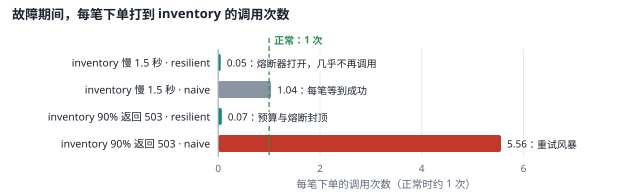
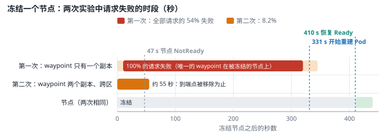

# 故障注入与传播（E6） {#ch-e6}

<div class="lead">前几章测量的是系统在正常情况下的表现。本章主动制造故障：让一个依赖变慢、大量返回错误，冻结一个节点，切断一个可用区，观察故障怎样传播、哪些机制挡住了它、哪些机制反而放大了它。每个实验都先写下假设和稳态指标，再执行，最后对照服务等级目标（SLO）计算影响。实验过程中还发生了两次计划外的真实事故，本章把它们和实验一样记录、分析，并写出复盘。</div>

::: opener
::: q
**工程问题**

故障一定会发生。它会停在出故障的那个服务里，还是沿着调用链扩散成整个系统的故障？超时、重试、熔断这些机制，各自让结果变好还是变坏？
:::
::: k
**实测结论**

- 依赖变慢时，统一 1 秒超时的 resilient 模式让订单全部快速失败；naive 模式全部成功，但订单的 p95 是 1769 ms——“不失败”和“不变慢”要按操作取舍。
- 依赖 90% 失败时，naive 模式的重试让每笔下单打到 inventory 的调用变成 5.56 次；重试预算和熔断器把它压到 0.07 次。
- 冻结一个节点：只有一个副本的 waypoint 让全部请求失败了约 5.5 分钟（54%）；改为两个副本、跨可用区之后是约 55 秒（8.2%）。
- 可用区分区时节点一直 Ready、端点从未移除——Kubernetes 看不见这种故障；用户只损失了 0.22% 的请求，是长连接掩盖了它。
:::
:::

## 本章目标与产出

| 产出 | 位置（相对于 `v2/`） |
|---|---|
| 故障注入实验脚本（依赖故障、节点失效、可用区分区） | `experiments/e6/` |
| 实验前提交的假设 | `evidence/e6/node-failure-prediction.md`、`evidence/e6/partition-prediction.md` |
| 修复：waypoint 两个副本与中断预算、通知服务至少两个副本、PriorityClass、资源请求 | `gitops/platform/manifests/mesh/`、`gitops/platform/manifests/policies/priorityclasses.yaml`、`gitops/platform/values/` |
| 全部测量记录与两份事故记录 | `evidence/e6/` |

**学完本章，你应当能够：**

- 按“稳态—假设—注入—观察—恢复”的步骤设计故障实验，并用 SLO 和错误预算衡量影响；
- 解释超时、重试、重试预算、熔断和隔舱怎样决定故障的传播，以及它们在不同故障下的取舍；
- 说出节点失效后 Kubernetes 的处理时间线，以及它为什么看不见网络分区；
- 找出平台中的单点：单副本的组件、被卷固定在节点上的有状态组件、没有余量的资源请求；
- 为真实事故写出不追究个人的复盘，区分根本原因、促成因素和改进项。

本章的实验都是 `[真实]` 运行的，故障是 `[注入]` 的：依赖的延迟和错误由服务内置的 `/admin/faults` 接口注入；节点失效用 `docker pause` 冻结节点容器（kubelet、容器运行时和其上的所有 Pod 同时停止响应）；可用区分区用节点容器内的 iptables 规则丢弃与另外两个可用区之间的流量。三个可用区本身是 `[模拟]` 的（第 1 章）。两次事故不是注入的，是实验过程中真实发生的。

## 原理 {#e6-principles}

### 稳态、假设与 SLO

故障实验不是“随便弄坏点什么看看”。每个实验先定义稳态：系统正常时可测量的输出（这里是用户看到的成功率和延迟）；再写下假设：注入某个故障之后，稳态会怎样变化；然后限定爆炸半径和结束条件，执行，对照。本章用下面的 SLO 衡量所有实验：

| 用户旅程 | 可用性 | 延迟 |
|---|---|---|
| 浏览商品 | 成功率 ≥ 99.5% | p95 ≤ 300 ms |
| 下单 | 成功率 ≥ 99% | p95 ≤ 1 s |

错误预算是 SLO 允许的“坏”的量。以时间计，30 天里 99.5% 的可用性允许约 216 分钟完全不可用，99% 允许约 432 分钟。一次 5 分钟的全面故障，就用掉浏览预算的约 2.5%。

### 故障怎样传播

服务之间的调用有五个决定传播方式的参数（第 3 章的 storefront 已经实现，`apps/storefront/src/storefront/common/resilience.py`）：

- **超时**：一次调用最多等多久。太长，调用方的资源被慢依赖拖住；太短，依赖稍慢就变成失败。
- **重试**：失败后再试。对偶发错误有效；对过载的依赖，每一层的重试相乘：三层各重试 3 次，最底层的负载可能放大到 4³ = 64 倍。
- **重试预算**：重试最多占正常请求的一定比例（这里 20%），限制放大。
- **熔断器**：连续失败后一段时间内直接拒绝，给依赖恢复的时间，也让调用方快速失败。
- **隔舱**：限制同时等待某个依赖的调用数，防止一个慢依赖耗尽调用方的全部并发。

两种模式用于对照：**naive**（超时 30 秒、立即重试 3 次、没有预算、没有熔断和隔舱）和 **resilient**（超时 1 秒、带抖动的退避重试 2 次、20% 的重试预算、熔断器、64 的隔舱）。

```{.mermaid caption="调用方发出一次依赖调用要经过的五道机制，每一道回答一个问题。超时把“慢”变成“失败”；重试把偶发的失败变成成功，也会把负载放大；预算和熔断给这种放大封顶；隔舱防止一个慢依赖占满调用方。去掉隔舱、熔断器和重试预算，并把超时放宽到 30 秒，就是本章用来对照的 naive 模式。"}
flowchart TB
  C["调用方<br/>例如 orders"] --> BH["隔舱<br/>在途调用太多了吗？<br/>上限 64"]
  BH --> CB["熔断器<br/>对方最近一直失败吗？<br/>是：立即拒绝"]
  CB --> TO["超时与截止时间<br/>这一次最多等多久？<br/>1 秒，且不超过上游的剩余时间"]
  TO --> D["被调用方<br/>例如 inventory"]:::bad
  D -. "失败或超时" .-> RT["重试 + 重试预算<br/>值得再试吗？<br/>重试总量不超过 20%"]
  RT -. "带抖动的退避之后再试" .-> CB
```

### 节点失效的时间线

节点停止响应后，Kubernetes 按固定的时间表处理：kubelet 不再更新租约，节点控制器在宽限期（本环境测得约 50 秒）后把节点标为 NotReady，节点上的 Pod 随之变为未就绪，从服务的端点中移除；节点被加上 `node.kubernetes.io/unreachable` 污点，Pod 默认容忍它 300 秒，之后才被标记删除，由控制器在其他节点上创建替代者。被卷固定在这个节点上的有状态 Pod 无处可去，只能等节点回来。

## 实验 1：依赖变慢与失败：两种韧性模式 {#e6-dependency}

`experiments/e6/fault-phase.sh` 在 30 迭代/秒的负载下运行 120 秒稳态、120 秒故障、120 秒恢复，故障施加在 inventory 的全部副本上（订单流程依赖它，浏览流程不依赖），并从 Prometheus 统计每个服务的请求、5xx、服务间调用的结果、重试、快速拒绝，以及“每笔下单在 inventory 上产生多少次调用”（放大倍数）。韧性模式经 GitOps 切换（`gitops/envs/prod/storefront/common.yaml`），对照完成后恢复为 resilient。

| 故障阶段 | resilient | naive |
|---|---|---|
| **inventory 慢 1.5 秒** | 17.00% 的请求失败（几乎全部订单）；订单 p50 4.0 ms：快速失败 | 0.00% 失败；订单 p50 1616 ms、p95 1769 ms |
| 　每笔下单在 inventory 上的调用 | 0.05 | 1.04 |
| **inventory 90% 返回 503** | 17.26% 的请求失败（全部订单）；订单 p50 4.0 ms | 9.80% 的请求失败；订单 p50 705 ms |
| 　每笔下单在 inventory 上的调用 | 0.07 | 5.56（inventory 每秒 44 个请求，稳态 7.9 个） |
| 浏览（四种情况） | p95 17.5–17.6 ms，不受影响 | p95 17.1–17.7 ms，不受影响 |



（`evidence/e6/slow-resilient.log`、`slow-naive.log`、`errors-naive.log`、`errors-resilient-2.log`）

**依赖变慢时，resilient 把“慢”变成了“全部失败”。**1 秒的超时短于 1.5 秒的延迟：orders 对 inventory 的每次调用都超时，加上重试，orders 自己的响应超过了网关对它的 1 秒超时，于是网关到 orders 的熔断器打开，此后网关每秒直接拒绝 8.95 个下单请求。naive 模式下订单全部成功，只是慢了 1.5 秒：可用性目标满足，延迟目标（p95 ≤ 1 s）违反。哪个更好取决于业务：对一个能等的操作，慢比失败好；resilient 的超时应当按依赖的真实延迟分布设定，并留出余量，而不是一个统一的 1 秒。

**依赖出错时，naive 制造了重试风暴。**orders 对 inventory 每秒重试 31.6 次，网关对 orders 每秒重试 5.1 次，inventory 收到的请求是稳态的 5.6 倍。由于注入的错误与负载无关，重试反而救回了一部分订单：naive 的失败率（9.80%）低于 resilient（17.26%，熔断后所有订单都被拒绝）。但如果错误来自过载（第 4 章测得的饱和），5.6 倍的负载只会让依赖更快崩溃，失败从一个服务蔓延到它的所有调用方。resilient 的熔断器和预算把 inventory 收到的调用降到正常的 7%，给了它恢复的空间，代价是故障期间的订单全部快速失败。两种模式下浏览都不受影响：浏览不经过 inventory 和 orders，故障没有越过服务的边界。

### 验证：事先写下假设的一次运行

上面四次运行是探索性的对照，运行之前没有写下假设。为此又做了一次验证：在还没有运行过的条件下（resilient 模式，inventory **50%** 返回 503），先提交假设（`evidence/e6/dependency-prediction.md`），再运行（`evidence/e6/errors50-resilient.log`、`errors50-recovery.log`）：

| | 假设 | 结果 |
|---|---|---|
| D1 | 故障不越过服务边界：浏览不受影响 | 符合：浏览 p95 18.7 ms（稳态 19.2 ms） |
| D2 | 重试预算和熔断器限制 inventory 的负载，没有重试风暴：每笔下单不超过 1.3 次调用 | 符合：0.07 次 |
| D3 | 失败的订单快速失败 | 符合：订单 p50 4.1 ms |
| D4 | 故障期间违反订单的 SLO，撤除故障后 30 秒内恢复 | 符合：15.8% 的请求（几乎全部订单）失败；撤除后的第一个完整 30 秒窗口里已经没有 5xx |

假设全部得到验证，但这次运行把一个代价看得更清楚：inventory 只有一半的请求失败，仅靠 2 次重试，大约 87.5% 的订单本可以成功（1 − 0.5³）；网关到 orders 的熔断器却打开了，此后几乎拒绝所有订单，只在半开状态下放过少量探测请求（orders 每秒的请求数在 0.6 和 3 之间来回）。按服务的熔断器把部分失败变成了全部失败，这与实验 2 中第二次节点失效的发现是同一个问题。

## 实验 2：节点失效 {#e6-node}

`experiments/e6/node-failure.sh` 在 30 迭代/秒的负载下冻结 ent-worker（zone-a）420 秒，每 2 秒记录节点状态、这个节点上的端点是否就绪、待调度和终止中的 Pod，并按 10 秒统计客户端的失败。选择 ent-worker 是因为 ent-worker3 上有 PostgreSQL 的主库、唯一的 Valkey 和 OpenBao（它们的故障切换属于第 8 章），ent-worker2 上有 Prometheus。假设在运行前提交（`evidence/e6/node-failure-prediction.md`）。

### 第一次：一个副本的 waypoint

冻结之前，ent-worker 上有 catalog、inventory、orders 各一个副本，还有通知服务和 waypoint 的**唯一**副本。“每个服务都有两个副本，丢一个节点没关系”的直觉不适用于 waypoint：storefront 服务之间的每一次调用都经过它（第 3 章）。结果（`evidence/e6/node-1.log`）：

| 时间（冻结后） | 事件 |
|---|---|
| 0–10 s | 一半的请求失败 |
| 10–320 s | **100% 的请求失败**，浏览也不例外 |
| 47 s | 节点 NotReady，节点上的端点全部移除；但没有其他 waypoint 可用 |
| 331 s | 节点控制器标记删除节点上的 Pod（容忍 300 秒的不可达污点之后） |
| 约 345 s | 新的 waypoint 在 ent-worker3 上运行，失败停止 |
| 410 s | 解冻后节点恢复 Ready |

整个运行 54% 的请求失败。按时间计，5.5 分钟的全面故障用掉了浏览 30 天错误预算的约 2.5%。Grafana 的替代者因内存不足无法调度。通知服务的唯一副本也在冻结的节点上，但没有丢失通知：JetStream 中通知消费者已确认的位置等于流的最后一条（193 792），没有待处理、没有重投（`evidence/e6/incident-2c.log`）。

还有一个计划外的后果：被驱逐的 metrics-server 的替代者（优先级 system-cluster-critical）在 ent-worker2 上找不到位置，于是**抢占**了那里的 Prometheus。Prometheus 的卷固定在 ent-worker2 上，而这个节点的内存已经被其他 Pod 请求满了，它回不去，监控因此中断（下文的事故二）。

### 修复与第二次

修复按发现的问题逐一进行（`evidence/e6/spof-fix.log`）：waypoint 改为两个副本、按可用区分布、加上中断预算（经 Istio 的参数 ConfigMap，`gitops/platform/manifests/mesh/waypoint-storefront.yaml`）；通知服务至少两个副本；Prometheus 获得 PriorityClass `platform-critical`。waypoint 的滚动更新本身卡住了：严格的可用区分布要求新副本放在 zone-a，而 zone-a 的内存请求只剩 56 Mi（“didn't match pod topology spread constraints … Insufficient memory”），直到把 metrics-server 的内存请求从 200 Mi 改为 64 Mi（实际用约 40 MiB，`evidence/e6/metrics-server-usage.log`），才让出了位置。这正是第 5 章讨论过的取舍：DoNotSchedule 的分布约束在资源紧张时会阻塞部署。

第二次冻结同一个节点（`evidence/e6/node-2.log`，假设见同一文件的第二部分）：

| | 第一次 | 第二次 |
|---|---|---|
| 全部请求的失败率 | 54% | 8.2% |
| 失败持续 | 约 5.5 分钟 | 约 55 秒（到端点移除为止） |
| 节点 NotReady | 47 s | 52 s |
| Prometheus | 被抢占，监控中断 | 一直运行，记录了全过程 |



故障时间从 5.5 分钟缩短到 55 秒，但第二次的假设 M1 被推翻了：我预计在端点移除之前只有部分请求失败（两个 waypoint 中只有一个被冻结），实际上这 55 秒里 99% 的请求失败。Prometheus 给出了原因（`evidence/e6/node-2-analysis.log`）：真正因冻结而超时的调用每秒只有几个（一分钟内网关到 catalog 超时 105 次、到 orders 68 次），但它们让网关对 catalog 和 orders 的熔断器打开，此后网关每秒 52.9 次直接拒绝，5xx 正好是 52.8 次。应用的熔断器是**按服务**的，不知道服务背后有两个副本，其中一个完好。按实例剔除故障端点（网格中 Envoy 的异常检测）才能只隔离坏的那一个。

第二次还显示了资源余量的问题：驱逐之后，Argo CD 控制器、Grafana、第二个 waypoint 的替代者都因内存不足无法调度，直到节点回来（这期间 GitOps 停止同步）；节点恢复后，节点控制器取消了对仍在节点上的 Pod 的删除。另外，经过两次节点失效，catalog、gateway、payments 的两个副本都集中到了 zone-c：调度器只在放置新 Pod 时考虑分布，从不重新平衡（第 5 章）。系统每经历一次故障，就变得更脆弱一点，除非有人（或 descheduler）把副本重新分散。

## 实验 3：可用区分区 {#e6-partition}

`experiments/e6/partition.sh` 在 ent-worker（zone-a）的节点容器里加入一组 iptables 规则，丢弃它与另外两个工作节点之间的所有流量（节点地址和 Pod 网段），控制面和负载均衡器仍然可达，持续 300 秒，负载 30 迭代/秒。经过两次节点失效，zone-a 上的 storefront Pod 只剩两个 waypoint 中的一个。假设在运行前提交（`evidence/e6/partition-prediction.md`）。

```{.mermaid caption="分区与节点失效的区别：数据面断了，控制面没有断。节点的心跳照常到达，Kubernetes 认为一切健康，不会移除任何端点；能发现问题的，只有发起连接的一方。"}
flowchart TB
  CP["控制面<br/>心跳照常：节点全部 Ready，端点一个也没有移除"]
  subgraph A["zone-a（ent-worker，被隔离）"]
    WA["waypoint 副本<br/>storefront 的 Pod"]
  end
  subgraph BC["zone-b、zone-c"]
    ZB["其他节点上的 ztunnel 与 Pod"]
  end
  CP --- A
  CP --- BC
  ZB -. "新连接仍有一部分发往 zone-a：超时" .-> WA
  A x--x|"iptables 丢弃节点间的全部流量"| BC
```

| | 假设 | 结果 |
|---|---|---|
| Q1 | 节点一直 Ready，它上面的端点一直就绪：Kubernetes 看不见分区 | 符合：300 秒内节点一直 Ready，waypoint 的端点一直就绪 |
| Q2 | 失败持续整个分区期间，不像节点失效那样一分钟后自愈 | **不符合**：整个运行只有 0.22% 的请求失败；分区开始后 50–60 秒有一个小高峰（4.7%），其余每 10 秒不到 1%，个别请求等待了 58 秒 |
| Q3 | Prometheus 在一分钟内看到 zone-a 的抓取目标下线 | 符合：12 秒后第一个，24 秒后 10 个 |
| Q4 | 分区结束后一分钟内失败停止 | 符合：分区在 13:09:11 解除，13:09:17 所有目标恢复 |

（`evidence/e6/partition-1.log`）

Q2 为什么错了？zone-c 节点上 ztunnel 的访问日志显示（`evidence/e6/partition-1-analysis.log`），分区期间它并没有避开不可达的 waypoint：完成的连接中 106 条去了 zone-b 的 waypoint，91 条去了 zone-a 的那个，还有 68 次连接超时（“connection timed out, maybe a NetworkPolicy is blocking HBONE port 15008”）。用户几乎感觉不到，是因为连接是长期复用的：应用与 waypoint 之间、k6 与负载均衡器之间的保持连接大多在分区之前就已建立，只有新建的连接会被分到不可达的一侧；失败之后，应用的重试换一条连接就成功了，失败的频率低到熔断器没有打开。

与第二次节点失效对比，差别在于故障的端点处在哪一层。那里被冻结的有一个 catalog 副本，waypoint 按**请求**在两个 catalog 之间分配，每个请求都有一半的机会碰到它，熔断器很快打开；这里不可达的是 waypoint 本身，ztunnel 按**连接**选择 waypoint，只有新连接受影响。

但隐患并没有消失：Kubernetes 始终把不可达的 waypoint 当作健康的端点，只要出现新连接（Pod 重启、连接池回收），就有一半先撞上超时。分区持续多久，这个隐患就存在多久，不会像节点失效那样在一分钟后被自动处理。分区对监控是可见的（10 个目标下线），对调度器不可见，处理它要靠人或自动化的判断：例如封锁 zone-a 的节点、删除那里的 Pod，或者让网格按实例剔除不可达的端点。

## 实验 4：GameDay 与复盘 {#e6-gameday}

GameDay 是团队有计划地演练故障：事先约定场景、角色、中止条件和观察的指标，演练后复盘。本章的演练是一个人完成的，按同样的步骤执行了上面的实验。比演练更有价值的，是演练过程中发生的两次真实事故。下面按不追究个人的复盘格式记录它们：发生了什么、影响、时间线、根本原因与促成因素、改进项。

### 事故一：一次发布让节点越过了驱逐阈值

**摘要。**把韧性模式从 naive 改回 resilient 的 GitOps 发布，使 ent-worker2 的内存工作集越过 kubelet 的驱逐阈值。kubelet 先后驱逐了 Argo CD 的应用控制器和 Prometheus；Prometheus 的卷固定在这个节点上，在节点的内存压力解除之前无法重新调度，监控中断约 5 分钟，正在进行的实验因此没有指标，只能重做。

| 时间（UTC） | 事件 |
|---|---|
| 10:27:45 | 提交并发布“恢复 resilient”，6 个服务开始滚动更新（新 Pod 先于旧 Pod 退出） |
| 10:27:58 | 驱逐 Argo CD 应用控制器：使用 538 MiB，请求 512 Mi |
| 10:28:01 | ent-worker2 内存压力，节点带上污点 |
| 10:29:06 | 驱逐 Prometheus |
| 10:34:01 | 内存压力解除，Prometheus 在同一节点上重新启动 |

（`evidence/e6/incident-1.log`）

**根本原因。**两个关键组件的内存请求低于实际用量：Prometheus 请求 640 Mi，实际约 940 MiB；Argo CD 控制器请求 512 Mi，实际 538 MiB。按第 5 章测得的驱逐排序，超出请求最多的 Pod 最先被驱逐，它们正是这两个。

**促成因素。**集群的内存请求已经接近饱和（三个工作节点 95%–99%），滚动更新时新旧 Pod 同时存在，短时间内增加了工作集；Prometheus 的卷固定在一个节点上，没有别处可去。第 5 章的驱逐实验已经指出“超出请求的 Pod 先走”，第 6 章结束时也记录了 ent-worker2 距驱逐阈值只有约 240 MiB，但都没有据此调整请求。

**改进项。**① 已完成：Prometheus 的内存请求改为 1 Gi，Argo CD 控制器改为 640 Mi，与实际用量一致（`gitops/platform/values/monitoring.yaml`、`gitops/bootstrap/argocd-values.yaml`）。② 已完成：被卷固定的平台组件获得 PriorityClass（见事故二）。③ 待办：为所有组件定期比较请求与实际用量（本章的 `incident-1.log` 和 `spof-fix.log` 中有一次手工比较），并把内存余量作为告警。

### 事故二：故障后的替代者抢占了监控

**摘要。**节点失效实验中，被驱逐的 metrics-server 的替代者（system-cluster-critical）在另一个节点上抢占了 Prometheus（优先级 0）。Prometheus 被卷固定在原节点，而那里的内存请求随即被其他替代者占满，它无法回来。两次手工腾出空间都失败了：调度器先把新的 Pod 放进了腾出的空间。监控中断约 27 分钟。

| 时间（UTC） | 事件 |
|---|---|
| 10:54:54 | 节点控制器标记删除被冻结节点上的 Pod |
| 10:54:55 | Prometheus 被抢占（“Preempted by pod … on node ent-worker2”） |
| 10:56:33 | Prometheus 无法调度：“didn't match PersistentVolume's node affinity … Insufficient memory” |
| 11:00–11:21 | 两次手工移走 ent-worker2 上的 Pod（11:00、11:10，每次等待 10 分钟），新 Pod（包括 Grafana）先占了位置 |
| 11:21:38 | 加上 PriorityClass `platform-critical` 后，Prometheus 在原节点上启动 |

（`evidence/e6/incident-2.log`、`incident-2b.log`、`incident-2c.log`）

**根本原因。**被卷固定在节点上的平台组件与普通工作负载优先级相同（0）。高优先级的系统组件需要位置时，它是合法的牺牲者；而它被抢占之后，无法像无状态的 Pod 那样在别处重建。

**促成因素。**没有资源余量：一个节点的 Pod 被驱逐后，其余节点放不下它们的替代者；手工腾空间与调度器竞争，没有确定的结果。

**改进项。**① 已完成：PriorityClass `platform-critical`（`gitops/platform/manifests/policies/priorityclasses.yaml`），Prometheus 使用它，因而能在自己的节点上抢占普通 Pod，第二次节点失效中它一直在运行。② 待办：PostgreSQL、NATS、Tempo、Loki、OpenBao 等同样被卷固定的组件也使用它（修改它们会重启实例，放到第 8 章与数据可靠性一起做）。③ 待办：按“失去一个可用区后其余节点能容纳全部替代者”规划容量，这正是第 4 章算过的冗余。

## 局限 {#e6-limits}

- **故障注入是内置的。**依赖故障由服务自己的 `/admin/faults` 注入，与负载无关；真实的过载会随负载加重，重试风暴的后果会比这里更严重。没有使用 Chaos Mesh 一类的工具：内存已经紧张，`docker pause` 和 iptables 足以制造本章的故障。
- **节点失效用 `docker pause` 模拟**：进程冻结、连接保持而无响应，接近一台机器失去网络或卡死；不同于断电（连接被重置）或优雅关机。
- **每种情况只做了一次**（naive 和 resilient 各一次，节点失效修复前后各一次），没有统计意义上的重复。
- **集群没有资源余量。**三个工作节点的内存请求在 95%–99% 之间，节点失效后多数替代者无法调度；这既是本章的发现，也限制了实验能观察到的恢复过程。
- **演练是一个人完成的**，没有值班、升级和沟通的环节；第 10 章（E9）的事故演练再补上。

### 从实验环境到生产环境

::: prod
| 本章的做法 | 生产环境通常的做法 | 差别意味着什么 |
|---|---|---|
| 故障由服务自带的开关、`docker pause` 和 iptables 注入 | Chaos Mesh、Litmus 或云厂商的故障注入服务，带范围限制与自动中止条件 | 本章靠脚本的 trap 收回故障；生产演练需要更强的护栏、审批与公告 |
| 一台机器上的三个“可用区” | 真实的可用区：独立的供电、网络与延迟 | 整区失联、跨区延迟升高这类相关故障，只能在真实拓扑上演练 |
| 按服务的熔断器 | 按实例的异常检测，加上按服务的熔断 | 本章中一半的实例失败时，按服务的熔断器把部分故障放大成了全部失败 |
| 节点的内存请求已达 95%–99% | 按“失去一个可用区仍能容纳全部负载”预留容量 | 否则故障后的替代 Pod 无处可去——余量是韧性的一部分，不是浪费 |
:::

## 常见问题 {#e6-faq}

**resilient 模式在依赖变慢时让订单全部失败，还要用吗？**要，但超时不能随便定。超时应当按依赖的延迟分布设定（例如它的 p99.9 加余量），并且沿调用链递减：最外层的截止时间要能容纳内层的超时加重试，否则外层总是先放弃。本章的问题在于每一层都是 1 秒。对能等待的操作，还可以改为异步（接受请求、稍后完成），而不是同步等待。

**为什么熔断器反而让节点失效变得更糟？**因为它是按服务的：两个副本中一个出问题，熔断器看到的是“这个服务有一部分调用失败”，于是对整个服务打开。故障发生在实例上时，应当剔除实例（Envoy 的异常检测、客户端的负载均衡健康检查），熔断器只用来保护整体不可用的依赖。

**为什么节点失效后要等 5 分钟 Pod 才在别处重建？**默认的不可达容忍是 300 秒，用来避免网络抖动造成大规模的 Pod 迁移。无状态服务可以缩短（在 Pod 上设置更短的 `tolerationSeconds`），但前提是集群有余量放下替代者，否则缩短只会更早地制造一批无法调度的 Pod。真正缩短影响的，是让服务在端点移除的那一刻就有足够的健康副本（本章第二次实验的 55 秒）。

**复盘为什么强调“不追究个人”？**因为目的是找出让错误可能发生、让影响扩大的系统条件。事故一的直接触发是一次正常的发布，追究“谁发布的”不会让下一次更安全；把请求改为实际用量、给关键组件优先级、为资源余量设告警，才会。

## 练习 {#e6-exercises}

::: exercise
1. **（计算）** 一条调用链 A → B → C，每层都立即重试 3 次且没有预算，C 的 90% 请求失败（错误与负载无关）。估算 C 收到的请求是正常时的多少倍；如果 C 的失败来自过载，这个倍数会带来什么后果？本章实测的倍数是 5.56，为什么低于你的估算？
2. **（设计）** 为 orders → inventory 和 gateway → orders 两段调用设定超时，使 inventory 慢 1.5 秒时订单仍能成功、而 inventory 完全不可用时订单在 2 秒内失败。说明你的依据和需要的截止时间传递方式。
3. **（分析）** 第二次节点失效中，两个 waypoint 只冻结了一个，为什么在端点移除之前几乎所有请求都失败？给出两种改进，并说明各自的代价。
4. **（计算）** 浏览的 SLO 是 30 天 99.5%。第一次节点失效约 5.5 分钟完全不可用，第二次约 55 秒。各用掉多少错误预算？如果每月有两次节点失效，按第一次的情况，预算还剩多少？
5. **（设计）** 本环境三个工作节点的内存请求在 95%–99% 之间。按“失去任何一个可用区，其余节点能容纳全部替代者”的原则，每个节点的请求最多能到多少？需要做哪些调整？
6. **（复盘）** 选择事故一或事故二，补全复盘中缺少的部分：检测（是怎样发现的、能否更早发现）、影响的量化，以及每个改进项的负责人和期限应当怎样定。
7. **（分析）** 为什么说可用区分区比节点失效更难处理？结合实验 3 的数据，说明 Kubernetes、负载均衡器和网格各自看到了什么、没看到什么。
:::

参考答案见附录。

## 本章小结

- 先写假设，再注入故障：每个实验都有事先提交的假设、稳态指标和 SLO 对照；被推翻的假设（例如“两个 waypoint 就只会部分失败”）和被证实的一样有价值。
- 依赖变慢时，统一 1 秒超时的 resilient 模式让订单全部快速失败，naive 模式让订单全部成功但 p95 达到 1.77 秒；依赖出错时，naive 的重试让 inventory 的负载放大 5.6 倍，resilient 的熔断器和预算把它降到 7%。浏览在所有情况下都不受影响。事先写下假设的验证运行（50% 错误）四项假设全部符合，也暴露出按服务的熔断器在一半请求失败时就拒绝了几乎所有订单。
- 节点失效：单副本的 waypoint 让 5.5 分钟内 100% 的请求失败；改为两个副本并分布到不同可用区后，故障缩短到 55 秒，但按服务的熔断器把部分失败放大成了全部失败。
- 资源余量决定恢复：内存请求在 95%–99% 时，节点失效后的替代者无法调度；分布约束会阻塞部署；副本在每次故障后向幸存的可用区集中。
- 两次真实事故：一次发布让节点越过驱逐阈值，驱逐了内存请求偏低的 Prometheus 和 Argo CD 控制器；一次故障后的替代者抢占了被卷固定的 Prometheus。改进是按实际用量设置请求、为被卷固定的平台组件设置优先级、为余量设告警。
- 可用区分区：节点一直 Ready，Kubernetes 从未移除不可达的端点；用户看到的失败只有 0.22%，因为长期复用的连接只把新连接暴露给分区，应用的重试掩盖了它们。故障端点处在按请求分配的一层（实验 2 的 catalog）还是按连接分配的一层（这里的 waypoint），决定了同一类故障的影响大小。分区对监控可见（24 秒内 10 个目标下线），对调度器不可见。
