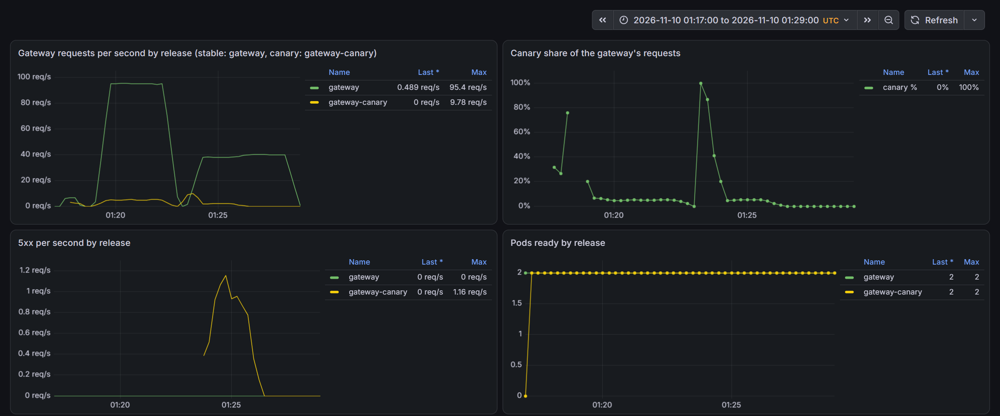

# 发布治理（E8） {#ch-e8}

<div class="lead">到第 8 章为止，平台已经能扩容、隔离租户、承受故障、在整个集群丢失后重建，但“谁能把什么改动送进生产、送得多快、出了错怎么收回”仍然只靠约定。本章把发布变成一条有关卡的路径：每个改动都是一个合并请求，流水线在合并之前执行与集群准入相同的策略；入口改为按请求分流，金丝雀精确到 5%；Argo CD 以各项目自己的账号写入集群；冻结期由两把钥匙把守；每一次部署都自动记录下来，DORA 指标由这些记录计算。每一项都先写下假设再运行，七条假设被测量推翻；在空集群上重建时，还暴露出两个只有从零开始才会出现的顺序依赖。</div>

## 本章目标与产出

| 产出 | 位置（相对于 `v2/`） |
|---|---|
| 配置仓库的合并请求门禁：受保护的 main、流水线（渲染 + 发布策略 + 冻结检查）、开发者 alice | `platform/gitops/setup.sh`、`platform/gitops/mr.sh`、`gitops/.gitlab-ci.yml`、`gitops/policies/release/` |
| 第 7 层入口（Gateway API）与带权重、按请求头预览的金丝雀 | `gitops/platform/manifests/mesh/ingress-storefront.yaml`、`gitops/platform/manifests/routes/` |
| Argo CD 按项目的同步冒用（sync impersonation）：每个项目一个部署账号 | `gitops/bootstrap/`、`gitops/platform/apps/00-projects.yaml`、`gitops/platform/manifests/tenants/argocd-deployers.yaml` |
| 变更冻结：流水线的冻结检查与 Argo CD 同步窗口 | `gitops/.gitlab-ci.yml`、`gitops/platform/apps/00-projects.yaml` |
| 部署事件（Argo CD 通知 → GitLab 部署记录）与 DORA 指标脚本 | `gitops/bootstrap/argocd-values.yaml`、`platform/gitops/deploy-events.sh`、`platform/gitops/dora.py` |
| 9 个同步波次的布局与两处顺序依赖的修复；无停顿的重建驱动 | `gitops/platform/apps/`、`experiments/e8/rebuild-run.sh` |
| 演练工具与发布看板 | `experiments/e8/`、`platform/dashboards/gen.py` |
| 每组实验前提交的假设与全部测量记录 | `evidence/e8/` |

**学完本章，你应当能够：**

- 说明在 GitOps 中“合并就是发布决定”意味着什么，把策略检查放到合并之前，并让平台拒绝绕过它的推送；
- 解释第 4 层与第 7 层入口在扩容时的差别，用带权重的路由和请求头做金丝雀与预览，估算一次失败的金丝雀会伤及多少请求；
- 配置 Argo CD 的同步冒用，让 Kubernetes RBAC 而不只是 Argo CD 本身执行项目边界，并避开根应用、命名空间创建和开启顺序上的陷阱；
- 用两把钥匙实施变更冻结，并为紧急变更留出可追溯的通道；
- 从合并请求和部署记录自动计算 DORA 指标，知道这些数字漏掉了什么。

本章的实验都是 `[真实]` 运行的：GitLab、流水线、Argo CD 和集群都是真实的软件，负载由 k6 产生。金丝雀的故障是 `[注入]` 的（服务的 `/admin/faults` 让一半的请求返回 503）；冻结演练中的“紧急情况”是 `[模拟]` 的，并没有真的发生连接池耗尽。合并请求由脚本代替两个角色提出：管理员 root 和开发者 alice（团队 shop）。实验时长以分钟计，DORA 指标反映的是一个实验日，不是一个团队的长期交付能力。

## 原理 {#e8-principles}

### 合并就是发布决定

在推送式的持续交付里，流水线最后一步把制品部署出去，审批和检查都可以挂在这一步之前。GitOps 把方向倒了过来：Argo CD 不停地把集群拉向 main 分支所描述的状态（本平台每 60 秒轮询一次，`timeout.reconciliation: 60s`）。于是 main 上出现什么，集群里就会出现什么，**合并本身就是部署决定**。由此得出三条要求：

1. **所有检查必须在合并之前完成。**集群的准入策略（第 6 章的 Kyverno）仍然是最后一道防线，但它在合并之后才起作用：被拒绝的改动已经留在 main 上，Argo CD 会一遍遍重试，main 与集群从此不一致。所以本章把同一套策略“左移”：流水线先按 Argo CD 的方式渲染出将要部署的清单，再用 Kyverno CLI——集群准入所用的同一个引擎——检查它们，不通过就不能合并。
2. **main 只接受合并。**任何人（包括管理员）直接推送到 main，都会绕过上面的检查，平台必须拒绝它，而不是靠大家自觉。
3. **每一次部署都应当能追溯到一个合并请求。**这是后面计算 DORA 指标的前提，也是冻结期的紧急变更能被事后审查的前提。

### 第 4 层与第 7 层入口

第 5 章的扩容实验留下一个问题：HPA 已经扩出新的网关 Pod，它们却几乎收不到请求。原因在入口的层次。第 4 层负载均衡（这里是 cloud-provider-kind 的负载均衡器加 Service 的 iptables 规则）分配的是**连接**：连接建立时选定一个后端，此后这条连接上的所有请求都去同一个 Pod。k6 的虚拟用户使用长连接，扩容发生时连接早已建好，新 Pod 只能等新连接。第 7 层入口（本章用 Gateway API，由 Istio 的 Envoy 实现）终结客户端连接，**按请求**在当前就绪的端点之间分配，新 Pod 一就绪就会分到请求。代价是多了一跳代理；本章测量了这一跳的代价。

### 金丝雀、预览与爆炸半径

金丝雀是新版本的第二个发布（这里是 `gateway-canary`），与稳定版并存。HTTPRoute 的 `backendRefs` 按权重分流（95/5），每个请求独立抽签；带请求头 `x-storefront-preview: canary` 的请求则总是去金丝雀，测试人员可以在零权重时先行验证。一次失败的金丝雀伤及的请求比例约为：

$$\text{受影响比例} \approx \text{金丝雀权重} \times \text{金丝雀的失败率}$$

权重 5%、金丝雀失败一半时约 2.5%。第 7 章的浏览 SLO 是 99.5%，只允许 0.5% 的失败：这样一个金丝雀必须在几分钟之内被发现并撤回，而撤回本身也要经过门禁。

### 同步冒用：项目边界由谁执行

第 6 章用 Argo CD 的项目（AppProject）限制每个团队能部署到哪些命名空间、能创建哪些种类的对象。但这个限制只由 Argo CD 检查；真正写入集群的是 Argo CD 应用控制器自己的服务账号，它在集群里几乎可以做任何事。一旦项目定义过宽（例如允许“核心组的所有种类”，其中就包括 Secret），或者 Argo CD 自身有缺陷，Kubernetes 不会提供第二道检查。

同步冒用（Argo CD 2.13 引入，仍为 alpha）改变了写入的身份：控制器借助 Kubernetes 的 impersonation 机制，以项目为目标位置指定的服务账号（`destinationServiceAccounts`）执行同步。API 服务器按被冒用的账号做 RBAC 判断，审计日志同时记下真实的请求者和被冒用的用户。前提是控制器有 `impersonate serviceaccounts` 权限，而每个项目都必须有自己的账号——包括创建其他项目的根应用所在的项目。

### 变更冻结的两把钥匙

在 GitOps 中，冻结需要两把钥匙。第一把在合并之前：冻结期内，普通的合并请求不能合并（GitLab 的部署冻结期让流水线带上 `CI_DEPLOY_FREEZE` 变量，冻结检查据此失败），只有标明 `[emergency]` 的紧急变更可以通过，而且这个标记永久留在历史里。第二把在 Argo CD：同步窗口（`syncWindows`）中的 deny 窗口期间不做自动同步，已经合并进 main 的改动也被挡住，只有操作员手动同步（`manualSync: true`）能放行。只有第二把钥匙时，冻结期间 main 会不断前进，窗口一结束，积压的改动同时生效；只有第一把钥匙时，绕过流水线进入 main 的改动（或者自愈）照样生效。

### DORA 指标从哪里来

DORA 的四个指标衡量交付的速度与稳定性：部署频率、变更前置时间（从提交到在生产运行）、变更失败率（需要回滚或修复的部署所占比例）、恢复时间（失败的部署到恢复）。它们都可以从系统里已有的记录计算：合并请求给出“改了什么、何时提出、何时合并”，部署记录给出“何时在生产生效”。困难在于对应关系——一个合并请求影响哪些应用、哪一次部署包含它——以及不经过合并请求的改动：它们在这些记录里根本不存在。

```{.mermaid caption="本章的发布路径：每个改动都是一个合并请求，每道关卡都留下记录"}
flowchart TB
  subgraph G["合并之前：GitLab"]
    direction LR
    dev["开发者 alice<br/>（Developer）"] -->|"合并请求"| ci["流水线：渲染、发布策略<br/>（Kyverno CLI）、冻结检查"]
    ci -->|"失败：拒绝合并（405）"| keep["main 不变"]
    ci -->|"通过：Maintainer 合并"| main["main（配置仓库）"]
  end
  subgraph C["合并之后：集群"]
    direction LR
    argo["Argo CD<br/>项目边界、同步窗口"] -->|"以项目的部署账号写入"| k8s["Kubernetes<br/>RBAC、准入策略"]
    k8s --> notif["Argo CD 通知"]
    notif -->|"Deployments API"| dep["GitLab 部署记录<br/>→ DORA 指标"]
  end
  G -->|"Argo CD 每 60 s 轮询 main"| C
```

## 实验 1：合并请求门禁 {#e8-gate}

配置仓库 `root/platform-gitops` 的 main 设为受保护分支：推送权限“无人”，合并权限 Maintainer，并开启“流水线成功才能合并”（`platform/gitops/setup.sh`）。流水线（`gitops/.gitlab-ci.yml`）有两个作业：`render` 用 Helm 4.3.1 按 ApplicationSet 的方式渲染每个服务的发布（`gitops/ci/render.sh`）；`release-policies` 用 Kyverno CLI 1.19.2 检查渲染结果——镜像来自 `localhost:5001` 且带固定标签，有资源请求和内存限制，有就绪探针；生产环境至少两个副本、自动扩缩容的下限不低于两个。流水线镜像把 Helm 和 Kyverno CLI 装在一起（`platform/gitops/ci-tools/`），因为官方的 kyverno-cli 镜像里没有 shell。

接入门禁之前，先在本地跑了一遍同一条流水线，结果发现了一个问题：团队 insight 的 insight-api 没有就绪探针——门禁一旦打开，这个租户的下一个改动就会被拒绝。修复和门禁本身放在同一个改动里。假设在接入之前提交（`evidence/e8/gate-prediction.md`）：

| | 假设 | 测量 | |
|---|------------------------|------------------------------|-----|
| G1 | 引入门禁的改动自己就要通过门禁 | 合并请求 !1，流水线 50 s 成功，合并 | 符合 |
| G2 | alice 把 catalog 的镜像改为 `:latest`：release-images 失败，GitLab 拒绝合并 | 流水线 48 s 失败于 `release-images`；合并返回 HTTP 405 | 符合 |
| G3 | 去掉 catalog 的内存限制：release-resources 失败 | 31 s 失败于 `release-resources`；405 | 符合 |
| G4 | 生产环境只留一个副本：release-prod-availability 失败 | 32 s 失败于 `release-prod-availability`；405 | 符合 |
| G5 | 合规的改动（catalog 的数据库连接池 10 → 12）：流水线通过；alice 自己不能合并；Maintainer 合并后 Argo CD 在一个轮询周期内完成发布 | 第二次尝试（!8）流水线通过；alice 合并返回 HTTP 401；root 合并后 27 s，catalog 的滚动更新已经完成（数据库连接池为 12） | 符合 |
| G6 | 直接推送到 main，即使是管理员，也被拒绝 | `GitLab: You are not allowed to push code to protected branches on this project`（pre-receive 钩子拒绝） | 符合 |

两处意外值得记下。G5 的第一次尝试（!5）流水线在 15 s 时失败，原因是作业拉取代码时一次没有解释的 HTTP 403；重新提交后通过，这次失败没有复现，原因未查明。更重要的是 G4/G5 的合并请求里混进了无关的文件：`mr.sh` 把工作区的 `v2/gitops` 整个镜像到分支上，而演练进行时工作区里有尚未完成的修改。门禁检查的是“这次合并之后 main 的样子”，而不是“提出者想改什么”——审查者必须看差异，自动化脚本必须从干净的状态出发。此后的演练都遵守一条规则：演练期间不编辑 `v2/gitops`。

门禁把一类事故挡在了合并之前，代价是每个改动多等半分钟到一分钟（本章所有流水线在 15–50 s 之间）。从第 6 章起集群里就有同样的 Kyverno 策略；区别在于失败发生在哪里：在流水线里，main 保持不变，提出者立刻看到原因；在准入控制里，改动已经进入 main，Argo CD 反复同步失败，集群与 main 长时间不一致。

## 实验 2：第 7 层入口下重做扩容台阶 {#e8-scaleout}

第 5 章的结论之一是：HPA 扩出的网关 Pod 收不到请求。本章新增第 7 层入口 `storefront-ingress`（Gateway API 的 Gateway + HTTPRoute，Istio 部署两个 Envoy 副本，`172.20.0.14:8080`），用与第 5 章相同的负载台阶（30 → 170 → 30 迭代/秒，分别持续 120/300/420 s；网关 HPA 2–6 个副本，目标为 500m 请求的 100%）对比两种入口。假设提交在 `evidence/e8/hpa-prediction.md`：

| | 假设 | 测量 | |
|---|------------------------|------------------------------|-----|
| H1 | 第 4 层入口：扩出的 Pod 几乎收不到请求 | `hpa-l4`：+48 s 与 +93 s 扩出两个 Pod；高负载阶段的每一分钟都只有原来的两个 Pod 在服务（各 135–150 请求/秒），新 Pod 为 0 | 符合 |
| H2 | 第 7 层入口：新 Pod 就绪后约 10 s 内分到请求，负载均匀分布 | `hpa-l7`：第一个新 Pod 在它的第一个完整分钟里服务了 79 请求/秒；最后四个 Pod 共同承担（各 22–44 请求/秒） | 符合 |
| H3 | 第 7 层入口：失败只出现在第一分钟，低于该阶段的 5% | 高负载阶段失败 57.20%（`hpa-l7`）和 49.18%（复测 run A） | **推翻** |
| H4 | 第 7 层入口在中位数上多花 1–2 ms | 浏览请求低负载阶段的中位数 11.6 ms（L7）对 12.4 ms（L4），测不出代价 | **推翻** |
| H5 | 复测：入口重试了大量请求 | 重试 **0** 次（`envoy_cluster_upstream_rq_retry`）；Istio 默认的路由重试策略里 `retriable-status-codes` 为空，503 不会被重试 | **推翻** |


H1 和 H2 说明第 7 层入口做到了第 5 章要求的事：新 Pod 立刻分担负载。H3 的推翻更有意思：负载分散了，失败却没有减少。run A 的高负载阶段，入口把 66 409 个请求转给网关 Pod，得到 40 704 个 503、19 540 个 200、3067 个 201、745 个 504；网关自己的拒绝计数器显示 `circuit_open` 40 010 次——是网关对过载下游的断路器（第 7 章引入的按服务熔断）拒绝了大部分请求。**容量的上限在网关后面**，多几个网关 Pod 并不增加它。

时间花在哪里也出人意料：网关自己测得的 p95 是 387 ms，入口为同一批请求测得的 p95 却是 9446 ms（`istio_request_duration_milliseconds`，reporter 为 source）。请求在入口的 Envoy 与网关应用之间排了队，而入口的待处理请求溢出计数为 0。原因没有查明，候选是过载时网关 Pod 的 accept 队列和 ambient 的 HBONE 路径；入口的连接与待处理指标不在导出的统计之中。k6 在台阶开始后 14–21 s 就达到了 600 个虚拟用户的上限并开始丢弃迭代，因此两种入口的总数不能直接比较。保留的结论是有限的：第 7 层入口解决了负载分配，没有解决超出系统容量的台阶。

## 实验 3：5% 的金丝雀、预览与撤回 {#e8-canary}

金丝雀是网关的第二个 Helm 发布 `gateway-canary`：同一个 chart，用新增的 chart 值 `app: gateway` 运行网关程序，镜像为 `8ef5584`，这个版本在每个响应里加上 `X-Storefront-Version` 头（稳定版 `fd38028` 早于这个头，“没有这个头”就表示稳定版）。HTTPRoute 有两条规则：带 `x-storefront-preview: canary` 的请求去金丝雀，其余按权重分配。每一步都是一个经过门禁的合并请求（流水线 32–38 s）：!10 权重 0，!11 权重 5，!12 撤回，!13 提升。假设提交在 `evidence/e8/canary-prediction.md`：

| | 假设 | 测量 | |
|---|------------------------|------------------------------|-----|
| C0 | 金丝雀通过门禁；权重 0 时不收公共请求，只收预览请求 | !10 用 33 s 通过；15 s 探测：300 个不带头的请求全部由 fd38028 回答，300 个带预览头的全部由 8ef5584 回答 | 符合 |
| C1 | 权重 95/5：20 000 个请求中 5.0% ± 0.3% 由金丝雀回答 | k6 每秒 100 个请求、持续 200 s：**20 001 个中 986 个 = 4.93%**（2 个失败，都由稳定版回答）；同一窗口 Prometheus：20 019 个中 1007 个 = **5.03%** | 符合 |
| C2 | 在 95/5 的权重下，预览头仍然 100% 去金丝雀 | 400 个中 400 个 | 符合 |
| C3 | 有故障的金丝雀（50% 返回 503）伤及约 2.5% 的请求；撤回在合并后 30 s 内生效，从决定起约 1.5 min | 决定之前 90 s：金丝雀回答 3596 个中的 178 个（4.95%），**失败 88 个 = 2.45%**，全部来自金丝雀；决定 → 合并 43 s；**最后一个金丝雀回答出现在合并后 2.8 s、决定后 46.1 s**；合并后 154 s 内 0 个失败 | 符合（更快） |
| C4 | 提升时没有失败的请求 | 提升期间 8697 个请求 **0 个失败**；合并后 55.5 s 最后一次由 fd38028 回答；2.7 min 后 ApplicationSet 删除了金丝雀的 Application 及其资源 | 符合 |



C1 的两种测量互相印证：k6 按响应头计数，Prometheus 按服务端计数，两者相差 0.1 个百分点。C3 证实了上面的公式：权重 5%、失败一半，伤及 2.45% 的请求，而且只伤及金丝雀自己的请求。撤回最慢的环节是决定本身和门禁：43 s 中大部分是流水线；路由变更进入集群只用了几秒。对照第 7 章 99.5% 的 SLO，这个金丝雀在被发现之前每多运行一分钟，就多消耗一大块错误预算——金丝雀分析必须在分钟级做出判断，而不是等到第二天看报表。

## 实验 4：按项目的同步冒用 {#e8-impersonation}

实验前先确认现状：应用控制器在 `storefront` 命名空间里可以创建 Secret（`kubectl auth can-i create secrets -n storefront --as=system:serviceaccount:argocd:argocd-application-controller` 为 yes），而项目 storefront 允许“核心组的所有种类”。设计如下：

- 团队的部署账号 `storefront/argocd-storefront` 与 `insight/argocd-insight`，Role 只覆盖它们的发布实际渲染出的种类（storefront：Deployment、Service、ServiceAccount、PDB、HPA、ScaledObject、ServiceMonitor；insight：Deployment、Service、ExternalSecret），没有 Secret、Pod 和 RBAC；
- 平台账号 `argocd/argocd-platform`（cluster-admin）随 Argo CD 的 Helm 发布一起创建（`extraObjects`），不放在 Git 里——否则根应用要先同步出自己的权限才能同步；
- 两个临时应用：`e8-probe` 往 storefront 写一个 Secret，`e8-probe-ns` 写一个 ConfigMap 并带 `CreateNamespace=true`。

先在冒用关闭时合并一次（!14），再用 `helm upgrade` 打开 `application.sync.impersonation.enabled`，然后让两个探针再写一次、同时做一个普通发布（!15），最后删除探针（!16）。每一步由 `experiments/e8/impersonation.sh` 记录状态，并从审计日志里取出“谁写了什么”（`experiments/e8/audit_who.py`）。假设提交在 `evidence/e8/impersonation-prediction.md`：

| | 假设 | 测量 | |
|---|------------------------|------------------------------|-----|
| I1 | 冒用关闭：`e8-probe` 以 Argo CD 自己的权限创建 Secret，尽管 `argocd-storefront` 无权这么做 | 03:49:28 Secret 被创建，审计日志：`system:serviceaccount:argocd:argocd-application-controller`，没有被冒用的用户，`create secrets 201`；`argocd-storefront` 的 `can-i create secrets` 为 no | 符合 |
| I2 | 冒用打开：对这个 Secret 的修改被 Kubernetes RBAC 拒绝 | 同步失败：`secrets "e8-probe" is forbidden: User "system:serviceaccount:storefront:argocd-storefront" cannot get resource "secrets"`——在应用之前读取现状时就被拒绝；每次重试都被拒绝，Secret 保持原样 | 符合 |
| I3 | 普通发布以 `argocd-storefront` 的身份成功 | orders（把 `LOG_LEVEL: INFO` 写明）：03:54:07 合并，03:55:25 同步完成（78 s），滚动更新完成；审计日志：`patch deployments`、`patch poddisruptionbudgets`，被冒用的用户 `argocd-storefront`，200 | 符合 |
| I4 | 平台的应用照常工作；根应用下一次同步以 `argocd-platform` 成功 | 项目 platform 的应用：是。**根应用：否**——它在项目 `default` 里，`default` 没有账号：`no matching service account found for destination server ... namespace argocd`，重试 5 次；从 !16 合并（03:58）到修复（04:05:33），根应用无法同步 | **推翻** |
| I5 | `CreateNamespace=true` 需要读取命名空间的权限 | 控制器日志：`namespace auto creation failed: namespaces "storefront" is forbidden: ... cannot get resource "namespaces"`；Argo CD 随后打算创建这个命名空间，又被项目检查拒绝（`resource :Namespace is not permitted in project storefront`，这是应用上显示的最终信息）；同一个应用在冒用关闭时同步成功 | 符合 |

I4 的推翻揭示了根应用的特殊位置：它创建其他项目，所以不能属于其中任何一个，只能放在 Argo CD 自带的 `default` 项目里——而 `default` 没有部署账号。修复是给根应用一个专属项目 `root`（`gitops/bootstrap/root.yaml`，和根应用一样由人工应用一次），它只允许 `argocd` 命名空间里的 Application、ApplicationSet 和 AppProject，冒用的账号 `argocd-root` 也只拥有这三种对象的 Role。修复后根应用在 04:05:33 同步成功，并以 `argocd-root` 的身份删除了两个探针（`delete applications 200`，2 次）。`default` 保持没有账号：冒用打开之后，放在其中的任何应用都无法同步，这正好关上了一扇后门。

```{.mermaid caption="同步冒用之后，Argo CD 以哪个账号写入集群"}
flowchart LR
  ctl["argocd-application-controller<br/>只负责冒用，<br/>自己只写 Argo CD 的对象"]
  ctl -->|"项目 root"| r["argocd:argocd-root<br/>只能写 Application、ApplicationSet、AppProject"]
  ctl -->|"项目 platform"| p["argocd:argocd-platform<br/>cluster-admin：Operator、CRD、集群级对象"]
  ctl -->|"项目 storefront"| s["storefront:argocd-storefront<br/>只能写发布用到的 7 种对象"]
  ctl -->|"项目 insight"| i["insight:argocd-insight<br/>只能写 3 种对象"]
  ctl -.->|"项目 default"| d["没有账号：无法同步"]
```

另外三个发现：

- **开关可能跑在权限前面。**一次 `helm upgrade` 同时带来开关和平台账号：Helm 在 03:50:17.572 写入 `argocd-cm`，在 03:50:19.574 才写入 ClusterRoleBinding。这 2 秒里，一次以 `argocd-platform` 身份执行的试运行被拒绝（403，对象是 Kyverno 的 CRD）。这次无害，但在运行中的系统上应当分两步：先建账号，再打开开关。
- **冒用不只影响同步，也影响比较。**使用 `ServerSideApply=true` 的应用由服务端试运行（`dryRun=All`，字段管理器 `argocd-controller`）计算差异，这些请求同样以项目的账号发出：即使什么都不同步，账号也需要对其应用中所有对象的 patch 权限。
- **审计日志从此能回答“哪个项目改的”。**每次写入都记录被冒用的用户，而不是笼统的“Argo CD”。根应用在约 7 分钟里无法同步，却没有任何告警——同步失败的告警留给第 10 章（E9）。

## 实验 5：变更冻结与紧急变更 {#e8-freeze}

两把钥匙放在同一段时间上：GitLab 的部署冻结期（项目设置中的 Deploy freezes）和项目 storefront 上的 Argo CD deny 窗口，都覆盖 04:28:00–04:42:00 UTC（`experiments/e8/freeze-drill.sh 5 14`，记录 `evidence/e8/freeze/run.txt`）。窗口和冻结检查本身由合并请求 !18 引入，演练结束后由 !21 移除；项目里保留一个年终冻结窗口（12 月 24–26 日）。冻结检查是流水线的一个作业，只在冻结期且不在 main 上时出现：

```yaml
freeze:
  stage: render
  rules:
    - if: $CI_DEPLOY_FREEZE && $CI_COMMIT_BRANCH != $CI_DEFAULT_BRANCH
  script:
    - |
      case "$CI_COMMIT_MESSAGE" in
        *"[emergency]"*) echo "deploy freeze active - emergency change, allowed: $CI_COMMIT_TITLE" ;;
        *) echo "deploy freeze active - only emergency changes ([emergency] in the commit message) may merge"; exit 1 ;;
      esac
```

假设提交在 `evidence/e8/freeze-prediction.md`：

| | 假设 | 测量 | |
|---|------------------------|------------------------------|-----|
| F1 | 冻结期内，alice 的普通合并请求在冻结检查中失败，GitLab 拒绝合并 | !19（catalog 改为 `LOG_LEVEL: WARNING`）：流水线 17 s 失败于 `freeze`，日志 `deploy freeze active - only emergency changes ... may merge`；合并返回 HTTP 405；随后关闭 | 符合 |
| F2 | 紧急合并请求通过，作业日志写明它是紧急变更，一分钟内合并 | !20 `[emergency] orders, catalog: DB_POOL_MAX +2 (pool exhaustion)`：流水线 23 s，`emergency change, allowed`；04:29:00 合并，距提出 28 s | 符合 |
| F3 | deny 窗口挡住已合并的改动至少 120 s；操作员的手动同步在窗口内一分钟之内放行 catalog | 合并后 +30/60/90/120 s，两个应用都是 OutOfSync，最近一次同步仍是 03:49 和 03:55 那次；控制器日志 `Sync prevented by sync window`；04:30:59 手动同步，04:31:23 catalog 已同步且健康 | 符合 |
| F4 | 窗口结束后，orders 在 2 分钟内自动同步 | 窗口 04:42:00 结束，orders 04:42:56 开始同步，结束后 **76 s** 已同步且健康；main 与集群不一致持续了 **14 分钟**（04:29:00 合并 → 04:42:57） | 符合 |
| D1 | 每次同步恰好产生一条 GitLab 部署记录，应用恢复健康后 60 s 内出现 | #11 prod/catalog 04:31:22.98（同步结束于 04:31:01），#12 prod/orders 04:43:15.25（同步结束于 04:42:57），都指向紧急提交 3783f524，由项目的机器人账号创建；没有多余的记录 | 符合 |
| D2 | GitLab 把紧急合并请求关联到这两条部署 | 两条部署都关联了 !20 **和 !18** | 符合，另有 !18 |

这次演练的“紧急情况”是 `[模拟]` 的，连接池并没有耗尽；但两把钥匙的行为都是真实的，也印证了原理中的判断：只靠 Argo CD 的窗口，main 会在冻结期间继续前进，窗口一结束，期间合并的所有改动一起生效；只靠流水线，已经进入 main 的改动（以及自愈）照样会被同步。两者一起使用时，紧急通道有两道明确的手续：提交信息里的 `[emergency]`（永久留在历史中）和一次有记录的手动同步。

## 部署事件与 DORA 指标 {#e8-dora}

部署事件由 Argo CD 的通知控制器产生（`gitops/bootstrap/argocd-values.yaml` 的 `notifications`）：storefront 的每个应用通过 ApplicationSet 模板上的注解订阅两个触发器，同步成功且应用健康时、或同步失败时，各发送一次（`oncePer` 为这次同步操作的开始时间），内容是一条 GitLab 部署记录——环境为 `prod/<服务>`，提交为本次同步的版本。凭据是配置仓库的一个项目访问令牌（角色 Developer，这是能创建部署记录的最低角色），通过标准输入写入 `argocd-notifications-secret`（`platform/gitops/deploy-events.sh`）。开启时，六个服务各产生了一条记录，代表它们当时的状态（04:20:07–09）。这些记录保存在集群之外：下一节的重建抹掉了 Argo CD 的全部历史，它们仍然在。

D2 暴露了 GitLab 关联方式的局限：它按环境上两次部署之间的提交来关联合并请求，不看合并请求改了什么，所以只改了冻结配置的 !18 也被算进 catalog 和 orders 的部署。DORA 脚本（`platform/gitops/dora.py`）因此自己做对应：

1. 从 GitLab 取出合并到 main 的全部合并请求，以及每个合并请求改动的文件；
2. 对每个 Argo CD 应用，找出它的“输入”：源路径下的文件和它引用的 values 文件（按 Argo CD 的方式解析相对路径和 `$values/` 引用）；一个合并请求改动了某个应用的输入，就“涉及”这个应用；
3. 部署记录来自 Argo CD 的应用历史（`status.history`，每个应用最近 10 次同步，随集群一起消失）或 GitLab 的部署记录；一个合并请求在某个应用上的部署，是该应用第一次在包含其合并提交的版本上的同步（按 main 的 first-parent 历史判断）；
4. 如果在那次同步之前，同一个应用又合并了一个更晚的合并请求，而且两者间隔超过 10 分钟，那次同步归更晚的那个：前一个改动没有改变这个应用的清单，Argo CD 无事可做（记为“no sync”）。

第 4 条是第一次运行后加上的。第一版把 !9（chart 增加 `app` 值，按设计不改变现有服务的清单）算到了 orders 三小时之后的那次部署上，前置时间成了 181.9 分钟；加上规则后，!9 在六个服务上都是 no sync，只部署了平台的 mesh 应用。

重建之前的快照（`evidence/e8/dora-*.txt`，Argo CD 历史，2026-11-09 23:58 – 11-10 04:45）：

| 范围 | 部署频率 | 变更前置时间 | 变更失败率 | 恢复时间 |
|------|------------|---------|---------|-------|
| 全部应用（16 个合并请求） | 5.5 小时的记录中 56 次应用部署（折合每天 243 次；按合并请求每天 69 个） | 中位数 1.2 min，最长 14.3 min（冻结） | 1/16 = 6%：!11（金丝雀权重 5%）被 !12 撤回 | 7.0 min（部署到部署） |
| storefront 的六个服务 | 5.3 小时 12 次（5 个合并请求） | 中位数 1.4 min，最长 14.3 min | 0/5 | - |

这些数字需要读者带着三个保留去看：

- **它们描述的是一个实验日。**部署频率折合成“每天 243 次”只是换算，不代表一个团队的稳定节奏；前置时间短到一两分钟，是因为合并请求由脚本提出、立即合并，没有人工审查的等待。
- **失败率只认得留下记录的失败。**金丝雀被撤回（!12 的标题含 rollback）被识别出来；但冒用开启后根应用 7 分钟无法同步，是 `helm upgrade` 这一流程外的改动造成、又由流程外的操作修复的，在合并请求和部署记录里都不存在。最危险的改动恰恰最容易逃出度量。
- **恢复时间按“部署到部署”计是 7.0 分钟，**其中包括 C1 中金丝雀健康地运行了 200 秒；从注入故障到最后一个金丝雀回答，实测约 138 秒（故障 01:23:12.7 开始，91.7 s 后做出决定，再过 46.1 s 最后一个金丝雀回答，实验 3）。DORA 的定义是“从失败到恢复”，失败何时开始，部署记录里没有。

## 实验 6：空集群上的同步波次 {#e8-waves}

第 8 章的第二次重建（R2）用了 15 分钟。根应用从第一次同步到全部应用就绪用了 692 秒，经过 11 个波次，每个波次都要等上一波中最慢的那个应用健康。按 R2 记录的逐应用耗时，许多波次之间其实没有依赖：barman-cloud 只需要 cert-manager，却和日志、链路追踪一起排在 -1 波，等 external-secrets（238 秒）把 -3 波拖完；PostgreSQL 的恢复（178 秒）又要再等一个波次。新的布局（9 个波次，合并请求 !23）把没有相互依赖的 Operator 放在一起，让数据服务提前一个波次：

| 波次 | 应用 | 依据 |
|----|------------------|--------------|
| -10、-8 | 项目；baseline（PriorityClass）、**namespaces**（原 -3） | 只是对象，很多应用要用 |
| -6 … -4 | Istio 链，不变 | CRD → istiod 与 CNI → ztunnel |
| -3 | 各 Operator，加上 **cnpg-operator**（原 -2）、**barman-cloud**（原 -1，cert-manager 就绪前靠重试）、**velero**（原 -1） | 彼此之间只有 barman-cloud → cert-manager 一条依赖 |
| -2 | tenants、mesh、**pg-main**（原 0）、nats、valkey、policies、loki、tempo、otel-collector、dashboards | 只需要 Operator 和 CRD |
| -1、0 | storefront、backup-jobs；insight | 需要数据库、租户的账号和已解封的 OpenBao |

假设（`evidence/e8/waves-prediction.md`）：W1 根应用 600 秒内全部就绪（估算 565 秒）；W2 没有死锁、除计划内的 OpenBao 恢复外不需要人工处理；W3 同步冒用从第一次同步就生效；W4 部署事件记录下重建；W5 从删除集群到全部就绪不超过 13.5 分钟。重建由 `experiments/e8/rebuild-run.sh` 驱动：第 8 章的手册步骤一气呵成，中间没有停顿，OpenBao 的 Pod 一出现就开始恢复。

**第三次重建（R3）卡在了 -2 波。**30 分钟后仍有 3 个应用没有出现，根应用同步失败并放弃了重试。原因有两个，都只会在空集群上出现：

1. **一条路由挡住了整个平台。**HTTPRoute `storefront` 属于 -2 波的 mesh 应用，它的后端是 storefront 的 Service `gateway`——要到 -1 波才创建。后端不存在时路由的 `ResolvedRefs=False`（BackendNotFound），Argo CD 判定它 Degraded，mesh 随之 Degraded；根应用等 -2 波健康，storefront 就永远不会被创建。这条路由是本章实验 2 引入的第 7 层入口（!6），旧布局里同样有这个顺序，只是在已经存在的集群上，后端一直都在。修复：路由移到单独的应用 `storefront-routes`，放在最后一个波次。
2. **一个只写在注释里的顺序假设被打破了。**Kyverno 的生成策略 `tenant-namespace-defaults` 为带 `tenant` 标签的新命名空间生成默认的配额、LimitRange 和网络策略；shop-dev 和 insight 的这些对象由 Git 提供，策略之所以不碰它们，只是因为这两个命名空间一向比策略先存在——这一点只写在策略文件的注释里。新布局把 policies 和 tenants 放进同一个波次，Kyverno 抢先生成了这 8 个对象，Argo CD 和 Kyverno 从此争夺它们。修复：给这两个命名空间加上标签 `tenant-defaults: git`，生成规则显式排除它。在运行中的集群上，Kyverno 拒绝了这次修改（生成规则的匹配条件不可变），只能删除策略、由 Argo CD 从 Git 重建。

两处修复合并之后（!25），R3 在两分钟内恢复了 storefront，删除并重建策略之后 36 个应用全部就绪——这一次花了 55.8 分钟，其中约 35 分钟是等待和诊断。

**第四次重建（R4）没有任何人工步骤。**

| | 假设 | 测量 | |
|---|------------------------|------------------------------|-----|
| W1 | 根应用 600 s 内全部就绪（R2：692 s） | **636 s**（36 个应用；R2 为 35 个），比 R2 快 56 s（8%） | **推翻** |
| W2 | 没有死锁，没有计划外的人工处理 | R3：两处，人工修复（推翻）；**R4：没有**（符合） | 见左 |
| W3 | 同步冒用从第一次同步就生效 | R4 的全部审计日志：控制器以自己的身份只写了 Argo CD 自己的对象（854 次状态更新），其余写入全部经过冒用——argocd-root 33 次（第一次在 05:54:35，根应用刚开始同步）、argocd-platform 1315 次、argocd-storefront 36 次、argocd-insight 3 次，没有一次被 RBAC 拒绝 | 符合 |
| W4 | 部署事件记录下重建 | GitLab 部署记录 #19–#24，每个服务一条，成功 | 符合 |
| W5 | 从删除到全部就绪不超过 13.5 min（R2：15.05 min） | **14.1 min**；R4 的步骤之间没有停顿，R2 约有 35 s | 推翻 |

```{.mermaid caption="R2 与 R4：根应用第一次同步之后的时间线（秒）。R4 中 PostgreSQL 的恢复提前了 130 秒开始，但 Gateway API CRD 波次慢了 86 秒，恢复本身慢了 52 秒"}
%%{init: {"gantt": {"barHeight": 30, "barGap": 6, "fontSize": 15, "sectionFontSize": 15, "leftPadding": 150, "topPadding": 40}}}%%
gantt
  dateFormat X
  axisFormat %M:%S
  section R2（11 个波次）
  Istio 链           :r2a, 0, 68
  Operator（-3 波）   :r2b, 68, 311
  tenants、mesh、cnpg :r2c, 311, 345
  数据与可观测（-1 波） :r2d, 345, 438
  pg-main 恢复（0 波） :crit, r2e, 438, 616
  storefront         :r2f, 616, 692
  section R4（9 个波次）
  Istio 链           :r4a, 10, 162
  Operator 与 barman-cloud :r4b, 162, 308
  pg-main 恢复（-2 波） :crit, r4c, 308, 538
  其余的 -2 波        :r4d, 308, 543
  storefront（-1 波） :r4e, 543, 636
```

新布局带来了它在结构上承诺的东西：barman-cloud 在 Operator 波次里就绪（277 秒，没有自己的波次），PostgreSQL 提前 130 秒开始恢复。但两个布局没有触及的组件合计比 R2 慢了 138 秒：Gateway API 的 CRD 应用用了 121 秒（R2 是 35 秒，R3 是 109 秒，原因没有查明），PostgreSQL 的恢复用了 230 秒（R2 是 178 秒）。同一个组件在三次重建中的耗时差异（CRD 35/109/121 秒、恢复 178/190/230 秒、external-secrets 238/200/约 146 秒）与重排的收益同一量级：每种布局只重建一次，分辨不出两分钟的改进。看得清的是结构上的变化，例如关键路径上少了一个波次；看不清的是总时间。

三条经验比秒数更重要：

- **只有空集群才会暴露顺序依赖。**两个问题都在已经存在的集群上隐藏了很久：一个从 E8 开始就埋下，一个由本次重排引出。重建演练不只检验备份，也检验依赖图本身。
- **依赖要写成代码，而不是注释里的约定。**“shop-dev 和 insight 比策略先存在”这个假设藏在注释里，重排时没有人看到；改成标签和排除条件之后，顺序就无关紧要了。
- **健康状态会传染。**一条找不到后端的路由让 mesh、根应用、乃至其后所有波次都停了下来。被等待的应用里，不该有依赖后来者的资源。

另外两个记录：两次重建中，演练写入器都只在删除集群前运行了十几秒（R4 是我的失误：等待时间按 WSL 的本地时区计算，结果早已过去），它们的写入都没有进入任何已归档的 WAL 段，全部丢失——这与第 8 章的结论一致（RPO 最多是一个 `archive_timeout`），不是新的 RPO 测量。审计日志保存在主机上，重建之后仍在；R4 的引导过程写满了一个 100 MB 的文件，统计时要读取全部 `audit*.log`。

## 局限 {#e8-limits}

- **两个角色都由脚本扮演。**alice 和 Maintainer 的操作由 `mr.sh` 通过 GitLab API 完成，没有人工审查。真实团队的前置时间主要花在等待审查上，本章的一两分钟不包含这部分。
- **门禁只检查渲染出的发布。**平台自己的应用（Helm chart 加 values）不经过发布策略；Argo CD 本身的升级（`helm upgrade`）更是完全在合并请求之外——本章唯一的一次故障（根应用无法同步）正来自这里。
- **金丝雀的判断是人做的。**C3 中“决定撤回”由演练脚本在 90 秒后做出，没有自动的金丝雀分析；第 7 层入口的排队原因（p95 9.4 s）也没有查明。
- **同步冒用仍是 alpha 功能**，平台账号仍是 cluster-admin：它保护的是团队项目的边界，平台项目内部没有更细的划分。
- **部署事件只覆盖 storefront 的六个服务**，平台应用的同步没有记录；DORA 的失败只认得标题里带 rollback 或 revert 的合并请求。
- 这些数字来自这个实验环境里的一个实验日，不代表任何生产系统的交付能力或规模。

## 常见问题 {#e8-faq}

**集群里已经有 Kyverno 准入策略，为什么还要在流水线里检查一遍？**准入在合并之后才起作用：被拒绝的改动已经在 main 上，Argo CD 会反复同步失败，main 与集群长期不一致，而提出者不一定看到原因。流水线在合并之前用同一个引擎检查同样的策略，把失败留在合并请求里。两者不是重复，准入仍然是绕过流水线的改动（例如有人用 kubectl）的最后一道防线。

**金丝雀为什么做成第二个发布，而不是用 Argo Rollouts 之类的工具？**本章要看清楚每一个机制：路由权重、预览头、撤回经过门禁。第二个发布加上 HTTPRoute 的权重就能做到，没有新的控制器。渐进式交付工具的价值在于自动化——按指标自动推进或撤回——这正是 C3 中人工判断最慢的那一段。

**同步冒用开启后，团队想在自己的命名空间里放一个 Secret 怎么办？**通过平台提供的通道：ExternalSecret 从 OpenBao 复制（第 6 章），由平台的 SecretStore 决定能读哪些路径。直接给部署账号 Secret 的写权限，等于把 Git 仓库变成密钥的存放处。

**为什么根应用不直接放进项目 platform？**项目 platform 是根应用自己创建的。第一次同步时它还不存在；以后如果有人在 Git 里改坏了这个项目，根应用就失去了修复它所需的权限。单独的 root 项目和它的账号随 Argo CD 一起安装，与 Git 的内容无关。

**冻结期间发现了安全漏洞怎么办？**这正是紧急通道的用途：提交信息带 `[emergency]`，流水线照常检查其余的一切；合并后由操作员在 Argo CD 中手动同步。两步都有记录，事后可以审查每一次紧急变更是否名副其实。

## 练习 {#e8-exercises}

::: exercise
1. **（计算）** 一个金丝雀的权重为 5%，它让 40% 的请求失败。入口每秒处理 100 个请求，浏览 SLO 是 30 天 99.5%。从故障开始到撤回生效用了 3 分钟，这次事故用掉多少错误预算？如果权重是 1%，又如何？
2. **（分析）** H3 被推翻：第 7 层入口让负载均匀分布，失败却没有减少。根据 run A 的数字，指出瓶颈在哪里，并提出两项能让 170 迭代/秒台阶成功的改动。
3. **（设计）** 为 C3 设计自动的金丝雀分析：用哪些指标、多长的窗口、什么阈值判定失败？在权重 5%、每秒 100 个请求时，要多少秒才能有把握区分 0.1% 和 2% 的错误率？
4. **（分析）** 如果把 `argocd-root` 及其 Role 放进 `platform/manifests/` 由 Git 管理，在下一次整集群重建时会发生什么？说明为什么 I4 的修复必须放在 Argo CD 的 Helm 发布里。
5. **（操作）** 团队 shop 需要在 storefront 中新增一个 KEDA 的 TriggerAuthentication。冒用开启后它的同步会怎样失败？写出需要修改的文件和改动。
6. **（设计）** 分别描述只有 GitLab 冻结、只有 Argo CD 窗口时，冻结会怎样被突破。再设计一个办法，让每一次紧急变更都自动生成一条需要事后审查的记录。
7. **（分析）** DORA 脚本没有发现根应用 7 分钟无法同步这次故障。提出一种能让流程外的改动（例如 `helm upgrade`）也出现在变更与部署记录中的办法，并说明它的局限。
8. **（分析）** R4 中 gateway-api-crds 用了 121 秒，R2 中只用了 35 秒。列出三个可能的原因，并说明怎样用已有的记录（审计日志、Argo CD 的操作状态与控制器日志）区分它们。
:::

参考答案见附录。

## 本章小结

- 在 GitOps 中合并就是发布决定。合并请求门禁用集群准入所用的同一个引擎检查渲染后的发布，六个假设全部符合：违规的改动在 31–48 秒内被流水线拒绝，GitLab 以 405 拒绝合并，直接推送 main 被拒；合规的改动合并后 27 秒就完成了滚动更新。
- 第 7 层入口让扩出的 Pod 立刻分到请求（第 4 层下，高负载阶段它们一个请求也没有分到），却没有让超出容量的台阶成功：失败来自网关之后的断路器，入口前还有一段原因未明的排队。
- 5% 的金丝雀实测为 4.93%（k6）和 5.03%（Prometheus）；注入一半失败的金丝雀伤及 2.45% 的请求，全部是它自己的；经过门禁的撤回在决定之后 46 秒生效，提升过程零失败。
- 同步冒用让 Kubernetes RBAC 也来执行项目边界：团队账号写 Secret 被拒绝，普通发布照常。代价是每个项目都要有账号——包括创建其他项目的根应用；它所在的 default 项目没有账号，根应用 7 分钟无法同步而无人察觉。
- 变更冻结要两把钥匙：流水线拒绝普通合并、放行标明的紧急变更，Argo CD 的窗口挡住已合并的改动 14 分钟，手动同步是窗口内唯一的通道。
- 部署事件写进集群之外的 GitLab，重建之后仍在；DORA 指标可以从合并请求和部署记录自动计算，但流程外的改动（本章唯一的一次故障）不在记录里。
- 在空集群上重建，暴露出一条依赖后来者的路由和一个只写在注释里的顺序假设；修复后的第四次重建无人工干预，636 秒全部就绪。重排让 PostgreSQL 提前 130 秒开始恢复，但单个组件的波动与这个收益同一量级。
