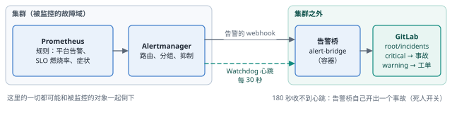
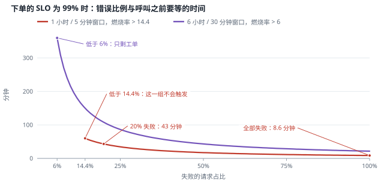
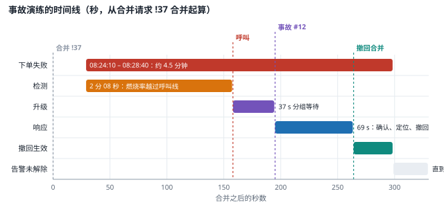
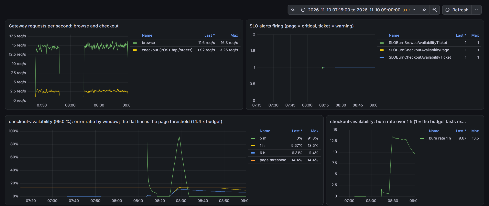
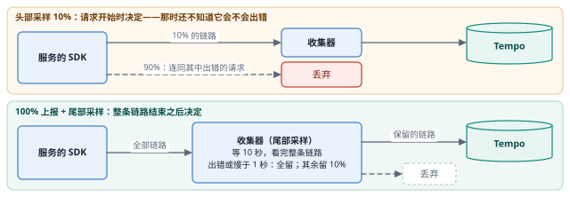
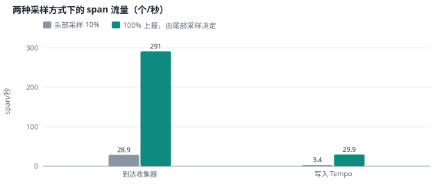
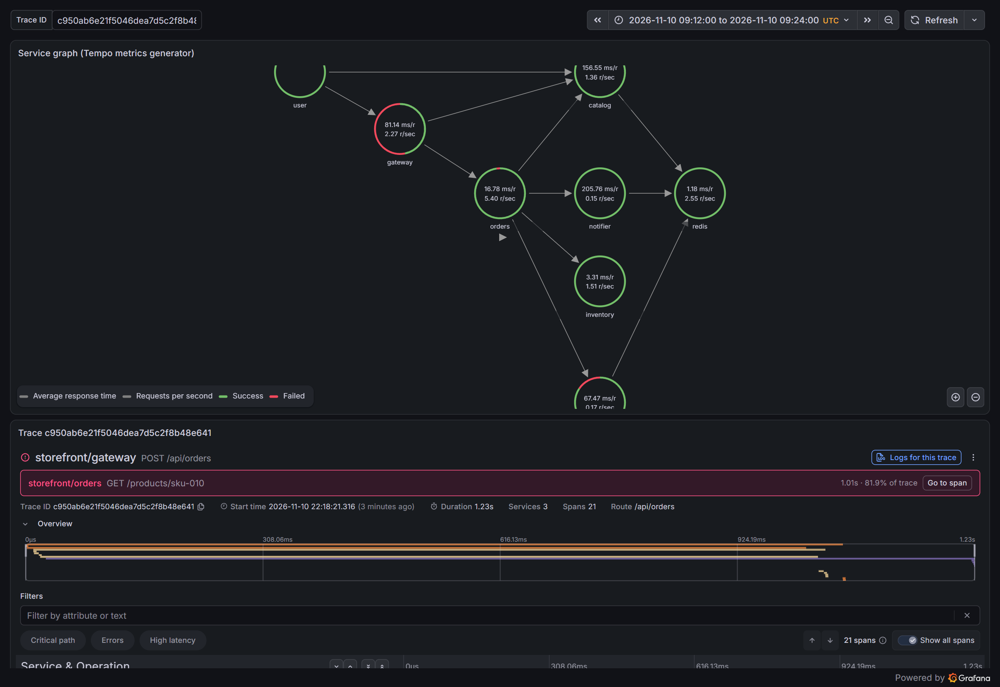

# 可观测性与事故响应（E9） {#ch-e9}

到第 9 章为止，平台测量了很多东西，却几乎从不主动告诉任何人：Alertmanager 用的是默认配置，所有告警都送进了“null”。本章让告警离开集群：严重的变成 GitLab 中的事故，一般的变成工单，告警链路本身由集群外的“死人开关”看守。告警规则从 SLO 规格生成，按多窗口、多燃烧率触发；日志改为在每个节点收集，链路改为尾部采样，审计日志开始记录谁读了哪个密钥。最后用一次真实的事故演练检验整条链：从一个看似无害的合并请求，到被呼叫、定位、撤回、关闭，再到复盘与行动项。

::: opener
::: q
**工程问题**

平台测量了很多东西，却从不主动告诉任何人。怎样让告警在监控系统自己出故障时也能送达、只在值得叫醒人的时候响，并且把一次事故从发现到复盘完整地走一遍？
:::
::: k
**实测结论**

- 告警要离开故障域：集群外的告警桥把严重告警变成 GitLab 中的事故；冻结监控所在的节点之后，死人开关在 183.2 秒时开出事故。
- 启用路由后的第一条呼叫是个误报：虚拟机的时钟漂移让“进程启动时间”10 分钟里变化 14–15 次，而进程一次也没有重启。
- 事故演练：一个测试参数经门禁进入生产，98.1% 的下单失败；影响开始后 2 分 08 秒呼叫，37 秒后开出事故，再过 69 秒撤回。
- 燃烧率告警在故障恢复之后 28.5 分钟才解除；10% 的头部采样让 670 次失败只留下 84 条错误链路。
:::
:::

## 本章目标与产出

| 产出 | 位置（相对于 `v2/`） |
|---|---|
| 集群外的告警桥：Alertmanager → GitLab 事故与工单，死人开关 | `platform/alerting/bridge.py`、`platform/alerting/run-bridge.sh` |
| 告警路由、抑制与平台告警（Argo CD、OpenBao、Velero、Alertmanager 重启），处置手册 | `gitops/platform/values/monitoring.yaml`、`gitops/platform/manifests/alerts/`、`docs/runbooks.md` |
| SLO 规格与生成器：记录规则、多窗口多燃烧率告警、SLO 看板 | `platform/slo/`、`platform/dashboards/gen.py` |
| 节点级日志（Fluent Bit → Loki）、尾部采样、记录服务账号读取 Secret 的审计规则 | `gitops/platform/values/node-logs.yaml`、`gitops/platform/values/otel-collector.yaml`、`platform/cluster/audit-policy.yaml` |
| 事故演练脚本、时间线与复盘 | `experiments/e9/`、`evidence/e9/incident/` |
| 每组实验前提交的假设与全部测量记录 | `evidence/e9/` |

**学完本章，你应当能够：**

- 设计一条不与被监控对象同处一个故障域的告警链路，并用死人开关检测它自身的失效；
- 从 SLO 推导多窗口、多燃烧率告警，事先算出一次故障多久之后才会呼叫值班人员；
- 用路由与抑制区分“立即处理”和“工作时间处理”，避免一次故障触发一串告警；
- 在节点上收集日志，使被删除或被驱逐的 Pod 的输出仍可查询；用尾部采样只保留有价值的链路；
- 按“检测—升级—缓解—解决”记录一次事故的时间线，写出带行动项的复盘。

本章的实验都是 `[真实]` 运行的：Prometheus、Alertmanager、GitLab、Fluent Bit、OpenTelemetry Collector 和集群都是真实软件，负载由 k6 产生。冻结节点、重启 OpenBao、写入一个注定失败的应用是 `[注入]` 的故障；事故演练的起因——一个测试环境的参数被带进了生产配置——是 `[模拟]` 的情节，之后的检测、通知、诊断与撤回都是真实发生的。值班工程师由我扮演，按脚本记录每一步的时刻。

## 原理 {#e9-principles}

### 告警要能离开故障域

监控系统最容易被忽略的失效，是它自己和被监控的对象一起倒下。第 8 章的 F4 中，唯一的 Prometheus 与 PostgreSQL 主库在同一个节点上，节点被冻结时告警一条也发不出来，直到故障切换结束。解决办法有两层：

1. **通知路径要离开集群。**本章的告警桥是一个运行在集群之外（与 GitLab 同一个 Docker 网络）的小程序：Alertmanager 用 webhook 把通知发给它，它在 GitLab 项目 `root/incidents` 中为每条告警开一个 issue——critical 是事故（incident），warning 是普通工单——告警解除时评论并关闭。
2. **用心跳检测“沉默”。**kube-prometheus-stack 自带一条永远在触发的告警 Watchdog。Alertmanager 每 30 秒把它发给告警桥；告警桥 180 秒没有收到心跳，就自己开一个事故：“集群的告警链路沉默了”。这就是死人开关（dead man's switch）：它不依赖被监控的系统说出“我坏了”，只依赖“它不再说话”。

### 从 SLO 到告警：多窗口、多燃烧率

SLO 的错误预算 $b = 1 - \text{SLO}$（下单 99%：$b = 1\%$）。某个时间窗口内的错误比例除以 $b$，就是燃烧率：燃烧率 1 意味着预算恰好用 30 天；燃烧率 14.4 意味着 1 小时就用掉 30 天预算的 2%（$14.4 / 720 = 0.02$）。按 Google SRE 工作手册的做法，本章的规则是：

| 级别 | 条件（两个窗口同时超过） | 含义 |
|------|------------------|------------|
| 呼叫（critical） | 1 h 与 5 min 都 > 14.4 $b$，或 6 h 与 30 min 都 > 6 $b$ | 按此速度约 2 天或 5 天用完预算 |
| 工单（warning） | 1 d 与 2 h 都 > 3 $b$，或 3 d 与 6 h 都 > 1 $b$ | 慢性消耗 |

长窗口保证告警是“真的在燃烧”，短窗口让燃烧一停告警就解除。代价是检测时间：如果之前一小时的流量全部正常，故障开始后错误比例为 $e$，1 小时窗口的比例在 $t$ 分钟后达到 $t \cdot e / 60$，越过 $14.4 b$ 需要

$$t = \frac{14.4\, b \cdot 60}{e}\ \text{分钟}$$

下单全部失败（$e = 100\%$）时 $t \approx 8.6$ 分钟，失败一半时约 17 分钟，失败 20% 时 43 分钟，低于 14.4% 的错误比例在这一组窗口上永远不会呼叫。这不是缺陷，而是设计：呼叫只用于会在几天内耗尽预算的燃烧。这些规则由 `platform/slo/gen.py` 从 `platform/slo/slos.yaml` 生成：浏览可用性 99.5%、下单可用性 99%、浏览延迟（500 ms 内）99%。

### 路由、抑制与分级

告警分两级就够了：需要立即处理的（critical，呼叫）和可以等到工作时间的（warning，工单）。Alertmanager 按 `severity` 路由，按 `alertname`、`namespace`、`slo` 分组（同一组只发一次通知，等待 30 秒以收集同时发生的告警）。抑制规则让“原因”压住“后果”：某个 SLO 的呼叫告警抑制同一 SLO 的工单告警；`PostgresPrimaryMissingReplicas` 抑制 `PostgresReplicaNotStreaming`；同一告警的 critical 版本抑制 warning 版本。每条告警都带 `team` 标签和处置手册的链接（`docs/runbooks.md`）。

### 日志、链路与审计：保留什么

- **日志**以前只有服务通过 OTLP 主动发送的部分；其他容器的标准输出、以及一个已经被删除或驱逐的 Pod 的输出，随 Pod 一起消失（第 5 章的驱逐实验就读不到被驱逐 Pod 的最后几行）。节点级收集在每个节点上读取 `/var/log/containers`，与 Pod 的生命周期无关。
- **链路**在每秒几十个请求时就已经很多。头部采样在请求开始时决定是否保留，无法知道这次请求会不会出错；尾部采样等整条链路结束（这里等 10 秒）再决定：保留全部出错的、全部慢于 1 秒的、其余的 10%。代价是收集器要在内存里暂存每条链路，而且同一条链路的所有 span 必须到达同一个收集器实例。
- **审计**此前不记录服务账号的读操作（数据量太大），因此回答不了“哪个控制器读了哪个 Secret”。本章只为 Secret 打开这一类记录，级别为 Metadata：记录谁、读了哪个对象，从不记录内容。

## 实验 1：一条永远在响的告警 {#e9-false-positive}

启用路由之前，先看现在有哪些告警在触发：除了 Watchdog，只有一条 critical 的 `AlertmanagerClusterCrashlooping`——它在第 8 章就一直在响，经过两次整集群重建（全新的 Alertmanager）仍然在响。Alertmanager 的重启次数是 0。规则的输入是 `changes(process_start_time_seconds[10m])`：进程启动时间在 10 分钟内变化超过 4 次就视为崩溃循环。实际记录（`evidence/e9/clock-drift.log`）显示，这个“启动时间”每半分钟左右往回退 1 秒，10 分钟内变化了 14–15 次，而进程从未重启。

原因在时钟。Linux 计算进程启动时间用的是“开机时刻 + 进程启动时的开机时长”，开机时刻 `btime` = 当前墙上时间 − 开机时长。在这台 WSL2 虚拟机里，单调时钟（开机时长）比墙上时钟快约 3%：60 秒的开机时长里墙上时间只走了 58.3 秒（WSL 里测得 +2.91%，kind 节点里 +2.86%；另一次 45 秒的测量是 +3.74%），墙上时钟被不断校正回主机时间，于是 `btime` 每分钟后退约 2 秒，所有进程的“启动时间”跟着后退。节点导出器报告的时钟偏移却是 0、状态“已同步”——它看的是内核的 NTP 状态，看不到这种虚拟化层面的校正。

处置：关闭这条默认规则（kube-prometheus-stack 的 `defaultRules.disabled`），换成按 kubelet 统计的真实重启次数判断的 `AlertmanagerRestarting`。这个结论对其他测量也有意义：用单调时钟计时的工具（k6 的耗时、Go 和 Python 的计时器）与按墙上时间计算的间隔，在这台机器上可能相差 3% 左右；本书各章的时间点和间隔都来自墙上时间（`date`、Prometheus、审计日志的时间戳）。

## 实验 2：告警离开集群 {#e9-routing}

告警桥运行在集群外（容器 `alert-bridge`，172.20.0.15），集群内的 Alertmanager 按名字访问它；GitLab 项目 `root/incidents` 和一个只有 Reporter 角色的项目访问令牌由 `platform/alerting/run-bridge.sh` 创建。路由、抑制和平台告警通过合并请求 !27 生效。假设提交在 `evidence/e9/alerting-prediction.md`：

| | 假设 | 测量 | |
|---|----------------------|--------------------------|---------|
| A1 | 启用路由不会打开任何 issue | 第一条通知（06:45:18）就是 **AlertmanagerClusterCrashlooping**：规则已经从 Prometheus 删除，Alertmanager 却还持有这条告警直到它过期；告警桥开了事故 #1，06:49:12 在告警解除后关闭 | **推翻** |
| A2 | 重启后的 OpenBao 处于密封状态：Pod 启动 2.5 分钟内开出事故，解封 3 分钟内关闭 | Pod 06:46:01 运行；31 秒后 `vault_core_unsealed` 为 0（密封时指标端点仍然应答）；41 秒 pending、102 秒 firing；事故 #2 在 **128 秒**后开出；06:48:13 解封，**112 秒**后关闭 | 符合 |
| A3 | 一个同步失败的应用触发 `ArgoCDSyncFailing`，1.5 分钟内开出工单 | 探针应用 06:57:26 在 5 次重试后失败——**告警从未触发**：`argocd_app_sync_total{phase="Failed"}` 在第一次失败时才诞生，初值就是 1，`increase()` 看不到任何增长 | **推翻**（规则已修正） |
| A4 | 冻结同时运行 Prometheus 与 Alertmanager 的节点：最后一次心跳后 180–200 秒死人开关开出事故；解冻一分钟内关闭；数据库写入不受影响 | 07:16:38 冻结 ent-worker3；45 秒后节点状态 Unknown；事故 #6 在最后一次心跳后 **183.2 秒**开出；解冻后 3 秒关闭；冻结期间写入 14 行 | 符合 |
| A5 | 一次带警告的备份 2 分钟内开出工单 | 备份 e9-warnings 完成，7 个警告；告警 06:52:57 触发，工单 #3 在 34 秒后开出 | 符合 |

A3 的修正值得记住：计数器的某个标签组合在第一次发生时才出现，它的第一个样本就是 1，`increase()` 和 `rate()` 都认为“没有增长”。修正后的规则同时匹配“10 分钟前还不存在的失败计数器”（`... unless ... offset 10m`），并用已经记录在 Prometheus 中的数据回测：新规则会在 06:58 到 07:07 之间触发，旧规则始终为空（`evidence/e9/a3-backtest.log`）。

另有两个发现比假设本身更重要：

- **一个永远不健康的子应用挡住了根应用。**为了让同步波次等待，平台给 Argo CD 的 Application 配置了健康检查（第 9 章），于是根应用的同步要等每个子应用健康。探针应用永远不会健康，根应用的同步一直“等待 e9-probe 健康”，删除探针的合并（!29）因此迟迟无法生效。新规则 `ArgoCDRootNotSynced` 在 07:13:30 开出了事故 #5——一次真正的呼叫。团队的应用由 ApplicationSet 生成，不是根应用的直接子应用，只有平台自己声明的应用会这样挡住根应用。
- **沉默的 Prometheus 看起来像“一切正常”。**节点冻结期间，Prometheus 不再刷新告警，Alertmanager 让仍在生效的 `VeleroBackupWarnings` 过期并发出“已解除”，告警桥关闭了工单 #3，而问题并没有解决。这一刻唯一说真话的是死人开关。

## 实验 3：被删除的 Pod 的日志，和谁读了哪个密钥 {#e9-logs-audit}

Fluent Bit 5.1.3 以 DaemonSet 运行在全部 4 个节点上（每个只请求 16 MiB 内存，ent-worker3 的内存请求已经到了 98%），把容器的标准输出连同命名空间、Pod、容器、节点标签推送给 Loki。审计策略在“服务账号的读操作一律不记录”之前加了一条：服务账号读取 Secret 记录到 Metadata 级别；策略文件在主机上，API 服务器重启后生效（这次重启用了 8 秒）。假设提交在 `evidence/e9/logs-audit-prediction.md`：

| | 假设 | 测量 | |
|---|----------------------|--------------------------|---------|
| L1 | 被删除的 Pod 的标准输出仍可从 Loki 查到，30 秒之内 | Pod 写下标记后被删除，`kubectl logs` 返回 NotFound；标记行**在 Loki 中**，但第一次查询（删除后 19 秒）没有找到，而且所在的流**没有**命名空间和 Pod 标签 | 符合，有两个保留 |
| U1 | API 服务器重启后一分钟内，审计日志记录服务账号读取 Secret | 一分钟内 30 个服务账号读取 Secret 的记录，例如 External Secrets 读取 `insight/insight-api-key`、`data:pg-main` 读取备份凭据 `pg-backup-s3`、Kyverno 读取自己的 TLS 证书 | 符合 |

L1 的两个保留来自同一个细节：Fluent Bit 默认每 60 秒才发现一次新文件。这个只活了 9 秒的 Pod 的日志文件在 Pod 删除之后才被发现（kubelet 恰好还没删除文件），发现的那一刻又正赶上 API 服务器重启，补充元数据失败，于是这一行只带着 job 标签发了出去。当时 Loki 中共有 75 个流，除了 API 服务器重启那几秒发出的行，都带有完整的标签。改为每 5 秒发现一次新文件之后，寿命短于 5 秒、文件又被 kubelet 先删掉的 Pod 仍然会丢失日志——节点级收集缩小了窗口，没有消灭它。

## 实验 4：事故演练——一个测试参数进入了生产 {#e9-drill}

情节（`[模拟]` 的起因）：团队 shop 想测试支付服务商出错时的处理，准备了一个测试环境用的参数 `PSP_ERROR_RATE: "1"`（每一笔扣款都失败），这一行却被写进了生产的 `envs/prod/storefront/services/payments.yaml`。alice 提出合并请求，门禁通过（发布策略检查镜像、资源、探针和副本数，不检查环境变量的含义），Maintainer 合并。负载：k6 以每秒 10 次迭代运行（70% 浏览、25% 下单、5% 查询），在改动之前先运行约一小时，让 SLO 的窗口里装满正常流量。值班工程师由我扮演，只通过 GitLab 中的事故和部署记录工作，演练脚本 `experiments/e9/incident-drill.sh` 为每一步打上时间戳。

计划之外发生了一件事：等待期间主机进入了睡眠，从约 07:47 到 08:13，整个实验环境冻结了 26 分钟。醒来时死人开关立即开出了事故 #8（“1548.5 秒没有心跳”），各个 SLO 都出现了短暂的错误尖峰（浏览的 5 分钟错误比例一度达到 73%），下单的慢燃烧工单 #9 被触发后又自行解除。结果是改动发生时，SLO 的窗口里只有约 35 分钟的流量，而不是计划中的一小时——这个偶然恰好成了本节最有教益的部分。

| 时刻（UTC） | 事件 | 间隔 |
|------|------------------|------------|
| 08:23:40.7 | 合并请求 !37 合并（流水线 42 s 通过） | 改动 |
| 08:23:47 | Argo CD 同步 payments | |
| 08:24:01.6 | GitLab 部署记录 #25：prod/payments，成功 | |
| 约 08:24:10 | 下单开始失败（第一个出现 503 的 30 秒区间结束于 08:24:30） | 影响开始 |
| 08:24:33.5 | 慢燃烧工单告警触发，工单 #11 于 08:25:17.6 发出 | |
| 08:26:18.5 | **呼叫告警触发**（SLOBurnCheckoutAvailabilityPage） | 检测：+2 分 08 秒 |
| 08:26:55.5 | **告警桥开出事故 #12**（分组等待 30 秒） | 升级：+37 秒 |
| 08:27:20.8 | 值班工程师确认（GitLab 中的评论） | |
| 08:27:22.7 | 诊断：prod/payments 的部署记录 #25 关联了 alice 的 !37 | |
| 08:28:04.6 | **撤回合并**（经过门禁） | 缓解：呼叫后 69 秒 |
| 约 08:28:40 | 最后一批失败的下单 | 影响结束 |
| 08:33:56 | 下单 5 分钟错误比例回到 0 | |
| 08:57:05.5 | **事故 #12 关闭**（告警解除） | 恢复后 28.5 分钟 |

假设提交在 `evidence/e9/incident-prediction.md`（演练开始之前）：

| | 假设 | 测量 | |
|---|----------------------|--------------------------|---------|
| S1 | 改动通过门禁，2 分钟内到达 payments | 流水线 42 s 通过；Argo CD 在合并后 7 秒同步；部署记录在合并后 21 秒 | 符合 |
| S2 | 下单几乎全部失败（> 90%），浏览不受影响 | 08:24:30–08:28:30 网关回答的 638 个下单中 626 个是 503（**98.1%**），其中只有 113 个到达了 orders——网关对 orders 的断路器快速失败；浏览没有 5xx | 符合 |
| S3 | 失败开始 9–10 分钟后呼叫，不会更早；不会有工单 | **2 分 08 秒**后呼叫，由 6 小时 / 30 分钟这一组窗口触发；1 小时 / 5 分钟那一组从未触发（1 小时比例最高 13.5%）；**工单先于呼叫**发出 | **推翻** |
| S4 | 告警触发后 1 分钟内开出 GitLab 事故 | 37 秒，带 team::shop 与 slo::checkout-availability 标签 | 符合 |
| S5 | 不登录集群，只凭 GitLab 找到原因；撤回合并后 3 分钟内失败停止 | 部署记录 #25 列出了 !37；撤回 08:28:04 合并，36 秒后不再有失败 | 符合 |
| S6 | 失败停止后 5 分钟内告警解除；消耗当月预算的个位数百分比 | 告警在失败停止 **28 分钟**后才解除；670 次失败的下单占当月预算的 **0.97%** | 解除时间**推翻**，预算符合 |

S3 的推翻揭示了燃烧率告警的一个性质：它的检测时间取决于窗口里有多少正常流量。改动发生时，所有窗口里都只有约 35 分钟的流量，于是“6 小时”的比例实际上是 35 分钟的比例，11.4% 超过了 6 倍燃烧率的线（6%），两分钟就呼叫了。如果窗口里装满了正常流量，同样 98% 的失败要让 1 小时比例超过 14.4%，需要 $14.4\% \times 60 / 0.98 \approx 8.8$ 分钟——几乎是这次整个故障时长（约 4.5 分钟）的两倍。换句话说，在一个平稳运行的系统里，这次每一笔下单都失败的故障，可能在修复之前根本不会呼叫任何人。S6 的推翻是同一枚硬币的另一面：30 分钟的短窗口让告警在失败停止后又持续了 28 分钟，“已解除”远远晚于“已缓解”。

做得好的地方：部署事件（第 9 章）让值班工程师一次查询就找到了可疑的改动——prod/payments 在第一笔失败之前 9 秒被部署，GitLab 在这次部署上列出了 !37；撤回同样经过门禁，用时 42 秒；网关的断路器让失败快速返回，638 个下单中只有 113 个到达 orders，失败的支付服务商没有把订单服务和数据库拖进重试风暴。

复盘（`evidence/e9/incident/postmortem.md`，无责）列出了七个行动项，其中四个已经完成并经过验证：

| # | 行动项 | 状态 |
|------|------------------|------------|
| 1 | 发布策略 `no-fault-simulation`：生产环境中 PSP_ERROR_RATE 与 PSP_HANG_RATE 必须为 0 | 完成；alice 再次提出同样的改动，流水线在 `release-prod-availability` 失败，合并返回 405 |
| 2 | 症状告警 `CheckoutFailing`：2 分钟内超过一半的下单失败（且超过 20 次）即呼叫，不看预算 | 完成；用演练的数据回测：08:26:15 触发 |
| 3 | SLO 工单的分组等待改为 5 分钟，让随后的呼叫有机会先抑制它 | 完成；尚未在真实燃烧中观察到 |
| 4 | 下单的 SLI 只统计 POST 请求 | 完成 |
| 5 | 对支付等关键服务的配置改动也走金丝雀（第 9 章的加权路由） | 未完成 |
| 6 | 事故区分“已缓解”和“已解除” | 未完成 |
| 7 | 演练前让主机保持唤醒，并检查 SLO 窗口里有多少历史 | 未完成（实验环境） |

## 实验 5：尾部采样与 exemplar {#e9-sampling}

收集器在演练之前就开启了尾部采样（等待 10 秒，保留全部出错的、全部慢于 1 秒的、其余的 10%）。演练之后再看它在事故期间做了什么，结果令人意外：08:23:30–08:35:00 之间它对 4770 条链路做了决定，出错策略只保留了 86 条；Tempo 里这段时间只有 84 条出错的链路，而失败的下单有 670 次。原因在上游：生产环境从第 4 章起就以 10% 的比例做头部采样（`tracesSampleRatio: "0.1"`），十个请求里只有一个的 span 会被发送到收集器——尾部采样保留不了它从未收到的链路。两种采样叠加，最终只有约 1% 的 span 进入 Tempo，而出错的链路只剩十分之一。

exemplar 让这个问题更直观。服务从 b13e3cf 起在请求耗时直方图上记录 exemplar：只为出错或慢于 1 秒的请求附上链路 ID，也就是尾部采样一定会保留的那些链路，Prometheus 按 OpenMetrics 格式抓取并保存它们。假设提交在 `evidence/e9/exemplars-prediction.md`；检验时给 catalog 注入 45 秒、每个请求 1.2 秒的延迟：

| | 假设 | 测量 | |
|---|----------------------|--------------------------|---------|
| X1 | 注入之后只有 1 秒以上的桶有 exemplar | 2 秒桶 18 个、5 秒桶 4 个——**还有 30 个落在 5 毫秒桶**：网关的断路器在约 1 毫秒内返回 503，出错的请求不论快慢都会带上 exemplar（这正是设计） | **推翻**（预测忽略了快速失败） |
| X2 | 每个 exemplar 的链路都能在 Tempo 中打开 | 第一次：5 个里只有 **1 个**。没有被头部采样选中的请求仍然有链路 ID，exemplar 指向了一条从未被记录的链路 | **推翻** |

修正有两处：exemplar 只在 span 确实被采样（`trace_flags.sampled`）时才记录；头部采样改为 100%，由尾部采样一处决定（镜像 05a04fe）。第二次检验 5 个链路全部能打开（X2 修正后符合）。代价在相同负载下测量（`evidence/e9/tracing-cost.log`）：

| | 头部采样 10% | 100%，由尾部采样决定 |
|------|------------------|------------|
| 六个服务的 CPU | 0.393 核 | 0.413 核（+5%，每个请求 +9%） |
| 到达收集器的 span | 28.9 个/秒 | 291 个/秒 |
| 写入 Tempo 的 span | 3.4 个/秒 | 29.9 个/秒（8.7 倍） |
| 收集器的 CPU / 内存 | 0.009 核 / 92 MiB | 0.013 核 / 118 MiB |

两个采样器各自都合理，叠加起来却让“保留全部错误”的承诺落空，exemplar 也指向了不存在的链路。这类问题不会自己报错：链路少了，看板照常显示；只有拿具体的事故去核对，才会发现记录里缺了九成。

## 局限 {#e9-limits}

- **告警桥是一个单点。**它运行在集群之外，但只有一个实例，与 GitLab 在同一台主机上；告警桥或 GitLab 倒下时，告警无处可去，死人开关也会一起失效。生产环境会把死人开关交给另一个独立的服务（例如商业的心跳监控），通知也会走多个渠道（电话、即时消息）。
- **值班工程师早有准备。**演练中从呼叫到确认只用了 25 秒，因为扮演值班的我正在等待；真实的确认时间取决于值班安排和通知方式，本章没有测量。
- **事故中的检测时间是偶然的结果。**主机睡眠让 SLO 窗口只有 35 分钟的历史，呼叫因此提前；满一小时历史的检测时间是推算（8.8 分钟），不是测量。
- **每种情况只做了一次。**OpenBao 密封、死人开关、事故演练都只运行了一次，时间受到这台机器负载和睡眠的影响。
- **30 天的预算无法完整呈现。**Prometheus 只保留 3 天，看板显示的是窗口内的燃烧率，不是 30 天里剩余的预算。
- 这些数字来自这个实验环境，不代表任何生产系统的规模或经验。

### 从实验环境到生产环境

::: prod
| 本章的做法 | 生产环境通常的做法 | 差别意味着什么 |
|---|---|---|
| 告警桥只有一个实例，与 GitLab 在同一台机器上 | 托管的值班系统，加一个独立于自己机房的心跳监控 | 死人开关与它看守的对象共用一台机器：整机冻结时一起失效（第 11 章的事故 E10-1） |
| 值班工程师由作者扮演，按脚本记录时刻 | 轮值、升级策略、交接与对外沟通 | 本章测到的是机器的延迟；人的响应时间没有被真正测量 |
| SLO 的窗口里只有几十分钟的历史 | 28–30 天的滚动窗口 | 历史不足让告警比设计的更早触发，也更晚解除 |
| Prometheus 只保留几天的数据 | 长期存储与降采样（Thanos、Mimir 等） | 月度的错误预算报告在本环境算不出来 |
:::

## 常见问题 {#e9-faq}

**既然有了 SLO 燃烧率告警，为什么还要 CheckoutFailing 这种症状告警？**燃烧率告警回答的是“预算会不会耗尽”，它的检测时间随窗口里的历史变化，一次短暂但彻底的故障可能在修复之前都不会呼叫。对下单这种直接关系收入的路径，“超过一半失败”本身就值得立即处理。两者不冲突：症状告警负责“现在坏了”，燃烧率告警负责“正在悄悄变坏”。

**告警为什么不直接发邮件或即时消息，而要经过一个告警桥？**本章需要三件事：通知离开集群；每条告警在一个可以追踪的地方有记录（谁确认、何时缓解、何时解除）；告警链路自身的失效能被发现。Alertmanager 的 webhook 加一个很小的桥就能做到，GitLab 的事故页面同时充当时间线。生产环境通常用 PagerDuty、Opsgenie 一类的服务做同样的事。

**为什么不把 Alertmanager 的 resolve_timeout 调大，避免冻结期间告警被“解除”？**`resolve_timeout` 只对不带结束时间的告警生效；Prometheus 发送的告警自带结束时间，Prometheus 一停止刷新它们就会过期。根本的办法是承认监控会沉默，并让沉默本身成为告警——这正是死人开关。

**尾部采样为什么不能在头部采样之后补救？**被头部采样丢弃的请求根本不会创建可导出的 span，收集器看不到它们。要让尾部采样保留全部错误，就必须让所有链路都到达收集器，代价是服务和收集器多做的那部分工作，以及更多的网络流量。

## 练习 {#e9-exercises}

::: exercise
1. **（计算）** 浏览的 SLO 是 99.5%。窗口里装满了一小时的正常流量之后，浏览请求有 30% 失败。1 小时 / 5 分钟这一组呼叫条件多久之后满足？如果只有 3% 失败，会不会呼叫？会不会开工单？
2. **（分析）** 事故演练中，下单的呼叫来自 6 小时 / 30 分钟这一组窗口，而且在失败停止 28 分钟之后才解除。解释这两个现象分别由哪个窗口决定，并说明把 30 分钟换成 10 分钟的利弊。
3. **（设计）** 告警桥只有一个实例，又与 GitLab 在同一台机器上。设计一个方案，让“告警桥本身失效”也能被发现，并说明它依赖什么。
4. **（分析）** `ArgoCDSyncFailing` 的第一版规则从未触发（A3）。找出本章中另一个可能因为同样的原因漏报的指标，并改写对应的规则。
5. **（设计）** 一个新服务每秒只有 0.2 个请求，SLO 是 99.9%。按本章的多窗口规则，它的呼叫告警会有什么问题？提出两种改进。
6. **（分析）** 第 4 章选择了 10% 的头部采样以降低开销，本章改回 100%。分别列出两种做法在“保留错误链路”“服务的 CPU”“存储”三方面的代价，并说明在什么规模下你会重新引入头部采样，以及要配合什么。
7. **（操作）** 为 storefront 的浏览延迟写一个症状告警（类似 `CheckoutFailing`），说明阈值、窗口和最小请求数的选择理由，并用本章 exemplar 实验的数据（catalog 注入 1.2 秒延迟的 45 秒）回测它何时触发。
:::

参考答案见附录。

## 本章小结

- 告警离开了集群：critical 变成 GitLab 事故，warning 变成工单，Watchdog 心跳由集群外的死人开关看守。冻结同时运行 Prometheus 与 Alertmanager 的节点后，死人开关在最后一次心跳后 183 秒开出事故，而集群内的告警一条也发不出来，甚至把一张工单错误地标为“已解除”。
- 一条在两次整集群重建后仍在响的 critical 告警，原因是 WSL 虚拟机的单调时钟比墙上时钟快约 3%，进程的“启动时间”随之漂移。启用通知之前先清理误报，否则第一次呼叫就是假的（A1）。
- 规则必须用真实数据检验：同步失败计数器在第一次失败时才诞生，`increase()` 看不见它（A3）；一个永远不健康的子应用挡住了根应用的同步，新告警及时呼叫。
- SLO 告警由规格生成，按多窗口、多燃烧率触发。事故演练中，一个进入生产的测试参数让 98% 的下单失败；因为窗口里只有 35 分钟的历史，呼叫在 2 分钟后到来，否则需要约 9 分钟——比整个故障还长。值班工程师从部署记录中找到了改动，69 秒后撤回；告警却在恢复 28 分钟后才解除。670 次失败约占当月下单预算的 1%。
- 复盘的七个行动项中四个已经完成并验证：发布策略拒绝生产环境中的故障模拟参数，症状告警在 2 分钟内呼叫，工单等待 5 分钟以便被呼叫抑制，SLI 只统计 POST。
- 节点级日志让被删除的 Pod 的输出可以查询，审计日志开始记录服务账号读取了哪个 Secret。10% 的头部采样曾让尾部采样只看到十分之一的错误、让 exemplar 指向不存在的链路；改为 100% 后，服务的 CPU 增加 5%，存储增加 8.7 倍，每一个错误都可以从指标点到链路。
