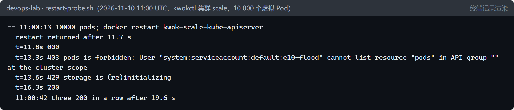

# 控制面的规模边界（E10） {#ch-e10}

<div class="lead">本书的实验集群只有 4 个节点。企业集群常有几百个节点、上万个 Pod，控制面——etcd、API server、调度器——在那个规模上会遇到 4 个节点时看不到的问题。本章不假装拥有一个大集群：用 KWOK 在同一台电脑上启动一套真实的 Kubernetes v1.37.0 控制面，让它管理 1000 个 `[虚拟]` 节点和 10 000 个 `[虚拟]` Pod——它们只是 etcd 里的对象，状态由一个控制器代写，没有一个容器真正运行。测量的是控制面为这么多对象所做的工作：调度被什么限速，etcd 里一个 Pod 占多少空间、删除为什么先让数据库变大，一万个 Pod 的 LIST 由谁提供，以及 API Priority and Fairness（APF）能否挡住一个失控的客户端。最后这个实验没有按计划进行：第一次运行冻结了整个实验环境（事故 E10-1），之后的六次运行逐一排除了错误的解释，才看清真正的限制——APF 完全按配置限制了并发，可是三个同时执行的大 LIST 就让 API server 多用了约 1.4 GiB 内存。</div>

## 本章目标与产出

| 产出 | 位置（相对于 `v2/`） |
|---|---|
| kwokctl 安装脚本（固定版本，按发布页的摘要校验 SHA-256） | `platform/kwok/install.sh`、`platform/versions.env` |
| 规模实验驱动：建集群并设内存上限、批量创建 Pod、记录状态、LIST、清理 | `experiments/e10/scale.sh` |
| etcd 体量、压缩与碎片整理 | `experiments/e10/etcd-size.sh` |
| APF 洪水实验、API server 重启探测 | `experiments/e10/apf.sh`、`experiments/e10/restart-probe.sh` |
| 实验前提交的假设、全部测量记录与结果 | `evidence/e10/scale-prediction.md`、`evidence/e10/scale-results.md` |
| 事故 E10-1 的复盘 | `evidence/e10/incident-1.md` |

**学完本章，你应当能够：**

- 说明虚拟节点能验证什么、不能验证什么，并据此设计和解释规模实验；
- 从调度时间线上读出客户端限速，判断大批量创建 Pod 时哪个组件先成为瓶颈；
- 估算 etcd 的容量，说明压缩与碎片整理各做什么、什么时候需要；
- 判断一个 LIST 请求由 watch 缓存还是 etcd 提供，以及这对大集群为什么重要；
- 用 FlowSchema 和优先级隔离一个失控的客户端，并说明 APF 管不住什么。

本章的控制面是 `[真实]` 的：etcd、kube-apiserver、kube-controller-manager、kube-scheduler 都是 Kubernetes v1.37.0 的官方镜像，由 kwokctl v0.8.0 作为 Docker 容器启动。节点和 Pod 是 `[虚拟]` 的：没有 kubelet，没有容器运行时，没有一个镜像被拉取。洪水客户端是 `[注入]` 的负载。事故 E10-1 是计划外的真实事件。每种配置只运行了一次，而且这套控制面与前十章的实验集群共用同一个 WSL 虚拟机——所有数字都要在这个前提下读。

## 原理 {#e10-principles}

### KWOK：只有控制面的集群

KWOK（Kubernetes WithOut Kubelet）有两个部分。kwokctl 用真实的组件启动一个集群的控制面；kwok 控制器代替所有的 kubelet：它看到一个 Pod 被绑定到虚拟节点，就把 Pod 的状态写成 Running，并替每个虚拟节点续租表示心跳的 Lease。对 API server、调度器和各个控制器来说，这些节点和 Pod 与真的一样：同样的对象，同样的写入、监听和调度。

```{.mermaid caption="本章的实验环境。同一个 WSL 虚拟机中，前十章的实验集群 ent 与 kwokctl 启动的集群 scale 并存。scale 的控制面组件是真实的 Kubernetes v1.37.0 容器，每个都有内存上限（事故 E10-1 之后加上）；它管理的 1000 个节点和 10 000 个 Pod 只是 etcd 里的对象。"}
flowchart TB
  CLI["实验客户端 [注入]<br/>kubectl 与 curl"]
  ENT["实验集群 ent [真实]<br/>同一个虚拟机"]
  subgraph SCALE["kwokctl 集群 scale：v1.37.0 的容器，各有内存上限 [真实]"]
    SCH["kube-scheduler<br/>768 MiB"]
    KCM["controller-manager<br/>512 MiB"]
    KWOK["kwok 控制器<br/>代替 kubelet"]
    PROM["Prometheus<br/>384 MiB"]
    API["kube-apiserver<br/>1536 MiB"]
    ETCD[("etcd<br/>512 MiB")]
  end
  OBJ["1000 个节点<br/>10 000 个 Pod<br/>[虚拟]"]
  CLI --> API
  SCH --> API
  KCM --> API
  KWOK --> API
  PROM -.->|抓取| API
  API --> ETCD
  ETCD -.- OBJ
```

所以 KWOK 能测的是控制面为 N 个对象所做的工作：调度的吞吐、etcd 的体量、LIST 与 WATCH 的代价、限流。它测不了节点一侧：真实的 kubelet 会不断更新 Pod 和节点的状态，节点要拉镜像、启动容器、配置网络和存储，工作负载要消耗 CPU 和内存——这些在这里都不存在。本章的数字说明的是“控制面在这么多对象下的行为”，而不是“这台电脑能运行一万个 Pod”。

### 调度器：算法之外还有客户端限速

调度一个 Pod 分两步：先在节点中筛选、打分，选出一个节点；再向 API server 写一个绑定（`pods/binding` 子资源）。第二步是一次 API 请求，受调度器客户端的限速约束：`KubeSchedulerConfiguration` 的 `clientConnection.qps` 默认 50、`burst` 默认 100——令牌桶最多攒 100 个令牌，之后每秒补充 50 个。每个 Pod 一次绑定，所以无论算法多快，持续的调度速度都不会超过每秒 50 个。其他控制面组件也有同样的限速，例如 kube-controller-manager 的默认值是每秒 20 次、突发 30 次，它决定了 ReplicaSet 控制器创建 Pod 的速度。

限速保护的是 API server 和 etcd：所有组件都放开限速，写入就可能超过它们的承受能力。提高某个组件的限速是一个容量决定，不是免费的优化。

### etcd：每次写入都是一个新版本

etcd 是一个多版本（MVCC）的键值存储：每次创建、修改、删除都产生一个新的修订版本（revision），旧版本仍然留在数据库文件里，直到被压缩（compaction）。kube-apiserver 每 5 分钟压缩一次（`--etcd-compaction-interval`），压缩到它上一次运行时记下的版本，所以 etcd 里通常保留着 5 到 10 分钟的历史。压缩只是把旧版本占用的页面标记为空闲，文件本身不变小；碎片整理（defragmentation）把有效数据重写到一个新文件里，才把空间还给文件系统。碎片整理期间这个成员不能读写，生产环境要逐个成员进行。

文件的大小很重要：etcd 有一个空间配额（`--quota-backend-bytes`，默认 2 GiB）。超过配额时，etcd 触发 `NOSPACE` 告警，整个集群只接受读和删除——不能再创建任何对象，包括事件。恢复的步骤是压缩、碎片整理、解除告警，缺一不可。

### watch 缓存：LIST 由谁提供

API server 为每种资源维护一个内存中的缓存，通过一个对 etcd 的 watch 保持更新。客户端的 WATCH 由它提供，带 `resourceVersion=0` 的 LIST 也由它提供（结果可能略旧）。不带 resourceVersion 的 LIST 要求“一致”——看到此刻 etcd 中的数据——过去必须从 etcd 读：一万个 Pod 就是几十 MB 的数据从 etcd 读出、解码、再编码。在大集群里，大量客户端同时重新 LIST（比如控制器重启之后）曾是 etcd 和 API server 过载的常见原因。从 Kubernetes 1.31 起，一致的 LIST 默认也由缓存提供（KEP-2340）：API server 只向 etcd 询问当前的修订版本，等缓存追上这个版本，再从内存返回结果。

### APF：按优先级分配并发

API Priority and Fairness 用 FlowSchema（按用户、服务账号、动词、资源匹配）把每个请求分到一个优先级（PriorityLevelConfiguration）。API server 的总并发——默认 `--max-requests-inflight` 400 加 `--max-mutating-requests-inflight` 200，共 600 个“席位”——按各优先级的份额（`nominalConcurrencyShares`）分配。同一优先级内，不同的“流”（例如不同的用户）排进不同的队列，用混洗分片（shuffle sharding）避免一个流挤占所有队列；队列满了，请求立即得到 429（Too Many Requests）。按设计，一个 LIST 会按估算要处理的对象数量占用多个席位（大约每 100 个对象一个，最多 10 个）；实验 4 会看到实际情况并非总是如此。

份额只决定一个优先级的“名义”席位。空闲的优先级可以把一部分席位借出（`lendablePercent`），繁忙的优先级可以借用（上限由 `borrowingLimitPercent` 决定，不设置就没有上限）。

APF 限制的是“同时处理多少个请求”。它不限制一个请求用多少内存：返回一万个 Pod 的 LIST，无论在哪个优先级执行，都要构造几十 MB 的响应。本章最后一个实验会反复碰到这一点。

## 实验 1：一万个虚拟 Pod 的调度（K1、K2） {#e10-scheduling}

kwokctl 在 15 秒内建好 1000 个虚拟节点（每个 32 核、256 GiB、最多 110 个 Pod）；8 个并行的 `kubectl create` 创建 10 000 个 Pod，每个请求 0.1 核和 128 MiB，容忍所有污点。脚本每隔几秒数一次：已有多少 Pod、多少还没调度、多少已经 Running。实验前写下的假设：

- **K1**：在调度器的默认限速下（每秒 50 次，突发 100），调度速度约为每秒 50 个，10 000 个至少需要 3.3 分钟；
- **K2**：用 `--disable-qps-limits` 重建集群（调度器改为每秒 5000 次、突发 10 000），同样的 10 000 个 Pod 至少快 5 倍，瓶颈转移到调度器的 CPU 和 API server 的写入延迟。

| | K1：默认限速 | K2：放开限速 |
|---|---|---|
| 8 个 kubectl 创建完 10 000 个 Pod | 51.3 秒 | 27.5 秒 |
| 全部调度完成 | 193.0 秒 | 29.4 秒 |
| 创建结束后的调度速度 | 每秒 50.3 个（54.5–164.7 秒） | 跟上了创建的速度 |
| 全部 Running | 193.0 秒 | 48.6 秒 |
| 调度尝试（Prometheus） | 10 000 次，全部成功 | 10 000 次，全部成功 |

```{.mermaid caption="处于 Running 的虚拟 Pod 数。蓝线是 K1（默认限速），橙线是 K2（放开限速）。图中每 10 秒一个点，由相邻两次计数线性插值得到（原始计数见 evidence/e10/k1/timeline.txt 与 k2/timeline.txt）。K1 在创建结束之后是一条直线，斜率每秒 50 个，正是调度器的客户端限速。"}
%%{init: {"xyChart": {"height": 330}, "themeVariables": {"xyChart": {"plotColorPalette": "#2563eb, #ea580c"}}}}%%
xychart-beta
  title "Running 的虚拟 Pod"
  x-axis "创建开始后的秒数" 0 --> 200
  y-axis "Pod 数" 0 --> 10000
  line [0, 706, 1525, 2307, 2872, 3416, 3920, 4392, 4863, 5346, 5831, 6317, 6811, 7305, 7785, 8246, 8706, 9125, 9505, 9886, 10000]
  line [0, 2494, 4863, 7166, 8690, 10000, 10000, 10000, 10000, 10000, 10000, 10000, 10000, 10000, 10000, 10000, 10000, 10000, 10000, 10000, 10000]
```

**K1 成立。** 创建结束之后，已调度的 Pod 以每秒 50.3 个的速度直线增长，与客户端限速一致：调度器并不忙，它在等令牌。10 000 次调度全部一次成功——虚拟节点共有 32 000 核，这些 Pod 只请求了 1000 核。后来为 K5 新建的集群（同样的默认值）在 31–166 秒之间测得每秒 52 个，重复了这个结果。

**K2 只成立了一半。** 放开限速后，全部 Pod 在 29.4 秒调度完成，是 K1 的 6.6 倍；但创建本身就用了 27.5 秒，调度器一直跟着创建走——测到的上限是 8 个 kubectl 的创建速度，调度器真正的上限（假设的后半句）没有测到，只能说“至少每秒 340 个”。Running 比调度晚了 19 秒，因为所有状态都由一个 kwok 控制器写入；在真实集群里，这项工作由每个节点上的 kubelet 并行完成。

工程上的含义：大批量创建 Pod 时，先成为瓶颈的往往是某个组件的客户端限速，而不是调度算法。一个 Deployment 从 0 扩到一万个副本，Pod 由 ReplicaSet 控制器创建，它受 kube-controller-manager 的限速约束（练习 1）。批处理和训练任务常常需要调高这些限速，每一次调高，都要确认 API server 和 etcd 承受得住。

## 实验 2：etcd 里的一个 Pod（K3） {#e10-etcd}

假设 **K3**：etcd 随对象数量线性增长，每个 Pod（连同它的事件）几 KB；删除 Pod 不会让数据库文件变小，直到碎片整理。数据库的大小直接从 etcd 读取（`etcdctl endpoint status`：文件大小和其中的有效数据）。

先看删除。集群里有 10 000 个 Pod 时，数据库文件是 92.5 MiB；删除全部 Pod 之后，文件变成了 172.7 MiB——**删除让它增大了 80 MiB**。

```{.mermaid caption="删除 10 000 个 Pod 前后的 etcd 数据库。灰色柱是数据库文件的大小，红线是其中的有效数据。删除让文件增大；API server 的压缩把有效数据降到 24.3 MiB，文件却没有变小；碎片整理之后文件才变为 18.7 MiB。"}
%%{init: {"xyChart": {"height": 330}, "themeVariables": {"xyChart": {"plotColorPalette": "#94a3b8, #dc2626"}}}}%%
xychart-beta
  title "etcd 数据库（MiB）"
  x-axis ["10 000 个 Pod", "全部删除后", "API server 压缩后", "碎片整理后"]
  y-axis "MiB" 0 --> 200
  bar [92.5, 172.7, 178.6, 18.7]
  line [92.5, 172.7, 24.3, 18.7]
```

每删除一个 Pod 会写两次：先给它打上删除标记（优雅删除），kwok 控制器随后真正删除它。两个都是新版本，第一个是对象的完整副本；旧版本要等到压缩才会消失。在后面逐步删除的测量里，每删除一个 Pod，数据库先增大 8.1–8.5 KiB。

接下来的几步各有教训：

- **压缩之前做碎片整理没有用，而且慢。** 删除之后立刻整理，etcdctl 在默认的 5 秒命令超时后失败：172 MiB 全是有效数据，没有什么可以还回去，却有很多要复制。压缩之后再整理，只用了 0.35 秒。脚本此后给 etcdctl 设置 120 秒的超时。
- **API server 的压缩来得比预想的晚。** 它在 10:28:47 出现，正好是这个 API server 上一次重启（10:18:42，K5 第二次运行时被杀）之后 10 分钟：重启后的第一次运行只与 etcd 中记录的压缩进度同步，第二次才真正压缩。之后文件 178.6 MiB，其中有效数据只有 24.3 MiB。
- **只有碎片整理让文件变小**：18.7 MiB。

再看增长是否线性。从 10 000 个 Pod 开始逐步删除，每一步都把 etcd 压缩到当前版本（`compact --physical`，等旧版本真正删除之后才返回）并整理碎片，得到的就是有效数据的大小：

| Pod 数 | 0 | 5000 | 6969 | 7134 | 10 000 |
|---|---|---|---|---|---|
| 数据库（MiB） | 17.65 | 35.85 | 43.02 | 43.62 | 54.14 |

0 到 5000 每个 Pod 3.73 KiB，5000 到 10 000 每个 3.75 KiB：严格线性，**每个 Pod 3.73 KiB**。刚创建完时（还带着 5–10 分钟的历史）是 89–93 MiB，比有效数据多出约 70%。K3 成立，而且删除比假设的更糟：它不只是不让文件变小，而是先让它变大。

这里的 Pod 很小：一个容器、pause 镜像，JSON 只有 3.4 KB。真实的 Pod 有多个容器、环境变量、卷、探针和 `managedFields`，常常大好几倍，容量估算要用自己的对象来测（练习 6）。最危险的情形由上面两个结果合成：数据库已经接近配额时，有人批量删除大量对象来“腾空间”——在压缩之前，删除本身就可能把 etcd 推过配额，触发 `NOSPACE`（练习 2）。

测量中犯过两个错误，都留在记录里：第一次“上行”测量用的 `etcdctl compact` 没有加 `--physical`，碎片整理在旧版本被真正删除之前就开始了，那几个“压缩后”的数值仍然包含历史，没有用于上面的表格；一次按名字删除 5000 个 Pod 的操作每秒只删掉约 5 个（原因没有深究，`kubectl delete pods --all` 在同一个集群上每秒至少 84 个），被脚本的超时打断，之后改为 16 个 kubectl 并行删除。

## 实验 3：一万个 Pod 的 LIST（K4） {#e10-lists}

假设 **K4**：Kubernetes 1.37 从 watch 缓存提供一致的 LIST（不带 resourceVersion），它的延迟与 `resourceVersion=0` 接近，etcd 不会被读取；一万个 Pod 的响应有几十 MB。

| 请求（各 5 次） | 耗时 | 大小 |
|---|---|---|
| `resourceVersion=0` | 0.94–1.23 秒 | 33 MiB |
| 不带 resourceVersion（一致的读） | 0.88–1.06 秒 | 33 MiB |
| 分页，`limit=500`（20 页） | 5.6–7.1 秒（大部分是客户端的时间，见下文） | 33 MiB |

每种请求单独发一次，在请求前后读取 API server 的计数器：三种请求发往 etcd 的 Pod LIST 都是 +0；一致的读和分页遍历各让“由 watch 缓存提供的一致读”加 1。这个 API server 启动以来，一共只向 etcd 发过 2 次 Pod 的 LIST（填充缓存），却由缓存提供了 1043 次一致读。**K4 成立。**

第一次归因用错了指标：`apiserver_storage_list_total` 在存储层计数，由缓存提供的 LIST 也算在内，据此得出的“etcd +110”是错的。判断请求到底去了哪里，要看真正发往 etcd 的请求（`etcd_request_duration_seconds_count{operation="list"}`）。分页遍历的耗时也要打折扣：脚本为了取出下一页的 continue 令牌，每一页都启动一个新的 Python 进程来解析 1.7 MB 的 JSON，这 5.6–7.1 秒主要是客户端自己的时间（练习 3）。

工程上的含义：即使由内存提供，一次完整的一万个 Pod 的 LIST 也要 API server 工作约 1 秒、传输 33 MiB。一个每 10 秒运行一次 `kubectl get pods -A` 的看板或脚本，就要持续消耗每秒 3.3 MB 的序列化和网络。控制器应当用 informer（LIST 一次，然后 WATCH），脚本应当用标签或字段选择器缩小范围。下一个实验展示 40 个不这样做的客户端会怎样。

## 实验 4：一个失控的客户端（K5）与事故 E10-1 {#e10-apf}

设计：服务账号 e10-flood 由一个 FlowSchema（`matchingPrecedence` 500）分到优先级 e10-low：份额 1（折合 3 个席位），不借出（`lendablePercent: 0`），一个长度为 5 的队列。40 个工作进程以它的身份循环 LIST 全部 Pod（`resourceVersion=0`），持续 60 秒。受害者 e10-victim 走默认的 FlowSchema service-accounts，进入优先级 workload-low（244 个席位），每 0.5 秒 GET 一个 Pod：先单独运行 30 秒，再在洪水期间运行 60 秒。假设 **K5**：洪水的大部分请求得到 429；受害者的 p99 不超过安静时的 2 倍。

这个实验一共运行了七次。每次失败之后，先把新的解释作为假设写下并提交（K5b–K5e，见 `evidence/e10/scale-prediction.md`），再运行下一次：

| 运行 | 与前一次相比的改变 | API server | 受害者成功的 GET 的 p99：安静 → 洪水 |
|---|---|---|---|
| 1 | 原始设计，没有内存上限 | 整个虚拟机冻结：事故 E10-1 | 42.8 ms → 10.4 s，之后中断 |
| 2 | 每个容器加内存上限（API server 1536 MiB），但误用了 APF 被关闭的集群 | 被内核杀死 8 次 | 40.1 ms → 2081 ms |
| 3 | 换成默认配置的集群，APF 开启 | 被杀 6 次 | 19.4 ms → 219 ms |
| 4 | API server 设置 `GOMEMLIMIT=1300MiB`（K5b） | 被杀 4 次 | 19.4 ms → 1800 ms |
| 5 | 5000 个 Pod 代替 10 000 个（K5c） | 被杀 8 次 | 15.6 ms → 1387 ms |
| 6a | e10-low 设置 `borrowingLimitPercent: 0`（K5d） | 被杀 5 次 | 20.7 ms → 437 ms |
| 6b | 去掉借用上限（与 1–5 相同） | 被杀 8 次 | 14.7 ms → 1540 ms |
| 7 | 同 6a，API server 内存上限 2560 MiB（K5e） | 被杀 1 次 | 20.3 ms → 194 ms |

### 第一次运行：事故 E10-1

APF 做了它承诺的事：1329 个洪水请求中有 1289 个在约 0.1 秒内得到 429，只有 4 个被接纳。但受害者的 p99 从 42.8 毫秒升到 10.4 秒，几分钟后整个 WSL 虚拟机停止响应——实验集群 ent、GitLab、告警桥，所有东西一起冻结。强制终止虚拟机时，1 分钟负载是 858。

复盘（`evidence/e10/incident-1.md`）的结论：被测的控制面与实验集群共用一个虚拟机，又没有内存上限；10 000 个 Pod 时它已占用约 1.8 GiB，虚拟机只剩 2.3 GiB 可用。被接纳的 LIST 加上其余负载把虚拟机推进了换页，从那一刻起所有进程一起变慢。

恢复时还暴露了一个隐藏的故障：集群外的告警桥（第 10 章）重启后，死人开关第一次检查就试图在还没启动完的 GitLab 中开事故，HTTP 调用抛出异常，检查线程就此退出——死人开关停了，却什么也没说。修复后每次检查都单独捕获异常并重试，线程不在时 `/healthz` 返回失败。与本实验有关的行动项是：给实验控制面的每个容器设置硬内存上限（`docker update --memory`，交换空间同值），让过载只杀死自己 cgroup 里的进程；洪水脚本监视虚拟机的可用内存，低于 1.2 GiB 时自行停止。

### 内存上限，以及 API server 重启时客户端看到什么

第二次运行用的是 K2 的集群——它用 `--disable-qps-limits` 创建，而这个选项同时以 `--enable-priority-and-fairness=false` 和 `--max-requests-inflight=0` 启动 API server（事后在一个临时集群上核实并记录）。我事先没有检查：FlowSchema 和优先级被 API 接受了，却没有任何作用，这次运行不能检验 APF。

它检验了内存上限：洪水开始 1.7 秒后，API server 达到 1536 MiB，内核在它自己的 cgroup 里把它杀死（内核日志：`Memory cgroup out of memory: Killed process … (kube-apiserver) … anon-rss:1567152kB`），Docker 重启它，60 秒内重复了 8 次；虚拟机始终有 3.4 GiB 可用，实验集群不受影响。Docker 的 `OOMKilled` 标志却显示 false——它只描述容器当前这一次运行，证据要看内核日志和重启次数。

客户端在每次重启之间看到了什么？专门的探测（重启 API server，然后每 0.2 秒以 e10-flood 的身份 LIST 一次）给出了答案：



把 403 当作最终结果的客户端，会放弃一个它其实有权限做的请求。真实的高可用控制面让负载均衡器只把流量发给 `/readyz` 就绪的 API server，客户端就看不到这个窗口；本实验的客户端直接连到 API server。洪水客户端还暴露了另一个问题：16 873 个请求在约 2 毫秒内以连接失败告终——一个没有退避的客户端，对着一个正在重启的服务器空转。

### APF 开启，API server 仍然被杀

第三次在一个按默认值新建的集群上运行，APF 确认开启：响应头显示受害者的请求经过 FlowSchema service-accounts、优先级 workload-low，洪水请求经过 e10-flood、e10-low。API server 仍然被杀死了 6 次。洪水开始 20 秒时的一个探测请求得到 429，消息却是“storage is (re)initializing”——它来自重启后的 watch 缓存，不是 APF。APF 的拒绝计数显示 +0：计数器在进程里，每次重启都从零开始。

洪水开始前 API server 已经常驻 976 MiB。第一个解释是 Go 的垃圾回收器：它默认（`GOGC=100`）在堆增长到上次回收后存活数据的两倍时才回收，而且不知道容器的内存上限，除非设置了 `GOMEMLIMIT`。第四次运行给 API server 设置了 `GOMEMLIMIT=1300MiB`，指标 `go_gc_gomemlimit_bytes` 证实它已生效——API server 仍然被杀了 4 次。回收器的余量不是全部原因。

### 借来的席位，和不等于内存的席位

第五次运行把 Pod 减半，并且每秒记录一次 API server 所在 cgroup 的内存。它仍然被杀了 8 次。内存曲线说明了原因的方向：静止时 662 MiB，洪水开始后的几秒内依次是 825、1172、1523 MiB——然后被杀；每次重启之后，几秒之内又涨过 1.2 GiB。所有 4033 个 429 都带着 APF 的消息“Too many requests, please try again later.”。每秒 200 MiB 以上的增长，不像是一次只执行一个 LIST。

问题出在实验设计上。e10-low 设置了 `lendablePercent: 0`——它不借出席位——却没有设置 `borrowingLimitPercent`。在 v1.37 的 API 文档里（`kubectl explain`），这个字段“为空时，上限实际上是无限的”。默认的优先级都没有设置它，而且都在借出：workload-low 借出 244 个席位中的 90%，workload-high 和 global-default 各 50%，system 33%，node-high 25%。洪水需要席位时，e10-low 可以借用其他优先级空闲的席位。

第六次运行在同一个集群上先后做了两次洪水，每 2 秒记录一次 e10-low 的席位：设置 `borrowingLimitPercent: 0` 时，它的上限始终是 3 个席位（3 个在执行，5 个在排队）；去掉这个设置，上限升到 7 个——借来了 4 个。**借用是真的，但它不是根本原因**：只有 3 个席位时，API server 同样在洪水开始 4 秒内从 938 MiB 涨到 1487 MiB，被杀了 5 次。还有一个意外：采样显示 3 个 LIST 只占 3 个席位，每个 LIST 只算 1 个席位，并没有按要返回的对象数量加权（原因没有深究）。

```{.mermaid caption="API server 的匿名内存（MiB），每 2 秒取一个点（原始数据每秒一个：evidence/e10/k8/ 与 k9/ 下的 apf-apiserver-mem.txt）。深蓝是第 6a 次运行，浅蓝平线是它的上限 1536 MiB；深红是第 7 次运行，浅红平线是它的上限 2560 MiB。洪水在第 10 秒左右开始，两次运行中 e10-low 都只有 3 个 LIST 在执行；曲线落到 0 的地方，是进程被内核杀死、Docker 重启它的时刻。"}
%%{init: {"xyChart": {"height": 330}, "themeVariables": {"xyChart": {"plotColorPalette": "#1d4ed8, #93c5fd, #b91c1c, #fca5a5"}}}}%%
xychart-beta
  title "洪水期间 API server 的内存"
  x-axis "秒" 0 --> 74
  y-axis "MiB" 0 --> 2600
  line [938, 938, 938, 939, 939, 939, 1066, 1487, 3, 13, 274, 418, 755, 1187, 1295, 1445, 0, 166, 550, 828, 1349, 0, 3, 453, 1135, 0, 70, 333, 433, 604, 1310, 1369, 0, 14, 70, 355, 393, 394]
  line [1536, 1536, 1536, 1536, 1536, 1536, 1536, 1536, 1536, 1536, 1536, 1536, 1536, 1536, 1536, 1536, 1536, 1536, 1536, 1536, 1536, 1536, 1536, 1536, 1536, 1536, 1536, 1536, 1536, 1536, 1536, 1536, 1536, 1536, 1536, 1536, 1536, 1536]
  line [1018, 1018, 1018, 1018, 1018, 1018, 1560, 1760, 1816, 2238, 2437, 2437, 2437, 2437, 2437, 2552, 0, 8, 143, 222, 285, 461, 817, 1264, 1290, 1584, 1666, 1716, 1730, 1962, 1967, 2004, 1744, 1744, 1900, 1775, 1729, 1584]
  line [2560, 2560, 2560, 2560, 2560, 2560, 2560, 2560, 2560, 2560, 2560, 2560, 2560, 2560, 2560, 2560, 2560, 2560, 2560, 2560, 2560, 2560, 2560, 2560, 2560, 2560, 2560, 2560, 2560, 2560, 2560, 2560, 2560, 2560, 2560, 2560, 2560, 2560]
```

第七次运行回答了剩下的问题：席位不变（3 个），只把 API server 的上限提高到 2560 MiB。它的内存在洪水开始 1 秒后是 1560 MiB，8 秒后是 2437 MiB，停在那里 10 秒，然后涨到 2552 MiB，被杀了一次；重启之后，在同样的洪水下维持在 1.6–2.0 GiB，没有再被杀。三个并发的、返回一万个 Pod（每个 33 MiB 的 JSON）的 LIST，连同垃圾回收器的余量，让 API server 多用了约 1.4 GiB。即使在它正常服务的时候，受害者成功的 GET 也慢了：中位数从 13 毫秒变成 71 毫秒，p99 从 20 毫秒变成 194 毫秒。

### 七次运行说明了什么

K5 不成立：没有一次运行让受害者的 p99 保持在 2 倍以内，每一次 API server 都至少被杀了一次。但这七次运行把问题拆得很清楚：

1. **APF 完全按配置工作。** 分类（由响应头确认）、席位（采样确认 3 个在执行、5 个在排队）、拒绝（429 “Too many requests”）都和配置一致。
2. **份额不是上限。** 不设置 `borrowingLimitPercent` 的优先级会在需要时借用别人的席位；要一个硬上限，就要显式设为 0。
3. **席位不是内存。** APF 数的是同时执行的请求，一个返回一万个 Pod 的 LIST 和一个 GET 在这里都只算 1 个席位，内存代价却相差几个数量级。给大 LIST 的客户端分配席位时，要按“席位数 × 每个 LIST 的内存”留出 API server 的内存，或者干脆把这类客户端的席位压到最少。
4. **CPU 也不在 APF 的管辖之内。** 只有 3 个 LIST 在执行时，另一个优先级里的 GET 也慢了 5 到 10 倍：它们共享同一个进程的 CPU 和垃圾回收。
5. **内存上限把“整台机器冻结”变成了“一个进程被杀”。** 这是正确的方向，但被杀的 API server 重启之后要面对更多的负载：授权器加载之前返回 403，缓存填充期间返回 429，每个组件都要重新 LIST。生产环境的控制面有多个 API server，正是为了让一个实例的重启不变成整个集群的中断。
6. **根本的修复在客户端。** 不要在循环里 LIST 全部对象：用 informer（LIST 一次，然后 WATCH），用分页把每个响应限制在几 MB，遇到 429 和连接失败要退避。

## 规模边界 {#e10-boundaries}

| | 本章测得（1000 个 `[虚拟]` 节点、10 000 个 `[虚拟]` Pod，单机） |
|---|---|
| 调度 | 默认限速下每秒 50 个；放开限速后至少每秒 340 个（受创建速度限制，调度器的上限未测到） |
| etcd | 每个 Pod 3.73 KiB 有效数据，线性；刚创建时带着历史，多约 70%；删除时每个 Pod 先增大 8.1–8.5 KiB |
| LIST | 10 000 个 Pod 的响应 33 MiB，约 1 秒，一致的读也由 watch 缓存提供 |
| 内存 | 10 000 个 Pod 时 API server 常驻约 0.95 GiB，控制面合计约 1.8 GiB |
| 洪水 | APF 按配置分类、限流、拒绝；三个并发的一万 Pod LIST 让 API server 多用约 1.4 GiB，1.5 GiB 和 2.5 GiB 的上限都没能让它撑过 60 秒的洪水 |

作为参照，Kubernetes 文档给出的大集群上限是 5000 个节点、150 000 个 Pod、每个节点 110 个 Pod。本章的规模只是它的五分之一和十五分之一，而且节点和 Pod 都是虚拟的。没有测量的东西同样重要：kubelet 的负载、真实 Pod 的大小、高可用控制面（3 个 etcd 成员、负载均衡器后面的多个 API server）、真实的网络和工作负载。本章能支持的结论是控制面机制层面的：限速在哪里、存储如何增长、读由谁提供、限流管什么不管什么；不能支持“这套配置能承载多大的生产集群”。

## 局限 {#e10-limits}

- 每种配置只运行一次；控制面与实验集群共用一个虚拟机，绝对数值随实验集群的活动而变化。
- 节点和 Pod 是虚拟的：kwok 控制器替 1000 个节点续租 Lease、写 Pod 状态，真实的 kubelet 写入更多；镜像、容器、网络完全不存在。
- K2 没有找到调度器本身的上限；K4 的分页耗时包含客户端的解析时间。
- K5 的七次运行中，前两次各自混入了一个额外的变量（第一次没有内存上限，第二次 APF 被关闭）；第三次没有记录每个 429 的消息，它的 429 中有多少来自 APF、多少来自缓存，无法区分。`GOMEMLIMIT` 只测试了一个值；2560 MiB 是这台机器在实验集群运行时能让出的上限，更大的内存没有测试。
- 每个 LIST 只占 1 个席位、第七次运行重启后 25 次连续的连接失败，这两个现象的原因没有查明。
- etcd 的每 Pod 大小只适用于本实验的最小 Pod。

## 常见问题 {#e10-faq}

**问：KWOK 的结果能代表真实集群吗？**
控制面部分可以：同样的二进制，同样的对象，同样的请求路径，调度器的限速、etcd 的增长、watch 缓存、APF 的行为都与真实集群一致。节点一侧不能：没有 kubelet 的状态更新，没有镜像拉取和容器启动。用它回答“控制面在 N 个对象下会怎样”，不要用它回答“集群能跑多少负载”。

**问：既然调度器被限速在每秒 50 个，为什么默认值不调高？**
默认值要适用于所有集群，包括小规模的控制面。调度器每秒的绑定就是 API server 每秒的写入，加上随之而来的事件和状态更新。需要高调度吞吐的集群（批处理、训练任务）应当在确认 API server 和 etcd 余量之后，有意识地调高，并同时观察写入延迟。

**问：删除对象为什么会让 etcd 变大？**
etcd 保留每个键的历史版本。删除一个 Pod 至少写两个新版本：删除标记（对象的完整副本）和删除本身。旧版本要等 API server 的压缩（每 5 分钟，保留 5–10 分钟的历史）才会被清除，文件要等碎片整理才会变小。所以批量删除应当分批进行，并留出压缩的时间。

**问：APF 已经拒绝了 97% 的洪水请求，为什么机器还是被拖垮了？**
APF 控制的是同时执行的请求数，不是每个请求的内存，也不是整台机器的资源。一个 LIST 一万个 Pod 的请求要构造 33 MiB 的响应；API server 本身在 10 000 个 Pod 时就占用约 1 GiB。第一次运行时这些压力落在一个没有余量的共享虚拟机上；之后的运行里，同样的压力落在 API server 自己的内存上限上。即使只有 3 个这样的 LIST 同时执行，API server 也多用了约 1.4 GiB；另一个优先级的请求虽然没有被拒绝，也因为共享 CPU 而慢了 5 到 10 倍。

**问：API server 刚启动时返回 403，是权限配置错了吗？**
不是。重启探测中，同一个服务账号在启动后 1.5 秒得到 403，3 秒后就得到 200：授权器加载 RBAC 绑定之前，所有需要 RBAC 授权的请求都会被拒绝。生产环境中，负载均衡器按 `/readyz` 转发流量，客户端看不到这个窗口；直连 API server 的客户端应当对启动期间的 403 和 429 有所准备。

<div style="break-before: page"></div>

## 练习 {#e10-exercises}

::: exercise
1. **（计算）** 一个 Deployment 从 0 扩到 10 000 个副本。kube-controller-manager 使用默认的客户端限速（每秒 20 次，突发 30 次），调度器也使用默认值。估算全部 Pod 被调度所需的最短时间，指出瓶颈在哪个组件；如果把 kube-controller-manager 的限速调到每秒 200 次，瓶颈移到哪里？
2. **（计算）** 一个集群有 40 000 个 Pod，按本章的方法测得每个 Pod 在 etcd 中有效数据 12 KiB，其余对象共 300 MiB，etcd 使用默认配额。估算压缩并整理后的数据库大小；一次删除 20 000 个 Pod，在压缩之前数据库会增长多少？给出一个安全的批量删除方案。
3. **（分析）** K4 的分页遍历用了 5.6–7.1 秒，是完整 LIST 的 6 倍。解释为什么这不能说明分页在服务器端很慢，并设计一个能把服务器端和客户端的时间分开的测量。
4. **（设计）** 一个 CI 系统的服务账号每 10 秒列出所有命名空间的 Pod，集群有 30 000 个 Pod。从 API server（FlowSchema 与优先级、借用上限、内存）和客户端（informer、选择器、分页、退避）两方面给出改进，说明每一项防住的是什么、防不住什么。
5. **（分析）** 重启探测中，客户端在 API server 启动后先得到 403，再得到 429。分别说明它们的来源；对一个把 403 当作永久错误的控制器，这会造成什么后果？生产环境如何避免？
6. **（操作）** 用第 2 章 storefront 中任意一个 Deployment 的 Pod 模板代替 pause Pod，重复 K3 的“下行”测量（`experiments/e10/etcd-size.sh down`），得出每个 Pod 的有效数据大小，与本章的 3.73 KiB 比较并解释差异。
:::

参考答案见附录。

## 本章小结

- KWOK 让一台电脑运行真实的控制面和虚拟的节点；它能回答控制面的问题，不能回答节点和负载的问题。实验报告必须写清哪些是真实的、哪些是虚拟的。
- 在默认配置下，调度速度由调度器的客户端限速决定：每秒 50 个，10 000 个 Pod 需要 193 秒。放开限速后，测到的上限变成了创建 Pod 的客户端。
- etcd 中每个最小的 Pod 约 3.73 KiB，严格线性；删除先让数据库变大，压缩释放文件内部的空间，只有碎片整理才把空间还给文件系统。
- 一万个 Pod 的 LIST 是 33 MiB，在 Kubernetes 1.37 中即使要求一致，也由 watch 缓存提供，etcd 不再承担这部分读取。
- APF 正确地分类、排队和拒绝了失控的客户端，但它管的是并发：不设置借用上限的优先级会借用别人的席位；一个返回一万个 Pod 的 LIST 和一个 GET 一样只占 1 个席位，内存代价却相差几个数量级。真正的修复在客户端：informer、分页、退避。
- 一次计划外的事故（E10-1）比计划内的实验教得更多：被测系统必须有自己的资源上限，看守者必须在另一个故障域，每一步都要检查而不是假设（APF 是否真的开启）。
