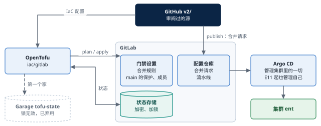
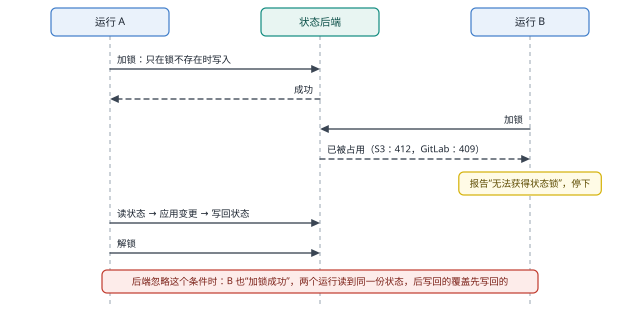
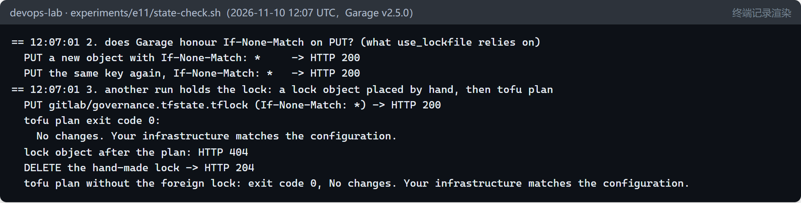
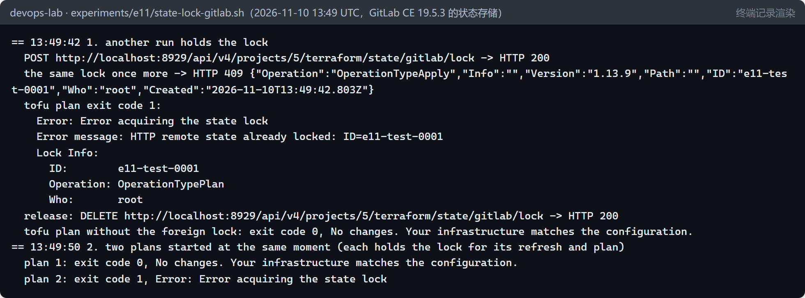
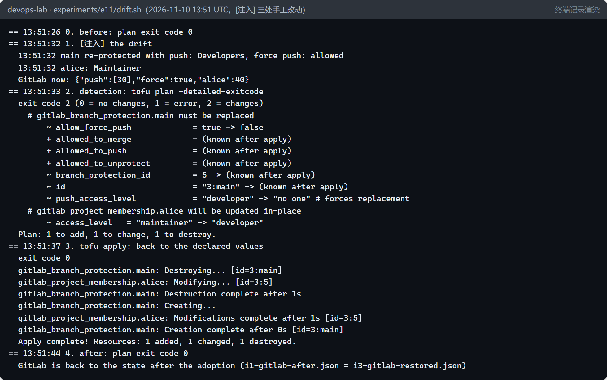
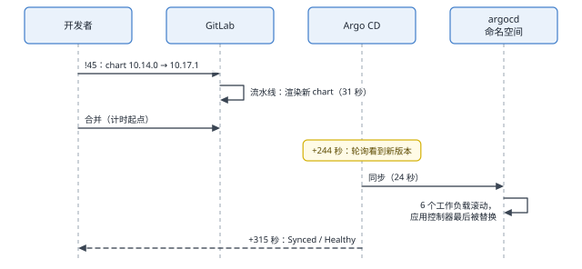
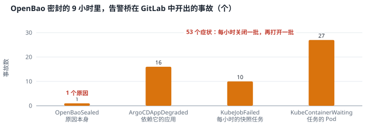

# 基础设施即代码与云迁移（E11） {#ch-e11}

Argo CD 把集群里的一切拉向 Git，可集群之外还有东西没人看管：配置仓库的门禁——谁能合并、合并前必须通过什么——是第 9 章用一个命令式脚本设置的，被人改了也没有任何东西会发现；Argo CD 自己来自 bootstrap 的一次 helm 安装，而第 9 章唯一一次发布故障，正出自流程之外的一次 helm upgrade。本章用 OpenTofu 接管门禁，把状态加密、加锁保存，并检验它能否发现手工改动；让 Argo CD 管理它自己，经合并请求完成一次升级；最后只用可核实的事实，对照 AWS 与 Azure 分析迁移，重点是第 8 章留下的缺口——不可删除的异地备份。本章还记录了一次计划外的事故：主机重启之后，一个恢复脚本毁掉了 OpenBao 唯一的解封密钥。

::: opener
::: q
**工程问题**

Argo CD 看守着集群里的一切，可集群之外的门禁没有人看守，Argo CD 自己也是手工安装的。怎样把这些也纳入“声明、比较、纠正”，又不让管理工具本身成为新的风险？
:::
::: k
**实测结论**

- 接管不是重建：OpenTofu 导入 3 个已有的对象，没有改动 GitLab 的任何设置。
- 状态里有秘密，要在客户端加密；锁必须亲手测试——Garage 不实现条件写入，锁什么也没锁住，还删掉了别人的锁；换到 GitLab 的状态存储后，第二次加锁得到 409。
- 手工改动被 `plan` 以退出码 2 报告并恢复；但这次修复是“替换”，main 有约 1 秒没有任何保护。
- Argo CD 管理自身：升级经合并请求完成，合并后 315 秒恢复；流程外的 helm upgrade 被字段所有权拒绝。
- 计划外的事故：一个恢复脚本清空了唯一的解封密钥；密封的 9 小时里，一个原因开出了 54 个事故。
:::
:::

## 本章目标与产出

| 产出 | 位置（相对于 `v2/`） |
|---|---|
| OpenTofu 安装脚本（固定版本，两处来源校验 SHA-256） | `platform/iac/install.sh`、`platform/versions.env` |
| GitLab 治理的配置：项目设置、main 的保护、成员；导入块；状态加密；状态后端 | `iac/gitlab/`、`iac/tofu.sh`、`platform/iac/state-project.sh` |
| 状态与锁的检查、迁移后的一致性检查、漂移实验 | `experiments/e11/state-check.sh`、`state-lock-gitlab.sh`、`state-consistency.sh`、`drift.sh` |
| Argo CD 管理自身：应用、门禁中的渲染、bootstrap 的唯一版本来源 | `gitops/platform/apps/argocd.yaml`、`gitops/ci/render.sh`、`platform/bootstrap/bootstrap.sh`、`experiments/e11/watch-argocd.sh` |
| 云迁移分析（含不可删除的备份） | `docs/cloud-migration.md` |
| 假设、记录、结果与事故 E11-1 | `evidence/e11/` |

**学完本章，你应当能够：**

- 把已经存在的基础设施导入 IaC，而不是删掉重建；
- 说明远程状态为什么必须加密和加锁，并亲手验证锁是否真的生效；
- 用 `plan` 的退出码检测漂移，并预见“修复”本身带来的风险；
- 让 GitOps 工具管理自身：先看差异再接管，经合并请求升级；
- 只用可核实的事实做云迁移分析，设计不可删除、并且打得开的备份。

本章的软件都是 `[真实]` 的：OpenTofu 1.13.9、GitLab 提供者 19.5.0、GitLab CE 19.5.3、Garage v2.5.0、Argo CD v3.6.1 与它的 Helm chart。漂移和流程外的 helm upgrade 是 `[注入]` 的：由我以 root 身份通过 API 或命令行做出，代替有人在网页上点击。云迁移只是分析，没有创建任何云资源。事故 E11-1 是计划外的真实事件。

## 原理 {#e11-principles}

### IaC 与 GitOps 的分工

Argo CD 是一个持续运行的控制器：它不停地比较 Git 与集群，并把集群拉回 Git。OpenTofu 是“计划—应用”：只有在有人运行它时才比较，比较的依据是它保存的状态。适合 OpenTofu 的，是没有控制器替我们看守的东西——集群之外的 GitLab 项目设置、云账户、DNS。同一个对象只能有一个管理者：两个工具同时管理，就会互相覆盖。

### 状态：IaC 的记忆

状态把配置中的每个资源对应到真实世界里的对象，并保存 OpenTofu 读到的每一个属性——包括秘密：本章导入的 GitLab 项目，带着它的 runner 注册令牌。所以状态要满足两个条件。

- **加密。** OpenTofu 的状态加密在客户端完成：本章用 AES-GCM，密钥由一段不在 Git 中的口令经 PBKDF2 派生，状态和计划文件都加密，`enforced = true` 让未加密的状态无法写入。存储后端看到的只是密文。
- **加锁。** 两个人同时 `apply`，后完成的会覆盖先完成的状态，丢掉对方记录的资源。锁需要后端提供一个原子操作：“只有不存在时才写入”。OpenTofu 的 S3 后端用 `use_lockfile` 写一个锁对象，并带上 `If-None-Match: *`——已经存在就应得到 412；GitLab 的状态存储提供加锁接口，已被锁住时返回 409；Azure 用 Blob 租约。

### 漂移

漂移是现实偏离了声明。`tofu plan -detailed-exitcode` 用退出码报告它：0 表示没有差异，1 表示出错，2 表示有差异。它只在运行时才发现漂移，所以检测要定时运行。修复就是 `apply`——但一个改动是“就地修改”还是“替换”（先删除、再创建），由提供者决定，计划中会写明 `must be replaced`。

### 让 GitOps 工具管理自己

Argo CD 不能安装它自己：第一次只能由 bootstrap 用 helm 安装（先有鸡还是先有蛋）。之后创建一个应用，指向同一个 chart 和同一份 values，从此 Argo CD 的版本和配置都在 Git 里，升级就是一次合并请求。风险在于同步时它会重启自己：同步操作的状态保存在 Application 对象里，新的控制器启动后接着完成。本章的做法是分步接管：先不自动同步，看清差异，再打开自动同步；不开启 prune，避免 Argo CD 删掉自己的一部分；用服务器端应用（server-side apply），因为 Argo CD 的 CRD 太大，放不进客户端应用所需的注解。

## 实验 1：接管已有的门禁（I1） {#e11-adopt}

第 9 章的门禁由 `platform/gitops/setup.sh` 设置：项目只在流水线成功时合并（流水线被跳过也不行）、合并后删除源分支；main 不允许任何人推送，只有 Maintainer 能合并，不允许强制推送；alice 是 Developer。OpenTofu 用导入块（`import`）接管这些已经存在的对象，而不是删除后重建。alice 的访问令牌不纳入 IaC——令牌的值会进入状态。

假设 **I1**：导入之后的第一次计划显示配置与现实的差异；修正配置（而不是修正现实）之后，计划不再有差异；接管不会改动 GitLab。

结果：第一次计划就是 `3 to import, 0 to add, 0 to change, 0 to destroy`——配置是照着 API 读出的实际值写的，没有需要修正的地方。应用之后导入了 3 个资源，下一次计划没有差异（退出码 0）；接管前后 GitLab 门禁的快照完全相同。**I1 成立。**在真正的“棕地”接管中，第一次计划几乎总会有差异；规则只有一条：改配置去贴合现实，确认无误之后，才让配置成为现实的标准。

## 实验 2：状态加密，锁真的锁住了吗（I2） {#e11-state}

假设 **I2**：状态在 Garage 中是密文；`use_lockfile` 在 Garage v2.5.0 上能排斥第二个运行。

**加密成立。**直接从 Garage 读回状态对象，只有 `encrypted_data`、`encryption_version`、`lineage`、`meta`、`serial` 这几个字段；`platform-gitops`、`runners_token`、`only_allow_merge` 在密文中各出现 0 次，解密后各出现 1 次。

**锁不成立。**Garage 不理会 `If-None-Match`：同一个键第二次带条件写入，仍然返回 200 而不是 412。于是手工放一个“别人的锁”之后，`tofu plan` 照常运行，而且结束时把那个锁删掉了：

这不是 OpenTofu 的错误：它依赖 S3 的一个语义，而一个“兼容 S3”的存储没有实现它。在 AWS 的 S3 上，条件写入从 2024 年 8 月起可用，同样的锁会成立（见本章的云迁移分析）。教训是：**锁必须被测试，而不是被相信**——一个不起作用的锁，在出事之前与正常的锁毫无区别。

于是状态迁到了 GitLab 的状态存储（项目 `root/platform-iac`，`http` 后端，GitLab 的加锁接口），用 `tofu init -migrate-state`。同样的检查，这次锁住了：

迁移恰好被一次中断打断：迁移之后的那次计划运行时，Windows 主机失去响应被注销，虚拟机随之停止。重启后先做一致性检查，再继续：目标中的状态完整（serial 1，3 个资源和 1 个数据源），没有残留的锁，工作目录指向 `http` 后端，重新运行被打断的计划，没有差异。中断之后要回答的四个问题是：状态在哪里、是否完整、是否被锁住、工作目录指向哪个后端——在回答之前，不要再导入，也不要再应用。

这个选择有代价：GitLab 门禁的状态保存在 GitLab 里。GitLab 坏了，修复它的 IaC 也拿不到自己的状态。Garage 中的副本留作第一个家，GitLab 也保存状态的历史版本。

## 实验 3：手工改动能被发现吗（I3） {#e11-drift}

假设 **I3**：三处手工改动——main 向 Developer 开放推送、允许强制推送、alice 升为 Maintainer——让 `plan -detailed-exitcode` 以 2 退出，并显示 2 个资源需要修改；`apply` 恢复声明的值，之后的计划以 0 退出。

**检测与恢复成立，但预测错了一处。**提供者认为 `push_access_level` 的改变需要替换整个分支保护，于是计划是 `1 to add, 1 to change, 1 to destroy`，而不是两个就地修改；应用时先删除了保护（1 秒），再重新创建——**在这一秒里，main 没有任何保护。**修复打开了一个它本来要关上的窗口。

这类问题只能靠读计划发现：一个安全控制旁边出现 `must be replaced`，就意味着修复期间控制会短暂消失。可以选择的做法有：在低风险的时间应用、改用就地修改的 API 修复、或者接受窗口但让它尽可能短（练习 3）。另一个要点是检测的时机：本章在手工改动后立即运行计划；实际环境需要定时运行，并把退出码 2 变成工单或告警（练习 2）。

## 实验 4：Argo CD 管理自己（I4） {#e11-argocd}

假设 **I4**：应用 `argocd`（chart argo-cd 10.14.0，values 来自 Git）接管 bootstrap 安装的版本，不重启 Argo CD；升级到 10.17.1 经过合并请求、流水线通过，10 分钟内所有应用回到 Synced 和 Healthy；之后一次流程外的 helm upgrade 被 selfHeal 撤销。

**接管分两步。**第一个合并请求（!43）只创建应用，不自动同步。Argo CD 报告 59 个资源中有 56 个 OutOfSync——看起来差异很大。对同一份渲染结果做服务器端试运行（`kubectl diff --server-side`），只有 1 个对象不同：helm 安装后已删除的钩子任务 `argocd-redis-secret-init`；其余差异只是 Argo CD 自己的跟踪注解。确认之后，第二个合并请求（!44）打开自动同步：同步用了 22 秒，60 个资源全部一致，Argo CD 没有一个 Pod 重启。

**流程外的 helm upgrade 被拒绝了两次。**按第 9 章那次故障的方式，用 helm 把 argocd-server 改成 2 个副本——这一次 helm 失败了：helm 4 也用服务器端应用，而这些字段已经属于 Argo CD 的字段管理者 `argocd-controller`，API server 报告冲突（例如 `.spec.replicas`），什么也没有改变。这是预测之外的一层保护。用 `--force-conflicts` 强行覆盖之后，helm 成功了，Argo CD 的 selfHeal 在几秒内把副本数改回 1，`.spec.replicas` 又归 `argocd-controller` 所有。只是 helm 的历史从此记着“第 4 版，chart 10.14.0，2 个副本，已部署”，而升级之后的集群是 chart 10.17.1、1 个副本——一份不再描述集群的记录。

**升级经过合并请求。**10.14.0 到 10.17.1 两个版本的 Argo CD 都是 v3.6.1。先用同一份 values 渲染两个版本比较：镜像不变，7 个对象改变——6 个工作负载的 Pod 加上了 `seccompProfile: RuntimeDefault`，以及一个标签。所以 Argo CD 的每个组件都会滚动，包括正在执行同步的应用控制器。门禁的流水线这次多了一步：用我们的 values 渲染新版本的 chart，chart 不接受这份 values 就在合并之前失败。

**I4 成立，并多了一个发现。**从合并到 Synced 和 Healthy 用了 5 分 15 秒；其他应用的状态没有变化——35 个 Healthy，以及 4 个 Degraded，它们来自下一节的事故，与升级无关。

## 事故 E11-1：恢复脚本毁掉了唯一的解封密钥 {#e11-incident}

本章进行到一半，Windows 主机失去响应，被注销；虚拟机随之停止。重启后的例行步骤之一是运行 `openbao-init.sh` 为 OpenBao 解封。这一次它毁掉了 OpenBao 唯一的解封密钥（`evidence/e11/incident-1.md`）。

| 时间（UTC） | 经过 |
|---|---|
| 13:43 | 虚拟机启动，带重启策略的容器（包括 4 个 kind 节点）随之启动，节点很快 Ready |
| 13:44:03 | 运行 `openbao-init.sh`。Pod 的状态还停留在重启之前的 Running，脚本的等待随即通过，可容器还不存在；状态检查吞掉了错误，把“没有回答”当成“没有初始化”，执行了 `bao operator init … > init.json`——shell 在命令失败之前就清空了文件。这个文件是解封密钥和根令牌唯一的副本 |
| 13:44:24 | 容器启动；再运行一次，用空文件解封，得到 400 |
| 13:45 | 发现文件为 0 字节、修改于 13:44:03；机器上没有其他副本；上一次恢复留下的临时密钥打不开恢复后的密钥环（试过，被拒绝） |
| 13:47:39 | 告警 OpenBaoSealed 经告警桥在 GitLab 中开了事故 #14——第 10 章的告警链路如期工作 |

**影响**：OpenBao 的数据再也无法读取——配置可由脚本重建，数据只是第 6 章写入的两个随机测试值；但**第 8 章每小时一次的 OpenBao 快照全部失去意义**，它们用同一个密钥环加密。没有工作负载受影响：唯一的使用者保留着最后一次同步的 Secret。第 6 章和第 8 章都写过“解封密钥只有一份……快照无法打开”，这一次风险成了现实。

**为什么**：状态检查分不清“没有回答”和“没有初始化”；等待条件被一个过期的 Pod 状态满足；输出重定向在命令运行之前就截断了目标文件；而密钥只有一份。

**改了什么**：两个脚本都改为等 OpenBao 自己回答；状态只在有回答时才算数；存在密钥文件时拒绝初始化；新密钥先写临时文件再移动到位，设为只读并保留第二份——只读之后，误写的 `>` 会失败，而不是清空文件。

**恢复需要所有者的决定。**清除永久密封的存储是不可逆的删除，本次会话的权限检查两次拦下了它，连“保留旧数据”的做法也一样。所有者批准之后（约 22:37），旧卷的回收策略改为 Retain——9.5 MiB 的密文留在节点上，万一旧密钥的副本出现还能重新挂载——OpenBao 换上新卷，由修复后的脚本初始化、解封、配置，重新写入两个测试值；3 秒后 External Secrets 恢复同步，用新密钥做的快照上传到 Garage，22:39:39 所有 39 个应用回到 Synced 和 Healthy，22:40:15 事故 #14 关闭。新密钥的副本由所有者自己保管。

**还有一个教训来自告警。**OpenBao 密封的 9 个小时里，每小时一次的快照任务都失败一次，告警桥为这一个原因在 GitLab 中开了 54 个事故：16 个应用 Degraded、10 个任务失败、27 个容器等待，每小时关闭一批、再打开一批。

第 10 章的抑制规则只覆盖同一告警的不同级别、SLO 的呼叫与工单，以及 PostgreSQL 主库与副本这一对因果，没有覆盖“一个依赖坏了，它的症状全都在叫”。改进是让 `OpenBaoSealed` 触发时抑制它的下游症状，并通过故意密封 OpenBao 来测试——这一项留作后续行动（第 13 章的实操题完成了规则与合成告警的检验）。

这次事故与本章的主题相连：备份能否恢复，取决于两样东西——备份本身不能被删除，打开它的密钥也不能丢失。下一节的云迁移分析把这两点放在首位。

## 云迁移分析：只陈述可核实的事实 {#e11-migration}

分析全文在 `docs/cloud-migration.md`。每一条关于云服务的陈述都附官方来源，核实日期为 2026-11-10；没有核实的写明“未核实”；价格不在分析之内。与本书实验直接相关的几条：

| 实验环境 | AWS | Azure |
|---|---|---|
| Istio ambient + Gateway API | 自行安装；AWS App Mesh 已于 2026-09-30 停止支持 | AKS 的 Istio 插件尚不支持 ambient 模式，也不支持用 Gateway API 管理网格流量——保留 ambient 就要自行安装开源 Istio |
| Argo CD | 自管理，或 EKS Capabilities 的托管 Argo CD（2025-11-30 正式可用） | 自管理（托管选项未核实） |
| Garage 与 Velero | S3 Object Lock；AWS Backup 自 2025-11-10 起支持 EKS，2026-03-12 起可用逻辑隔离的保管库 | Blob 不可变存储；Azure Backup for AKS 的保管库层与不可变保管库 |
| OpenTofu 状态 | S3 后端 + `use_lockfile`：S3 支持条件写入，实验 2 中失败的锁在这里成立 | azurerm 后端（Blob 租约锁，未核实） |

**不可删除的异地备份**——第 8 章的缺口——有两种成熟的做法。S3 Object Lock 的合规模式下，受保护的对象版本不能被任何用户覆盖或删除，包括 AWS 账户的 root 用户；保留期不能缩短，到期前删除它的唯一方法是删除整个账户。Azure 的不可变存储在锁定基于时间的保留策略之后，策略不能删除，保留期只能延长，数据连账户管理员也不能修改或删除。两者都需要先开启版本控制或选择 WORM 的范围；两者的不可逆也是代价：保留期设长了，误存的数据在到期前删不掉（练习 6）。再加上事故 E11-1 的教训：密钥的保管要和备份一起设计、一起演练。

## 局限 {#e11-limits}

- IaC 只覆盖一个 GitLab 项目的门禁，而不是一个组织的几百个项目；OpenTofu 使用 root 的令牌——企业中应是权限最小的专用服务账号。
- 漂移检测是手动运行的，没有定时任务；修复窗口的长短只测了一次（约 1 秒）。
- 状态的家：Garage 的锁无效，GitLab 的锁有效，但状态与被管理的对象在同一个系统里。迁移前后外层 `lineage` 字段不同，原因没有深究（解密后的状态完整）。
- Argo CD 的升级是一次 chart 升级，应用版本没有变化（两个版本都是 v3.6.1）；没有测试跨大版本、CRD 结构变化的升级。
- 云迁移分析没有核实所有组件（表中写明），没有价格和性能数据。
- 事故 E11-1 已经恢复，但留下三项后续：旧的密封数据仍在一个保留的卷上（是否删除由所有者决定）；新密钥只有虚拟机中的两份和所有者自己保管的副本，没有做成多人分片或托管的 KMS；抑制下游症状的告警规则还没有实现和测试。

### 从实验环境到生产环境

::: prod
| 本章的做法 | 生产环境通常的做法 | 差别意味着什么 |
|---|---|---|
| OpenTofu 用 root 的令牌管理一个项目 | 权限最小的专用服务账号，按环境分开状态 | 状态和执行身份的泄露面，要按“它能改多少东西”来划分 |
| `plan` 由人手动运行 | 流水线定时运行 `plan`，在合并请求里展示计划，审批之后再 `apply` | 漂移只在运行时才被发现；不定时运行，就等于没有检测 |
| 状态存放在被管理的 GitLab 自己里面 | 独立的、带版本和锁的状态存储 | GitLab 出故障时，修复它的 IaC 拿不到自己的状态 |
| 解封密钥是一个文件，恢复脚本直接读写它 | KMS 自动解封或多人分片保管；恢复流程经过评审与演练 | 事故 E11-1：一个脚本缺陷就毁掉了唯一的一份密钥 |
:::

## 常见问题 {#e11-faq}

**问：既然有了 Argo CD，为什么还要 OpenTofu？**
Argo CD 管的是集群里的对象。GitLab 的项目设置、云账户、DNS 这些没有控制器的东西，需要一个“计划—应用”的工具记录和比较。两者分工明确，同一个对象只能属于其中一个。

**问：OpenTofu 的状态为什么要加密？后端不是已经有访问控制了吗？**
状态里有秘密（本章是 runner 注册令牌，在别处是数据库密码）。后端的访问控制保护的是“谁能读”，加密保护的是“读到了也没用”——备份、日志、误配置的权限都可能让状态落到别人手里。

**问：S3 兼容的存储都能做 OpenTofu 的锁吗？**
不一定。`use_lockfile` 依赖条件写入：已存在的键必须返回 412。本章的 Garage v2.5.0 不实现它，锁形同虚设，而且没有任何报错。换用一个存储之前，先用本章的方法测一次。

**问：Argo CD 管理自己，出问题时怎么办？**
接管时不开 prune，Argo CD 不会删掉自己的组件；升级前在门禁中渲染新版本；最后的退路是 bootstrap：它从 Git 中读取同一个 chart 版本，用 helm 重新安装。

**问：恢复脚本为什么会毁掉密钥？这不是很基础的错误吗？**
是基础的错误，而且组合起来才致命：一个吞掉错误的状态检查、一个过期的 Pod 状态、一次截断文件的重定向、一份没有副本的密钥。任何一处设计成防御式的，事故都不会发生。恢复脚本往往在最混乱的时候运行，最需要防御式编写。

## 练习 {#e11-exercises}

::: exercise
1. **（分析）** 实验 2 中，Garage 上的 `tofu plan` 不但没被锁挡住，还删除了别人的锁。设想两个 `apply` 同时运行，写出一条导致“更新丢失”的时间线；在支持条件写入的 S3 上，同样的时间线会在哪一步停下？
2. **（设计）** 为本章的 GitLab 门禁设计定时漂移检测：在哪里运行、用什么身份和凭据、发现漂移后如何通知、是否自动修复。结合实验 3，说明自动修复的风险。
3. **（分析）** 实验 3 中分支保护被“替换”而不是“修改”，main 有约 1 秒没有保护。给出两种消除或缩短这个窗口的做法，并说明各自的代价。
4. **（分析）** Argo CD 接管自身时，59 个资源中 56 个显示 OutOfSync，而服务器端试运行只有 1 个对象不同。解释两个数字为什么不同，以及为什么接管之前要做试运行。
5. **（设计）** 如果一次 Argo CD 升级改变了某个 CRD 的结构，本章的流程（合并请求 → 门禁渲染 → 自身同步）在哪一步能发现问题、哪一步发现不了？给流程补充一项检查。
6. **（设计）** 用 S3 Object Lock 的合规模式保存第 8 章的备份：保留期设多长？分别说明设得过长和过短的代价；结合事故 E11-1，说明密钥应当如何保管。
:::

参考答案见附录。

## 本章小结

- IaC 管理没有控制器的东西；接管已有的对象用导入，改配置去贴合现实，而不是反过来。
- 状态保存着秘密，要加密；状态要加锁，而锁必须被测试：Garage 不实现条件写入，`use_lockfile` 在那里什么也锁不住，还会删掉别人的锁；GitLab 的状态存储返回 409，锁住了。
- `plan -detailed-exitcode` 能发现手工改动；读计划时要看清“替换”——修复本身可能短暂移除一个安全控制。
- Argo CD 可以管理自己：先看差异再接管，经合并请求升级，流程外的 helm upgrade 被字段所有权拒绝，被强行覆盖时由 selfHeal 撤销。
- 云迁移分析只写可核实的事实：不可删除的备份在两家云上都有成熟的做法；而事故 E11-1 说明，打开备份的密钥必须和备份一起设计。
