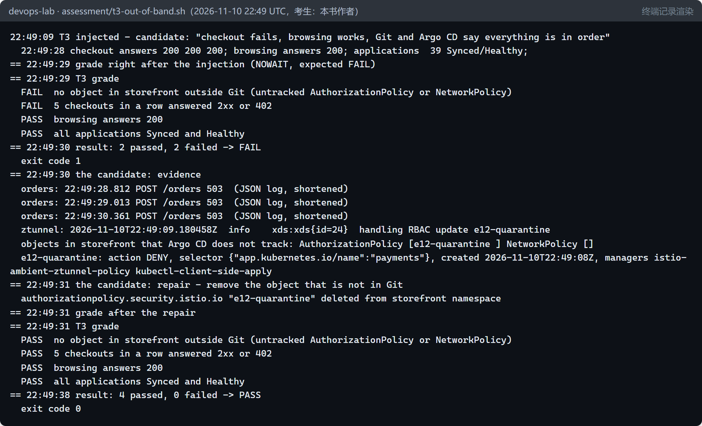

# 能力考核（E12） {#ch-e12}

前十二章回答的是“这些技术在一个受控环境中是否被正确地设计、实施、测量和排查”。本章把它们变成可以重复使用的考核：五道架构设计题，三道故障排查题——脚本注入故障、只告诉考生一句症状、脚本自动判分——以及一道实操题：关闭事故 E11-1 留下的一个行动项。所有题目都在本书的实验环境中真实运行过一遍：判分脚本在故障存在时判 FAIL，修复之后判 PASS，环境在每道题前后都是 39 个应用全部 Synced 和 Healthy。需要说明的是，这一遍的考生是本书的作者：它证明的是考核本身能用，不证明任何人的能力。

## 本章目标与产出

| 产出 | 位置（相对于 `v2/`） |
|---|---|
| 考核说明：规则、运行方式、安全措施 | `assessment/README.md` |
| 架构设计题（5 道，每道 20 分，附评分要点） | `assessment/design.md` |
| 故障排查题（注入、判分、恢复） | `assessment/t1-argocd-repo.sh`、`t2-openbao-restart.sh`、`t3-out-of-band.sh`、`lib.sh` |
| 实操题（自动判分） | `assessment/p1-inhibition.sh` |
| 假设、运行记录与结果 | `evidence/e12/` |

本章的故障都是 `[注入]` 的，其余都是 `[真实]` 的：真实的集群、Argo CD、OpenBao、Istio、Alertmanager 和 GitLab。

## 考核的设计原则 {#e12-principles}

- **判结果，不判命令。**判分脚本只看环境的最终状态和行为：凭据是否正确（比较哈希）、应用是否同步、下单是否成功、告警是否被抑制。考生用什么命令、走什么路径都可以，但修复必须真实有效。
- **判原因，不只判症状。**这是本章运行时得到的教训：T2 中，OpenBao 已经密封，“密钥同步”这一项却仍然通过——External Secrets 的状态要过一会儿才更新；T3 中，单次下单探测在故障刚注入的几秒里仍会成功。所以每道题都同时检查原因（OpenBao 是否解封、是否存在 Git 之外的对象）和症状。
- **故障来自本书的真实事件。**T1 是 GitOps 的数据通路断了；T2 是事故 E11-1 本身；T3 是第 12 章“流程外的改动”的另一种形态；实操题是事故 E11-1 的行动项 5。
- **安全。**每个注入只触及一个对象，都有对应的恢复动作；凭据只经文件或标准输入传递，判分只比较哈希；实操题的行为检验使用被静默的合成告警，不会通知任何人。

## 架构设计题 {#e12-design}

| 题目 | 场景 | 主要依据 |
|---|---|---|
| D1 跨区域灾备 | 下单 RPO ≤ 5 分钟、RTO ≤ 30 分钟 | 第 8 章的重建与备份、第 12 章的不可删除备份、事故 E11-1 的密钥保管 |
| D2 十倍流量 | 营销活动，2 小时，10 倍流量 | 第 4 章的容量与第一个瓶颈、第 5 章 HPA 的反应时间、第 7 章节点的余量 |
| D3 保护控制面 | CI 系统每分钟列出 3 万个 Pod | 第 11 章的 LIST 代价、APF 与借用、客户端的修复 |
| D4 发布与治理 | Argo CD、OpenTofu、门禁都进入合并请求，并保留应急路径 | 第 9 章的门禁与冻结、第 12 章的漂移与字段所有权 |
| D5 告警治理 | 一个原因开了 54 个事故 | 第 10 章的路由与抑制、事故 E11-1、实操题 P1 |

每道题 20 分，评分要点写在 `assessment/design.md` 中，并且都要求引用本书的测量数据：例如 D2 的满分答案必须从第 4 章测得的饱和点出发，而不是从一个假设的数字出发。

## 故障排查题 {#e12-troubleshoot}

| 题目 | 告诉考生的症状 | 实际注入的故障（考生不知道） | 判分 |
|---|---|---|---|
| T1 | 十分钟前合并的改动没有到达集群 | Argo CD 仓库凭据的密码被换成随机字符串 | 凭据正确（哈希）、没有 ComparisonError、全部应用同步 |
| T2 | 一次重启之后，平台的密钥不再刷新 | 重启 openbao-0，它回来时是密封的 | OpenBao 已解封、密钥文件的哈希不变且只读、密钥同步恢复 |
| T3 | 下单失败，浏览正常，Git 和 Argo CD 都显示一切正常 | 在 Git 之外手工创建的 Istio 拒绝策略，作用于 payments | 没有 Git 之外的策略对象、连续 5 次下单成功、浏览正常 |

三道题的运行结果：

| 题目 | 注入后判分 | 修复 | 修复后判分 |
|---|---|---|---|
| T1 | 0/3：37 个应用报告 `authentication required: HTTP Basic: Access denied` | 先确认令牌本身在 GitLab 上有效（HTTP 200），再把集群中的凭据从实验室的秘密文件经标准输入恢复 | 3/3，25 秒后 |
| T2 | 2/3：OpenBao 已密封，但密钥同步一项仍通过（状态滞后） | 用修复后的 `openbao-init.sh` 解封，5 秒 | 3/3，密钥文件不变 |
| T3 | 2/4：存在 Git 之外的策略，连续下单失败；Argo CD 始终显示 39 个应用正常 | 删除那条 Argo CD 不跟踪的拒绝策略 | 4/4，7 秒后 |

T3 最能说明“从症状到原因”的路径。考生得到的症状里，Argo CD 一切正常——第 12 章说过，Argo CD 只管它跟踪的对象。线索来自三处：orders 的访问日志全是 503；ztunnel 的日志里有一条 `handling RBAC update e12-quarantine`；而这条策略的字段管理者是 `kubectl-client-side-apply`，不是 Argo CD。在 storefront 中列出所有没有 Argo CD 跟踪注解的对象，原因就出现了：

## 实操题：关闭事故 E11-1 的行动项 5 {#e12-practical}

任务：OpenBao 密封时，让 Alertmanager 抑制它的症状——命名空间 `secrets` 中的任务失败和容器等待告警，以及依赖它的 4 个应用的 Degraded 告警——而且不影响其他告警；改动必须经合并请求进入配置仓库，由 Argo CD 部署。

这道题有一个陷阱。已有的 4 条抑制规则都用 `equal` 要求源告警和目标告警的某个标签相等（例如 `namespace`），照抄它们的写法看起来很自然。但 `OpenBaoSealed` 是用 `max(...)` 计算的，聚合掉了所有标签，它没有 `namespace`——带 `equal: [namespace]` 的规则永远不会匹配，而且不会有任何报错。正确的写法是不用 `equal`，直接在目标的匹配条件中写出命名空间和应用名。

判分因此必须检验行为，而不是检验文本。脚本先在 Alertmanager 中建一个静默（被静默的告警不会发出通知，但仍然可以作为抑制的源），再用 `amtool` 发送一组合成告警：一个 `OpenBaoSealed`、三个应当被抑制的症状、两个不应被抑制的对照（storefront 的任务失败、storefront-gateway 应用 Degraded），标签与真实告警相同；然后检查每个告警的 `inhibitedBy`；最后把合成告警标为已解决，并让静默过期。

| | 规则提交前 | 规则经合并请求 !46 部署后 |
|---|---|---|
| main 中有以 `OpenBaoSealed` 为源的规则 | FAIL | PASS |
| main 受保护（只能经合并请求进入） | PASS | PASS |
| 运行中的 Alertmanager 已加载规则 | FAIL | PASS（合并后 38 秒） |
| 3 个症状被抑制 | FAIL ×3 | PASS ×3 |
| 2 个对照不被抑制 | PASS ×2 | PASS ×2 |
| 判分 | 3/8 | 8/8 |

两次判分期间，告警桥收到的通知都是 0 条：考核没有在 GitLab 中开任何事故。还没有做的是用一次真实的密封来检验这条规则——那需要让 OpenBao 密封几个小时，等待每小时的快照任务失败。

## 局限 {#e12-limits}

- **这一遍的考生是作者。**题目由作者设计，作者也知道注入了什么；运行证明的是“考核脚本可运行、判分正确”，不能证明任何人的排查能力。真正的考核需要一位不了解注入内容的考生，并按 `assessment/README.md` 的规则进行。
- 每道题只运行了一遍；判分在“故障存在”和“修复之后”两种状态下得到验证，没有验证所有错误的修复方式（例如一个只修复了症状的考生）。
- 架构设计题没有由第三方评分；评分要点由作者给出。
- 实操题的规则只用合成告警检验过，没有经历一次真实的 OpenBao 密封。

## 第二册的边界

第二轮验证的是：在一台笔记本上，用真实的开源软件搭建一个接近企业生产的平台，并对架构、容量、弹性、安全、故障、数据可靠性、发布、可观测性、控制面规模和基础设施即代码做可重复、有证据的实验。它没有验证的是：真实的用户与流量、跨团队的协作、合规审计、长期运行带来的问题，以及比这台电脑大几个数量级的规模。书中所有的数字都来自这台电脑上的一次或几次运行；两次计划外的事故（E10-1、E11-1）和第 10 章中主机的一次睡眠同样是真实的，它们教给我们的，往往比计划中的实验更多。

全部 13 个阶段的完成情况、关键结果、证据位置、局限与剩余风险，汇总在独立的验收报告中（`docs/acceptance-report.md`）。
